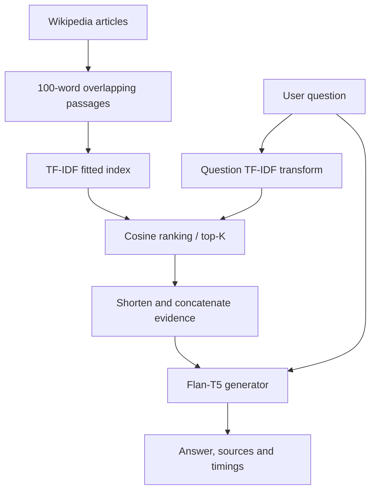

# IIT Bombay Offline Wikipedia RAG — Master Learning Handbook

**Course:** IIT Bombay ePGD in AI & DS — Deep Learning / Generative AI  
**Project:** Offline Wikipedia Retrieval-Augmented Generation (RAG)  
**Audience:** Beginner to advanced, with actual project implementation as the anchor  
**Edition:** Complete 12-chapter learning reference — 11 November 2026

> This handbook is designed to be read months after the project. Every chapter follows: intuition → technical model → mathematics and notation → Python → actual implementation → interpretation and limitations. It is a learning reference, not a replacement for the academic submission README or the [three-project operations runbook](IITB_RAG_Three_Project_Runbook.md).

## Contents and progress

1. [What RAG is and why we built it](#chapter-1-what-rag-is-and-why-we-built-it) — **Complete**
2. [Wikipedia corpus selection, streaming, preprocessing and chunking](#chapter-2-wikipedia-corpus-selection-and-chunking) — **Complete**
3. [TF-IDF and cosine similarity](#chapter-3-tf-idf-and-cosine-similarity) — **Complete**
4. [Retrieval ranking and interface contracts](#chapter-4-retrieval-ranking-and-interface-contracts) — **Complete**
5. [Flan-T5 and generative question answering](#chapter-5-flan-t5-and-generative-question-answering) — **Complete**
6. [Evidence fusion and token budgets](#chapter-6-evidence-fusion-and-token-budgets) — **Complete**
7. [RAG evaluation metrics](#chapter-7-rag-evaluation-metrics) — **Complete**
8. [Semantic embeddings with MiniLM](#chapter-8-semantic-embeddings-with-minilm) — **Complete**
9. [ChromaDB and persistent vector search](#chapter-9-chromadb-and-persistent-vector-search) — **Complete**
10. [FastAPI and project architecture](#chapter-10-fastapi-and-project-architecture) — **Complete**
11. [Engineering quality and operations](#chapter-11-engineering-quality-and-operations) — **Complete**
12. [Experiments, revision and references](#chapter-12-experiments-revision-and-references) — **Complete**

---

# Chapter 1 — What RAG is and why we built it

## 1.1 Learning objectives

After this chapter you should be able to:

- Explain the difference between answering from model parameters and answering with retrieved evidence.
- Trace a question through the actual academic RAG code.
- Explain the roles of Wikipedia, chunking, TF-IDF, cosine similarity, evidence preparation and Flan-T5.
- Read the basic mathematical abstraction of a RAG pipeline and understand every symbol.
- Explain why the Engineering version can swap retrievers while reusing the generator.
- Distinguish retrieval success, evidence availability, factual correctness and lexical evaluation scores.

## 1.2 Layman intuition: open-book versus closed-book exam

Suppose a professor asks, **“Who is Diana Richburg?”**

**Closed-book approach:** You try to answer using what you remember. A pretrained language model often responds in a broadly similar way: it generates text based on patterns and information encoded in its learned parameters. Its training knowledge may be incomplete or outdated, and fluent text is not guaranteed to be accurate.

**Open-book approach:** You search a trustworthy set of notes, find the Diana Richburg paragraph, read it, and answer **“middle-distance runner.”**

**RAG** stands for **Retrieval-Augmented Generation**. It implements a version of this open-book workflow:

1. **Retrieve:** Search an external collection for passages relevant to the question.
2. **Prepare:** Trim and combine the selected passages into a manageable context.
3. **Generate:** Ask the language model to answer using that context.

RAG does **not** automatically verify facts and does **not** guarantee that the language model will use the evidence correctly. We observed both problems in the IIT experiments.

## 1.3 Why RAG rather than only a language model?

| Issue | Standalone model | RAG-based workflow |
| --- | --- | --- |
| Specific facts in a local corpus | Might not have learned them | Retrieves relevant corpus passages at question time |
| Supporting context | Usually not supplied externally | Supplies retrieved text and source metadata |
| Changing documents | Would not automatically update its learned parameters | Can update/rebuild the retrieval index without retraining the generator |
| Answer accuracy | Can still hallucinate | Can still hallucinate, but has external evidence available |
| Failure modes | Model knowledge or generation | Retrieval **plus** evidence preparation **plus** generation |

Do not confuse RAG with model fine-tuning. **RAG adds information to the prompt at inference time; fine-tuning changes trainable model parameters.** The original academic project uses a pretrained Flan-T5 model and externally retrieved Wikipedia evidence; the semantic Engineering stage changes retrieval, not Flan-T5's learned weights.

## 1.4 The actual IIT academic pipeline

The original project uses the following flow:



**Verified implementation details:**

| Stage | Technology or configuration | What it accomplishes |
| --- | --- | --- |
| Source | `wikimedia/wikipedia`, `20231101.en`, streaming sample | Acquires Wikipedia text |
| Corpus | 1,000 selected articles | Fixed, inspectable working set |
| Chunking | 100 words with 20-word overlap | Produces 8,191 indexed passages |
| Indexing | `sklearn.feature_extraction.text.TfidfVectorizer` | Builds sparse term-weight vectors |
| Index size | 8,191 rows × 30,000 vocabulary features | One row per passage |
| Retrieval | `TfidfRetriever` with cosine similarity | Ranks passages relevant to a question |
| Evidence | `prepare_evidence` + `concatenate_evidence` | Shortens and combines passages |
| Generator | Local Flan-T5-Small | Generates text conditioned on question and evidence |
| Output | Structured Python dictionary | Includes answer, sources, tokens, timings and device |

The precise original file locations are:

```text
Mid-Sem-Project-RAG/
  src/run_rag.py
  src/rag/indexer.py
  src/rag/retriever.py
  src/rag/evidence.py
  src/rag/fusion.py
  src/rag/pipeline.py
  src/rag/generator.py
  data/wiki_chunks_100w_20overlap/
  data/tfidf_index/
  models/flan-t5-small/
```

The **Engineering** folder is a separate sibling project and must not be mistaken for the source of these original academic files.

## 1.5 Mathematical abstraction: learn the notation

Let:

| Symbol | Meaning | In our implementation |
| --- | --- | --- |
| \(q\) | User question (text) | `"Who is Diana Richburg?"` |
| \(D=\{d_1,\ldots,d_N\}\) | Passage collection | 8,191 Wikipedia chunks; \(N=8191\) |
| \(s(q,d_i)\) | Similarity score for question and passage | Cosine similarity of TF-IDF vectors or MiniLM embeddings |
| \(k\) | Maximum number of retrieved passages | Often 1, 3 or 5 |
| \(D_k\) | The top-\(k\) ranked passages | `retriever.retrieve(question, top_k=k)` |
| \(P\) | Evidence preparation function | Shortening and concatenation |
| \(E_k=P(D_k)\) | Evidence actually sent to the generator | May be shorter than retrieved passage text |
| \(G\) | Generative model/pipeline | Flan-T5-Small |
| \(\hat a\) | Generated answer | `"middle-distance runner"` |

First rank and select passages:

\[
D_k=\operatorname{TopK}_{d_i\in D}\;s(q,d_i).
\]

Then prepare evidence:

\[
E_k=P(D_k).
\]

Finally produce an answer:

\[
\boxed{\hat a=G(q,E_k)}.
\]

This is **conceptual notation**. The neural generator is a conditional text model and may produce different strings from the same input depending on its decoding configuration; the equation does not imply factual correctness.

### Tiny worked example

Question \(q\): `Who is Diana Richburg?`

Top retrieved passage \(d_1\): `Diana Lynn Richburg ... is an American former middle-distance runner.`

Prepared evidence \(E_1\): the shortened text retained for generation.

Generated answer \(\hat a\): `middle-distance runner`.

Retrieval finds evidence; **generation extracts or phrases the answer**. They are different computations.

## 1.6 Python: follow the real `RAGPipeline.answer()` method

The following is a **simplified teaching version** of `src/rag/pipeline.py`, matching the observed control flow. The original method also calculates latency, counts tokens and returns additional metadata.

```python
def answer(self, question, top_k=1):
    # 1. Find the most relevant indexed passages.
    retrieved_passages = self.retriever.retrieve(
        question=question,
        top_k=top_k,
    )

    # 2. Use the generator tokenizer to limit evidence length.
    prepared_passages, combined_evidence = concatenate_evidence(
        passages=retrieved_passages,
        tokenizer=self.generator.tokenizer,
        max_tokens=self.max_evidence_tokens,
    )

    # 3. Generate an answer conditioned on the question and evidence.
    generation_result = self.generator.generate(
        question=question,
        passages=combined_evidence,
    )

    return {
        "question": question,
        "answer": generation_result["answer"],
        "sources": retrieved_passages,
        "prepared_sources": prepared_passages,
    }
```

**Python concepts explained:**

- `class`: A blueprint for objects that maintain state and provide methods.
- `self`: The current `RAGPipeline` object, which stores a retriever and a generator.
- `def answer(...)`: A method definition.
- `top_k=1`: A default argument; if the caller omits `top_k`, the method uses 1.
- `self.retriever.retrieve(...)`: Calls a method of another object (composition).
- `prepared_passages, combined_evidence = ...`: **Tuple unpacking** of two returned values.
- `dict` return value: Named fields let APIs, notebooks and evaluations access results reliably.
- `self.generator.tokenizer`: The tokenizer belongs to the generator, so the evidence budget is measured using **generator tokens**, not simple words or MiniLM tokens.

## 1.7 Why we can swap TF-IDF for semantic retrieval

The academic pipeline expects a retriever object with a compatible method:

```python
retriever.retrieve(question, top_k)
```

Both retrievers return ranked dictionaries containing fields such as `rank`, `score`, `chunk_id`, `article_id`, `title`, `url` and `text`. This is an **interface contract**.

Conceptual Python illustration:

```python
tfidf_pipeline = RAGPipeline(
    retriever=tfidf_retriever,
    generator=flan_t5_generator,
)

semantic_pipeline = RAGPipeline(
    retriever=semantic_retriever,
    generator=flan_t5_generator,
)
```

These are illustrative variable names, not a standalone executable script. The actual Engineering adapter reuses the original initialized generator and creates a separate semantic pipeline. The original academic pipeline remains unchanged.

This pattern is called **dependency injection** (passing components into a class) and **composition** (building a larger system from smaller objects). It helps us compare retrieval algorithms while keeping generation machinery consistent.

## 1.8 How the Engineering project extends the architecture

| Academic original | Engineering enhancement |
| --- | --- |
| Fitted TF-IDF vocabulary; sparse vectors | Pretrained MiniLM; dense 384-dimensional embeddings |
| Saved sparse TF-IDF matrix | Persistent ChromaDB collection `wikipedia_minilm_384` |
| `TfidfRetriever` | `SemanticRetriever` with matching return fields |
| Direct Python RAG use | FastAPI `/health` and `/answer` interface |
| Academic evaluation | Full paired TF-IDF versus semantic experiments |
| Original generator | **Same original Flan-T5 generator reused** |

An embedding is a numerical representation of text. TF-IDF mainly reflects observed word frequencies and their rarity; MiniLM is trained to produce embeddings that capture semantic relationships. Both methods can be compared with cosine similarity, but **their raw similarity scores are not directly interchangeable**. We will derive both representations and cosine similarity in later chapters.

## 1.9 Important distinction: a pipeline can fail after retrieval succeeds

Our question about B. Reith's first full-length album provides a verified failure case:

1. The semantic retriever returned a passage containing the correct title, *Now Is Not Forever*.
2. That passage had **145 Flan-T5 tokenizer tokens**.
3. Evidence preparation retained only the first **80 tokens**.
4. The album title disappeared from the prepared evidence.
5. The generator answered incorrectly or abstained.

Retained share:

\[
\frac{80}{145}\times100\approx55.17\%.
\]

The discarded **65 tokens** represented about **44.83%** of the passage length. This does not quantify the fraction of useful information lost; a few discarded tokens can remove the one fact that answers the question.

The lesson is:

\[
\boxed{\text{Relevant retrieval}\;\not\Rightarrow\;\text{Correct generated answer}}.
\]

Possible failure points include retrieval, chunk boundaries, evidence truncation, generation and evaluation itself.

## 1.10 Reading evaluation results cautiously

For *Who is Diana Richburg?*, the reference was `An American former middle-distance runner` while the generator returned `middle-distance runner`.

After the original evaluation normalizer removes punctuation and English articles:

- Reference tokens: `american former middle distance runner` (5)
- Predicted tokens: `middle distance runner` (3)
- Common tokens: 3

Thus precision \(=3/3=1\), recall \(=3/5=0.6\), and:

\[
F_1=\frac{2PR}{P+R}=\frac{2(1)(0.6)}{1+0.6}=0.75.
\]

**Exact Match = 0** because the normalized strings differ. This is not proof the shorter answer is factually wrong. Conversely, a high lexical F1 is not proof the generated statement is supported. We will study metrics and error analysis in detail in Chapter 7.

## 1.11 Quick self-review (no quiz required)

Before moving on, be able to explain these five ideas in your own words:

1. Why does a RAG system search an external corpus before generation?
2. Why do we chunk Wikipedia articles instead of giving the entire corpus to Flan-T5?
3. What are \(q\), \(D_k\), \(E_k\), \(G\) and \(\hat a\)?
4. Why can we replace TF-IDF with MiniLM without replacing the generator?
5. How did the Q009 result prove that relevant retrieval alone is insufficient?

## 1.12 Chapter summary

- **RAG = retrieve relevant external text + prepare context + generate an answer.**
- The original academic implementation uses Wikipedia, TF-IDF, cosine retrieval, evidence concatenation and Flan-T5-Small.
- Its 1,000 selected articles were transformed into 8,191 overlapping passages.
- The Engineering project adds MiniLM/ChromaDB retrieval while preserving the academic generator.
- A clear retriever interface makes the components replaceable.
- Inspect **retrieved sources and prepared sources** separately when troubleshooting.
- Neither similarity scores nor Exact Match alone establish factual correctness.

**Next:** Chapter 2 — how streaming Wikipedia was sampled, why 100-word chunks with 20-word overlap were chosen, the formula for chunk count, and the exact dataset structure.

---

## Project evidence used in this chapter

The explanations are grounded in earlier inspected code and verified terminal outputs: `src/rag/pipeline.py`, `src/rag/indexer.py`, `src/rag/retriever.py`, `src/rag/fusion.py`, `src/rag/evidence.py`; the 8,191-passage corpus audit; the full 120-record Engineering answer evaluation; and the Q009 token-truncation diagnostic. The simplified code blocks above are labeled as illustrations. Full source should remain the authority for executable details.

---

# Chapter 2 — Wikipedia corpus selection and chunking

## 2.1 Learning objectives

By the end of this chapter, you should understand:

1. The difference between an **article**, a **passage/chunk** and an **index record**.
2. Why we used a bounded sample of Wikipedia instead of the entire encyclopedia.
3. How streaming datasets, shards and finite shuffle buffers work.
4. Why long articles are cut into overlapping windows.
5. The relationship between **window length**, **overlap** and **stride**.
6. How to reason about expected chunk counts and edge cases.
7. The exact schema and integrity measurements observed in the IIT corpus.
8. Why word counts and model-token counts are different.

## 2.2 Layman intuition: turning textbooks into searchable note cards

Imagine a library containing thousands of very long books. A student asks one narrow question. Giving the language model every book would be wasteful and exceed the model's input limits. Instead, a librarian divides books into labeled note cards and retrieves a handful of likely cards.

In our project:

- **Wikipedia article:** The full book or chapter.
- **Chunk / passage:** One short note card cut from an article.
- **Metadata:** The card's label: article ID, title, URL and chunk number.
- **Index:** A searchable numerical representation of the cards.
- **Retriever:** The librarian that ranks likely cards for a question.

The text is still the source of facts; indexing changes **how we search for** passages, not what the passage says.

## 2.3 The original Wikipedia dataset

The academic project inspected the Hugging Face dataset:

```python
# Educational illustration of the inspected dataset call.
from datasets import load_dataset

wiki_stream = load_dataset(
    "wikimedia/wikipedia",
    "20231101.en",
    split="train",
    streaming=True,
)
```

Observed article fields:

| Field | Meaning |
| --- | --- |
| `id` | Wikipedia article identifier |
| `url` | Wikipedia article page URL |
| `title` | Article title |
| `text` | Full article text |

The project first profiled **100 sampled articles** and then selected a working corpus of **1,000 unique articles**. There were **1,000 unique article IDs** in the selected corpus. After chunking, that became **8,191 passages**. The 1,000 articles were not 8,191 separate Wikipedia articles; many long articles contributed multiple chunks.

### Why a bounded corpus?

Using the entire English Wikipedia would require substantially more storage, preprocessing and indexing effort. A fixed 1,000-article experiment is easier to reproduce on a laptop, inspect manually and evaluate during an academic assignment.

**Limitation:** The model can only retrieve facts represented in the selected corpus. A Wikipedia fact outside those 1,000 articles is not automatically available to the offline retriever.

## 2.4 What does `streaming=True` mean?

Normally, loading a dataset may involve materializing large dataset files before you process records. Streaming lets your program **iterate through examples as they become available**, so you do not need to hold the entire dataset in RAM.

```python
# Conceptual: streaming is iterable, not a preloaded Python list.
for article in wiki_stream:
    # Process one article at a time.
    process(article)
```

The snippet illustrates iteration; `process` is a placeholder, not a function from the original project.

Streaming does not mean the dataset needs no network access when first accessed. Downloading and caching behavior depends on the dataset and its environment. Once the selected passages have been saved locally, our RAG runtime reads those local artifacts rather than repeatedly streaming Wikipedia.

## 2.5 What are shards and shuffle buffers?

A **shard** is one part of a large dataset stored separately. Think of a huge encyclopedia packed into many boxes. The dataset loader may open boxes in some order and read articles from them.

A **shuffle buffer** is a temporary holding area. Instead of loading all Wikipedia articles into memory for a perfect global shuffle, a streaming shuffle algorithm keeps a limited pool of available examples and draws from that pool while replacing items as the stream advances.

For example, with buffer size 4:

1. Initially hold articles A, B, C and D.
2. Randomly output one of those four.
3. Replace the chosen slot with a newly read article E.
4. Repeat as the stream progresses.

This gives local randomness with bounded memory, **not a uniform random permutation of every article in English Wikipedia**. Shard order and buffer size influence which items can be sampled early. Therefore, do not describe the selected 1,000 articles as a perfectly uniform random sample of Wikipedia unless a separate method proves that property.

## 2.6 Chunking: window, overlap and stride

Your project uses a **100-word target window** with **20 words of overlap**.

Define:

- \(W\): desired chunk window size in words, here \(W=100\).
- \(O\): overlap with the following chunk, here \(O=20\).
- \(S\): **stride**, the number of word positions to advance each time.

The central formula is:

\[
\boxed{S=W-O=100-20=80\text{ words}.}
\]

For a single article with 230 words, using zero-based positions:

| Chunk | Start index | Last included index | Length |
| --- | ---: | ---: | ---: |
| 0 | 0 | 99 | 100 |
| 1 | 80 | 179 | 100 |
| 2 | 160 | 229 | 70 |

Chunk 0 and chunk 1 share the words at positions 80–99: **20 overlapping words**. Chunk 1 and chunk 2 share positions 160–179.

Why overlap? Imagine the relevant fact starts at the end of one chunk and continues into the next. Overlap helps preserve context around boundaries. It is **not** a guarantee that every useful fact survives truncation or that retrieval returns the right chunk.

## 2.7 How many chunks should an article produce?

Let \(n\) be the word count of a single article.

**Convention A — generate starts at every stride until the end:**

```python
for start in range(0, n, S):
    chunk = words[start:start + W]
```

For nonempty input, this convention produces:

\[
\boxed{C_A=\left\lceil\frac{n}{S}\right\rceil.}
\]

It may create a very short final chunk, even if the previous full chunk already covered nearly all of the article.

**Convention B — stop once a window has covered the end:**

For nonempty input with \(n\leq W\), one chunk is sufficient. For \(n>W\), one common formula is:

\[
\boxed{C_B=1+\left\lceil\frac{n-W}{S}\right\rceil.}
\]

For \(n=230\), both conventions yield three chunks. For \(n=180\), they differ: Convention A produces three starts (0, 80, 160), including a short final chunk; Convention B can stop after two full windows.

**Important:** We have verified the stored corpus counts and the 100/20 configuration, but the original chunk-generation loop has **not been provided in the inspected source excerpts**. Therefore, these are educational formulas for two possible implementations—not a claim about which final-chunk convention the original project uses. Inspect the chunking source before choosing one as the project's precise chunk-count formula.

### Python demonstration of Convention A

```python
def chunk_words(text: str, window: int = 100, overlap: int = 20):
    """Illustrative word-window chunker, not copied project source."""
    if window <= 0 or overlap < 0 or overlap >= window:
        raise ValueError("Need 0 <= overlap < window")

    words = text.split()
    stride = window - overlap
    return [
        " ".join(words[start:start + window])
        for start in range(0, len(words), stride)
    ]

# Demonstrate lengths without constructing a real article.
example = " ".join(f"word{i}" for i in range(230))
chunks = chunk_words(example)
print([len(chunk.split()) for chunk in chunks])  # [100, 100, 70]
```

### Python concepts

| Construct | Explanation |
| --- | --- |
| `text.split()` | Splits text on whitespace into a list of strings |
| `range(0, len(words), stride)` | Generates starting positions 0, S, 2S, ... |
| `words[start:start + window]` | Slices the word list; upper endpoint is exclusive |
| `" ".join(...)` | Reconstructs text from a list of words |
| List comprehension | Compact construction of a list of chunks |
| `ValueError` | Rejects impossible settings, e.g. overlap ≥ window |

**Word-based chunking is not the same as sentence segmentation or tokenizer-aware chunking.** It may split a sentence or phrase; punctuation and multilingual scripts complicate counts.

## 2.8 Actual dataset schema and integrity

The original persisted passage dataset was loaded using `datasets.load_from_disk`, with these **verified fields**:

| Field | Example | Why it matters |
| --- | --- | --- |
| `chunk_id` | `55617566::0` | Unique passage identifier |
| `article_id` | `55617566` | Groups chunks by source article |
| `title` | `Diana Richburg` | Human-readable source |
| `url` | Wikipedia page URL | Source traceability |
| `chunk_number` | `0` | Position within source article |
| `text` | Actual passage | Evidence for retrieval and generation |
| `word_count` | `100` | Chunk-length metadata |

The inspection found:

- **8,191 passages** total; expected count matched.
- **8,191 unique chunk IDs**; zero duplicates.
- **Zero empty passage texts**.
- All required schema fields present.

The original persisted directory is:

```text
Mid-Sem-Project-RAG/data/wiki_chunks_100w_20overlap/
```

### Read-only inspection command

From the Engineering directory, with `.cvenv` active:

```powershell
@'
from pathlib import Path
from datasets import load_from_disk

path = Path.cwd().parent / 'Mid-Sem-Project-RAG' / 'data/wiki_chunks_100w_20overlap'
passages = load_from_disk(str(path))
print('Passages:', len(passages))
print('Fields:', passages.column_names)
print('First record:', {k: passages[0][k] for k in ('chunk_id', 'title', 'word_count')})
'@ | python -
```

Expected count: **8191**, with the seven fields listed above. This reads the saved data; it does **not** download Wikipedia or modify the index.

## 2.9 Word count versus tokenizer tokens

A **word** is often approximated by whitespace splitting. A **token** is a unit defined by a particular model's tokenizer; it may be a word, subword, punctuation fragment or another piece.

Therefore:

\[
\text{100 whitespace words}\;\ne\;\text{100 model tokens}.
\]

Our MiniLM inspection over all 8,191 passages found:

| Statistic | Observed value |
| --- | ---: |
| Minimum token length | 23 |
| Mean | 131.31 |
| Median | 130 |
| Maximum | 1,772 |
| MiniLM maximum sequence length | 256 |
| Passages exceeding limit | 32 (0.39%) |

Why could a nominal 100-word chunk become 1,772 tokens? The overlong passages contained unusual formula/table formatting, dotted sequences, URLs, multilingual text and other text fragments that subword tokenization splits aggressively. The longest examples came from *Experimental uncertainty analysis*.

The correct takeaway is **not** that our word chunking failed for all passages. It is that word-count constraints do not strictly control model-token length. For 32 chunks, the embedding model could not represent the entire original passage within its 256-token context.

## 2.10 Why these decisions affect retrieval and generation

| Design choice | Potential benefit | Potential failure |
| --- | --- | --- |
| Short chunks | Focused topic and efficient retrieval | Fact or sentence split across a boundary |
| Long chunks | More nearby context | Noise, wasted token budget, model truncation |
| Overlap | Preserves local boundary context | Duplicate evidence and larger index |
| Word-based segmentation | Simple and fast | Model-token lengths vary widely |
| Small corpus | Practical academic experiment | Questions about excluded articles cannot be answered from the corpus |

We observed a downstream example in C11: a B. Reith passage was relevant and answer-bearing before evidence preparation but lost the answer after being truncated to **80 Flan-T5 tokens**. That 80-token evidence budget is separate from the MiniLM **256-token embedding** limit. **Different models use different tokenizers and limits.**

## 2.11 Revision summary

1. **Articles are not chunks:** 1,000 selected Wikipedia articles produced 8,191 indexed passages.
2. Streaming processes examples incrementally; it does not require the whole dataset in memory.
3. A shard is a storage partition; a finite shuffle buffer is not a global uniform permutation.
4. The stride is \(S=W-O=80\) words for a 100-word window with 20-word overlap.
5. Actual chunk count depends on the source loop's final-chunk policy.
6. Every saved chunk has text and provenance fields (`chunk_id`, article ID, title, URL, position).
7. **Words are not model tokens:** 32 passages exceeded MiniLM's 256-token length.
8. Chunking, retrieval, generator-token preparation and answer quality are tightly connected.

**Next chapter:** TF-IDF from the ground up: term frequency, inverse document frequency, the fitted vocabulary, sparse matrices, L2 normalization, and cosine ranking—tied to `indexer.py` and `retriever.py`.

## Evidence and scope notes for Chapter 2

Dataset count, schema, token statistics, and sample records come from the user's completed C11.5.2, C11.3 token-inspection, and index-audit outputs. The original Wikipedia streaming configuration and 1,000-article selection were observed in earlier academic stages. The **illustrative chunking function** and alternate chunk-count formulas are educational; they should not be quoted as the exact academic source until the original chunker is inspected.

---

# Chapter 3 — TF-IDF and cosine similarity

## 3.1 Word rarity as a search signal

Imagine a library catalog: almost every article contains *the*, so it is not a useful clue. A less common word such as *middle-distance* narrows the candidate articles. **TF-IDF** weights a term according to its frequency in a document and rarity across the collection.

Let \(t\) be a term, \(d\) a passage, \(N=8191\) indexed passages, \(\operatorname{tf}(t,d)\) the raw term count in \(d\), and \(\operatorname{df}(t)\) the number of passages containing the term. The relevant scikit-learn defaults are:

\[
\operatorname{idf}(t)=\ln\left(\frac{1+N}{1+\operatorname{df}(t)}\right)+1;
\qquad w(t,d)=\operatorname{tf}(t,d)\operatorname{idf}(t).
\]

The extra ones in this IDF formula reflect the default **smoothing**. The term frequency is a raw count with default `sublinear_tf=False`, not necessarily count divided by document length.

For \(N=4\), a term appearing in only one passage has \(\operatorname{idf}=\ln(5/2)+1\approx1.9163\). A term in all four passages has \(\operatorname{idf}=1\). If the rare term occurs twice within one passage, its raw weighted value before normalization is \(2(1.9163)=3.8326\).

## 3.2 Our observed indexer

~~~python
vectorizer = TfidfVectorizer(
    lowercase=True,
    stop_words="english",
    max_features=30000,
    norm="l2",
)
tfidf_matrix = vectorizer.fit_transform(passages)
~~~

- `lowercase=True` merges uppercase/lowercase spellings.
- English stop-word removal excludes many common words.
- `max_features=30000` caps vocabulary size. The fitted project reached 30,000 features.
- `norm="l2"` scales every nonzero TF-IDF row to unit Euclidean length.
- `fit_transform` learns vocabulary and IDF weights **and** creates passage vectors.

The resulting sparse matrix is **8,191 × 30,000**. Most cells are zero because each short passage uses few terms. A dense float64 version would require 245,730,000 × 8 = 1,965,840,000 bytes (about 1.83 GiB), without other processing overhead; avoid calling `toarray()` on the whole matrix.

~~~python
print(tfidf_matrix.shape)  # (8191, 30000)
print(tfidf_matrix.nnz)    # Stored nonzero values
~~~

The original `src/rag/indexer.py` exposes `build_tfidf_index` and `load_tfidf_index`. The saved files are `vectorizer.joblib`, `tfidf_matrix.npz` and `index_metadata.json`. The loader validates row counts and vocabulary dimensions. Joblib loads are appropriate only for locally generated, trusted artifacts.

## 3.3 Cosine similarity and L2 normalization

For vectors \(q,d\in\mathbb{R}^{V}\), with \(V\) vocabulary features:

\[
\operatorname{cos}(q,d)=\frac{q^\top d}{\|q\|_2\|d\|_2}
=\frac{\sum_jq_jd_j}{\sqrt{\sum_jq_j^2}\sqrt{\sum_jd_j^2}}.
\]

If both are L2-normalized, their cosine equals their dot product. Example:

\[
q=(1,1,0),\quad d_1=(2,1,0),\quad d_2=(0,0,3)
\]
\[
\cos(q,d_1)=3/(\sqrt2\sqrt5)\approx0.9487,\quad \cos(q,d_2)=0.
\]

Thus \(d_1\) is directionally closer. This score is **not a calibrated probability** of the answer's correctness.

## 3.4 Critical Python difference: fitting versus querying

~~~python
# Index time: fit on the corpus once.
vectorizer, matrix = build_tfidf_index(passages)

# Question time: reuse the fitted vocabulary and IDF statistics.
question_vector = vectorizer.transform(["Who is Diana Richburg?"])
~~~

Do **not** call `fit_transform([question])` for a query: it would redefine the vocabulary and columns, so its vector space would not match the stored index. Words outside the learned vocabulary cannot contribute lexical signal.

**Review:** TF-IDF is lexical, sparse, weighted and usually normalized. The index is a numerical search representation, not a generator. Its fitted vocabulary must remain fixed during retrieval.

---

# Chapter 4 — Retrieval ranking and interface contracts

## 4.1 Top-K selection: scores to passages

In the inspected `src/rag/retriever.py`:

~~~python
question_vector = self.vectorizer.transform([question])
scores = cosine_similarity(question_vector, self.tfidf_matrix).ravel()
top_k = min(top_k, len(self.passages))
indices = np.argsort(-scores, kind="stable")[:top_k]
~~~

`transform` produces a 1 × 30000 question vector; cosine similarity against 8191 passages produces a 1 × 8191 score array; `ravel()` produces a one-dimensional view/array. The minus sign in `argsort` yields descending order, `stable` preserves initial order for equal scores, and `[:top_k]` selects the first K results.

~~~python
import numpy as np
scores = np.array([0.10, 0.55, 0.37, 0.55, 0.08])
print(np.argsort(-scores, kind="stable")[:3])  # [1 3 2]
~~~

These are **passage indices**, not the text itself. The retriever looks up source records and builds dictionaries containing `rank`, `score`, `chunk_id`, `article_id`, `title`, `url` and `text`.

## 4.2 Why metadata is essential

The source article can contain many passages. The `chunk_id` locates the exact evidence unit, while `title` and `url` give provenance. A correct **article hit** may still retrieve a wrong or unhelpful **chunk**. The evaluation in Chapter 7 tracks both.

## 4.3 An interface contract makes replacement possible

The original `RAGPipeline` expects a retriever with `retrieve(question, top_k)` and matching returned fields. Engineering's `SemanticRetriever` preserves that contract, so the same generator and pipeline code can accept a different ranking algorithm. This is *composition* and *dependency injection*.

~~~python
# Illustrative typing, not a verbatim source file.
from typing import Protocol
class RetrieverLike(Protocol):
    def retrieve(self, question: str, top_k: int = 3) -> list[dict]:
        ...
~~~

The original retriever rejects empty questions, invalid K values and booleans. The Engineering API exposes K in {1,3,5}; C14 tests discovered and fixed Pydantic's prior conversion of JSON `true` to 1 using a before-validator.

## 4.4 More context can be worse

Small K may omit the answer; large K can include distractors or duplicate passages. At K=3/5, TF-IDF sometimes answered *Moldovan chess player* for Diana Richburg because a different Diana's passage appeared in context. Top-K controls evidence selection, not the truthfulness of the eventual answer.

---

# Chapter 5 — Flan-T5 and generative question answering

## 5.1 The reader after the librarian

The retriever is a librarian selecting passages. **Flan-T5** is the reader/writer that formulates an answer. T5 is an **encoder–decoder Transformer**: the encoder turns input text into contextual representations, and a decoder emits output tokens autoregressively while attending to the encoder.

~~~mermaid
flowchart TD
    A["Question and prepared evidence"] --> B["Flan-T5 tokenizer"]
    B --> C["Transformer encoder"]
    C --> D["Autoregressive decoder"]
    D --> E["Generated answer"]
~~~

One scaled dot-product **internal attention** operation is:

\[
\operatorname{Attention}(Q,K,V)=
\operatorname{softmax}(QK^\top/\sqrt{d_k})V.
\]

Here \(Q,K,V\) are attention matrices; they do **not** mean the user question or retrieval depth K. Internal attention and external cosine retrieval are separate mechanisms.

If \(x\) is question-plus-evidence input and \(y_1,\ldots,y_T\) generated tokens:

\[
P(y_1,\ldots,y_T\mid x)
=\prod_{t=1}^T P(y_t\mid y_{<t},x).
\]

Each next token depends on input evidence and preceding output. Decoding is not a proof of factual correctness.

## 5.2 Generator configuration and model-loading pattern

The observed original `FlanT5Generator` constructor accepts `model_name`, `max_input_tokens`, `max_new_tokens`, `device`, and optional `local_model_path`. The Engineering adapter reuses its already-loaded instance.

~~~python
# Educational Transformers illustration: not the project's full prompt.
from transformers import AutoTokenizer, AutoModelForSeq2SeqLM
path = "path/to/trusted/local/flan-t5-small"
tokenizer = AutoTokenizer.from_pretrained(path, local_files_only=True)
model = AutoModelForSeq2SeqLM.from_pretrained(path, local_files_only=True)
input_text = "question: Who is Diana Richburg? context: Diana was a middle-distance runner."
inputs = tokenizer(input_text, return_tensors="pt", truncation=True)
ids = model.generate(**inputs, max_new_tokens=32)
print(tokenizer.decode(ids[0], skip_special_tokens=True))
~~~

Generator-token input length, new-output-token length, and per-passage evidence length are three **different limits**. The original evidence budget was observed at 80 Flan-T5 tokens per passage. The project's exact prompt template and decoding parameters live in `src/rag/generator.py` and were not reproduced verbatim above.

## 5.3 GPU reuse, latency and failure types

Engineering shares the original generator (`Generator shared: True`) rather than loading a second copy. C13 measured cold /answer **6.046 s**, warm mean **0.103526 s**, and cache `hits=5, misses=1`. This is a local benchmark, not proof of safe concurrent GPU inference.

Failure types include: wrong retrieved passage, answer text lost in preparation, irrelevant distractors, generator misinterpretation, and unsupported answer. Q014 correctly yielded *Stana Katic* with semantic evidence; Q015 incorrectly yielded *Claudia* instead of *Faith Hubley*. The answer must be evaluated against the question and evidence, not merely judged by fluency.

---

# Chapter 6 — Evidence fusion and token budgets

## 6.1 What is evidence fusion?

The retriever may return K passages, but the generator usually expects one coherent input context. **Evidence fusion** assembles them. In our original academic implementation, the supported method is **concatenation**: shorten each passage, then join text pieces with blank lines.

The inspected source establishes this structure:

~~~python
def concatenate_evidence(passages, tokenizer, max_tokens=80):
    prepared = prepare_evidence(
        passages=passages, tokenizer=tokenizer, max_tokens=max_tokens
    )
    combined_text = "\n\n".join(passage["text"] for passage in prepared)
    return prepared, [{"text": combined_text}]
~~~

`prepare_evidence` creates a copy of each passage dictionary before replacing its text with a shortened version. Thus:

- `sources` in the result contain **original retrieved passages**.
- `prepared_sources` contain **shortened passages**.
- The generator receives the **combined, shortened text**.

Preserving the original source metadata makes debugging possible. Without both versions we could not have diagnosed the Q009 truncation.

## 6.2 Mathematical description

Let retrieved passages be \(D_k=(d_1,\ldots,d_k)\). For token budget \(T\), define:

\[
e_i=\operatorname{Truncate}_{T}(d_i),\qquad
E_k=e_1\;\Vert\;\text{separator}\;\Vert\;e_2\cdots e_k.
\]

The symbol \(\Vert\) means concatenation. The resulting prompt token length is **not exactly** \(kT\): questions, instructions, separators and tokenizer behavior also consume tokens. The generator's total input budget imposes a separate upper bound.

For prefix truncation of tokenized passage \(d_i=(t_1,\ldots,t_n)\):

\[
\operatorname{Truncate}_T(d_i)=(t_1,\ldots,t_{\min(n,T)}).
\]

This operation does not understand which tokens answer the question.

## 6.3 The verified Q009 loss of evidence

Question: *What was B. Reith's first full-length album?* Correct reference: *Now Is Not Forever*.

| Property | Observed value |
| --- | --- |
| Semantic rank-1 chunk | `21921907::3` |
| Cosine score | 0.6462 |
| Original Flan-T5 token count | 145 |
| Prepared token count | 80 |
| Original contains answer | True |
| Prepared contains answer | False |

The first 80 tokens did not retain the album title, although the unshortened chunk did. A second retrieved chunk at K=3 also originally contained the title but lost it during preparation. Thus the generator did **not receive the correct phrase** from those chunks.

\[
\text{Discarded}=145-80=65,\quad
\text{discarded fraction}=65/145\approx44.83\%.
\]

The shortened evidence mentioned a different album, *Urgent Message*, and the semantic RAG output at K=3/5 selected that title. This is a specific **retrieval-to-generation failure caused by evidence preparation**, not proof that the semantic retriever could not find the answer.

## 6.4 Why not always increase the limit?

With more tokens per passage, relevant details survive more often—but there may be increased compute cost, truncated overall prompts, more distraction, and longer latency. Increasing K has a similar trade-off. **The useful objective is retaining answer-relevant evidence, not maximizing raw context size.**

Engineering candidates for future experiments:

1. Query-aware truncation (keep the most relevant sentence span).
2. Sentence-boundary chunking instead of blunt word cuts.
3. Rerank passages or sections before allocating token budgets.
4. Set a **global prompt budget** that includes question and instructions.
5. Compare answer quality on the fixed 20 questions before/after each change.

These were **not** implemented in the completed C10–C15 scope. Changing them in the original academic project would compromise the comparison baseline.

## 6.5 Difference among three token limits

| Stage | Limit | Tokenizer or unit |
| --- | --- | --- |
| Original chunk creation | Nominal 100 words, 20 overlap | Word splitting |
| MiniLM embedding | Maximum sequence length 256 | MiniLM tokenizer |
| Generator evidence preparation | 80 tokens per passage observed | Flan-T5 tokenizer |

Do not substitute one token count for another. The 32 chunks that exceed MiniLM's 256 tokens are a different issue from Q009's 80 Flan-T5 evidence-token cap.

---

# Chapter 7 — RAG evaluation metrics

## 7.1 Why evaluation needs several measurements

A system may retrieve the right article but the wrong chunk. It may retrieve the right chunk but truncate the answer. It may produce an acceptable paraphrase with Exact Match zero. Therefore, assess **retrieval**, **prepared evidence**, **generated answer** and **latency** separately.

Our dataset has 20 questions. Each row includes `question_id`, `question`, `reference_answer`, `source_article` and one `supporting_chunk_id`. There were no missing gold IDs, duplicate question IDs or blank questions. One designated chunk per question is **not** exhaustive labeling of all possible answer-bearing chunks.

## 7.2 Answer normalization and Exact Match

The original `src/rag/evaluation.py` implements `normalize_answer` using:

1. Lowercasing.
2. Replacing ASCII punctuation with spaces.
3. Removing standalone English articles *a*, *an*, *the*.
4. Collapsing whitespace.

Exact Match (EM) is:

\[
\operatorname{EM}(p,r)=
\begin{cases}1&\text{if }\operatorname{norm}(p)=\operatorname{norm}(r)\\
0&\text{otherwise.}\end{cases}
\]

Here \(p\) is prediction and \(r\) reference. Mean EM is the fraction of questions with exact normalized equality.

Example: reference *An American former middle-distance runner* versus prediction *middle-distance runner* gives **EM=0** even though the occupation is substantially correct.

## 7.3 Token precision, recall and F1

Split the normalized answers into whitespace-separated tokens. Let:

- \(n_p\): number of predicted tokens, counting duplicates.
- \(n_r\): number of reference tokens.
- \(m\): multiset intersection count (token frequency-aware).

Then:

\[
P=m/n_p,\quad R=m/n_r,\quad
\boxed{F_1=\frac{2PR}{P+R}}.
\]

If no tokens overlap, F1 is zero. The original implementation handles empty-token edge cases separately.

Worked example:

- Prediction after normalization: `middle distance runner` (3 tokens).
- Reference after normalization: `american former middle distance runner` (5 tokens).
- Overlap: 3 tokens.
- \(P=3/3=1\), \(R=3/5=0.6\).
- \(F_1=2(1)(0.6)/(1+0.6)=\mathbf{0.75}\).

This exactly matches the observed Q001 Token F1. However, F1 reflects **lexical overlap**, not reasoning or factual entailment.

## 7.4 Retrieval ArticleHit@K and GoldChunkHit@K

For question \(q\), let \(A_q\) be the expected article and \(c_q\) the one annotated supporting chunk.

\[
\operatorname{ArticleHit@K}(q)=
\mathbf{1}[\exists d\in D_k:\operatorname{title}(d)=A_q]
\]

\[
\operatorname{GoldChunkHit@K}(q)=
\mathbf{1}[\exists d\in D_k:\operatorname{chunk\_id}(d)=c_q].
\]

\(\mathbf{1}[\cdot]\) is an indicator: 1 if condition true, otherwise 0. Average hits over the 20 questions to obtain hit rate. **Article Hit 100% does not mean the answer appeared in the top-K evidence**.

## 7.5 MRR: how early is the relevant item?

For each question, define \(r_q\) as the rank of the first annotated relevant item, when it appears among the top-K. Its reciprocal rank is \(1/r_q\); assign zero if absent.

\[
\operatorname{MRR@K}=\frac1Q\sum_{q=1}^{Q}
\begin{cases}1/r_q&\text{if found within K}\\0&\text{otherwise.}\end{cases}
\]

Example ranks 1, 2 and absent for three questions give MRR \((1+1/2+0)/3=0.5\). The project's evaluation separately tracked **article MRR** and **gold-chunk MRR**.

## 7.6 Evidence support is a lexical proxy

The inspected `evidence_support_at_k` checks whether the normalized reference answer occurs as a **contiguous substring** within at least one passage. It does not infer synonyms or logical entailment. Compute on:

- **Original sources**, before shortening.
- **Prepared sources**, after shortening.

If original support is 1 and prepared support is 0, information may have been removed (as in Q009). If both are 0, the result is inconclusive about semantic support; a paraphrase may still state the fact.

## 7.7 Pairwise comparison and experimental design

For each of 20 questions, both retrievers were tested at K=1,3,5 using the shared generator:

\[
20\text{ questions}\times2\text{ retrievers}\times3\text{ K values}
=\boxed{120\text{ evaluations}}.
\]

Mean metrics may hide a handful of failures, so compare per-question differences:

\[
\Delta F_1(q,k)=F_{1,\text{semantic}}(q,k)-F_{1,\text{TF-IDF}}(q,k).
\]

Positive means semantic had greater token overlap for that question; negative favors TF-IDF. For depth sensitivity within one retriever:

\[
\Delta_K F_1(q)=F_1(q,5)-F_1(q,1).
\]

## 7.8 Evaluation results — verified, not hypothetical

| Retriever | K | Mean EM | Mean Token F1 | Article hit | Gold-chunk hit |
| --- | ---: | ---: | ---: | ---: | ---: |
| TF-IDF | 1 | 0.75 | 0.85625 | 1.00 | 0.95 |
| Semantic | 1 | 0.75 | 0.85625 | 1.00 | 0.90 |
| TF-IDF | 3 | 0.70 | 0.78875 | 1.00 | 0.95 |
| Semantic | 3 | 0.70 | 0.82625 | 1.00 | 0.90 |
| TF-IDF | 5 | 0.65 | 0.73875 | 1.00 | 0.95 |
| Semantic | 5 | 0.70 | 0.839583 | 1.00 | 0.90 |

Both methods tied at K=1 on mean answer quality. At K=5, semantic had mean F1 higher by about **0.100833**, but the advantage was concentrated in a few questions. On the retrieval-only benchmark, TF-IDF was slightly faster: top-5 mean **0.0055 s** versus semantic **0.0068 s** in one local run. Avoid statistical significance claims from 20 partially correlated questions.

**Source caution:** The original academic evaluation's `method` column refers to **evidence fusion method**, not TF-IDF versus MiniLM retrieval. The Engineering comparison uses a `retriever` field.

## 7.9 Saved reproducible result files

Within the Engineering project:

~~~text
results/evaluation/c11_answer_comparison_full.csv     # 120 records
results/evaluation/c11_answer_comparison_summary.csv  # 6 configurations
~~~

Read without rerunning models:

~~~python
import pandas as pd
full = pd.read_csv("results/evaluation/c11_answer_comparison_full.csv")
summary = pd.read_csv("results/evaluation/c11_answer_comparison_summary.csv")
print(len(full), len(summary))   # 120 6
print(summary[["retriever", "k", "exact_match", "token_f1"]])
~~~

## 7.10 Metric limitations and factual assessment

Q018 reference: *Crisler Arena*. Answer: *Crisler Arena in Ann Arbor, Michigan*. EM=0, F1=0.5 despite the correct venue. Q012 generated *president or superintendent of one of the sacred Panhellenic Games* against a slightly different reference: EM=0, F1=0.875. These are strong reasons to add manual **factual correctness, evidence support and faithfulness** checks. A manual reviewer should classify *correct*, *partially correct*, *incorrect*, *unsupported*, and *abstained* using clearly defined criteria, without changing labels to favor a model.

**Review:** No single metric proves RAG correctness. Retrieval hits, prepared evidence, lexical answer metrics, and human assessment answer different questions.

---

# Chapter 8 — Semantic embeddings with MiniLM

## 8.1 Why lexical overlap is not enough

Imagine asking about a *physician* while the document says *doctor*. A sparse word-based system may miss the relationship when words do not overlap. A **sentence embedding model** maps text into dense numerical vectors trained to capture similarities that extend beyond exact word identity.

Our Engineering retriever uses **`sentence-transformers/all-MiniLM-L6-v2`**, with 384-dimensional embeddings, on the verified CUDA GPU.

## 8.2 Embedding as a function

Let \(f_\theta\) denote the pretrained MiniLM embedding model with fixed parameters \(\theta\). It maps text to:

\[
e=f_\theta(\text{text})\in\mathbb{R}^{384}.
\]

Each coordinate is learned; it is **not** a simple labeled property such as “sports=1” or “person=2.” Similarity comes from the collective direction of the 384 numbers.

For a batch of 3 passages, the observed embedding shape was \((3,384)\); for one question, \((1,384)\). NumPy shapes represent **(number of items, embedding dimensions)**.

## 8.3 Normalize for cosine retrieval

L2 normalization transforms nonzero vector \(e\) into:

\[
\hat e=e/\|e\|_2,\qquad
\|e\|_2=\sqrt{\sum_{i=1}^{384}e_i^2}.
\]

Then:

\[
\cos(\hat q,\hat d)=\hat q^\top\hat d.
\]

The smoke test found question and passage norms of **1.0**. Embedding cosine can be negative in general; cosine **distance** is often defined as \(1-\cos\).

### Worked toy example (not actual MiniLM coordinates)

Let \(u=(3,4)\), \(v=(0,5)\). Norms are 5 and 5. Their normalized vectors are \((0.6,0.8)\) and \((0,1)\), so cosine \(=0.8\). Cosine distance \(=0.2\). Real MiniLM vectors have 384 components, but the calculation follows the same principle.

## 8.4 Python inference pattern

~~~python
from sentence_transformers import SentenceTransformer

model = SentenceTransformer("sentence-transformers/all-MiniLM-L6-v2")
sentences = [
    "Diana Richburg was an American middle-distance runner.",
    "Diana Baciu was a chess player.",
    "The athlete competed in track and field."
]
vectors = model.encode(sentences, normalize_embeddings=True)
print(vectors.shape)  # (3, 384)
~~~

This is a teaching snippet: it may download the model on first use and select a default device. Our experiment explicitly used CUDA and persisted embeddings rather than recomputing all passage vectors for every request.

## 8.5 Observed semantic ranking

In the initial three-passage smoke test for *Who is Diana Richburg?*:

| Rank | Passage theme | Cosine |
| --- | --- | ---: |
| 1 | Diana Richburg — middle-distance runner | 0.7412 |
| 2 | Diana Baciu — chess player | 0.4695 |
| 3 | Athlete — track and field | 0.1440 |

These values are specific to the smoke test's three candidate passages. In the **full 8,191-passage index**, the Diana Richburg result had a different score, 0.4846, and other ranked neighbors. Similarity varies with the exact passage, not simply corpus size; do not present two scores as contradictory measurements of one identical text pair.

## 8.6 Tokenizer limit and information loss

MiniLM's observed maximum input sequence length was **256 tokens**. Of 8,191 passages, **32 (0.39%)** exceeded it. Maximum measured length was 1,772 MiniLM tokens, despite many passages having 100 whitespace words. This is why model-specific tokenization matters.

The embedding represents the text the model actually receives. Truncation means a relevant fact near the end may not influence the embedding—even though the original ChromaDB document text is retained.

**Review:** MiniLM embeddings are dense, contextual and reusable, but they do not guarantee correct ranking, safe truncation, or factual generation.

---

# Chapter 9 — ChromaDB and persistent vector search

## 9.1 What is a vector database?

A traditional keyword index asks: “Which passages contain these words?” A vector database can ask: “Which stored passage **embedding vectors** are nearest to this question vector?” ChromaDB stores vectors together with IDs, original documents and metadata so search results remain traceable.

Think of a map with 384 coordinates rather than two. Nearby locations tend to represent related text. The distance metric must match the embedding model and the chosen search configuration.

## 9.2 Data model and actual index

Our verified persistent collection:

| Property | Value |
| --- | --- |
| Directory | `Mid-Sem-Project-RAG-Engineering/data/chroma_minilm` |
| Collection | `wikipedia_minilm_384` |
| Embedding model | `sentence-transformers/all-MiniLM-L6-v2` |
| Dimensions | 384 |
| Stored records | 8,191 |
| Source dataset | Original 8,191 Wikipedia chunks |
| Similarity space | Cosine |

Each item includes unique `chunk_id`, 384-dimensional embedding, original passage text and metadata such as article ID, title, URL, chunk number and word count.

The full C11.5.9 audit found: **0 missing IDs, 0 unexpected IDs, 0 text mismatches, 0 metadata mismatches, 0 invalid dimensions, 0 nonfinite embeddings and 0 unnormalized embeddings**. This is a data integrity result, not an accuracy guarantee.

## 9.3 Cosine distance to similarity

If Chroma returns cosine distance \(d\):

\[
d=1-\cos(q,p)\quad\Rightarrow\quad
\boxed{\cos(q,p)=1-d}.
\]

Example: distance \(0.35\) means cosine similarity \(0.65\). Distances are **not** probabilities and their interpretation depends on collection configuration. The smoke test with orthogonal unit vectors showed matching vector distance \(0\) and orthogonal vector distance \(1\).

## 9.4 Two deployment modes

- `chromadb.EphemeralClient()`: in-memory test collection; disappears with the process.
- `chromadb.PersistentClient(path=...)`: persists collection data locally across processes.

The Engineering index uses persistence. Do not conflate a **persistent local vector index** with a hosted production vector service.

### Educational Chroma example

~~~python
import chromadb

client = chromadb.EphemeralClient()
collection = client.create_collection(
    name="minilm_demo",
    configuration={"hnsw": {"space": "cosine"}},
)
collection.add(
    ids=["a", "b"],
    embeddings=[[1.0, 0.0], [0.0, 1.0]],
    documents=["Example A", "Example B"],
)
results = collection.query(
    query_embeddings=[[1.0, 0.0]],
    n_results=2,
    include=["documents", "distances"],
)
print(results["ids"][0])  # Closest first
~~~

These are toy 2-dimensional vectors for mathematics, **not** real MiniLM vectors, which must consistently have 384 components.

## 9.5 Index-building lifecycle

The inspected Engineering code includes `retrieval/build_chroma_index.py`. Observed workflow:

1. Load original dataset from disk.
2. Select all records or a test prefix (`--limit 10`).
3. Load MiniLM model once, preferably with CUDA if available.
4. Encode passages in batches (full run used batch size 32).
5. Add IDs, normalized embeddings, text and metadata.
6. Skip already-present IDs on subsequent runs.
7. Verify expected collection size and inspect integrity.

The first partial run inserted 10 records. Re-running with limit 10 inserted **0**, recognized **10 present**. Expanding to limit 20 inserted 10 more. The full batch run then inserted **8,171**, recognized **20 existing**, and finished at **8,191 total**. This demonstrates **idempotence at the record-ID level** for the observed runs.

~~~powershell
# From Engineering root. Only when intentionally building an index:
python -m retrieval.build_chroma_index --limit 10
python -m retrieval.build_chroma_index --batch-size 32
~~~

**Do not rebuild or erase a verified index for a normal API startup.** A rebuild is appropriate only after a deliberate corpus/model/index configuration change with an explicit migration plan.

## 9.6 Semantic retriever contract

The `SemanticRetriever` encodes the question, queries Chroma and maps returned IDs, metadata and distances into the **same fields expected by RAGPipeline**. It converts cosine distance into similarity for display. Its validation rejects empty questions, negative or non-integer K, and booleans. C11.6.4 and C11.6.5 smoke tests passed.

This illustrates a general software principle: **replace the internal algorithm while preserving the public interface**.

## 9.7 Future design choices

| Option | Potential use | Cost/limitation |
| --- | --- | --- |
| TF-IDF | Exact rare keywords and lightweight search | Synonym mismatch |
| MiniLM dense vectors | Semantic paraphrases | Embedding/model limits, some false neighbors |
| Hybrid retrieval | Combine lexical and semantic candidates | More engineering and score fusion |
| Reranking | Rerank initial candidate list by question relevance | Extra inference/latency |

Hybrid and reranking were **not** part of the verified C11 implementation. Do not imply they were built.

---

# Chapter 10 — FastAPI and project architecture

## 10.1 Why did we create three folders?

Separation protects the academic baseline and makes Engineering experimentation reversible.

~~~mermaid
flowchart TD
    A["Mid-Sem-Project-RAG: original RAG"] --> C["Engineering adapters"]
    A --> U["Mid-Sem-Project-RAG-UI: academic visualization"]
    B["Engineering ChromaDB / MiniLM"] --> C
    C --> F["Engineering FastAPI"]
    F --> T["HTTP /answer and /health"]
~~~

The UI's exact use of an Engineering API was **not established** by the earlier file inventory: do not draw an unverified runtime connection between Streamlit and FastAPI. Engineering reuses academic code through adapters; it does not require modifying its original classes.

## 10.2 Key Engineering components

| File | Purpose |
| --- | --- |
| `api/main.py` | FastAPI application, request/response schemas, endpoints |
| `adapters/rag_adapter.py` | Initialize/cache original TF-IDF academic pipeline |
| `adapters/semantic_rag_adapter.py` | Initialize/cache semantic pipeline while sharing generator |
| `retrieval/semantic_retriever.py` | MiniLM query and ChromaDB ranking |
| `retrieval/build_chroma_index.py` | Batch persistent embedding index construction |
| `api/observability.py` | JSON request logs and correlation IDs |
| `api/security.py` | Optional API key and response headers |
| `tests/test_engineering_contracts.py` | Model-free API regression suite |

## 10.3 What is an API?

An **Application Programming Interface** is a contract by which another program requests an operation. Our local FastAPI service exposes:

- `GET /health` — lightweight health status.
- `POST /answer` — question answering; accepts JSON body with nonblank `question` and supported `top_k`.

Example:

~~~powershell
# Terminal 1 — Engineering root:
python -m uvicorn api.main:app --host 127.0.0.1 --port 8000

# Terminal 2:
Invoke-RestMethod -Method Get -Uri "http://127.0.0.1:8000/health"
$body = @{ question="Who is Diana Richburg?"; top_k=1 } | ConvertTo-Json
Invoke-RestMethod -Method Post -Uri "http://127.0.0.1:8000/answer" -ContentType "application/json" -Body $body
~~~

Expected: `health.status=healthy`; answer normally `middle-distance runner` with `top_k=1`, source and runtime metadata. First answer may initialize the model and be much slower.

## 10.4 Pydantic validation and HTTP statuses

The Engineering API uses Pydantic request models to reject invalid JSON before GPU inference. Previous tests confirmed HTTP `422` for missing/empty/whitespace questions, unsupported K values and malformed JSON. A before-validator rejects boolean `top_k=True`, because Python treats booleans as integer subclasses and some schema coercions may otherwise map `true` to 1.

Status meanings:

| Status | Meaning in this project |
| --- | --- |
| 200 | Request succeeded |
| 401 | Correct API key missing when protection enabled |
| 404 | Route not found |
| 422 | Validation failed, e.g. malformed request |
| 500 | Unexpected internal error (requires log investigation) |

The API's internal data contracts are more important than arbitrary client assumptions. `top_k` exposure remains restricted to 1,3,5 even though the underlying academic retriever can accept other positive integers.

## 10.5 Caching and object reuse

The original adapter's cached factory returns the same initialized pipeline on successive requests. The semantic adapter creates a distinct pipeline with a different retriever but the same generator instance. Observed assertions:

~~~text
Original retriever: TfidfRetriever
Semantic retriever: SemanticRetriever
Same pipeline instance: False
Same generator instance: True
Semantic pipeline cached: True
~~~

This is **dependency injection** plus **memoization**. Memoization avoids loading weights and indices for every question. Concurrent first-time startup and worker-process duplication require further operational design; caching within a process does not imply one model shared across all server processes.

## 10.6 Starting each project

1. Activate `.cvenv` in the correct terminal.
2. For academic RAG, inspect the existing `README.md` and `src/run_rag.py` for its exact CLI options or use the academic notebook.
3. For the UI, the discovered entrypoint is `app.py`; conventional command from UI root: `python -m streamlit run app.py` (check its README for environment assumptions).
4. For Engineering, run `python -m uvicorn api.main:app --host 127.0.0.1 --port 8000` and exercise `/health` and `/answer`.

The separate **Three-Project Operations Runbook** documents prerequisites, verification, tests, troubleshooting and commands. Do not blindly start all services if one workflow only needs a notebook or offline evaluation.

---

# Chapter 11 — Engineering quality and operations

## 11.1 C12 observability: what happened to my request?

Imagine a user reports “the answer failed.” Without logs, troubleshooting is guesswork. The Engineering middleware assigns each HTTP request a random UUID, measures elapsed time using `time.perf_counter()`, and emits structured JSON including time, method, route, status and duration.

\[
L_i=t_{\text{end},i}-t_{\text{start},i}.
\]

Headers `X-Request-ID` and `X-Process-Time` allow correlation with server logs. Request question text, generated answers and retrieved passages are deliberately omitted from these logs. Logging only metadata reduces content exposure but does not itself prove complete privacy compliance.

Python concepts: `async def`, `await call_next(request)`, `request.state`, `try/finally`, `logging`, JSON serialization, and UUID generation. The integration was verified permanently in `api/main.py`. The TestClient emitted a library deprecation warning about its httpx interface but functional tests passed; avoid destabilizing dependency changes in the shared environment without a compatibility plan.

## 11.2 C13 performance: mean, median, P95 and throughput

For \(N\) measured requests with latency \(L_i\):

\[
\bar L=\frac1N\sum_{i=1}^N L_i,\qquad
\text{Throughput}=\frac{\text{completed requests}}{\text{elapsed seconds}}.
\]

Median is the 50th percentile of sorted observed latencies. P95 is an estimate of the 95th percentile, heavily sample-size dependent.

Verified C13 benchmark:

| Measurement | Result |
| --- | ---: |
| Health mean / median | 2.157 / 1.621 milliseconds |
| Health P95 | 4.992 milliseconds |
| Cold RAG request | 6.046 seconds |
| Warm RAG mean / median | 103.526 / 97.287 milliseconds |
| Warm RAG P95 | 123.272 milliseconds (five requests only) |
| Concurrent health throughput | 242.84 requests/s, 2 workers, tiny test |
| PyTorch GPU allocated / reserved | 301.71 / 344.00 MiB |
| Peak PyTorch allocation | 305.29 MiB |
| Pipeline cache | hits=5, misses=1, currsize=1 |

The cold request was roughly 58× the five-request warm average. This reflects expensive lazy initialization in this run, not a universal speed-up. The concurrency benchmark exercised **health only**, **not** shared GPU generation. PyTorch allocator counters are not a measurement of all GPU usage.

## 11.3 C14 automated regression testing

Tests should detect unintended changes. The permanent `unittest` suite checks health, request IDs, latency headers, validation, malformed JSON, unknown routes and module availability, without generating answers.

~~~powershell
python -m unittest discover -s tests -p "test_*.py" -v
python -m pip check
~~~

Verified: **12 tests passed** (0.046 seconds after the input-validation correction), and dependencies had no broken requirements. The suite found a real defect: JSON `top_k=true` unexpectedly returned HTTP 200 instead of 422; a Pydantic `field_validator("top_k", mode="before")` fixed it.

Testing terms:

- **Unit test:** Isolates a small function or rule.
- **Integration test:** Verifies interaction among components.
- **Regression test:** Prevents a previously working behavior from breaking.
- **Smoke test:** Quick check of critical startup behavior.
- **Benchmark:** Measures performance rather than correctness.

The 12 tests are **not** a complete proof of RAG quality or security; earlier C11 full evaluations cover another dimension.

## 11.4 C15 local security baseline

The Engineering API adds basic response headers:

- `X-Content-Type-Options: nosniff`.
- `X-Frame-Options: DENY`.
- `Cache-Control: no-store`.

When `RAG_API_KEY` is configured **before startup**, POST `/answer` requires a matching `X-API-Key` header. The key comparison uses `hmac.compare_digest`; wrong/missing keys receive 401, while `/health` stays available. With no configured key, the application is in unauthenticated **local development mode**. Never hardcode a real key, print it, or commit it to a repository.

**Do not expose the development service publicly.** The verified security baseline does **not** include TLS, rate limiting, request quotas, complete authN/authZ, secret rotation, centralized monitoring or penetration testing. A local test passing does not certify compliance with GDPR, the EU AI Act or any other legal standard.

## 11.5 Final C10–C15 audit

The consolidated audit found:

- Three sibling project directories present.
- Required Engineering modules present.
- 120 saved answer-evaluation records, six summaries, 20 question IDs.
- 12/12 regression tests passing.
- No broken Python requirements.
- **18/18 consolidated audit checks PASSED.**

This is a **local implementation and contract audit**. It is not an external deployment, full model accuracy certification or security penetration test.

## 11.6 Common operational issues

| Issue | Reason | First check |
| --- | --- | --- |
| Import of `rag` fails | Sibling academic `src` not on import path | Initialize through Engineering adapter; check configured source path |
| Server unavailable | Uvicorn stopped or wrong port | Start at `127.0.0.1:8000`; call `/health` |
| HTTP 422 | Invalid request body | Inspect question and K allowed values |
| HTTP 401 | Optional API key configured | Supply valid header securely |
| Slow first question | Cold model/index initialization | Compare cached warm requests |
| Unrelated answer with high K | Evidence contamination | Inspect ranked and prepared sources |
| Correct raw answer missing in prompt | Evidence truncation | Compare original and prepared token spans |
| CUDA false | Environment/build/device problem | Inspect PyTorch version, GPU, CUDA availability |

**Review:** Observability shows what happened, benchmarking how long it took, tests whether contracts hold, and security controls reduce—but do not eliminate—risk.

---

# Chapter 12 — Experiments, revision and references

## 12.1 The experimental question

Our Engineering research question was:

> Does replacing the original lexical TF-IDF retriever with a pretrained MiniLM semantic retriever improve evidence retrieval and final Flan-T5 answers on the original IIT Wikipedia question set?

To make the comparison interpretable, we held the **8,191-passage source corpus**, original Flan-T5 generator, evidence fusion, and 20-question evaluation set fixed. We changed the retrieval algorithm and evaluated K=1,3,5. The semantic and TF-IDF pipelines were separate but shared the generator instance.

## 12.2 Retrieval-only findings

At all three evaluated K values:

| Method | Article hit | Single designated gold-chunk hit | Article MRR | Gold-chunk MRR |
| --- | ---: | ---: | ---: | ---: |
| TF-IDF | 1.00 | 0.95 | 1.00 | 0.95 |
| Semantic | 1.00 | 0.90 | 1.00 | 0.90 |

The invariant hit rates across K=1,3,5 in this specific result mean the additional passages did not recover the missed designated chunk within top 5 for the failed questions. This is an observed outcome, not a general property of Hit@K.

Three designated-chunk misses prompted source inspection:

| Question | Method | Gold chunk missing from top 5 | What source inspection revealed |
| --- | --- | --- | --- |
| Q009, B. Reith's first full-length album | Semantic | `21921907::4` | Another retrieved chunk `::3` already contained the correct title before evidence preparation |
| Q014, actor portraying Kate Beckett | TF-IDF | `21922319::0` | Returned storyline chunks without the actor's name |
| Q015, John Hubley's second wife | Semantic | `1300733::0` | Returned related history but not sufficient explicit relationship evidence |

The result **does not** prove that TF-IDF retrieves all relevant evidence more often. Only one gold chunk was annotated per question, and Q009 showed another chunk could answer the question.

## 12.3 Answer-quality comparison

| Retriever | K | Exact Match | Token F1 |
| --- | ---: | ---: | ---: |
| TF-IDF | 1 | 75% | 85.625% |
| Semantic | 1 | 75% | 85.625% |
| TF-IDF | 3 | 70% | 78.875% |
| Semantic | 3 | 70% | 82.625% |
| TF-IDF | 5 | 65% | 73.875% |
| Semantic | 5 | 70% | 83.9583% |

At K=1, mean answer metrics tied. At K=3, semantic Token F1 was higher by **3.75 percentage points**. At K=5, semantic Token F1 was higher by approximately **10.08 percentage points**, and EM higher by **5 percentage points**.

Question-level F1:

| K | Semantic better | TF-IDF better | Tied |
| --- | ---: | ---: | ---: |
| 1 | 1 | 1 | 18 |
| 3 | 2 | 1 | 17 |
| 5 | 4 | 1 | 15 |

Comparing K=1 with K=5, TF-IDF improved on **0**, worsened on **4** and tied on **16** questions. Semantic improved on **1**, worsened on **1** and tied on **18**. Thus the higher-K semantic advantage came from a small number of questions, not universal superiority.

## 12.4 Root-cause case studies

### Q001 — Diana Richburg: evidence contamination

TF-IDF at K=1 answered *middle-distance runner*. At K=3/5 it answered *Moldovan chess player*, influenced by evidence concerning Diana Baciu. Semantic stayed at *middle-distance runner*. **Lesson:** more text may introduce an irrelevant entity.

### Q004 — Mir Basri: incomplete generation

Both gave *Baghdad* for K=1/3. At K=5, TF-IDF output only *Bag*. Prepared reference support was positive, so this is a generated-answer defect rather than simply a complete absence of source evidence.

### Q008 — Kavbiuro: confusing dates

Reference: *April 1920*. Answers included *8 April*, *3 July 1920* and *April*, depending on retriever/K. There were conflicting/incomplete date clues. **Lesson:** token overlap alone cannot decide whether a date is fully correct.

### Q009 — B. Reith: evidence truncation

Reference: *Now Is Not Forever*. TF-IDF answered correctly. Semantic retrieved raw chunks containing that exact phrase, but the 80-token Flan-T5 evidence cap removed it; the generator produced *Insufficient evidence* (K=1) or *Urgent Message* (K=3/5). This is the strongest confirmed **evidence-preparation root cause**.

### Q012 — Agonothetes: metric mismatch

Reference: *President or superintendent of the sacred Panhellenic Games*. Both generated *president or superintendent of one of the sacred Panhellenic Games*. EM=0, Token F1=0.875. This is largely a wording difference; automatic metrics alone should not label it factually incorrect.

### Q014 — Kate Beckett: semantic benefit

Semantic correctly answered *Stana Katic* for K=1/3/5; TF-IDF abstained or returned *Ryan*. Its top-5 chunks described TV plot rather than the actor. This is a meaningful retrieval advantage on this question.

### Q015 — John Hubley: missing relationship

Reference *Faith Hubley*; semantic repeatedly output *Claudia*, TF-IDF abstained or output *Benny Carter*. Both failed the exact relationship asked. A retrieved passage mentioning a relevant name is not the same as proof of *second wife*.

### Q018 — Michigan Wolverines: over-specific but correct

Reference *Crisler Arena*, output at K=3/5 *Crisler Arena in Ann Arbor, Michigan*: EM=0, F1=0.5 even though the venue is correct. **Lesson:** Exact Match penalizes extra context.

## 12.5 How to defend the project in an IIT viva

**Q: Why TF-IDF?** A fast, transparent sparse lexical baseline with easy offline indexing and cosine ranking.

**Q: What is IDF?** A factor increasing weights of terms found in fewer documents; scikit-learn's smoothed IDF includes \(1+N\) and \(1+\operatorname{df}\).

**Q: Why 100-word/20-overlap chunks?** Bounded searchable units plus contextual overlap at boundaries. It is a design choice with trade-offs, not a theorem that 100/20 is optimal.

**Q: What is a sparse matrix?** Stores mostly nonzero values/indices efficiently. 8,191 × 30,000 is the logical TF-IDF shape.

**Q: Why cosine?** Compares directions, so normalized text vectors can be ranked using their dot product.

**Q: Why use transform at query time?** To preserve the fitted corpus vocabulary and IDF weights.

**Q: Why MiniLM?** Dense learned embeddings can capture related meanings beyond exact shared words; here they have 384 dimensions.

**Q: Why ChromaDB?** Persistent storage and similarity search over vectors with original source text and metadata.

**Q: Why reuse Flan-T5?** Keeps generation relatively constant while testing retrieval changes, and reduces duplicated model loads.

**Q: Why didn't higher K always help?** More passages can add contradictory or irrelevant evidence; the generator also has finite context.

**Q: Why can retrieval succeed and RAG fail?** The answer may be truncated from prepared evidence or incorrectly interpreted during generation (Q009).

**Q: Is a 100% article hit rate the same as 100% factual accuracy?** No: title matching alone says nothing definitive about which chunk or fact the generator used.

**Q: What does P95 mean?** A latency percentile estimate from measured requests; five samples are too few for strong production claims.

**Q: Is the API production ready?** No. Local observability, regression tests and basic API-key handling passed; HTTPS, quotas and a security assessment remain.

## 12.6 One-page mathematical formula sheet

| Concept | Formula | Meaning |
| --- | --- | --- |
| Word-chunk stride | \(S=W-O\) | Window minus overlap |
| Smoothed IDF | \(\ln[(1+N)/(1+\operatorname{df}(t))]+1\) | Term rarity |
| TF-IDF | \(w(t,d)=\operatorname{tf}(t,d)\operatorname{idf}(t)\) | Weighted term count |
| L2 norm | \(\|x\|_2=\sqrt{\sum_ix_i^2}\) | Vector magnitude |
| Normalize | \(\hat x=x/\|x\|_2\) | Unit-length vector |
| Cosine | \(x^\top y/(\|x\|_2\|y\|_2)\) | Direction similarity |
| Cosine distance | \(d=1-\cos(x,y)\) | Distance for cosine search |
| Retrieval | \(D_k=\operatorname{TopK}_{d\in D}s(q,d)\) | Ranked evidence |
| RAG generation | \(\hat a=G(q,P(D_k))\) | Answer from prepared evidence |
| Precision | \(m/n_p\) | Overlap fraction among predicted tokens |
| Recall | \(m/n_r\) | Overlap fraction among reference tokens |
| F1 | \(2PR/(P+R)\) | Harmonic mean of P and R |
| MRR | \(Q^{-1}\sum_q1/r_q\), 0 if absent | Ranking quality |
| Mean latency | \(N^{-1}\sum_iL_i\) | Average response time |
| Throughput | completed requests / elapsed seconds | Work per time |

Symbols \(W,O,S,N,t,d,q,k,P,G,\hat a,m,n_p,n_r,r_q\) are defined in the earlier chapters. **The letter \(P\)** means evidence-preparation *function* in the RAG equation but **precision** in the F1 formula; context determines the meaning.

## 12.7 Compact Python knowledge checklist

| Python feature | Project use |
| --- | --- |
| Lists, dictionaries | Passages, source fields, structured answers |
| Functions, keyword arguments, defaults | Chunking and retrieval APIs |
| Classes / `self` | `TfidfRetriever`, `RAGPipeline`, generator |
| Validation / exceptions | Reject empty questions, impossible K, missing index |
| List comprehension and slicing | Selecting words/chunks/results |
| NumPy arrays / `argsort` | Ranked similarity scores |
| SciPy sparse matrices | Efficient TF-IDF passage index |
| `fit_transform` versus `transform` | Fixed vocabulary indexing and querying |
| Pathlib `Path` | Portable artifact locations |
| JSON / CSV / Joblib / NPZ | Configurations, outputs, saved fitted artifacts |
| `load_from_disk` | Local Hugging Face passage dataset |
| Pydantic models/validators | FastAPI request contract |
| `async` / `await` | HTTP middleware execution |
| `lru_cache` | Reuse initialized pipeline |
| `unittest` / `subTest` | Fast regression coverage |
| `time.perf_counter` | Latency measurement |

## 12.8 Daily operational quick reference

All commands below are **Windows PowerShell**. Use separate terminals for a running server and API requests.

~~~powershell
# Activate verified environment:
conda activate .cvenv
python --version
python -m pip check

# From Engineering project root:
python -m uvicorn api.main:app --host 127.0.0.1 --port 8000

# From another terminal:
Invoke-RestMethod -Uri "http://127.0.0.1:8000/health" -Method Get
$body = @{ question="Who is Diana Richburg?"; top_k=1 } | ConvertTo-Json
Invoke-RestMethod -Uri "http://127.0.0.1:8000/answer" -Method Post -ContentType "application/json" -Body $body

# Model-free regression:
python -m unittest discover -s tests -p "test_*.py" -v

# Read-only evaluation using existing model/index (can be costly):
python -m evaluation.retrieval_comparison --limit 3
python -m evaluation.answer_comparison --limit 3
~~~

**Do not** rerun full MiniLM indexing or overwrite saved evaluation files as part of routine startup. For the academic script and Streamlit UI, consult their own READMEs to confirm exact flags and dependencies. The companion **Three-Project Operations Runbook** lists path structure, known entrypoints and troubleshooting details.

## 12.9 Reproducibility and known unknowns

**Verified:** Python 3.11.14, GPU-accelerated PyTorch 2.10.0+cu128, 8,191 passages, 30,000 TF-IDF features, 384-dimensional normalized MiniLM vectors, complete Chroma index audit, 120 answer evaluations, 12 API regression tests, 18/18 final audit checks.

**Not fully confirmed from source:** precise academic chunk-generator final-window loop; original `run_rag.py` CLI options; full prompt construction/decoding defaults inside `generator.py`; UI-to-Engineering live integration. The handbook avoids inventing these. Inspect exact source if preparing a strict code walk-through or external deployment.

**Not established by this project:** statistically significant semantic superiority, fully automated factual correctness, production concurrency capacity, public API security certification or legal compliance.

## 12.10 Primary technical references for later study

These are authoritative starting points; library APIs can change, so match the version installed in `.cvenv` when reproducing code.

1. **scikit-learn TfidfVectorizer** — vocabulary, tokenization and parameters: https://scikit-learn.org/stable/modules/generated/sklearn.feature_extraction.text.TfidfVectorizer.html
2. **scikit-learn TfidfTransformer** — exact IDF normalization formulas: https://scikit-learn.org/stable/modules/generated/sklearn.feature_extraction.text.TfidfTransformer.html
3. **scikit-learn cosine similarity** — vector similarity: https://scikit-learn.org/stable/modules/generated/sklearn.metrics.pairwise.cosine_similarity.html
4. **Hugging Face Datasets loading API** — streaming and `load_from_disk`: https://huggingface.co/docs/datasets/package_reference/loading_methods
5. **Hugging Face T5 documentation** — encoder–decoder model and generation: https://huggingface.co/docs/transformers/model_doc/t5
6. **Sentence Transformers usage** — embeddings and cosine similarity: https://sbert.net/docs/sentence_transformer/usage/semantic_textual_similarity.html
7. **SentenceTransformer model API** — `encode` and normalization: https://sbert.net/docs/package_reference/sentence_transformer/model.html
8. **Chroma Python API** — persistent client and collections: https://docs.trychroma.com/reference/python
9. **Chroma architecture** — IDs, documents, metadata and vectors: https://docs.trychroma.com/docs/overview/architecture
10. **FastAPI middleware** — request processing and timing: https://fastapi.tiangolo.com/tutorial/middleware/
11. **FastAPI deployment concepts** — workers and HTTPS: https://fastapi.tiangolo.com/deployment/concepts/
12. **OWASP API Security Top 10** — API risk categories: https://api-security.owasp.org/editions/2023/en/0x11-t10/

### Internal project references

For claims about *this* implementation, prioritize actual inspected code and saved experiments:

- Academic: `src/run_rag.py`; `src/rag/indexer.py`, `retriever.py`, `pipeline.py`, `fusion.py`, `evidence.py`, `generator.py`, `evaluation.py`.
- Academic persisted artifacts: `data/wiki_chunks_100w_20overlap`, `data/tfidf_index`, `models/flan-t5-small`.
- Engineering: `api/main.py`, `api/observability.py`, `api/security.py`, adapters, semantic retriever, Chroma index builder.
- Engineering evaluations: `results/evaluation/c11_answer_comparison_full.csv` and `c11_answer_comparison_summary.csv`.
- Engineering tests: `tests/test_engineering_contracts.py`.

## Final synthesis

The academic project built an offline, inspectable Wikipedia RAG system using TF-IDF retrieval and Flan-T5 generation. The Engineering project preserved that baseline and added MiniLM/ChromaDB, a local HTTP API, caching, evaluation, request instrumentation, regression tests and a security baseline. The main scientific lesson is that **ranking the right passage is only the beginning**: chunking, token budgets, evidence assembly and generation all influence final answer quality.

**Handbook status: Chapters 1–12 complete.** This is a detailed study and project reference. Any uninspected CLI detail, future deployment decision or new experimental conclusion should be verified and appended as a new revision, not silently assumed.
