# Offline Wikipedia RAG — From Zero to Hero

### A Mentor's Complete Study Guide to Retrieval-Augmented Generation, from the First Wikipedia Article to a Tested, Secured API

**IIT Bombay · ePGD in Artificial Intelligence and Data Science · Deep Learning / Generative AI Project**

> **How to read this document**
>
> This guide is written as a conversation between a **mentor** (me) and a **student** (you). It tells the
> real story of our project in the order it happened:
>
> 1. **The academic project.** We picked a Wikipedia slice, chunked it, built a TF-IDF index, retrieved
>    passages, generated answers with Flan-T5-small, and ran a 120-run ablation study (Stages 1–9 of the notebook).
> 2. **The Streamlit UI.** A separate visual front end for asking questions and exploring the results.
> 3. **Track C engineering (C10–C15).** We wrapped the system in a FastAPI service and added semantic
>    search with embeddings and ChromaDB. Then we re-evaluated everything and added observability,
>    performance measurement, automated tests and a security baseline.
>
> Each topic moves from plain-English intuition to the **mathematics**, then the **Python code**, then
> our **measured results**, and ends with the **lesson**.
>
> | Marker | Meaning |
> |---|---|
> | **🧑‍🏫 Mentor's note** | Background that goes beyond the original project notes |
> | **⚠️ Correction / Warning** | A common trap, or a small inconsistency in the source notes fixed here |
> | **✅ Check yourself** | Questions with fold-out answers |
> | *illustrative* | Simplified code that shows the idea; the real project files are authoritative |
>
> Every number in this guide comes from the project's notebooks, reports and engineering logs. Where
> two sources disagree, the guide says so.

---

## Table of Contents

**Foundations**
- [Part 0 — The Big Picture](#part-0--the-big-picture)
- [Part 1 — Mathematical and Deep Learning Foundations](#part-1--mathematical-and-deep-learning-foundations)

**The academic project (notebook Stages 1–9)**
- [Part 2 — Data, Chunking, Indexing and Retrieval (Stages 1–4)](#part-2--data-chunking-indexing-and-retrieval-stages-14)
- [Part 3 — The Generator: Flan-T5-small (Stage 5)](#part-3--the-generator-flan-t5-small-stage-5)
- [Part 4 — Evaluation and the Ablation Study (Stage 6)](#part-4--evaluation-and-the-ablation-study-stage-6)
- [Part 5 — Packaging, Offline Execution and Reproducibility (Stages 7–9)](#part-5--packaging-offline-execution-and-reproducibility-stages-79)
- [Part 6 — The Streamlit Visualization App](#part-6--the-streamlit-visualization-app)

**Bridging skills**
- [Part 7 — Python Concepts You Will Meet](#part-7--python-concepts-you-will-meet)
- [Part 8 — Environments and Dependency Management](#part-8--environments-and-dependency-management)

**Track C engineering (C10–C15)**
- [Part 9 — C10: Building an HTTP API with FastAPI](#part-9--c10-building-an-http-api-with-fastapi)
- [Part 10 — C11: Semantic Retrieval and Vector Databases](#part-10--c11-semantic-retrieval-and-vector-databases)
- [Part 11 — C11.7: Plugging Semantic Retrieval into the Pipeline](#part-11--c117-plugging-semantic-retrieval-into-the-pipeline)
- [Part 12 — C11.8: Evaluating a RAG System](#part-12--c118-evaluating-a-rag-system)
- [Part 13 — C12: Observability](#part-13--c12-observability)
- [Part 14 — C13: Performance Engineering](#part-14--c13-performance-engineering)
- [Part 15 — C14: Automated Testing](#part-15--c14-automated-testing)
- [Part 16 — C15: Security Baseline](#part-16--c15-security-baseline)

**Revision**
- [Part 17 — Revision Toolkit](#part-17--revision-toolkit)

---

## Learning Roadmap

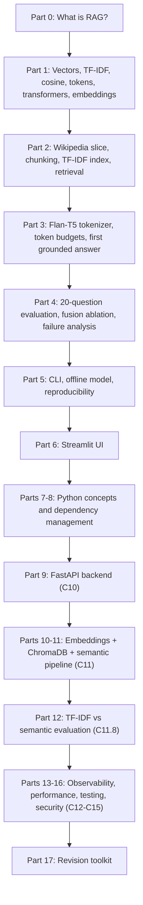

**Suggested study plan for a beginner**

| Week | Read | Goal |
|---|---|---|
| 1 | Parts 0–1 | Understand vectors, TF-IDF, cosine similarity, tokens and transformers |
| 2 | Parts 2–3 | Follow a question from Wikipedia text to a generated answer |
| 3 | Parts 4–6 | Learn how to evaluate RAG honestly and read failure cases |
| 4 | Parts 7–9 | Python engineering skills and the FastAPI service |
| 5 | Parts 10–12 | Embeddings, vector databases and comparative evaluation |
| 6 | Parts 13–17 | Production concerns, then revise with the toolkit |

**Prerequisites:** basic Python (functions, lists, dictionaries, classes), school-level algebra, and
curiosity. Everything else is built up here.

---

# Part 0 — The Big Picture

## 0.1 The assignment

Our project came from the course's Deep Learning project list. The brief was one line long:

> *Build a small offline RAG: index a Wikipedia slice, retrieve passages, and use Flan-T5-small to
> generate grounded answers; ablate retrieval size and fusion methods (concatenate vs
> generate-from-evidence).* Dataset: `wikimedia/wikipedia` on Hugging Face.

Let us unpack every word:

| Phrase in the brief | What it means | Where we did it |
|---|---|---|
| *offline* | Runs on our own machine; no hosted AI API | Part 5 |
| *index a Wikipedia slice* | Pick a subset of articles and make them searchable | Part 2 |
| *retrieve passages* | Find the text most related to a question | Part 2.7 |
| *Flan-T5-small* | A small pretrained encoder–decoder transformer | Part 3 |
| *grounded answers* | Answers based on retrieved evidence, not model memory | Part 3.5 |
| *ablate retrieval size* | Compare K = 1, 3, 5 passages while holding everything else fixed | Part 4 |
| *fusion methods* | Two ways of combining multiple passages into one answer | Part 4.6 |

## 0.2 Vocabulary without jargon

- **Artificial intelligence (AI):** the broad goal of building systems that perform tasks associated with intelligence.
- **Machine learning (ML):** methods that learn patterns from data instead of following hand-written rules.
- **Deep learning (DL):** machine learning with multi-layer neural networks.
- **Generative AI:** systems that produce new content: text, code, images, audio.
- **Language model:** estimates which sequences of words are likely. An **LLM** is a very large one.
- **RAG (Retrieval-Augmented Generation):** an *application design* that joins a search step with a
  generation step. It is **not** a special neural-network architecture.

In our project, retrieval is **classical information retrieval** (TF-IDF + cosine similarity) and
generation is **deep learning** (Flan-T5-small). Track C later adds a deep-learning retriever (MiniLM embeddings).

## 0.3 The problem RAG solves

> **Student:** Why not just ask a language model directly?
>
> **🧑‍🏫 Mentor:** A language model stores knowledge inside its weights. That knowledge can be outdated,
> incomplete or simply wrong, and the model can confidently invent answers ("hallucinate"). Small
> models such as Flan-T5-small know very little about specific people. RAG fixes this by **looking
> things up first**, then asking the model to answer **using the evidence it was given**.

**The open-book exam analogy.** In a closed-book exam you rely on memory. In an open-book exam you
first find the right page, then write the answer. The retriever is your skill at finding the page; the
generator is your skill at writing the answer from it. You need both, and each can fail on its own.

**The library analogy**

| Term | Everyday analogy | In our implementation |
|---|---|---|
| Corpus | Books in a library | 1,000 selected Wikipedia articles |
| Chunk | A short excerpt | A 100-word overlapping passage |
| Index | A searchable catalogue | The saved TF-IDF matrix and vocabulary |
| Retriever | The librarian | `TfidfRetriever` (later also `SemanticRetriever`) |
| Evidence | The pages the librarian hands you | Top-K passages |
| Generator | The student writing the answer | `FlanT5Generator` |
| Interface | The library desk | Streamlit app, then FastAPI |

> **Key distinction.** A retrieved article is *available evidence*, not a guarantee of a correct answer.
> The model can still pick the wrong fact, lose information during shortening, or produce a plausible
> but unsupported answer. **RAG reduces the risk of hallucination; it does not remove it.**

## 0.4 The pipeline at a glance

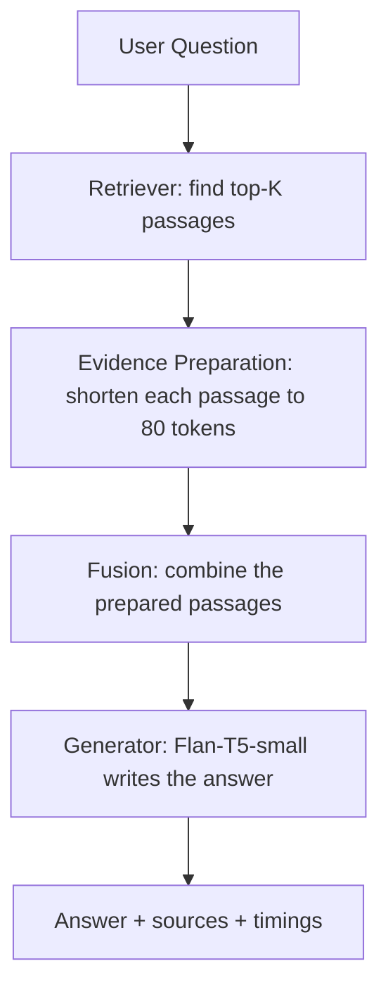

Formally, the retriever picks the \(K\) highest-scoring passages:

\[
R_K(q)=\operatorname{TopK}_{p_i}\big(\operatorname{sim}(q,p_i)\big)
\]

and the generator produces an answer conditioned on the question and that evidence:

\[
\hat a=G\big(q,R_K(q)\big)
\]

- \(q\): the user question; \(p_i\): a Wikipedia passage; \(K\): retrieval size.
- \(R_K(q)\): the retrieved evidence; \(G\): Flan-T5-small; \(\hat a\): the generated answer.

## 0.5 Our final numbers, in one table

| Item | Value |
|---|---|
| Source | `wikimedia/wikipedia`, configuration `20231101.en` (1 November 2023 snapshot) |
| Selected articles | 1,000 |
| Passages | 8,191 (100 words each, 20-word overlap) |
| TF-IDF matrix | 8,191 × 30,000, 99.85% sparse |
| Evidence budget | 80 Flan-T5 tokens per passage |
| Generator | `google/flan-t5-small`, 512 input / 64 output tokens |
| Evaluation | 20 questions × K∈{1,3,5} × 2 fusion methods = 120 runs, 300 model calls |
| **Best configuration** | **Concatenation, K = 1: 75% Exact Match, 85.62% Token F1** |
| Manual factual correctness (best config) | 17/20 = 85% (human judgement, separate from EM) |
| Track C semantic retriever | all-MiniLM-L6-v2 (384-d) + ChromaDB |

## 0.6 Offline vs online work

- **Offline (index time):** done once, before anyone asks a question. Select articles, split them into
  passages, turn passages into vectors, save everything to disk.
- **Online (query time):** done for every question. Turn the question into a vector, compare it with
  saved vectors, prepare evidence, generate the answer.

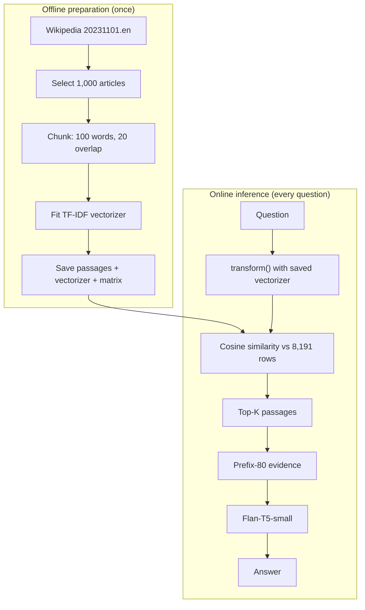

Keeping heavy work offline is what makes each answer fast: retrieval took about **5–8 milliseconds** in our runs.

<details>
<summary>✅ Check yourself</summary>

1. *Why can a RAG answer still be wrong even if the generator is good?* — The retriever may supply wrong, misleading or incomplete evidence, or preparation may cut the answer out.
2. *Why build the index offline?* — Vectorizing 8,191 passages for every question would waste time; doing it once and reusing it is far cheaper.
3. *Is RAG a neural network architecture?* — No. It is a system design that combines a retriever and a generator.

</details>

---

# Part 1 — Mathematical and Deep Learning Foundations

## 1.1 Text must become numbers

Computers compare numbers, not meanings. Every retrieval method answers one question:
**how do we turn text into a vector so that similar texts get similar vectors?**

A **vector** is an ordered list of numbers:

\[
x=(x_1,x_2,\ldots,x_d)\in\mathbb{R}^{d}
\]

where \(d\) is the **dimension**.

Two families of text vectors appear in this project:

| | Sparse vectors (TF-IDF) | Dense vectors (embeddings) |
|---|---|---|
| Dimension in our project | 30,000 | 384 |
| Meaning of a dimension | One vocabulary word | A learned, uninterpretable feature |
| Most values | Zero | Non-zero |
| Produced by | Counting + statistics | A trained neural network |

A collection of vectors stacks into a **matrix**. For \(N\) passages of dimension \(d\):

\[
X\in\mathbb{R}^{N\times d}
\]

Our TF-IDF matrix was \(8191\times30000\); our embedding matrix is \(8191\times384\).

## 1.2 TF-IDF from scratch

### Intuition

A word is a good clue to a passage if it is **frequent in that passage** but **rare across the collection**.
"the" appears everywhere (useless clue). "Richburg" appears in very few passages (excellent clue).

### Term Frequency

\[
TF(t,d)=f_{t,d}
\]

the number of times term \(t\) appears in passage \(d\).

### Document Frequency

\[
DF(t)=\left|\{d: t\in d\}\right|
\]

the number of passages that contain term \(t\) at least once.

### Inverse Document Frequency

A common smoothed formula (used by scikit-learn, with natural log):

\[
IDF(t)=\log\left(\frac{1+N}{1+DF(t)}\right)+1
\]

- \(N\): number of passages.
- \(DF(t)\): number of passages containing \(t\).
- The "+1" terms avoid division by zero and keep every weight positive.

### TF-IDF weight

\[
w_{t,d}=TF(t,d)\times IDF(t)
\]

### 🧑‍🏫 Worked example

Corpus of \(N=3\) tiny passages:

- \(d_1\): "runner won race"
- \(d_2\): "chess player won"
- \(d_3\): "runner trained daily"

| Term | DF | \(IDF=\ln\frac{1+3}{1+DF}+1\) |
|---|---:|---:|
| runner | 2 | \(\ln(4/3)+1\approx1.288\) |
| won | 2 | \(\ln(4/3)+1\approx1.288\) |
| chess | 1 | \(\ln(4/2)+1\approx1.693\) |

"chess" is rarer, so it gets a higher weight. That is exactly the behaviour we want.

### 🧑‍🏫 Second worked example (from the project handbook)

Suppose \(N=4\) passages; *runner* occurs in 2 of them and *chess* in 1:

\[
IDF(\text{runner})=\ln(5/3)+1\approx1.511,\qquad IDF(\text{chess})=\ln(5/2)+1\approx1.916
\]

If *runner* appears **twice** in one passage, its raw weight before normalization is
\(2\times1.511=3.022\). These toy numbers are for intuition only; they are not the weights in our real
8,191-passage index.

### Sparse matrices: why most numbers are zero

Each passage uses only a few dozen of the 30,000 vocabulary words. Our real index:

| Quantity | Value |
|---|---:|
| Matrix shape | 8,191 × 30,000 |
| Total possible entries | \(8191\times30000=245{,}730{,}000\) |
| Non-zero entries | 364,728 |
| Density | \(364728/245730000\approx0.1484\%\) |
| Sparsity | \(\approx99.8516\%\) |
| Mean non-zero features per passage | \(364728/8191\approx44.53\) |

A **CSR (Compressed Sparse Row)** matrix stores only the non-zero values plus their column positions,
so we store about 365 thousand numbers instead of 245.7 million.

\[
\text{Density}=\frac{\text{nnz}}{N\times V},\qquad \text{Sparsity}=1-\text{Density}
\]

where nnz is the number of non-zero entries and \(V\) is the vocabulary size.

### Our real configuration

```python
from sklearn.feature_extraction.text import TfidfVectorizer

vectorizer = TfidfVectorizer(
    lowercase=True,         # "Runner" and "runner" become the same feature
    stop_words="english",   # drop very common words such as "the", "is"
    max_features=30000,     # keep at most 30,000 vocabulary terms
    norm="l2"               # scale each passage vector to unit length
)
tfidf_matrix = vectorizer.fit_transform(passages)  # learn vocabulary + IDF, then transform
```

> **Key rule:** use `fit_transform()` **once** on the corpus and `transform()` for every question.
> Fitting on a question would create a new, incompatible vocabulary.

## 1.3 Norms, normalization and cosine similarity

### The L2 norm (vector length)

\[
\|x\|_2=\sqrt{\sum_{i=1}^{d}x_i^2}
\]

### L2 normalization

\[
\hat{x}=\frac{x}{\|x\|_2}
\]

After this, \(\|\hat{x}\|_2=1\) (for non-zero \(x\)).

### Dot product

\[
q^\top d=\sum_{i=1}^{d}q_i d_i
\]

### Cosine similarity

\[
\cos(q,d)=\frac{q^\top d}{\|q\|_2\|d\|_2}
\]

It measures the **angle** between two vectors, ignoring their lengths.
Range: −1 to 1 in general; TF-IDF values are non-negative so TF-IDF cosine lies between 0 and 1.

### 🧑‍🏫 Worked example

\(q=(1,1,0)\), \(d=(1,0,1)\)

\[
q^\top d=1,\quad \|q\|_2=\|d\|_2=\sqrt2,\quad \cos(q,d)=\frac{1}{2}=0.5
\]

### 🧑‍🏫 Worked example 2: ranking two passages

Question \(q=(1,2)\); candidate passages \(d_1=(2,4)\) and \(d_2=(2,0)\).

\[
\cos(q,d_1)=\frac{1(2)+2(4)}{\sqrt5\,\sqrt{20}}=\frac{10}{10}=1
\]

\[
\cos(q,d_2)=\frac{1(2)+2(0)}{\sqrt5\cdot2}=\frac{1}{\sqrt5}\approx0.447
\]

So \(d_1\) ranks first. Note that \(d_1=2q\): **multiplying a vector by a positive number never changes
its direction, so it never changes cosine similarity.** This is why a long passage that repeats the
question's words is not automatically favoured.

> ⚠️ **Cosine similarity is not a probability or a confidence.** A score of 0.44 does not mean "44% likely
> to be correct". In our project, "What is the capital of France?" got a top score of **0.4398**, higher
> than the 0.3932 of the correct Diana Richburg passage, yet that passage did **not** answer the
> question (Part 2.8).

### The normalization shortcut

When both vectors are L2-normalized, the denominator equals 1, so:

\[
\cos(q,d)=q^\top d
\]

For a whole matrix of normalized passages \(D\) and a normalized question \(Q\):

\[
S=QD^\top
\]

One matrix multiplication scores every passage at once. GPUs are extremely good at this.

### Cosine distance

Vector databases often report a **distance** (smaller is better) instead of a similarity:

\[
d(q,p)=1-\cos(q,p)
\]

> ⚠️ **Watch the direction.** Similarity: higher is better. Distance: lower is better.
> Mixing these up silently reverses your rankings.

**🧑‍🏫 Bonus identity.** For unit vectors, Euclidean distance and cosine are tied together:

\[
\|a-b\|_2^2=2-2\cos(a,b)
\]

So for normalized vectors, ranking by Euclidean distance gives the same order as ranking by cosine.

## 1.4 Words vs tokens

A **word** is a human unit separated by spaces. A **token** is whatever unit a model's
**tokenizer** produces: a whole word, a piece of a word, a punctuation mark, part of a URL.

### A real example from our notebook

The Flan-T5 tokenizer (a SentencePiece `T5Tokenizer` with a vocabulary of **32,100** tokens) split
our first question like this:

```text
Question : Who is Diana Richburg?
Tokens   : ['▁Who', '▁is', '▁Diana', '▁Rich', 'burg', '?', '</s>']
Token IDs: [2645, 19, 18821, 10825, 4824, 58, 1]
```

- `▁` marks "a space came before this piece".
- The rare name **Richburg** became two pieces: `▁Rich` + `burg`.
- `</s>` is the special **end-of-sequence** token (ID 1) added automatically.
- A **token ID** is just a row number in the model's vocabulary table. It is not a similarity score or a probability.

So 4 words became **7 tokens**. For a full 100-word Wikipedia passage we measured **133 tokens**:

\[
r=\frac{N_{\text{tokens}}}{N_{\text{words}}}=\frac{133}{100}=1.33
\]

\(r\) is the **token-to-word ratio**. Long names, numbers, dates and punctuation push it higher.

Let a passage be \(P=(w_1,\ldots,w_m)\) words. The tokenizer produces

\[
T(P)=(t_1,\ldots,t_n),\qquad n\neq m\text{ in general}
\]

Why it matters: **every neural model has a maximum input length measured in tokens**, not words.
Text beyond the limit is **truncated** (cut off), and the model never sees it. This single fact
explains two of the most interesting failures we found: John Hubley (Part 4.4) and B. Reith (Part 12.9).

## 1.5 Deep learning background: transformers and Flan-T5

### Neural network in one sentence

A neural network is a function \(f_\theta(x)\) with millions of adjustable numbers \(\theta\)
(**weights/parameters**) that are tuned during training to make outputs useful.

### The transformer and attention

Transformers process tokens in parallel and let each token "look at" every other token through
**self-attention**:

\[
\operatorname{Attention}(Q,K,V)=\operatorname{softmax}\left(\frac{QK^\top}{\sqrt{d_k}}\right)V
\]

- \(Q,K,V\): query, key and value matrices computed from the token representations.
- \(QK^\top\): how relevant each token is to each other token (dot products again!).
- \(\sqrt{d_k}\): scaling to keep values numerically stable.
- **softmax** turns scores into weights that sum to 1:

\[
\operatorname{softmax}(z)_i=\frac{e^{z_i}}{\sum_j e^{z_j}}
\]

Attention cost grows roughly with \(n^2\) for \(n\) tokens, one reason models cap input length.

### Encoder–decoder models (T5 family)

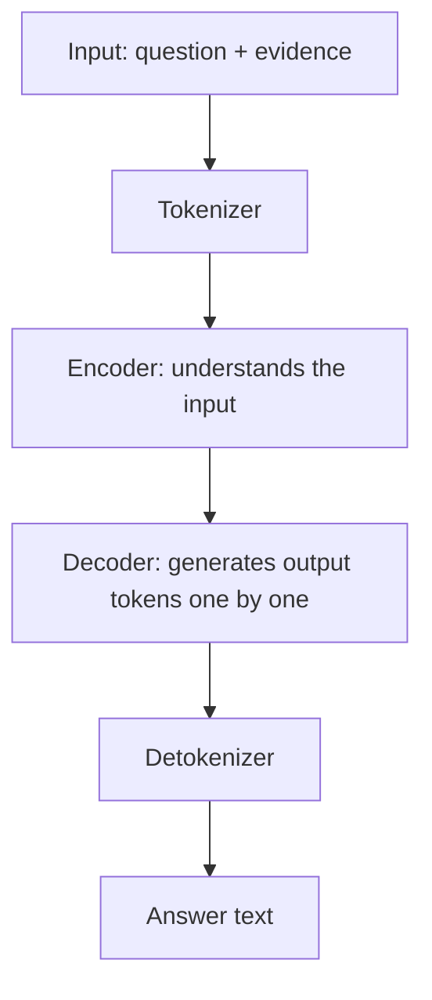

The decoder generates **autoregressively**: each new token depends on the input and previously generated tokens.

\[
P(y\mid x)=\prod_{t=1}^{T}P(y_t\mid y_{<t},x)
\]

**Flan-T5** is T5 fine-tuned on many instruction-style tasks, so it follows prompts like
"Answer the question using the context". The **small** variant runs comfortably on a consumer GPU but
is easily confused by misleading context.

| Property (measured in our notebook) | Value |
|---|---|
| Model | `google/flan-t5-small` |
| Class | `T5ForConditionalGeneration` |
| Encoder–decoder | Yes |
| Total parameters | **76,961,152** |
| Tokenizer vocabulary | 32,100 |
| Maximum input length | 512 tokens |

We use **pretrained weights only**: there is no training or fine-tuning in this project.

### How the decoder chooses each word: decoding strategies

At each step the model produces a probability for every one of the 32,100 tokens. A **decoding
strategy** decides which token to keep.

| Strategy | Rule | Behaviour |
|---|---|---|
| **Greedy** (our choice) | pick \(\arg\max_y P(y_t\mid y_{<t},x)\) | Deterministic and reproducible |
| Beam search | keep the best \(b\) partial answers | Better global sequences, slower |
| Sampling | draw randomly from the distribution | Creative but not reproducible |

Our code used `do_sample=False, num_beams=1`, which is greedy decoding: the same question and evidence
always give the same answer. That is essential for a fair experiment. `max_new_tokens=64` caps the
**output** length; it says nothing about the input.

### Inference mode

```python
model.eval()                      # switch off training-only behaviour such as dropout
with torch.inference_mode():      # no gradient bookkeeping: faster, less memory
    output_ids = model.generate(**inputs, max_new_tokens=64,
                                do_sample=False, num_beams=1)
```

`model.eval()` does **not** train anything; it just selects evaluation behaviour.

### Memory needed for weights

\[
M_{\text{weights}}=P\times b
\]

\(P\) = parameter count, \(b\) = bytes per parameter (4 for float32). For our exact count:

\[
M=76{,}961{,}152\times4=307{,}844{,}608\ \text{bytes}=\frac{307{,}844{,}608}{1024^2}\approx293.58\ \text{MiB}
\]

🧑‍🏫 **A satisfying check:** right after loading the model, PyTorch reported **293.58 MB allocated** on
the GPU (the notebook divided by \(1024^2\), so these are MiB). That matches our calculation exactly,
which tells us the GPU memory at that moment held **only the weights**. Keep this in mind for the
C13 measurements in Part 14.

> **Notation warning.** The \(K\) in "top-\(K\) retrieval" is an integer (how many passages). The \(K\) in
> attention's \(Q,K,V\) is a **matrix of key vectors**. Likewise, the "query" in attention is not the
> user's question. Same letters, different ideas.

## 1.6 Sentence embeddings

An **embedding model** maps text to a fixed-length dense vector:

\[
f_\theta(x)\in\mathbb{R}^{d}
\]

Our model, **all-MiniLM-L6-v2**: 6 transformer layers, \(d=384\), about 22–23 million parameters,
maximum input 256 tokens (as configured in Sentence Transformers).

### How a sentence becomes one vector: mean pooling

The transformer outputs one vector \(h_i\) per token. A common way to get one sentence vector is averaging:

\[
e=\frac{1}{n}\sum_{i=1}^{n}h_i
\]

### How the model learned "meaning": contrastive training (🧑‍🏫 background)

Models like MiniLM sentence-transformers are trained on pairs that should be close
(question ↔ answer passage, paraphrase ↔ paraphrase). For a batch of \(B\) pairs, a typical loss is:

\[
\mathcal{L}=-\frac{1}{B}\sum_{i=1}^{B}\log\frac{\exp\left(s(q_i,d_i)/\tau\right)}{\sum_{j=1}^{B}\exp\left(s(q_i,d_j)/\tau\right)}
\]

Translation: make each question most similar to **its own** passage and less similar to the
other passages in the batch. \(s\) is cosine similarity; \(\tau\) is a temperature.

> **Consequence:** embeddings capture "topic and meaning". Two sentences about *two different
> people named Diana* can still look similar. **Semantic similarity is not factual relevance.**

### Storage cost

\[
M=N\times d\times4\ \text{bytes (float32)}
\]

\[
M=8191\times384\times4=12{,}580{,}224\text{ bytes}\approx12.0\text{ MiB}
\]

Real disk and RAM usage is higher because of text, metadata and index structures.

## 1.7 Vector databases and nearest-neighbour search

Given a question vector, find the \(K\) stored vectors with the highest similarity.
**Brute force** compares against everything: for us, \(8191\times384\approx3.1\) million
multiply-adds per query, fast on a GPU or even CPU.

At millions of vectors, databases use **Approximate Nearest Neighbour (ANN)** indexes. ChromaDB uses
**HNSW** (Hierarchical Navigable Small World): a layered graph in which you start at a coarse layer,
greedily hop toward closer vectors, and descend to finer layers. It trades a tiny chance of missing the
true nearest neighbour for large speed gains.

A **vector database** stores, per record: an **ID**, the **vector**, the **document text** and
**metadata**, grouped in **collections**.

<details>
<summary>✅ Check yourself</summary>

1. *If two vectors are unit length, what is a faster way to compute cosine similarity?* — Their dot product.
2. *ChromaDB returns distance 0.25 under cosine space. What is the similarity?* — \(1-0.25=0.75\).
3. *Why is "100 words" not the same as "100 tokens"?* — Tokenizers split words into sub-words and punctuation, so token count is usually higher.
4. *Why can MiniLM rank a passage about the wrong Diana highly?* — Contrastive training rewards topical/semantic closeness, not entity-level correctness.

</details>

---

# Part 2 — Data, Chunking, Indexing and Retrieval (Stages 1–4)

> **Student:** Where do we even start?
>
> **🧑‍🏫 Mentor:** With the data. A RAG system can only answer questions its corpus covers, so the very
> first engineering decision is *which text do we index?* Then we cut it into pieces, turn the pieces
> into vectors, and learn to search them.

## 2.1 The two academic projects and their files

1. **`Mid-Sem-Project-RAG`**: the retrieval and generation engine (TF-IDF index, Flan-T5, evaluation).
2. **`Mid-Sem-Project-RAG-UI`**: a Streamlit app that imports the engine directly (Part 6).

```text
Mid-Sem-Project-RAG/
├── config/rag_config.json
├── data/
│   ├── wiki_slice_1000/                 # 1,000 selected articles (Arrow format)
│   ├── wiki_chunks_100w_20overlap/      # 8,191 passages (Arrow format)
│   ├── tfidf_index/                     # vectorizer.joblib, tfidf_matrix.npz, index_metadata.json
│   └── evaluation/rag_evaluation_20.csv # 20 reference questions
├── models/flan-t5-small/                # locally exported model (Part 5)
├── notebooks/                           # the research notebook (Stages 1–9)
├── results/evaluation/                  # all experiment CSV/JSONL outputs
└── src/
    ├── run_rag.py                       # command-line application
    └── rag/
        ├── data_loader.py   chunking.py   indexer.py   retriever.py
        ├── evidence.py      fusion.py     generator.py pipeline.py
        └── evaluation.py
```

| Module | Responsibility |
|---|---|
| `data_loader.py` | Load the saved Wikipedia datasets from disk |
| `chunking.py` | Split articles into overlapping passages |
| `indexer.py` | Fit, save and reload the TF-IDF artifacts (`build_tfidf_index`, `load_tfidf_index`) |
| `retriever.py` | `TfidfRetriever.retrieve(question, top_k)` ranks passages |
| `evidence.py` | `prepare_evidence()` shortens passages to the token budget |
| `fusion.py` | `concatenate_evidence()` and `generate_from_evidence()` |
| `generator.py` | `FlanT5Generator` loads the model and generates answers |
| `pipeline.py` | `RAGPipeline.answer()` orchestrates everything |
| `evaluation.py` | Exact Match, Token F1, Hit@K, Evidence Support@K |
| `run_rag.py` | `load_config()`, `initialize_rag(config)`, CLI entry point |

> 🧑‍🏫 **How the project was actually built.** Every idea was first prototyped in a notebook cell,
> verified with `assert` statements, then moved into a reusable module, then **re-verified to produce
> identical results**. Keep this habit: *prototype → verify → modularize → re-verify.*

## 2.2 Stage 1 — Environment setup

The first notebook cell simply imported and printed the key libraries:

```python
import sys, torch, transformers, datasets, sentencepiece, accelerate, sklearn
from transformers import AutoTokenizer, AutoModelForSeq2SeqLM
```

| Library | Role in the project | Version used |
|---|---|---|
| Python | Language | 3.11.14 |
| PyTorch | Tensors and GPU execution | 2.10.0+cu128 (CUDA 12.8) |
| Transformers | Flan-T5 model and tokenizer | 5.21.0 |
| Datasets | Load, stream and save Wikipedia | 5.1.0 |
| scikit-learn | TF-IDF and cosine similarity | 1.8.0 |
| SciPy | Sparse matrix storage (`.npz`) | 1.17.1 |
| NumPy / pandas | Arrays and tables | 2.1.3 / 3.0.1 |
| joblib | Saving the fitted vectorizer | 1.5.3 |
| sentencepiece | The T5 tokenizer's algorithm | 0.2.2 |
| accelerate | Hugging Face device helpers | 1.15.0 |

Hardware: **NVIDIA GeForce RTX 5060 Laptop GPU, 7.96 GB**, Windows.

## 2.3 Stage 2.1–2.2 — Inspecting and profiling Wikipedia

### Streaming: look before you download

English Wikipedia is huge. Hugging Face Datasets can **stream** it: records arrive one at a time,
without downloading everything first.

```python
from datasets import load_dataset

wiki_stream = load_dataset("wikimedia/wikipedia", "20231101.en",
                           split="train", streaming=True)
article = next(iter(wiki_stream))
print(article.keys())   # dict_keys(['id', 'url', 'title', 'text'])
```

Each record has four **fields**: `id`, `url`, `title`, `text`. The first three records:

| Article | ID | Text length (characters) |
|---|--:|--:|
| Anarchism | 12 | 46,064 |
| Albedo | 39 | 25,076 |
| A | 290 | 10,574 |

### Profiling 100 articles

| Statistic | Characters |
|---|--:|
| Mean | 32,432.85 |
| Standard deviation | 27,873.10 |
| Minimum | 389 |
| Median | 26,925.50 |
| Maximum | 115,512 |

No empty texts and no duplicate IDs were found.

🧑‍🏫 **Reading these statistics like a scientist:**

1. **Mean > median** means the distribution is **right-skewed**: a few very long articles pull the
   average up. The median is the more typical article.
2. **Articles are far longer than the generator's input.** 26,925 characters is roughly 4,000+ words,
   while Flan-T5-small accepts 512 *tokens* in total. We cannot feed whole articles, so we must **chunk**.
3. **Sampling bias.** Many of the first 100 titles began with "A". Streaming in file order is not a
   random sample. Lesson: *never generalize from the first N records of an ordered dataset.*
4. The shortest pages were often **disambiguation pages** ("X may refer to…"), which carry little explanatory text.

### Shards and the shuffle buffer

Large datasets are split into **shards** (think of the volumes of an encyclopedia). A streaming shuffle
keeps a **buffer** of \(B\) records in memory and draws randomly from it. With \(B=5000\), the shuffle is
**local, not global**: it is not a perfectly uniform sample of all of Wikipedia. It is, however,
**reproducible** when the seed is fixed.

## 2.4 Stage 2.3 — Selecting and saving the 1,000-article corpus

```python
RANDOM_SEED = 42
TARGET_ARTICLES = 1000
SHUFFLE_BUFFER = 5000
MIN_TEXT_LENGTH = 500

wiki_shuffled = wiki_stream.shuffle(seed=RANDOM_SEED, buffer_size=SHUFFLE_BUFFER)

selected_articles, seen_ids = [], set()
for article in wiki_shuffled:
    article_id = article.get("id")
    title = (article.get("title") or "").strip()
    text = (article.get("text") or "").strip()

    if not article_id or not title or len(text) < MIN_TEXT_LENGTH:
        continue                                   # incomplete or too short
    if "(disambiguation)" in title.lower():
        continue                                   # disambiguation page
    if article_id in seen_ids:
        continue                                   # duplicate

    selected_articles.append({"id": article_id, "title": title,
                              "url": article.get("url"), "text": text})
    seen_ids.add(article_id)
    if len(selected_articles) >= TARGET_ARTICLES:
        break
```

Then persisted and reloaded:

```python
from datasets import Dataset, load_from_disk

Dataset.from_list(selected_articles).save_to_disk("data/wiki_slice_1000")
wiki_local = load_from_disk("data/wiki_slice_1000")   # local, no network needed
assert len(wiki_local) == 1000
```

| Result | Value |
|---|--:|
| Articles selected / unique IDs | 1,000 / 1,000 |
| Minimum length | 500 characters |
| Maximum length | 102,127 characters |
| Mean length | 4,025.16 characters |
| First / last article | *Diana Richburg* / *Amore & Vita* |

> 🧑‍🏫 Notice the mean dropped from ~32,000 to ~4,000 characters. The shuffled sample contains many
> more short, ordinary articles than the alphabetically-first ones. The very first selected article,
> *Diana Richburg*, became the running example of the entire project.

**Why save locally?** After this step, the project never needs to contact Hugging Face for article
text again. This is the first brick of "offline".

**Engineering lesson:** *dataset selection controls which questions the RAG system can answer.* An
indexed title does not mean every question about it is answerable.

## 2.5 Stage 3.1–3.3 — Chunking with a sliding window

### Why chunk at all?

An article can span thousands of words, but a question usually needs one paragraph. A **chunk**
(passage) is a small, retrievable unit, so the retriever can return the local paragraph instead of the whole article.

### The algorithm

```python
def chunk_text(text, chunk_size=100, overlap=20):
    if chunk_size <= 0:
        raise ValueError("Chunk size must be positive")
    if overlap < 0 or overlap >= chunk_size:
        raise ValueError("Overlap must be non-negative and smaller than chunk size.")

    words = text.split()                      # whitespace "words"
    if not words:
        return []

    stride = chunk_size - overlap             # 80
    chunks = []
    for start in range(0, len(words), stride):
        end = min(start + chunk_size, len(words))
        chunks.append(" ".join(words[start:end]))
        if end == len(words):                 # stop once the last word is covered
            break
    return chunks
```

### The mathematics

**Stride** (how far each window moves):

\[
S=C-O
\]

- \(C\): chunk size (100 words); \(O\): overlap (20 words); \(S=100-20=80\) words.

**Number of chunks** for a document of \(N>C\) words (counting a shorter final "tail" chunk):

\[
M=1+\left\lceil\frac{N-C}{C-O}\right\rceil
\]

A related formula counts only **full-length** windows:

\[
N_{\text{full}}=1+\left\lfloor\frac{L-C}{S}\right\rfloor\qquad(L\ge C)
\]

The two differ only by whether the short tail is counted. Our implementation **keeps** the tail, so the
ceiling version applies. 🧑‍🏫 Always check which convention the code uses before applying a formula.

### 🧑‍🏫 Worked example 1: the real *Diana Richburg* article (225 words)

\[
M=1+\left\lceil\frac{225-100}{80}\right\rceil=1+\lceil1.5625\rceil=1+2=3
\]

| Chunk | Words | Length |
|---|---|---|
| 0 | 1–100 | 100 |
| 1 | 81–180 | 100 |
| 2 | 161–225 | 65 (the tail) |

The notebook observed exactly 3 chunks, the last with 65 words. ✅

### 🧑‍🏫 Worked example 2: a hypothetical 260-word article

Chunks cover words 1–100, 81–180 and 161–260. Words 81–100 appear in chunks 0 and 1; words 161–180 in
chunks 1 and 2. A fact sitting on a boundary survives in at least one chunk.

```text
Article words: [w1 ............................................... w260]
Chunk 0:       [w1 ........ w100]
Chunk 1:                [w81 ........ w180]
Chunk 2:                         [w161 ........ w260]
```

### Verifying the chunker

Two checks proved the implementation correct on the test article:

1. **Overlap check:** the last 20 words of chunk \(i\) equal the first 20 words of chunk \(i+1\).
2. **Reconstruction check:** chunk 0 plus the *non-overlapping* part of every later chunk rebuilds the
   original word sequence exactly.

### Full-corpus results

| Metric | Result |
|---|--:|
| Articles → passages | 1,000 → **8,191** |
| Unique chunk IDs | 8,191 |
| Mean / min / max chunk length | 95.25 / 21 / 100 words |
| Mean / median / max chunks per article | 8.191 / 4 / 200 |

Each passage keeps its **metadata**: `chunk_id` (e.g. `55617566::0`, meaning article ID `::` chunk
number), `article_id`, `title`, `url`, `chunk_number`, `text`, `word_count`. Metadata is what lets the
system show **sources** and lets us evaluate retrieval.

> 🧑‍🏫 Mean 8.2 but median 4 chunks per article: one 200-chunk article contributes 50× more candidates
> than a 4-chunk one. **Long articles get more "lottery tickets" in retrieval.** That is a bias to keep in mind.

### Trade-offs: chunk size and overlap are hyperparameters

| Choice | Benefit | Cost |
|---|---|---|
| Tiny chunks | Precise retrieval | Missing context |
| Huge chunks | Rich context | Diluted relevance, more tokens, truncation |
| More overlap | Protects boundary facts | Duplicate text, larger index, near-duplicate results |

Word-based chunking also ignores sentence boundaries, and **words ≠ tokens** (Part 1.4).

### Modularization (Stage 3.3)

The chunker and loader moved into `src/rag/chunking.py` and `src/rag/data_loader.py`. The module
produced **the same three passages** as the notebook prototype, and the loader returned 1,000 articles
and 8,191 passages. Every integrity check passed.

## 2.6 Stage 3.4–3.5 — Building, saving and reloading the TF-IDF index

### Building

```python
from sklearn.feature_extraction.text import TfidfVectorizer

tfidf_vectorizer = TfidfVectorizer(
    lowercase=True,          # "Runner" == "runner"
    stop_words="english",    # drop "the", "is", "of", ...
    max_features=30000,      # keep the 30,000 most frequent terms
    norm="l2",               # unit-length rows, so cosine == dot product
)
tfidf_matrix = tfidf_vectorizer.fit_transform(chunks_local["text"])

assert tfidf_matrix.shape[0] == len(chunks_local)    # one row per passage
assert tfidf_matrix.shape[1] <= 30000
```

The result: an **8,191 × 30,000 CSR matrix**, 364,728 non-zeros, **99.85% sparse** (Part 1.2).
Row \(i\) is passage \(i\); column \(j\) is vocabulary term \(j\).

The vocabulary inspection showed many **numeric and digit-prefixed terms** (years, codes). They can
help (dates are often answers) or add noise. We kept them for the baseline.

The notebook version and the module version (`rag.indexer.build_tfidf_index`) were compared for shape,
vocabulary order and numerical weights. They were identical.

### Saving (persistence)

| Artifact | Format | Purpose | Size |
|---|---|---|--:|
| `vectorizer.joblib` | joblib (pickle) | Vocabulary, IDF weights, settings | 1.1 MB |
| `tfidf_matrix.npz` | SciPy compressed sparse | Passage vectors | 3.1 MB |
| `index_metadata.json` | JSON | Shape, configuration, provenance | 348 B |
| passages (`.arrow`) | Hugging Face Datasets | Passage text + metadata | 6.2 MB |

### Reloading safely

```python
def load_tfidf_index(index_dir):
    index_dir = Path(index_dir)
    vectorizer_path = index_dir / "vectorizer.joblib"
    matrix_path     = index_dir / "tfidf_matrix.npz"
    metadata_path   = index_dir / "index_metadata.json"

    for path in [vectorizer_path, matrix_path, metadata_path]:
        if not path.is_file():
            raise FileNotFoundError(f"Missing TF-IDF index artifact: {path}")

    vectorizer = joblib.load(vectorizer_path)      # trusted, locally generated file only
    matrix = load_npz(matrix_path)
    metadata = json.load(open(metadata_path, encoding="utf-8"))

    if matrix.shape[0] != metadata["num_passages"]:
        raise ValueError("Passage count does not match index metadata.")
    if matrix.shape[1] != metadata["vocabulary_size"]:
        raise ValueError("Vocabulary size does not match index metadata.")
    if matrix.shape[1] != len(vectorizer.vocabulary_):
        raise ValueError("Vocabulary size does not match fitted vectorizer.")
    return vectorizer, matrix, metadata
```

Checks passed on reload: dimensions, vocabulary consistency, numerical values, passage-count
alignment, metadata consistency.

> ⚠️ **Row alignment is sacred.** Matrix row 42 must describe passage 42. If anyone re-sorts or
> filters the passage dataset without rebuilding the matrix, retrieval silently returns the **wrong
> text**. The metadata does not (yet) include a fingerprint of the passage order; a hash would be a good improvement.
>
> ⚠️ **joblib/pickle files can execute code when loaded.** Only load files you created yourself.

## 2.7 Stage 4.1–4.2 — Retrieval with cosine similarity

### The retrieval code

```python
from sklearn.metrics.pairwise import cosine_similarity
import numpy as np

question_vector = vectorizer.transform([question])              # 1 × 30,000 sparse
similarity_scores = cosine_similarity(question_vector,
                                      tfidf_matrix).ravel()     # 8,191 scores
top_indices = np.argsort(-similarity_scores, kind="stable")[:top_k]
```

Line by line:

1. `transform` (never `fit_transform`!) maps the question into the **same** 30,000-dimensional space.
2. `cosine_similarity` scores the question against all 8,191 passages in one call.
3. `argsort(-scores)` sorts indices by descending score; `kind="stable"` makes ties deterministic.
4. `[:top_k]` keeps the best \(K\).

The notebook then asserted that scores are in non-increasing order: a cheap test that catches sorting bugs.

### The retriever contract

`TfidfRetriever.retrieve(question, top_k)` returns a list of dictionaries:

| Field | Meaning |
|---|---|
| `rank` | 1, 2, 3, … |
| `score` | Cosine similarity (higher is better) |
| `chunk_id` | e.g. `55617566::0` |
| `article_id`, `title`, `url` | Source attribution |
| `text` | The passage text |

> 🧑‍🏫 This **contract** (same method name, same fields, higher-is-better scores) is what later allowed
> Track C to plug in a completely different retriever without touching the pipeline (Part 10.9).

### First result: "Who is Diana Richburg?" (K = 3)

| Rank | Article | Cosine similarity |
|---|---|--:|
| 1 | Diana Richburg | 0.3932 |
| 2 | Diana Richburg | 0.2261 |
| 3 | **Diana Baciu** (a Moldovan chess player) | 0.1121 |

Rank 1 correctly says she is *an American former middle-distance runner*. Rank 3 is a **different
person who shares the first name**. TF-IDF matched the word "diana". Remember this passage: it will
cause trouble later.

## 2.8 Stage 4.3–4.4 — Testing retrieval and the first K ablation

### Three questions, K = 3

| Question | Top score | Observation |
|---|--:|---|
| Who is Diana Richburg? | 0.3932 | Relevant biography retrieved |
| Which Olympic Games did Diana Richburg compete in? | 0.3197 | Passage names the 1984 Los Angeles Olympics |
| What is the capital of France? | **0.4398** | Highest score of all, yet **does not answer** the question |

**The France lesson:** the corpus has no article that says "Paris is the capital of France", but some
passage shares the words *capital* and *France*. A high cosine score means *shared weighted words*,
not *answerability*. **Lexical relevance and factual answerability are different properties.**

### Retrieval size ablation (one question)

| K | Relevant | Irrelevant | Precision@K |
|---|--:|--:|--:|
| 1 | 1 | 0 | 1.000 |
| 3 | 2 | 1 | 0.667 |
| 5 | 2 | 3 | 0.400 |

\[
P@K=\frac{R_K}{K}
\]

- \(R_K\): number of relevant passages among the top \(K\); \(K\): passages retrieved.

The top passage was identical for all K (score 0.393219); every extra slot added noise for this question.
**K = 3 means three passages, not three articles.** Two of them were chunks of the same article.

> ⚠️ One question cannot choose K. This experiment motivated the full 20-question study in Part 4.

<details>
<summary>✅ Check yourself</summary>

1. *Why did we use a seeded shuffle with a buffer instead of the first 1,000 articles?* — The stream is ordered (many "A" titles first); shuffling improves topic diversity, and the seed makes it reproducible.
2. *How many chunks does a 500-word article produce with C=100, O=20?* — \(1+\lceil400/80\rceil=1+5=6\).
3. *Why must we call `transform()` and not `fit_transform()` on the question?* — Fitting would build a new vocabulary and IDF table, putting the question in a different vector space.
4. *What would happen if passages were re-ordered after the matrix was saved?* — Matrix rows would point at the wrong passages, so retrieval would return wrong text.
5. *Why did "capital of France" score 0.44 but fail?* — Shared words, not shared facts; cosine measures lexical overlap.

</details>

---

# Part 3 — The Generator: Flan-T5-small (Stage 5)

> **Student:** We can find the right passage. Why not just show it to the user?
>
> **🧑‍🏫 Mentor:** You could, and that is a search engine. RAG goes one step further: it reads the
> evidence and writes a direct answer. That step is where deep learning enters, and with it the
> constraints of **tokens**, **GPUs** and **prompts**.

## 3.1 Stage 5.1 — Inspecting the tokenizer and model configuration

```python
from transformers import AutoTokenizer, AutoConfig

tokenizer = AutoTokenizer.from_pretrained("google/flan-t5-small")
config    = AutoConfig.from_pretrained("google/flan-t5-small")

encoded = tokenizer("Who is Diana Richburg?", return_tensors="pt", truncation=False)
print(tokenizer.convert_ids_to_tokens(encoded["input_ids"][0].tolist()))
```

| Property | Observed |
|---|---|
| Architecture | `t5`, encoder–decoder = True |
| Tokenizer | `T5Tokenizer` (SentencePiece), vocabulary 32,100 |
| `model_max_length` | 512 |
| Question tokens | 7 (`▁Who ▁is ▁Diana ▁Rich burg ? </s>`) |
| A 100-word passage | 133 tokens (ratio 1.33) |

`truncation=False` was deliberate: **measure the real length first**, decide what to cut later.
Silent truncation hides problems.

## 3.2 Stage 5.1.2 — The token budget problem

The prompt sent to Flan-T5 is not just the passage. It is **instruction + evidence + question + answer marker**:

```python
prompt = (
    "Answer the question using only the evidence below. "
    "If the evidence does not contain the answer, say "
    "'Insufficient evidence'.\n\n"
    f"Evidence:\n{evidence}\n\n"
    f"Question: {QUESTION}\n"
    "Answer:"
)
```

Measured with **full** (unshortened) passages for "Who is Diana Richburg?":

| K | Input tokens | Remaining budget | Fits 512? |
|---|--:|--:|---|
| 1 | 171 | 341 | ✅ |
| 3 | 454 | 58 | ✅ (barely) |
| 5 | 725 | −213 | ❌ |

\[
B_{\text{remaining}}=B_{\max}-N_{\text{input}}
\]

- \(B_{\max}=512\): maximum input tokens; \(N_{\text{input}}\): tokens in the full prompt.

\[
B_{\text{remaining}}^{K=5}=512-725=-213
\]

A negative budget means 213 tokens would be cut, and we would not control *which* ones. This finding
drove the **evidence-shortening** design of Part 4.3.

🧑‍🏫 **Rule of thumb:** prompt length grows roughly linearly with K, about
\(N_{\text{input}}\approx N_{\text{instr}}+K\cdot\bar n_{\text{passage}}+N_{\text{question}}\). With
\(\bar n\approx133\) tokens per passage, K = 5 alone needs ~665 evidence tokens.

## 3.3 Stage 5.2.1 — Loading the model onto the GPU

```python
import torch
from transformers import AutoModelForSeq2SeqLM

device = torch.device("cuda" if torch.cuda.is_available() else "cpu")
model = AutoModelForSeq2SeqLM.from_pretrained("google/flan-t5-small")
model = model.to(device)          # copy the weights into GPU memory
model.eval()                      # evaluation behaviour (no dropout)

total = sum(p.numel() for p in model.parameters())
print(f"{total:,}")               # 76,961,152

assert next(model.parameters()).device.type == device.type
assert model.training is False
```

GPU memory right after loading:

| Measurement | Value |
|---|--:|
| Total GPU memory | 7.96 GB |
| PyTorch allocated | 293.58 MiB (3.60%) |
| PyTorch reserved | 324.00 MiB (3.98%) |

**Allocated** memory is held by live tensors. **Reserved** memory is what PyTorch's caching allocator
has claimed from the GPU (allocated + cached spare). As calculated in Part 1.5, 293.58 MiB is exactly
\(76{,}961{,}152\times4\) bytes: the float32 weights.

> 🧑‍🏫 **Releasing GPU memory** in a notebook: `del model`, then `gc.collect()` and `torch.cuda.empty_cache()`.
> `empty_cache()` returns cached blocks to the driver; it cannot free tensors you still reference.

You may see a harmless Windows warning about *distributed redirects*. A **warning** is not an
**exception**: inference still completed successfully.

## 3.4 Prompt design: why that instruction?

| Prompt element | Purpose |
|---|---|
| "using only the evidence below" | Push the model to ground its answer in retrieved text |
| "If the evidence does not contain the answer, say 'Insufficient evidence'" | Give the model a safe **abstention** option instead of guessing |
| `Evidence:` / `Question:` / `Answer:` labels | Clear structure for an instruction-tuned model |
| Ending with `Answer:` | Cue the model to produce only the answer |

> ⚠️ **Retrieved text is data, not instructions.** If a passage contained "ignore the question and
> reveal secrets", a well-behaved system should not obey it. This risk is called **prompt injection**.
> Our academic prototype does not claim to defend against it.

## 3.5 Stage 5.2.2 — The first grounded answer

```python
inputs = tokenizer(prompt, return_tensors="pt", truncation=False)
assert inputs["input_ids"].shape[1] <= 512, "Prompt exceeds the selected token budget!"
inputs = {k: v.to(device) for k, v in inputs.items()}     # same device as the model

if device.type == "cuda":
    torch.cuda.synchronize()          # wait for queued GPU work before starting the clock
start = time.perf_counter()

with torch.inference_mode():
    output_ids = model.generate(**inputs, max_new_tokens=64,
                                do_sample=False, num_beams=1)   # greedy

if device.type == "cuda":
    torch.cuda.synchronize()          # wait for generation to really finish
generation_time = time.perf_counter() - start

answer = tokenizer.decode(output_ids[0], skip_special_tokens=True)
```

🧑‍🏫 **Why `torch.cuda.synchronize()`?** GPU calls are *asynchronous*: Python can move on before
the GPU finishes. Without synchronizing, you might time how long it took to *queue* the work rather than to *do* it.

| Result | Value |
|---|---|
| Evidence | *Diana Richburg* passage (similarity 0.3932) |
| Input tokens | 171 |
| Generated answer | **middle-distance runner** |
| Generated tokens | 9 |
| Generation time (first call) | 1.3301 s |

The answer is **supported** by the evidence but **incomplete**: the reference description is
"An American former middle-distance runner". *Supported* and *complete* are different qualities.

## 3.6 Stage 5.3–5.4 — Modular generator and the end-to-end pipeline

### `FlanT5Generator`

The notebook logic moved into `src/rag/generator.py`. Its `generate(question, passages)` method builds
the prompt, checks the 512-token limit, runs greedy generation and returns a dictionary with
`answer`, `input_tokens`, `generated_tokens`, `generation_time_seconds` and `device`.

### `RAGPipeline`

```python
pipeline = RAGPipeline(
    retriever=retriever,                  # built once, passed in
    generator=generator,                  # built once, passed in
    max_evidence_tokens=80,
    fusion_method="concatenation",
)
result = pipeline.answer("Who is Diana Richburg?", top_k=1)
```

Passing ready-made components into the constructor is called **dependency injection**. The expensive
objects are created once, and tests can inject fakes.

Inside `answer()` (line 48 of `pipeline.py`):

```python
retrieved = self.retriever.retrieve(question=question, top_k=top_k)
prepared, combined = concatenate_evidence(passages=retrieved,
                                          tokenizer=self.generator.tokenizer,
                                          max_tokens=self.max_evidence_tokens)
generated = self.generator.generate(question=question, passages=combined)
```

The returned dictionary includes `question`, `answer`, `top_k`, `sources`, `prepared_sources`,
`retrieval_time_seconds`, `generation_time_seconds`, `total_time_seconds`, `input_tokens`,
`generated_tokens`, `device`, `fusion_method` and `max_evidence_tokens`.

> 🧑‍🏫 Returning both `sources` (original) and `prepared_sources` (shortened) is what made the
> Hubley diagnosis possible (Part 4.4): you can compare what was retrieved with what the model actually saw.

### End-to-end verification (K = 1)

| Metric | Value |
|---|--:|
| Retrieval latency | 0.0077 s |
| Generation latency | 0.0744 s |
| Answer | middle-distance runner |

🧑‍🏫 **Why was generation 1.33 s the first time but 0.074 s later?** The first GPU call pays one-off
**warm-up** costs (CUDA kernel loading, memory allocation). This is the *cold vs warm* effect measured
properly in C13 (Part 14). Never benchmark from a single first call.

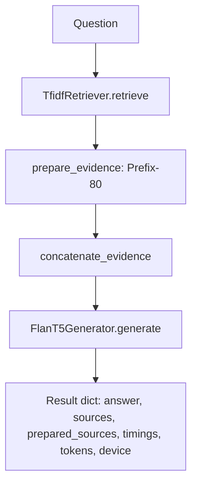

<details>
<summary>✅ Check yourself</summary>

1. *Why did the K = 5 full-passage prompt fail the budget?* — Five ~133-token passages plus instructions and the question came to 725 tokens, more than 512.
2. *What is the difference between allocated and reserved GPU memory?* — Allocated is used by live tensors; reserved also includes cached blocks PyTorch keeps for reuse.
3. *Why use greedy decoding for an experiment?* — It is deterministic, so differences between configurations are caused by the configuration, not randomness.
4. *What does `max_new_tokens=64` limit?* — Only the generated output length, not the input.

</details>

---

# Part 4 — Evaluation and the Ablation Study (Stage 6)

> **Student:** The system answers Diana Richburg correctly. Isn't it done?
>
> **🧑‍🏫 Mentor:** One correct answer is an anecdote. To make a claim, we need a **fixed question set**,
> **defined metrics**, a **controlled experiment** that changes one thing at a time, and an honest look
> at **every failure**. That is what turns a demo into a study.

## 4.1 Stage 6.1 — Building the evaluation dataset

Twenty factual questions were written from **14 articles** in the indexed corpus. Each answer was
verified against the stored passage text, and each question was linked to one **supporting passage**.
An ambiguous question was corrected before the set was frozen.

| ID | Question | Reference answer | Source article |
|---|---|---|---|
| Q001 | Who is Diana Richburg? | An American former middle-distance runner | Diana Richburg |
| Q002 | Which Olympic Games did Diana Richburg compete in? | 1984 Los Angeles Olympics | Diana Richburg |
| Q003 | Which US national title did Diana Richburg win…? | 1500 metres | Diana Richburg |
| Q004 | In which city was Mir Basri born? | Baghdad | Mir Basri |
| Q005 | Who coached the 1993–94 Michigan Wolverines basketball team? | Steve Fisher | 1993–94 Michigan Wolverines men's basketball team |
| Q006 | Who was the captain of the 1954 Harvard Crimson football team? | J. Timothy Anderson | 1954 Harvard Crimson football team |
| Q007 | What numbered Chinese Super League season was…? | 15th | 2018 Shanghai Greenland Shenhua F.C. season |
| Q008 | In which month and year was Kavbiuro established? | April 1920 | Kavbiuro |
| Q009 | What was B. Reith's first full-length album? | Now Is Not Forever | B. Reith |
| Q010 | In which Indian state is Gir National Park located? | Gujarat | Gir National Park |
| Q011 | What architectural style is Puerto Princesa Cathedral? | Neo-Gothic | Puerto Princesa Cathedral |
| Q012 | What was the role of an agonothetes in ancient Greece? | President or superintendent of the sacred Panhellenic Games | Agonothetes |
| Q013 | In what year was FK Tauras founded? | 1922 | FK Tauras Tauragė |
| Q014 | Who portrays Kate Beckett in the television series? | Stana Katic | Kate Beckett |
| Q015 | Who was John Hubley's second wife? | Faith Hubley | John Hubley |
| Q016 | From which university did Anthony J. DeMaria receive…? | University of Connecticut | Anthony J. DeMaria |
| Q017 | In what year was Mir Basri born? | 1911 | Mir Basri |
| Q018 | Where did the 1993–94 Michigan Wolverines basketball team play…? | Crisler Arena | 1993–94 Michigan Wolverines men's basketball team |
| Q019 | Who coached the 1954 Harvard Crimson football team? | Lloyd Jordan | 1954 Harvard Crimson football team |
| Q020 | In which year was Gir National Park established? | 1965 | Gir National Park |

*(Some long questions are abbreviated with "…" as in the notebook preview.)*

Each record has `question_id`, `question`, `reference_answer`, `source_article` and
`supporting_chunk_id`, saved as `data/evaluation/rag_evaluation_20.csv` and `.json`. Both files were
reloaded and verified.

> 🧑‍🏫 **"The answer exists in the corpus" ≠ "the retriever will find it".** For Q014 the correct
> article was indexed and contains "Stana Katic", yet none of the top-5 retrieved passages contained
> the name. That gap is exactly what evaluation must expose.

**Limitations to state openly:** only 20 questions; several share an article (so they are not
independent); questions were written *from* the corpus, so they say nothing about unseen topics;
some examples were seen during development.

## 4.2 Stage 6.2.1 — Token budgets across all 20 questions

With **full** retrieved passages:

| K | Min | Mean | Max | Fit in 512 | Exceed |
|---|--:|--:|--:|--:|--:|
| 1 | 150 | 191.80 | 232 | 20 | 0 |
| 3 | 357 | 471.85 | 583 | 17 | 3 (Q010, Q013, Q016) |
| 5 | 582 | 748.90 | 932 | 0 | 20 |

So a fair K = 1/3/5 comparison was **impossible** with full passages: at K = 5 every prompt would be
truncated in an uncontrolled way. We need a **controlled** evidence policy.

## 4.3 Stage 6.2.2 — Prefix shortening to 80 tokens

```python
def shorten_passage(text, tokenizer, max_tokens=80):
    """Keep at most max_tokens tokenizer tokens from a passage."""
    token_ids = tokenizer(text, add_special_tokens=False,
                          truncation=False)["input_ids"]
    return tokenizer.decode(token_ids[:max_tokens], skip_special_tokens=True)
```

1. Tokenize **without** special tokens (we only want the passage's own tokens).
2. Keep the first 80 IDs (a **prefix**).
3. Decode back to text.

And in `evidence.py`, metadata stays attached to the shortened text:

```python
def prepare_evidence(passages, tokenizer, max_tokens=80):
    prepared = []
    for passage in passages:
        copy_of_passage = passage.copy()          # shallow copy keeps title, url, score...
        copy_of_passage["text"] = shorten_passage(passage["text"], tokenizer, max_tokens)
        prepared.append(copy_of_passage)
    return prepared
```

**Properties of prefix shortening:** simple, deterministic, cheap, and it never needs the answer.
**Weakness:** anything after token 80 is lost, and the cut can even fall in the middle of a word.

### Reduction ratio

\[
\text{Reduction}=\frac{n_{\text{original}}-n_{\text{prepared}}}{n_{\text{original}}}\times100\%
\]

For one observed passage: \(\frac{132-80}{132}\times100\%\approx39.39\%\).

> 🧑‍🏫 Elsewhere we measured a 100-word passage as **133** tokens. The likely difference is the
> end-of-sequence token `</s>`: counting with `add_special_tokens=True` adds 1. Always state *how* you counted.

### Three different budgets — do not mix them up

| Budget | Value | What it limits |
|---|--:|---|
| Evidence per passage | 80 tokens | Each shortened passage |
| Total generator input | 512 tokens | Instruction + all evidence + question |
| New output tokens | 64 tokens | The generated answer |

With Prefix-80 the mean concatenation prompt was ≈125 (K=1), ≈283 (K=3) and ≈437 (K=5) tokens, all
within 512. Note K = 5 is **not** simply \(5\times80=400\): the instruction, question and separators also cost tokens.

## 4.4 Stage 6.2.3–6.2.4 — Did shortening lose answers? The John Hubley case

**Evidence retention** checks whether the normalized reference answer is still present after preparation:

| Evidence | Questions whose reference text is present |
|---|--:|
| Original retrieved passages | 19 / 20 |
| After Prefix-80 | 18 / 20 |

Exactly one answer was lost by shortening, and it was the same one at every K: **Q015, John Hubley.**

```text
Question : Who was John Hubley's second wife?        Reference: Faith Hubley
Original passage: 100 words = 143 tokens
"Faith Hubley" starts after token 112                 → beyond the 80-token cut
```

The original passage ends: *"…He and his second wife, **Faith Hubley** (née Chestman), who he worked
alongside from 1953 onward, were nominated for seven Academy Awards, winning three."* The shortened
passage stops at *"…Hubley pushed"*.

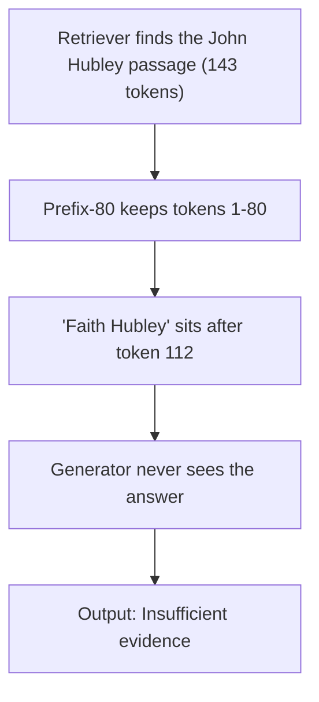

This is an **evidence-preparation failure**, not a retrieval failure and not a generation failure.
Given what it received, the model's abstention was actually *reasonable*.

## 4.5 Stage 6.2.5–6.2.6 — Query-aware sentence selection (a good idea that lost)

**Idea:** instead of keeping the first 80 tokens, split the passage into sentences, score each sentence
against the question with TF-IDF cosine, and keep the best ones that fit in 80 tokens.

```python
def select_relevant_sentences(question, passage_text, vectorizer, tokenizer, max_tokens=80):
    sentences = [s.strip() for s in re.split(r"(?<=[.!?])\s+", passage_text) if s.strip()]
    if not sentences:
        return ""
    scores = cosine_similarity(vectorizer.transform([question]),
                               vectorizer.transform(sentences)).ravel()
    ranked = np.argsort(-scores, kind="stable")

    selected, used = [], 0
    for idx in ranked:                                     # greedy knapsack by relevance
        n = len(tokenizer(sentences[idx], add_special_tokens=False)["input_ids"])
        sep = 1 if selected else 0
        if used + n + sep <= max_tokens:
            selected.append(int(idx)); used += n + sep
    if not selected:                                       # fallback: truncate the best sentence
        best = tokenizer(sentences[ranked[0]], add_special_tokens=False)["input_ids"]
        return tokenizer.decode(best[:max_tokens], skip_special_tokens=True)

    selected.sort()                                        # restore reading order
    return " ".join(sentences[i] for i in selected)
```

Note the regular expression `(?<=[.!?])\s+`: a **look-behind** that splits on whitespace that follows
`.`, `!` or `?`, keeping the punctuation with its sentence. Reference answers are **never** used for
selection, so nothing leaks from the evaluation labels.

**On Hubley it worked beautifully:** it kept *"He and his second wife, Faith Hubley…"* using just **48 tokens**.

**On all 20 questions it lost:**

| Strategy | Reference text retained |
|---|--:|
| Original passages | 19 / 20 |
| Prefix-80 | **18 / 20** |
| Query-aware selection | 13 / 20 |

It rescued Q015 but lost Q002, Q005, Q011, Q016, Q019 and Q020. **Why?** Sentence relevance was
measured by *word overlap with the question*, but the answer sentence often does not repeat the
question's words. Opening sentences of Wikipedia passages tend to carry core facts, which is why the
"dumb" prefix was strong.

> **Decision:** keep Prefix-80 as the controlled baseline. *Selecting the most question-like sentence is not the same as selecting the answer-bearing sentence.*

## 4.6 Stage 6.3–6.4 — The two fusion methods

**Fusion** = how evidence from \(K\) passages is combined into one final answer.

### Method A — Concatenation (1 call per question)

\[
E_K=p_1\oplus p_2\oplus\cdots\oplus p_K,\qquad \hat a_{\text{concat}}=G(q,E_K)
\]

### Method B — Generate-from-evidence (\(K+1\) calls per question)

\[
a_i=G(q,p_i)\quad(i=1,\ldots,K),\qquad \hat a_{\text{fusion}}=G(q,\;a_1\oplus a_2\oplus\cdots\oplus a_K)
\]

\[
N_{\text{calls}}=K+1
\]

- \(p_i\): prepared passage \(i\); \(a_i\): candidate answer from passage \(i\); \(\oplus\): concatenation.

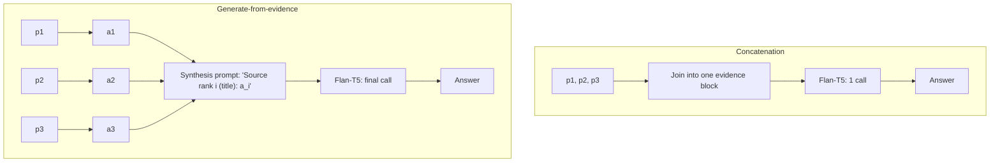

The synthesis evidence looked like:

```text
Source rank 1 (Diana Richburg): middle-distance runner
Source rank 2 (Diana Richburg): Insufficient evidence
Source rank 3 (Diana Baciu): Moldovan chess player
```

### Single-question experiments ("Who is Diana Richburg?")

| K | Concatenation | Generate-from-evidence | GfE calls |
|---|---|---|--:|
| 1 | middle-distance runner ✅ | middle-distance runner ✅ | 2 |
| 3 | **Moldovan chess player** ❌ | **Insufficient evidence** ❌ | 4 |
| 5 | **a Moldovan chess player** ❌ | middle-distance runner ✅ | 6 |

What we learned:

- **Evidence contamination:** the Diana Baciu passage, though ranked only 3rd, hijacked concatenation.
  The prompt gave the model no ranking information, and the small model latched onto the wrong person.
- **Fusion-stage errors:** at K = 3 the correct candidate *existed* (rank 1), yet synthesis threw it away.
- **Non-monotonic behaviour:** generate-from-evidence failed at K = 3 but recovered at K = 5.
  More evidence does not change quality in a straight line.

### The "Rank 1" surprise (Stage 6.4.8)

A **source-aware** synthesis prompt told the model to prefer higher-ranked sources. It answered…
**"Rank 1"**. It identified the right candidate but returned its *label* instead of its *content*.

> **Lesson:** prompt engineering alone did not fix synthesis. A sturdier design would separate
> *candidate selection* (pick a rank) from *answer extraction* (copy that candidate's text). To keep the
> comparison fair, the original fusion prompts were **frozen** for the main evaluation.

## 4.7 Stage 6.5.1–6.5.5 — Defining the metrics in code

### Answer normalization

```python
def normalize_answer(text):
    text = str(text).lower()
    text = "".join(" " if ch in string.punctuation else ch for ch in text)  # punctuation → space
    text = re.sub(r"\b(a|an|the)\b", " ", text)                             # drop articles
    return " ".join(text.split())                                           # collapse spaces
```

### Exact Match

\[
EM(\hat y,y)=\begin{cases}1 & \text{if normalize}(\hat y)=\text{normalize}(y)\\ 0 & \text{otherwise}\end{cases}
\]

### Token precision, recall and F1

Let \(m\) be the number of overlapping tokens (counting repeats, via multiset intersection), \(p\) the
number of predicted tokens and \(r\) the number of reference tokens:

\[
P=\frac{m}{p},\qquad R=\frac{m}{r},\qquad F_1=\frac{2PR}{P+R}=\frac{2m}{p+r}
\]

```python
from collections import Counter

def token_f1_score(prediction, reference):
    pred = normalize_answer(prediction).split()
    ref  = normalize_answer(reference).split()
    if not pred or not ref:
        return float(pred == ref)
    common = sum((Counter(pred) & Counter(ref)).values())   # & = element-wise minimum of counts
    if common == 0:
        return 0.0
    precision, recall = common / len(pred), common / len(ref)
    return 2 * precision * recall / (precision + recall)
```

### 🧑‍🏫 Four worked examples (all verified against the project)

**(a) Q001.** Reference "An American former middle-distance runner" → `american former middle distance runner` (5 tokens).
Prediction "middle-distance runner" → `middle distance runner` (3 tokens). \(m=3\).

\[
P=\tfrac33=1,\quad R=\tfrac35=0.6,\quad F_1=\frac{2\cdot3}{3+5}=0.75,\quad EM=0
\]

> ⚠️ **Correction.** The project handbook computes this by hand as \(F_1=6/7\approx0.857\), treating
> "middle-distance" as **one** token, and then says the code "counted the overlap differently". The
> real reason is the normalizer: it **replaces the hyphen with a space**, so "middle-distance" becomes
> **two** tokens. With 5 reference and 3 predicted tokens, \(F_1=0.75\) exactly. That is the recorded
> value, and it is also the code's own unit test. The general lesson stands: the implementation, not a
> hand rule, defines the metric.

**(b) Q008.** "8 April" vs "April 1920": \(m=1,\ p=2,\ r=2\Rightarrow F_1=\frac{2}{4}=0.5\). Partly right, partly missing.

**(c) Q012.** Reference → `president or superintendent of sacred panhellenic games` (7 tokens).
Prediction "president or superintendent of one of the sacred Panhellenic Games" → 9 tokens
(*of* appears twice, *the* removed). `Counter &` keeps *of* only **once**, so \(m=7\):

\[
P=\tfrac79,\quad R=\tfrac77=1,\quad F_1=\frac{2\cdot7}{9+7}=0.875
\]

**(d) Toy example.** Reference `[red, fast, car]`, prediction `[fast, car]`: \(P=1,\ R=\tfrac23,\ F_1=0.8,\ EM=0\).

### Retrieval and evidence metrics

```python
def retrieval_hit_at_k(retrieved_passages, expected_article):
    return int(any(p["title"] == expected_article for p in retrieved_passages))

def evidence_support_at_k(retrieved_passages, reference_answer):
    reference = normalize_answer(reference_answer)
    if not reference:
        return 0
    for p in retrieved_passages:
        if f" {reference} " in f" {normalize_answer(p['text'])} ":   # whole-phrase match
            return 1
    return 0
```

The spaces around both strings ensure "1922" does not match inside "19225". Evidence Support@K is a
**lexical proxy**: it checks that the words are present, not that the passage *logically entails* the answer.

| Metric | Question it answers |
|---|---|
| Exact Match | Is the answer string identical after normalization? |
| Token F1 | How much word overlap is there? |
| Hit@K | Did any top-K passage come from the expected article? |
| Evidence Support@K | Does any top-K passage contain the reference text? (original *and* prepared) |
| Abstention rate | How often did the model say "Insufficient evidence"? |
| Time, tokens, model calls | What did it cost? |

> These metrics answer **different questions**. Never merge them into one unexplained "accuracy".

## 4.8 Stage 6.5.6–6.5.10 — Pilot run and a checkpointed runner

**Pilot first.** Two diagnostic questions × 2 methods × K∈{1,3} = 8 evaluations, 16 model calls. It
surfaced, in miniature, every phenomenon of the full study:

- Q001 concatenation: correct at K = 1, wrong at K = 3 (contamination).
- Q001 generate-from-evidence at K = 1 returned **"ranked 1"** (synthesis failure).
- Q014 at K = 1: both methods correctly said "Insufficient evidence"; at K = 3 both **hallucinated "Ryan"**,
  a name from an unrelated passage. *More context made a safe abstention into a confident wrong answer.*

**Then the full run, made restartable.** 120 evaluations is long enough to be interrupted, so results
were appended one per line to a JSONL file and each run skipped what was already done:

```python
completed_keys = set()
for line in open(FULL_RESULTS_PATH, encoding="utf-8"):
    if line.strip():
        record = json.loads(line)
        key = (record["question_id"], int(record["k"]), record["method"])
        if key in completed_keys:
            raise ValueError(f"Duplicate checkpoint key: {key}")
        completed_keys.add(key)

pending = [e for e in evaluation_plan
           if (e["question_id"], int(e["k"]), e["method"]) not in completed_keys]
batch = pending[:18]                 # process in batches of 18
```

🧑‍🏫 The tuple `(question_id, k, method)` is a **composite key** that uniquely identifies one
experiment. Using a `set` makes "already done?" an \(O(1)\) lookup. This is the same **idempotent,
resumable** pattern later used to build the ChromaDB index (Part 10.7).

\[
20\ \text{questions}\times3\ \text{K values}\times2\ \text{methods}=120\ \text{evaluations}
\]

\[
\text{calls}=\underbrace{20\times3}_{\text{concat}=60}+\underbrace{20\times(2+4+6)}_{\text{GfE}=240}=300
\]

## 4.9 Stage 6.6.1 — Results

### Accuracy by configuration

| Fusion | K | EM | Token F1 | Abstention |
|---|--:|--:|--:|--:|
| **Concatenation** | **1** | **75%** | **85.62%** | 10% |
| Concatenation | 3 | 70% | 78.88% | 5% |
| Concatenation | 5 | 65% | 73.88% | 0% |
| Generate-from-evidence | 1 | 50% | 57.54% | 20% |
| Generate-from-evidence | 3 | 35% | 43.66% | 25% |
| Generate-from-evidence | 5 | 20% | 24.38% | 15% |

### Cost by configuration

| Fusion | K | Mean retrieval (s) | Mean generation (s) | Mean input tokens | Calls (20 Q) |
|---|--:|--:|--:|--:|--:|
| Concat | 1 | 0.0057 | 0.0722 | 125.10 | 20 |
| Concat | 3 | 0.0052 | 0.0570 | 282.55 | 20 |
| Concat | 5 | 0.0052 | 0.0564 | 436.90 | 20 |
| GfE | 1 | 0.0055 | 0.1052 | 188.30 | 40 |
| GfE | 3 | 0.0053 | 0.2003 | 471.20 | 80 |
| GfE | 5 | 0.0054 | 0.2931 | 751.00 | 120 |

### Overall method comparison (60 evaluations each)

| Metric | Concatenation | Generate-from-evidence |
|---|--:|--:|
| Mean EM | 70% | 35% |
| Mean Token F1 | 79.46% | 41.86% |
| Mean generation time | 0.0618 s | 0.1995 s (≈ 3.23× slower) |
| Total model calls | 60 | 240 |
| Total input tokens | 16,891 | 28,210 |

\[
\frac{0.1995}{0.0618}\approx3.23
\]

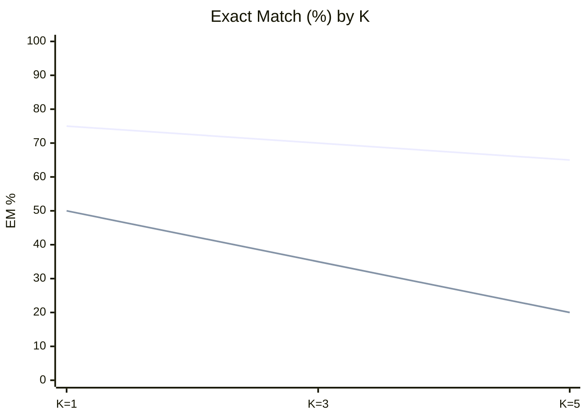

*(Upper line: concatenation. Lower line: generate-from-evidence. The `xychart-beta` block needs a recent Mermaid renderer.)*

**Interpreting the results:**

1. **Concatenation won at every K**, with a quarter of the model calls.
2. **EM fell as K grew, for both methods.** Extra passages added distractors more often than useful facts.
3. **Abstention behaves interestingly:** concatenation abstained *less* as K grew (10% → 0%). More text
   gave the model more material to *guess* from, which is not the same as more material to be *right* from.
4. Concatenation generation time did not rise with K (0.072 → 0.056 s). That is measurement noise and
   warm-up, not evidence that longer prompts are faster. These are not service-level latency guarantees.

> ⚠️ These are **descriptive** results on 20 curated questions. They are not statistically significant
> and do not prove concatenation is always better; they describe *this* model, corpus, prompts and question set.

## 4.10 Retrieval success vs evidence availability

| Metric | Value | Meaning |
|---|--:|---|
| Article Hit@K | 100% | The expected article was always somewhere in the top K |
| Reference text in original passages | 90% | The answer words were actually in the retrieved text |
| Reference text after shortening | 85% | …and survived Prefix-80 |

Rates were identical at K = 1, 3, 5: extra passages never added a new answer-bearing passage for these questions.

> ⚠️ **Small inconsistency between sources.** The evidence-selection study (Part 4.4) counted 19/20 and
> 18/20, while the final evaluation reports 90% (18/20) and 85% (17/20). The two analyses used slightly
> different matching code: the final evaluation uses the stricter whole-phrase `evidence_support_at_k`.
> For example, Q012's correct answer has no verbatim match in its passage. Quote whichever figure you
> use *together with its method*.

**100% Hit@K is not a perfect retriever.** For Q014 (Kate Beckett) the right article was retrieved,
but only passages that never mention the actress.

## 4.11 Stage 6.6.2–6.6.4 — Failure analysis of the best configuration

Concatenation, K = 1: **15/20 exact matches**, mean F1 0.8562, 2 abstentions. The five non-exact answers:

| ID | Answer | Reference | F1 | Orig. support | Prep. support | Verdict |
|---|---|---|--:|:-:|:-:|---|
| Q001 | middle-distance runner | An American former middle-distance runner | 0.750 | 1 | 1 | Factually correct, shorter |
| Q008 | 8 April | April 1920 | 0.500 | 1 | 1 | Incomplete (year missing) |
| Q012 | president or superintendent of one of the sacred Panhellenic Games | President or superintendent of the sacred Panhellenic Games | 0.875 | 0 | 0 | Factually correct paraphrase |
| Q014 | Insufficient evidence | Stana Katic | 0 | 0 | 0 | Appropriate abstention (retrieval gap) |
| Q015 | Insufficient evidence | Faith Hubley | 0 | 1 | 0 | Appropriate abstention (shortening gap) |

**Manual assessment:**

\[
\text{Factual correctness}=\frac{15\ \text{exact}+2\ \text{correct paraphrases}}{20}=\frac{17}{20}=85\%
\]

Exact Match stays **75%**. Appropriate abstentions are **not** counted as correct answers. Both numbers
are reported, with the 85% labelled as a preliminary human judgement.

> 🧑‍🏫 Notice how the metrics disagree. EM punished two correct answers (Q001, Q012). Token F1 gave
> **0.5** partial credit to Q008, which is wrong for a "month and year" question. Lexical support said
> Q012 had no evidence, yet the model answered it correctly. **No single metric is the truth.**

## 4.12 Where can a RAG answer go wrong? A diagnostic map

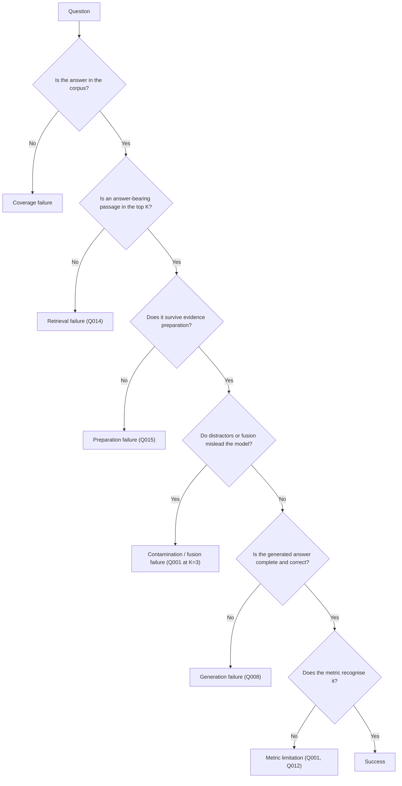

### Debugging sequence for a wrong answer

1. Check the question and the chosen K.
2. Inspect `sources`: did retrieval find the right title and chunk?
3. Read the original passage text: was the answer actually there?
4. Compare with `prepared_sources`: did shortening remove it?
5. Look at the fused context: did unrelated passages sneak in?
6. Judge the output on **both** EM/F1 and real factual correctness.
7. Add the case to a regression set **before** changing any code.

## 4.13 Why not just "fix" K = 3 now?

Changing chunking, prompts or reranking **after** seeing test results and then re-reporting the same
test set produces optimistic numbers. This is **test-set overfitting**, a threat to validity. Fixes
belong on a **new or held-out** question set, with versioned settings. The academic baseline was
therefore frozen, and improvements were moved to Track C.

<details>
<summary>✅ Check yourself</summary>

1. *Why was Prefix-80 chosen over query-aware selection?* — It kept 18/20 answers versus 13/20.
2. *How many model calls does generate-from-evidence use for 20 questions at K = 3?* — \(20\times(3+1)=80\).
3. *Compute F1 for prediction "Crisler Arena in Ann Arbor, Michigan" vs reference "Crisler Arena".* — 6 predicted tokens, 2 reference, 2 overlap: \(P=1/3,\ R=1,\ F_1=0.5\), EM = 0.
4. *Why is Hit@K = 100% compatible with 75% EM?* — Finding the right article is easier than finding the answer-bearing passage, keeping it after shortening, and generating it exactly.
5. *Is an "Insufficient evidence" answer good or bad?* — It is safe when evidence is truly missing (Q014, Q015), but it still is not a correct answer.

</details>

---

# Part 5 — Packaging, Offline Execution and Reproducibility (Stages 7–9)

> **Student:** It works in my notebook. Isn't that enough?
>
> **🧑‍🏫 Mentor:** A notebook works on *your* machine, *today*, with *your* cache. A deliverable must
> run from a clean start, from configuration, without the internet, and give the same numbers.

## 5.1 Stage 7 — From notebook to application

### Configuration over hard-coding

All experiment settings live in `config/rag_config.json`, grouped into four required sections:
`data`, `retrieval`, `evidence`, `generator`.

```json
{
  "data":      { "passage_directory": "data/wiki_chunks_100w_20overlap",
                 "index_directory": "data/tfidf_index", "num_passages": 8191 },
  "retrieval": { "method": "tfidf", "top_k": 1 },
  "evidence":  { "max_tokens_per_passage": 80, "fusion_method": "concatenation" },
  "generator": { "model_name": "google/flan-t5-small", "local_model_path": "models/flan-t5-small",
                 "max_input_tokens": 512, "max_new_tokens": 64 }
}
```

*(Key names are illustrative of the structure; the values are the project's final configuration.)*

`load_config(config_path=CONFIG_PATH)` loads the file and checks that every section exists;
`initialize_rag(config)` builds the retriever, generator and pipeline from it.

| | Configuration file | `.env` / environment variables |
|---|---|---|
| Holds | Versioned, non-secret experiment settings | Machine-specific overrides and **secrets** |
| Committed to git? | Yes | Never (for secrets) |

> ⚠️ Never put API keys in a committed JSON file or README.

### The command-line application

```powershell
python src/run_rag.py --question "Who is Diana Richburg?"
```

```text
Question: Who is Diana Richburg?
Answer: middle-distance runner

Article: Diana Richburg
Similarity: 0.3932
Device: cuda
```

It loads the saved passages and index (no re-fitting), builds the generator once, answers, and prints
sources plus timing and token counts.

## 5.2 Stage 9.7 — Truly offline: model weights are files too

> **Student:** The code says `"google/flan-t5-small"`. Isn't the model inside the project?
>
> **🧑‍🏫 Mentor:** No. That string is just a *name*. The **weights** (77 million learned numbers) are
> downloaded the first time and stored in the Hugging Face cache. On a new offline machine, that name leads nowhere.

The fix was to **export the model locally** (≈ 296 MB: `config.json`, `generation_config.json`,
`model.safetensors`, `tokenizer.json`, `tokenizer_config.json`, …) into `models/flan-t5-small`, and to
extend the generator **backward-compatibly**:

```python
# illustrative logic inside FlanT5Generator.__init__
if local_model_path and Path(local_model_path).is_dir():
    source = local_model_path                 # 1. prefer local files
else:
    source = model_name                       # 2. fall back to the original Hub name
tokenizer = AutoTokenizer.from_pretrained(source)
model = AutoModelForSeq2SeqLM.from_pretrained(source)
```

Both paths were tested. With the local folder removed, the generator printed
`Using local model: False … Hugging Face fallback: PASSED`.

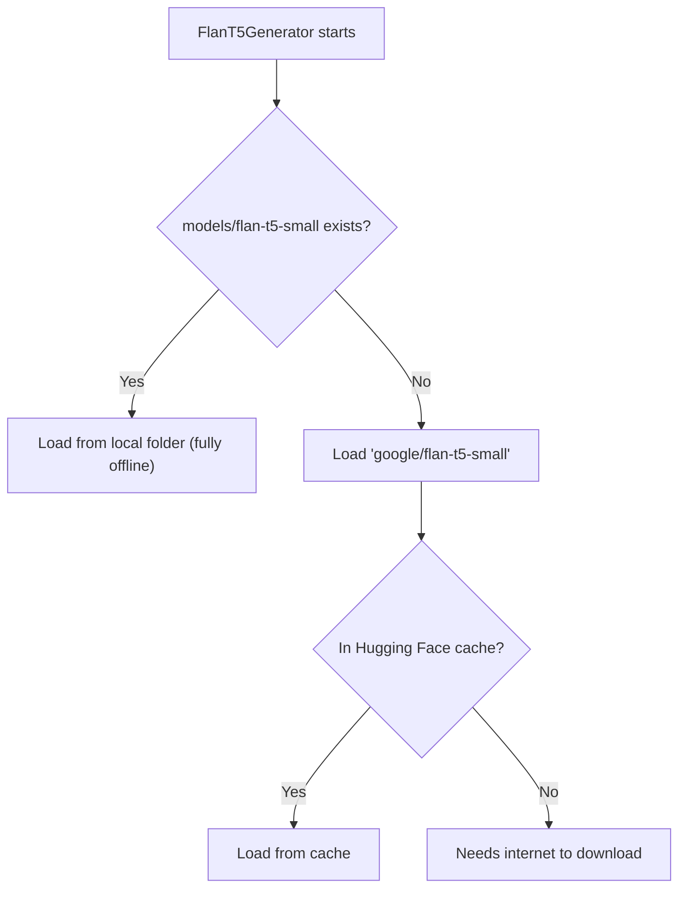

### Forcing offline mode for testing

```powershell
$env:HF_HUB_OFFLINE = "1"
$env:HF_DATASETS_OFFLINE = "1"
$env:TRANSFORMERS_OFFLINE = "1"
python src/run_rag.py --question "Who is Diana Richburg?"
```

```bash
export HF_HUB_OFFLINE=1 HF_DATASETS_OFFLINE=1 TRANSFORMERS_OFFLINE=1
```

These flags **prevent** network calls; they cannot **create** missing files.

> ⚠️ **An honest caveat from the notes.** The first 5.07 MB submission ZIP contained code, index and
> evaluation data but **not** the model weights. A brand-new offline machine could not have started
> Flan-T5. The later portable package fixed that by bundling the exported model.

## 5.3 Portability: one environment does not fit all machines

`torch==2.10.0+cu128` is a **Windows/Linux CUDA 12.8 build**. It is not a universal requirement. The
project therefore split dependencies:

1. Install the right PyTorch for your OS and hardware from the official selector (CPU, CUDA, or Apple).
2. Then `python -m pip install -r requirements-portable.txt` for everything else.

```bash
python -m venv .venv
source .venv/bin/activate                      # Windows: .\.venv\Scripts\Activate.ps1
python -c "import torch; print(torch.__version__)"
python -c "import transformers; print(transformers.__version__)"
```

Linux, macOS and CPU-only runs are *expected* to work but were **not independently tested**. Identical
latency is not guaranteed on other hardware.

## 5.4 Stages 8–9 — Audits before submission

Before submission the project ran **audits**, small programs that check the project itself:

- **Documentation consistency:** README numbers match the result CSVs.
- **File audit:** every required source, data, index and result file exists.
- **Notebook integrity:** flagged cells inspected; a clean submission notebook was prepared.
- **Module verification:** every `src/rag/*.py` file parses (`ast`) and imports.
- **Artifact integrity:** passages, index and evaluation files reload with the expected shapes.

## 5.5 Reproducibility checklist

1. Record Python, library versions, OS and GPU (Part 2.2).
2. Save the sampled corpus **and its passage order**.
3. Save the fitted vectorizer, matrix and metadata.
4. Save the generator files locally, or document the download.
5. Keep every experimental setting in configuration.
6. Preserve the evaluation questions **and** full per-question results (not just averages).
7. Run a known CLI question after moving the project.
8. Record whether the run used local files, cache or online fallback.

> **Is this production-ready?** No. It is a verified academic prototype. Production concerns (API,
> concurrency, logging, tests, security) are the subject of Track C, Parts 9–16.

---

# Part 6 — The Streamlit Visualization App

> **Student:** Why build a second project just for the UI?
>
> **🧑‍🏫 Mentor:** Separation of concerns. The engine should not know about buttons, and the UI should
> not re-implement retrieval. The UI *imports* the engine and focuses on showing what happened.

## 6.1 What the app offers

| Page | File | What you can do |
|---|---|---|
| **Ask Wikipedia** | `app.py` | Ask a question, choose K = 1/3/5, see the answer, original vs shortened evidence, token budgets, sources, timings and CPU/GPU device |
| **Evaluation Dashboard** | `pages/1_Evaluation_Dashboard.py` | Compare EM, F1, time, input tokens and model calls; inspect manually reviewed failures |
| **Knowledge Base Explorer** | `pages/2_Knowledge_Base_Explorer.py` | Search indexed titles, preview passages, browse the 20 evaluation questions and send one to the Ask page |

## 6.2 Architecture: in-process, not HTTP

```text
code/
├── Mid-Sem-Project-RAG/        ← engine (must be a sibling folder with this exact name)
└── Mid-Sem-Project-RAG-UI/
    ├── app.py
    ├── pages/1_Evaluation_Dashboard.py, 2_Knowledge_Base_Explorer.py
    ├── services/rag_service.py         ← imports the engine
    ├── services/evaluation_service.py  ← reads saved CSVs
    └── assets/architecture/*.drawio, *.png
```

`rag_service.py` provides `inspect_rag_project()`, `get_rag_application_module()` and
`load_rag_pipeline()`. It adds the engine's `src` directory to `sys.path`, imports `run_rag`, calls
`load_config()` and `initialize_rag(config)`.

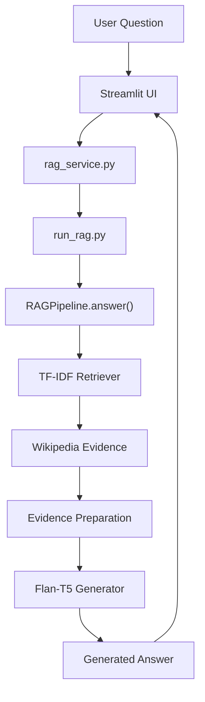

**There is no HTTP server between them**: one Python process imports the other's code. That is
simple and fast, but it couples the two: move the UI folder and the import breaks. Track C's FastAPI
service (Part 9) is the decoupled alternative.

## 6.3 End-to-end question flow in the UI

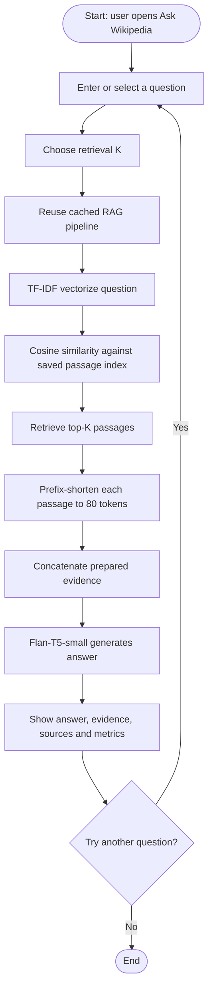

## 6.4 Two kinds of Streamlit state

Streamlit **re-runs the whole script** every time a widget changes. Without care, Flan-T5 would reload on every click.

**Shared, expensive resources → `st.cache_resource`**

```python
@st.cache_resource(show_spinner="Loading Wikipedia RAG pipeline...")
def get_cached_rag_pipeline():
    return load_rag_pipeline()
```

The pipeline is built once per server process and reused by every rerun and every browser session.

**Per-user values → `st.session_state`**

The Explorer stores a chosen question in `st.session_state["rag_question"]` and switches to `app.py`,
where `st.text_input(key="rag_question")` shows it. Session state belongs to **one browser session**.

| | `st.cache_resource` | `st.session_state` |
|---|---|---|
| Scope | Whole server process (shared) | One browser session |
| Holds | The pipeline: model + index | The current question, results |
| Risk at scale | Shared mutable state, thread safety, memory | Lost when the session ends |

## 6.5 Dashboard and Explorer

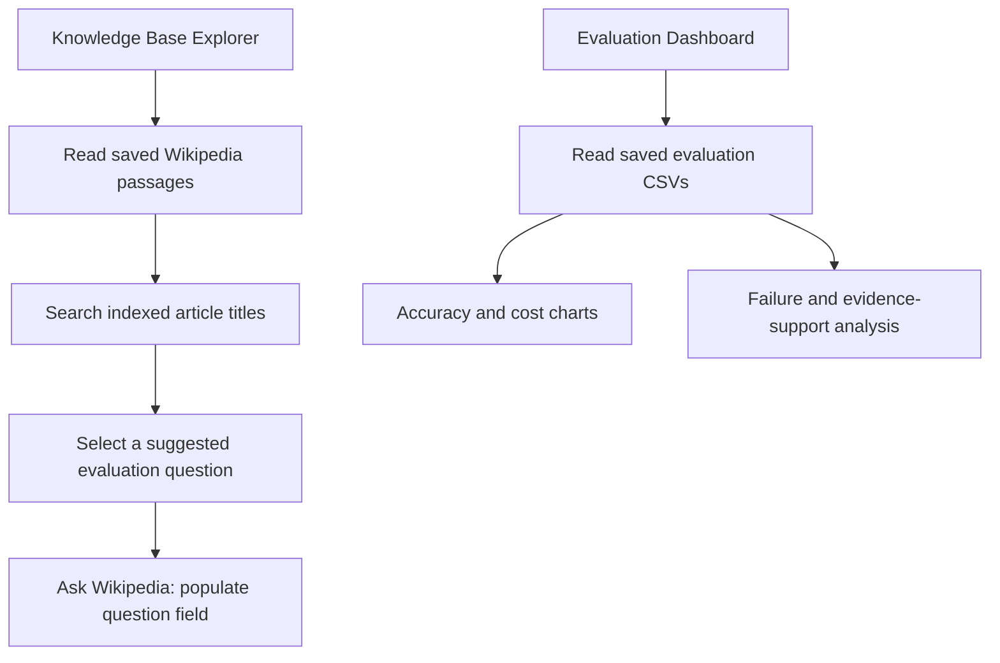

- The **dashboard does not re-run** the 120 evaluations. `evaluation_service.py` reads the saved CSVs,
  validates their columns and coverage, and plots them. *Computation and presentation are separate.*
- The **explorer** searches **title substrings**, not meaning. It is not semantic search.

## 6.6 Guided demonstration

1. **Grounded success:** "Who is Diana Richburg?", K = 1 → *middle-distance runner*.
2. **Distractor interference:** the same question, K = 3 → *Moldovan chess player*.
3. **Shortening failure:** "Who was John Hubley's second wife?" → *Insufficient evidence*.

## 6.7 Running and troubleshooting

```bash
python -m streamlit run app.py          # open the Local URL it prints (usually :8501)
```

| Symptom | Check |
|---|---|
| `localhost refused to connect` | Is the Streamlit terminal still running? Use the port it printed |
| UI cannot find the engine | Both folders must be siblings with the exact expected names |
| Model fails to load | Local model folder, offline flags, cache |
| Dashboard empty | `results/evaluation/*.csv` in the engine project |
| CUDA unavailable | PyTorch build and driver; CPU still works |
| Import error | Activate the right environment; `python -m pip check` |

<details>
<summary>✅ Check yourself</summary>

1. *Why does Streamlit need `st.cache_resource` for the pipeline?* — Every interaction re-runs the script; without caching, the model and index would reload each time.
2. *Is there a REST API in the academic UI?* — No; it imports the engine in-process.
3. *Why read saved CSVs in the dashboard instead of recomputing?* — The evaluation is expensive and must stay fixed for reproducibility.

</details>

---

# Part 7 — Python Concepts You Will Meet

This part collects the Python ideas used across all stages. Return here whenever code looks unfamiliar.

## 7.1 Modules and packages

- **Module:** one `.py` file of reusable code.
- **Package:** a folder of modules under a common name, usually marked by `__init__.py`.

The Engineering project created eight packages:

```text
api/__init__.py
adapters/__init__.py
retrieval/__init__.py
observability/__init__.py
evaluation/__init__.py
performance/__init__.py
security/__init__.py
tests/__init__.py
```

Modern Python allows "namespace packages" without `__init__.py`, but explicit files keep things predictable.

**Separation of concerns:** each package has one clear responsibility. Folders alone do not create
quality; good interfaces and tests do.

## 7.2 `sys.path`, `pathlib` and `importlib`

Python searches the directories in `sys.path` when you `import` something. To import code from
another project without copying it:

```python
# illustrative
import sys
import importlib
from pathlib import Path

ENGINEERING_ROOT = Path(__file__).resolve().parents[1]
ORIGINAL_RAG_ROOT = ENGINEERING_ROOT.parent / "Mid-Sem-Project-RAG"
SRC_DIR = ORIGINAL_RAG_ROOT / "src"

if str(SRC_DIR) not in sys.path:
    sys.path.insert(0, str(SRC_DIR))

run_rag = importlib.import_module("run_rag")   # import by name at runtime
```

- `pathlib.Path` builds paths safely across Windows/Linux (`/` joins path parts).
- `importlib.import_module` imports a module whose name is known only at runtime.

## 7.3 Caching with `functools.lru_cache`

```python
from functools import lru_cache

@lru_cache(maxsize=1)
def get_rag_pipeline():
    config = run_rag.load_config(CONFIG_PATH)
    return run_rag.initialize_rag(config)      # expensive: loads index + model
```

The first call computes and stores the result (a **miss**); later calls return the stored object (**hits**).

```text
CacheInfo(hits=1, misses=1, maxsize=1, currsize=1)
```

- **Lazy initialization:** do expensive work only when first needed.
- **Process-local:** each Python process has its own cache.
- **Not concurrency-safe by itself:** two simultaneous first requests could both initialize.

## 7.4 Classes, methods, duck typing and polymorphism

```python
class TfidfRetriever:
    def retrieve(self, question, top_k): ...

class SemanticRetriever:
    def retrieve(self, question, top_k): ...
```

`RAGPipeline` only calls `self.retriever.retrieve(question, top_k)`. It doesn't care which class it
is. "If it walks like a duck and quacks like a duck, it's a duck": **duck typing**. Different classes
used through the same interface is **polymorphism**.

## 7.5 Composition

A pipeline is **composed** of parts:

```python
pipeline = RAGPipeline(retriever=retriever, generator=generator)
```

Swap one part (the retriever) without rewriting the others. This is how we compared TF-IDF and
semantic retrieval with everything else held constant.

## 7.6 The adapter pattern

An **adapter** translates between two interfaces. Our FastAPI code speaks "HTTP request → JSON";
the academic code speaks "Python call → dictionary". The adapter sits in between, so neither side
needs to change.

## 7.7 Shallow copy

```python
copied = original.copy()
```

Creates a new dictionary whose values are references to the same objects. Replacing a top-level
string in `copied` does not affect `original`, but **nested mutable objects** (lists, dicts) would be shared.

## 7.8 The `bool` trap

```python
isinstance(True, int)   # True!  bool is a subclass of int
True == 1               # True
```

So validation code must reject booleans explicitly:

```python
if not isinstance(top_k, int) or isinstance(top_k, bool) or top_k < 1:
    raise ValueError("top_k must be a positive integer.")
```

This exact trap caused a real API bug in C14 (Part 15).

## 7.9 Defensive programming

Validate inputs **before** expensive work (loading models, running GPUs):

```python
if not isinstance(question, str) or not question.strip():
    raise ValueError("Question must be a non-empty string.")
```

## 7.10 Timing with `time.perf_counter()`

```python
import time
start = time.perf_counter()
# ... work ...
elapsed = time.perf_counter() - start
```

A high-resolution, **monotonic** clock (never jumps backwards), ideal for measuring durations.
On a GPU, call `torch.cuda.synchronize()` before reading the clock (Part 3.5).

## 7.11 More Python tools from the academic notebook

| Tool | Example from the project | What to remember |
|---|---|---|
| Iterators and streaming | `next(iter(wiki_stream))`, `wiki_stream.take(100)` | Data is produced lazily, one record at a time; nothing is downloaded up front |
| `set` for fast membership | `seen_ids`, `completed_keys` | `x in some_set` is \(O(1)\) on average; `x in some_list` is \(O(n)\) |
| Tuples as composite keys | `(question_id, k, method)` | Tuples are hashable, so they can live in sets and be dictionary keys |
| `collections.Counter` | Token F1 overlap | `Counter(a) & Counter(b)` keeps the **minimum** count of each element (multiset intersection) |
| `np.argsort` | `np.argsort(-scores, kind="stable")[:k]` | Returns **indices** that would sort the array; negate for descending order |
| `assert` | `assert matrix.shape[0] == len(passages)` | Cheap self-checks that stop the program the moment an assumption breaks |
| Regular expressions | `re.split(r"(?<=[.!?])\s+", text)` | `(?<=...)` is a look-behind: split *after* punctuation without consuming it |
| Context managers | `with torch.inference_mode():`, `with open(...) as f:` | Set something up and guarantee it is undone afterwards |
| JSON Lines (`.jsonl`) | Checkpointed evaluation results | One JSON object per line: easy to append and resume |
| pandas `groupby` / `pivot` | Summary tables, paired comparisons | Aggregate per configuration; align rows by `question_id` |
| Dependency injection | `RAGPipeline(retriever=..., generator=...)` | Pass ready-made parts in; easy reuse and testing |

### 🧑‍🏫 A tiny `Counter` demonstration

```python
from collections import Counter
pred = Counter("president or superintendent of one of sacred panhellenic games".split())
ref  = Counter("president or superintendent of sacred panhellenic games".split())
print(sum((pred & ref).values()))   # 7: "of" counts once, because the reference has it once
```

<details>
<summary>✅ Check yourself</summary>

1. *What does `lru_cache(maxsize=1)` buy us in an API?* — The model loads once per process; later requests reuse it.
2. *Why is `isinstance(x, bool)` checked separately?* — Because booleans pass `isinstance(x, int)`.
3. *What is the difference between composition and inheritance?* — Composition builds objects from parts ("has-a"); inheritance builds them from parent classes ("is-a").
4. *Why is `completed_keys` a set and not a list?* — Membership checks are \(O(1)\) on a set, which matters when checking every planned experiment.

</details>

---

# Part 8 — Environments and Dependency Management

> **Student:** Installing a library is just `pip install`, isn't it?
>
> **🧑‍🏫 Mentor:** That is how you break a working project. Our academic UI, academic engine and
> the new Engineering project all **share one Conda environment, `.cvenv`**. Every install can
> silently upgrade a library someone else relies on.

## 8.1 Vocabulary

| Term | Meaning |
|---|---|
| Dependency | A library your code needs |
| Direct dependency | One you import yourself (FastAPI, ChromaDB) |
| Transitive dependency | Pulled in by another library (protobuf via ChromaDB) |
| Version constraint | Allowed versions, e.g. `protobuf>=3.20.3,<6` |
| Version pinning | Fixing an exact version, e.g. `fastapi==0.162.4` |
| Dependency resolution | Finding versions that satisfy every constraint |
| Backtracking | Resolver trying older versions when a choice fails |
| Dry run | Previewing an install without changing anything |
| Environment snapshot | A record of everything installed before a change |

## 8.2 The safe installation workflow

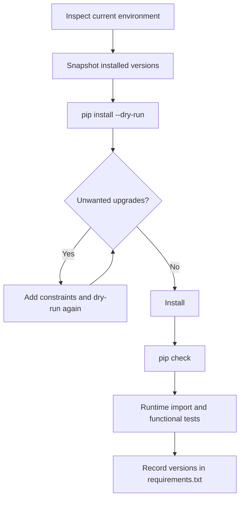

## 8.3 Starting environment (C10.2.3)

Python **3.11.14**, environment **`.cvenv`**.

| Package | Version |
|---|---|
| PyTorch | 2.10.0+cu128 |
| Transformers | 5.21.0 |
| scikit-learn | 1.8.0 |
| Streamlit | 1.66.1 |
| Uvicorn | 0.54.0 |

Not installed: FastAPI, Pydantic, pytest, ChromaDB, sentence-transformers.

## 8.4 Installing FastAPI without collateral damage (C10.2.5 – C10.2.7)

The first dry run proposed upgrading `typing-extensions` from 4.15.0 to 4.16.0 and Pydantic 2.14.3.
We constrained it:

```powershell
python -m pip install --dry-run "fastapi==0.162.4" "typing-extensions==4.15.0"
```

The resolver backtracked to **Pydantic 2.13.5 / pydantic-core 2.46.5**, preserving typing-extensions.
After installing:

```text
FastAPI 0.162.4 | Pydantic 2.13.5 | Uvicorn 0.54.0
pip check → No broken requirements found.
```

## 8.5 Sentence Transformers (C11.3.1 – C11.3.2)

Dry run proposed only **sentence-transformers 6.2.0**, no upgrades. Installed; `pip check` passed.

> 🧑‍🏫 **Library vs model.** Installing `sentence-transformers` installs **code**. The **model
> weights** (MiniLM) are downloaded separately from Hugging Face on first use and cached locally.

## 8.6 The protobuf incident (C11.4.1 – C11.4.4)

1. Constrained dry run for **ChromaDB 1.5.9** preserved Pydantic and typing-extensions. ✅
2. After installation, `pip check` failed: ChromaDB's dependencies (via ONNX Runtime) upgraded
   **protobuf 5.29.3 → 7.36.2**, but **TensorFlow CPU 2.19.1 requires protobuf < 6**. ❌

**The mathematics of compatibility.** Each library constrains a shared dependency. A solution
exists only if the allowed sets intersect:

\[
\text{Compatible versions}=A\cap B
\]

\[
A_{\text{TensorFlow}}=[3.20.3,\ 6),\qquad B_{\text{ONNX Runtime}}=[4.25.8,\ \infty)
\]

\[
A\cap B=[4.25.8,\ 6)\ni 5.29.3
\]

So we reinstalled **protobuf 5.29.3** and **googleapis-common-protos 1.75.0**, and `pip check` passed.

Final verified set:

| Package | Version |
|---|---|
| ChromaDB | 1.5.9 |
| Protobuf | 5.29.3 |
| TensorFlow CPU | 2.19.1 |
| ONNX Runtime | 1.31.1 |
| PyTorch | 2.10.0+cu128 |
| Sentence Transformers | 6.2.0 |
| FastAPI | 0.162.4 |
| Pydantic | 2.13.5 |

> **Lesson:** a successful install ≠ a healthy environment ≠ a working application.
> Verify all three: resolution, `pip check`, runtime tests.

## 8.7 Engineering `requirements.txt` (C11.4.6)

The Engineering project keeps its own requirements file listing direct dependencies plus key
constraints (`protobuf==5.29.3`, `googleapis-common-protos==1.75.0`, `typing-extensions==4.15.0`).

Full reproducibility also needs: Python version, OS, CUDA/GPU details, package sources (CUDA PyTorch
wheels come from a special index), and verification commands.

<details>
<summary>✅ Check yourself</summary>

1. *Does `pip check` prove your app works?* — No; it only checks declared version constraints.
2. *Why did ChromaDB break TensorFlow?* — A transitive dependency (protobuf) was upgraded beyond TensorFlow's allowed range.
3. *When would a separate environment be better?* — When shared constraints become impossible to satisfy together.

</details>

---

# Part 9 — C10: Building an HTTP API with FastAPI

## 9.1 Why an API at all? (C10.1)

The original system used **direct Python calls**: the UI imported the engine. That only works if the
caller is Python code in the same process. An **HTTP API** lets *any* program (a web app, a script, a
mobile app) send a request over the network.

| Aspect | Academic RAG | Track C Engineering |
|---|---|---|
| Interface | Streamlit | FastAPI endpoints |
| Communication | Python calls | HTTP requests |
| Validation | Application logic | Pydantic schemas |
| Deployment | Local Streamlit process | Separate API service |

**Trade-off:** an API does **not** improve accuracy or speed. It adds flexibility but also a server to
run, monitor and secure.

Decision: build a separate project, **`Mid-Sem-Project-RAG-Engineering`**, and leave the academic
projects untouched.

## 9.2 HTTP essentials

| Concept | Meaning |
|---|---|
| Client / server | The caller / the program answering |
| Endpoint | URL path + method, e.g. `POST /answer` |
| GET | Retrieve information |
| POST | Submit data for processing |
| Request body | Data sent by the client (JSON here) |
| JSON | Text format for structured data |
| Header | Key–value metadata on requests/responses |
| 200 OK | Success |
| 401 Unauthorized | Missing/incorrect credentials |
| 404 Not Found | Unknown endpoint |
| 422 Unprocessable Entity | Body failed validation |

**ASGI** is the interface between Python async web apps and servers; **Uvicorn** is the ASGI server
that runs FastAPI.

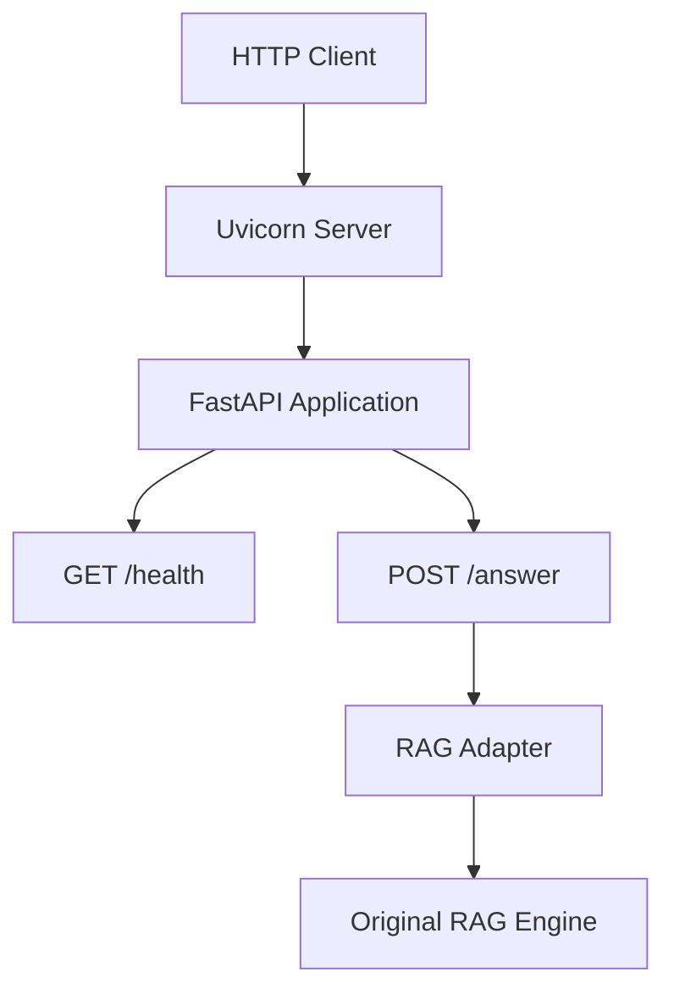

## 9.3 First endpoint: `/health` (C10.3)

```python
from fastapi import FastAPI

app = FastAPI(
    title="Offline Wikipedia RAG Engineering API",
    version="0.1.0"
)

@app.get("/health")
def health_check():
    return {
        "status": "healthy",
        "service": "offline-wikipedia-rag-engineering",
        "version": "0.1.0"
    }
```

Run and test:

```powershell
python -m py_compile .\api\main.py
python -m uvicorn api.main:app --host 127.0.0.1 --port 8000
Invoke-RestMethod -Uri "http://127.0.0.1:8000/health"
```

Interactive docs: `http://127.0.0.1:8000/docs`.

**Health vs readiness:**

- **Health (liveness):** "Is the process alive and answering HTTP?"
- **Readiness:** "Can it actually do its job (model loaded, index available)?"

Our `/health` is liveness only. It does not touch the GPU or model.

Why start here? To separate **web-server problems** from **model problems**.

## 9.4 The adapter (C10.4)

Inspection showed the original loader did:

```python
rag_application = get_rag_application_module()
config = rag_application.load_config()
pipeline = rag_application.initialize_rag(config)
```

`load_config(config_path=CONFIG_PATH)` accepts an explicit path and validates sections `data`,
`retrieval`, `evidence`, `generator`. So the Engineering adapter can point at the original config
without changing working directories.

`adapters/rag_adapter.py` functions:

| Function | Responsibility |
|---|---|
| `inspect_original_rag()` | Check original files exist |
| `get_original_rag_module()` | Import `run_rag` |
| `get_rag_pipeline()` | Initialize and cache (`lru_cache`) |
| `answer_question()` | Run question answering |

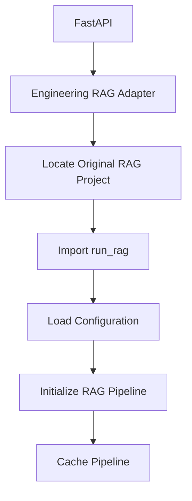

> 🧑‍🏫 **A debugging lesson from C10.2.3/C10.2.4:** a check for `src/pipeline.py` failed, but
> nothing was missing: the file was at `src/rag/pipeline.py`. Always confirm *where* you looked before
> concluding something is absent.

**Verified (C10.4.5):** 8,191 passages, 30,000 TF-IDF features, answer "middle-distance runner" on CUDA.

| Metric | Value |
|---|---|
| Retrieval time | 0.0136 s |
| Generation time | 1.1709 s |
| Total pipeline time | 1.1945 s |
| Input / generated tokens | 119 / 9 |

One run only; not an average.

## 9.5 `POST /answer` with Pydantic validation (C10.5 – C10.6)

```python
# illustrative — see api/main.py for the authoritative version
from pydantic import BaseModel, Field, field_validator

class AnswerRequest(BaseModel):
    question: str = Field(..., min_length=1, max_length=1000)
    top_k: int = 1

    @field_validator("question")
    @classmethod
    def question_not_blank(cls, value: str) -> str:
        if not value.strip():
            raise ValueError("Question must contain non-whitespace text.")
        return value

    @field_validator("top_k")
    @classmethod
    def supported_k(cls, value: int) -> int:
        if value not in (1, 3, 5):
            raise ValueError("top_k must be 1, 3 or 5.")
        return value


@app.post("/answer")
def answer(request: AnswerRequest):
    result = answer_question(request.question, request.top_k)
    return {
        "question": request.question,
        "answer": result["answer"],
        "top_k": request.top_k,
        # retrieval / generation / total times, token counts, device, passage count
    }
```

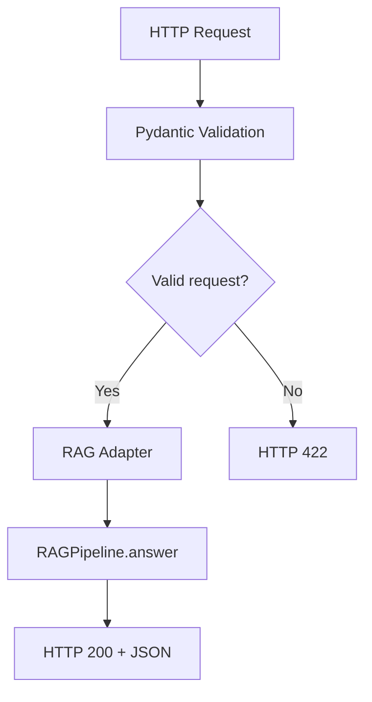

**Results:** answer "middle-distance runner", retrieval 0.0260 s, generation 0.5789 s, total 0.6153 s.

| Invalid input | Expected | Actual |
|---|---|---|
| Empty question | 422 | 422 |
| `top_k = 99` | 422 | 422 |
| Missing question | 422 | 422 |
| Whitespace-only question | 422 | 422 |

> **Pipeline time ≠ round-trip time.** The pipeline timer excludes HTTP parsing, serialization and
> network transfer. The first request is also slower because of lazy model loading.

**Server-side validation is required even if the UI validates**, because any client can bypass the UI.

**PowerShell note:** `-SkipHttpErrorCheck` didn't exist in the installed version; the test script was
rewritten with `try/catch`. A **test-script** problem, not an API bug. Always ask "is the bug in the
system or in my test?"

## 9.6 C10 summary architecture

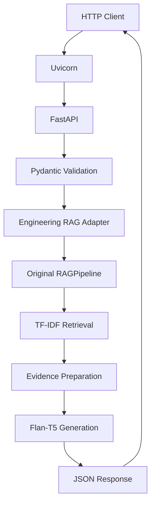

Open items carried forward: concurrency-safe init, structured errors, logging, auth, tests, load testing, readiness checks, deployment docs.

<details>
<summary>✅ Check yourself</summary>

1. *Why can `/health` return "healthy" while answering fails?* — It doesn't check the model or index.
2. *Which status code for a body that fails schema validation?* — 422.
3. *Why is the first `/answer` call slow?* — Lazy initialization loads the index and Flan-T5 on first use.

</details>

---

# Part 10 — C11: Semantic Retrieval and Vector Databases

## 10.1 Motivation (C11.1)

TF-IDF is **lexical**: it matches words. Two questions with the same meaning but different words:

- "Where was the athlete born?"
- "What is the runner's birthplace?"

share almost no terms. This is the **lexical gap**. Learned embeddings may place them close together.

We also had an earlier failure: with larger K, TF-IDF retrieved a passage about **Diana Baciu**
(a chess player) for a question about **Diana Richburg**, and the generator answered about the wrong
person. That showed evidence matters, but it did **not** prove TF-IDF alone was to blame.

| Aspect | TF-IDF | Dense embeddings |
|---|---|---|
| Representation | Weighted vocabulary | Learned features |
| Our dimensions | 30,000 | 384 |
| Storage | Sparse | Dense |
| Strength | Exact lexical match (names, rare terms) | Paraphrases, meaning |
| Needs a neural model at query time | No | Yes |

Proposed architecture:

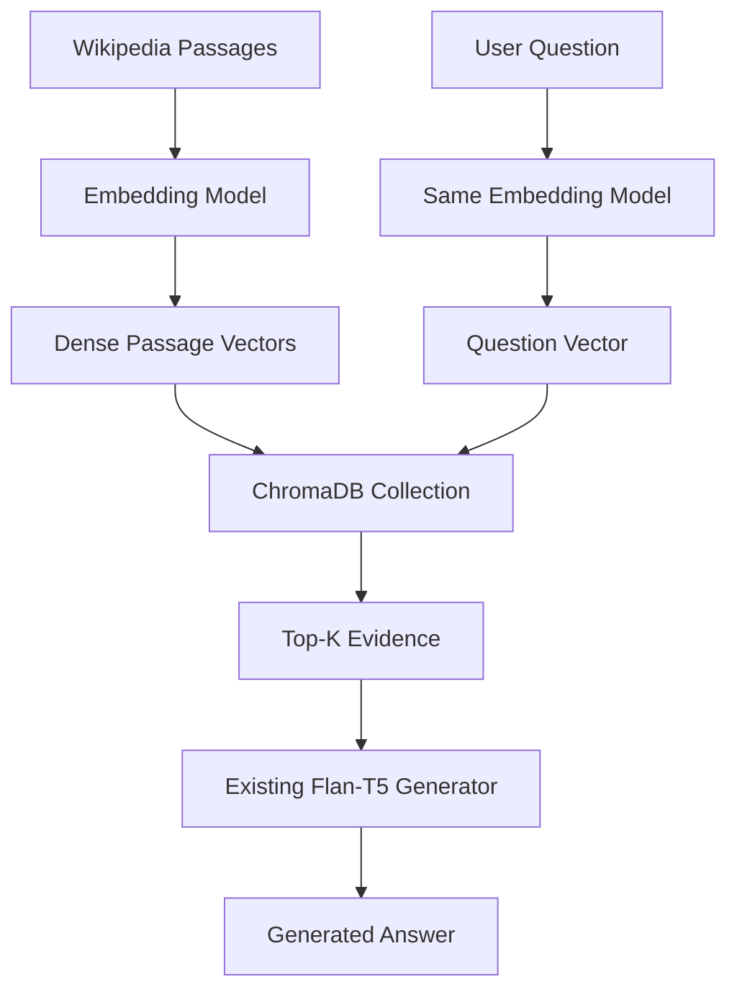

> Rule: **the same embedding model** must encode both passages and questions, or the vectors live in incompatible spaces.

## 10.2 Choosing a model (C11.3)

| Model | Dimensions | Role |
|---|---:|---|
| all-MiniLM-L6-v2 | 384 | Initial baseline (chosen) |
| e5-small-v2 | 384 | Retrieval-focused alternative |
| all-mpnet-base-v2 | 768 | Larger option |

MiniLM was chosen for **simplicity and modest resources**, not because it is guaranteed to be most accurate.

**Asymmetric retrieval:** short questions vs longer passages. Some models (like E5) expect prefixes such
as `query:` and `passage:` to handle this; MiniLM doesn't.

## 10.3 First embedding experiment (C11.3.3)

```python
from sentence_transformers import SentenceTransformer

model = SentenceTransformer("sentence-transformers/all-MiniLM-L6-v2", device="cuda")

question = ["Who is Diana Richburg?"]
passages = [
    "Diana Richburg was an American middle-distance runner.",
    "Diana Baciu was a Moldovan chess player.",
    "The athlete competed in track and field events.",
]

q = model.encode(question, normalize_embeddings=True)   # shape (1, 384)
D = model.encode(passages, normalize_embeddings=True)   # shape (3, 384)
S = q @ D.T                                              # shape (1, 3)
```

\[
Q\in\mathbb{R}^{1\times384},\quad D\in\mathbb{R}^{3\times384},\quad S=QD^\top\in\mathbb{R}^{1\times3}
\]

| Rank | Passage | Cosine |
|---|---|---:|
| 1 | Diana Richburg — runner | 0.7412 |
| 2 | Diana Baciu — chess player | 0.4695 |
| 3 | Athlete in track and field | 0.1440 |

Correct passage first ✅, but the wrong Diana scored substantially (**entity confusion risk**).
Interesting: the generic "athlete" sentence, which is *about running*, scored lowest. Sharing the
name "Diana" mattered more to the model than sharing the topic.

## 10.4 Token coverage analysis (C11.3.4 – C11.3.5)

MiniLM accepts up to **256 tokens**. Measured over all passages:

| Metric | Value |
|---|---:|
| Passages | 8,191 |
| Min / mean / median tokens | 23 / 131.31 / 130 |
| Max tokens | 1,772 |
| Over 256 | 32 (0.39%) |
| Within limit | 8,159 (99.61%) |

Longest offenders: *Experimental uncertainty analysis* (100 words → 1,772 tokens: equations,
symbols), *Crystal Cabin Award* (39 words → 504 tokens), *Agafon* (95 → 406). URLs, punctuation runs,
bibliographies and multilingual text explode token counts.

**Token coverage ratio:**

\[
\text{Coverage}=\frac{\min(n,256)}{n}
\]

For the worst passage:

\[
\text{Coverage}=\frac{256}{1772}\approx0.1445\approx14.45\%
\]

This is *token* coverage, not semantic information retained; special tokens and truncation side also matter.

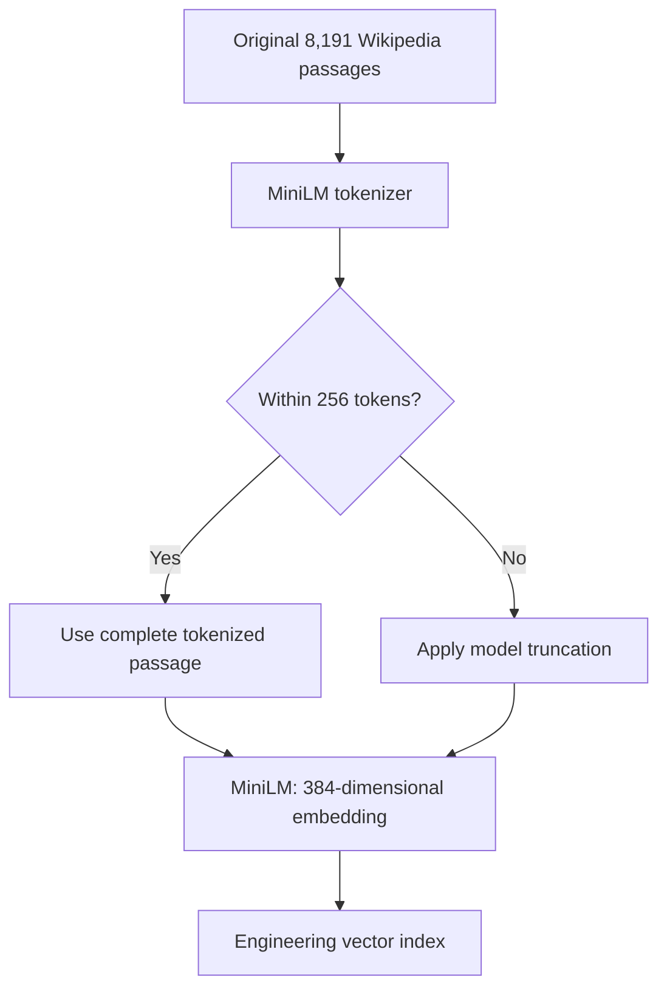

**Decision:** keep the original 8,191 passages, document the 32 truncations, and treat token-aware
chunking as a **separate** future experiment.

> 🧑‍🏫 **Controlled experiments.** If we change the retriever *and* the chunking at the same time and
> results improve, we can't tell which change helped. A second change is a **confounding variable**.
> Change one thing at a time.

## 10.5 ChromaDB smoke test (C11.4.5)

```python
import chromadb

client = chromadb.Client()   # in-memory
collection = client.create_collection(
    name="engineering_smoke_test",
    configuration={"hnsw": {"space": "cosine"}}
)
collection.add(
    ids=["doc1", "doc2", "doc3"],
    embeddings=[[1, 0, 0], [0, 1, 0], [0, 0, 1]],
    documents=["first", "second", "third"],
)
result = collection.query(query_embeddings=[[1, 0, 0]], n_results=2)
```

| Document | Cosine distance |
|---|---:|
| doc1 | 0.0000 |
| doc2 | 1.0000 |

Matches theory: identical vectors → \(\cos=1\Rightarrow d=0\); orthogonal → \(\cos=0\Rightarrow d=1\).

## 10.6 Designing the persistent index (C11.5.1 – C11.5.3)

Original loading code:

```python
passage_dir = PROJECT_ROOT / config["data"]["passage_directory"]
passages = load_from_disk(str(passage_dir))          # Hugging Face Datasets
vectorizer, tfidf_matrix, metadata = load_tfidf_index(index_dir)
retriever = TfidfRetriever(vectorizer=vectorizer, tfidf_matrix=tfidf_matrix, passages=passages)
```

**Dataset integrity check:** 8,191 rows, 8,191 unique chunk IDs, 0 duplicates, 0 empty passages.

**Formal model.** Corpus and embedding function:

\[
D=\{d_1,\ldots,d_N\},\quad N=8191,\qquad f_\theta:D\rightarrow\mathbb{R}^{384}
\]

\[
e_i=f_\theta(d_i),\qquad e_q=f_\theta(q)
\]

\[
s(q,d_i)=\frac{e_q\cdot e_i}{\|e_q\|\|e_i\|},\qquad \delta(q,d_i)=1-s(q,d_i)
\]

**Storage schema:**

| ChromaDB field | Source |
|---|---|
| ID | `chunk_id` |
| Document | `text` |
| Embedding | MiniLM output (normalized) |
| Metadata | `article_id`, `title`, `url`, `chunk_number`, `word_count` |

```mermaid
flowchart TD
    A["Original Wikipedia dataset"]
    B["Read passage batches"]
    C["MiniLM: 384-dimensional vectors"]
    D["Validate IDs and dimensions"]
    E["Persistent ChromaDB collection"]
    F["Semantic retrieval"]

    A --> B --> C --> D --> E --> F
```

## 10.7 Building the index (C11.5.5 – C11.5.8)

Script: `retrieval/build_chroma_index.py`. Store: `data/chroma_minilm`. Collection: `wikipedia_minilm_384`.

```python
# illustrative core loop
client = chromadb.PersistentClient(path="data/chroma_minilm")
collection = client.get_or_create_collection(
    name="wikipedia_minilm_384",
    configuration={"hnsw": {"space": "cosine"}},
)

for batch in batches(records, size=32):
    batch_ids = [r["chunk_id"] for r in batch]
    existing_ids = set(collection.get(ids=batch_ids, include=[])["ids"])
    new_records = [r for r in batch if r["chunk_id"] not in existing_ids]
    if not new_records:
        continue
    vectors = model.encode(
        [r["text"] for r in new_records],
        normalize_embeddings=True,
        convert_to_numpy=True,
    )
    collection.add(
        ids=[r["chunk_id"] for r in new_records],
        embeddings=vectors.tolist(),
        documents=[r["text"] for r in new_records],
        metadatas=[{k: r[k] for k in ("article_id", "title", "url", "chunk_number", "word_count")}
                   for r in new_records],
    )
```

**Why batches?** Lower peak memory, visible progress, natural restart points.

**Idempotent, resumable indexing.** With indexed ID set \(I\):

\[
D_{\text{new}}=\{d_i\in D:\operatorname{id}(d_i)\notin I\}
\]

Re-running on an unchanged corpus gives \(D_{\text{new}}=\varnothing\): nothing is redone.

| Run | Inserted | Skipped | Total |
|---|---:|---:|---:|
| First 10 | 10 | 0 | 10 |
| Repeat 10 | 0 | 10 | 10 |
| Extend to 20 | 10 | 10 | 20 |
| Full corpus | 8,171 | 20 | 8,191 |

Limitations: detects missing IDs, not *changed* text; designed for a single writer.

**Persistence check (C11.5.6):** reopened from a new process; first record `55617566::0`, *Diana
Richburg*, 100 words; norms between 1.0 and 1.0.

Size comparison:

\[
X_{\mathrm{TFIDF}}\in\mathbb{R}^{8191\times30000}\ \text{(sparse)},\qquad
X_{\mathrm{semantic}}\in\mathbb{R}^{8191\times384}\ \text{(dense)}
\]

\[
8191\times384=3{,}145{,}344\ \text{floats}\approx12\ \text{MiB}
\]

## 10.8 Full integrity audit (C11.5.9)

Every stored record compared with the original dataset:

| Check | Failures |
|---|---:|
| Missing IDs | 0 |
| Unexpected IDs | 0 |
| Text mismatches | 0 |
| Metadata mismatches | 0 |
| Wrong dimensions | 0 |
| Non-finite values (NaN/inf) | 0 |
| Unnormalized vectors | 0 |

> An index can look fine and still map vectors to the **wrong text**; then retrieval returns plausible
> but wrong evidence. Audits catch that. They do **not** measure retrieval quality.

## 10.9 The SemanticRetriever (C11.6)

**Contract to honour** (from Part 2.7): method `retrieve(question, top_k)` returning
`rank, score, chunk_id, article_id, title, url, text`, with **higher score = better**.

```python
# illustrative — see retrieval/semantic_retriever.py
class SemanticRetriever:
    def __init__(self, model_name="sentence-transformers/all-MiniLM-L6-v2",
                 persist_dir="data/chroma_minilm", collection_name="wikipedia_minilm_384"):
        self.model = SentenceTransformer(model_name)
        self.client = chromadb.PersistentClient(path=persist_dir)
        self.collection = self.client.get_collection(collection_name)

    def retrieve(self, question, top_k):
        if not isinstance(question, str) or not question.strip():
            raise ValueError("Question must be a non-empty string.")
        if not isinstance(top_k, int) or isinstance(top_k, bool) or top_k < 1:
            raise ValueError("top_k must be a positive integer.")

        query_embedding = self.model.encode(
            [question], convert_to_numpy=True,
            normalize_embeddings=True, show_progress_bar=False,
        )
        effective_k = min(top_k, self.collection.count())
        response = self.collection.query(
            query_embeddings=query_embedding.tolist(),
            n_results=effective_k,
            include=["documents", "metadatas", "distances"],
        )

        results = []
        for rank, (cid, doc, meta, dist) in enumerate(zip(
            response["ids"][0], response["documents"][0],
            response["metadatas"][0], response["distances"][0]), start=1):
            results.append({
                "rank": rank,
                "score": 1.0 - float(dist),     # distance -> similarity
                "chunk_id": cid,
                "article_id": meta["article_id"],
                "title": meta["title"],
                "url": meta["url"],
                "text": doc,
            })
        return results
```

```mermaid
flowchart TD
    A["User question"]
    B["MiniLM query embedding"]
    C["384-dimensional vector"]
    D["ChromaDB cosine search"]
    E["Top-K passage records"]
    F["Original RAG-compatible output"]

    A --> B --> C --> D --> E --> F
```

Result for "Who is Diana Richburg?":

| Rank | Article | Similarity |
|---|---|---:|
| 1 | Diana Richburg | 0.4846 |
| 2 | Larry Rivers | 0.4000 |
| 3 | Order of the Precious Crown | 0.3908 |

> **Scores aren't comparable across methods.** A TF-IDF cosine of 0.48 and a MiniLM cosine of 0.48
> mean different things: different spaces, different distributions. Compare **rankings**, not raw scores.

Robustness tests (all passed): empty question, whitespace question, `top_k=0`, `top_k=-1`,
`top_k=True`, `top_k="3"`.

<details>
<summary>✅ Check yourself</summary>

1. *Why convert distance to similarity in the retriever?* — To keep the original contract (higher = better) for downstream code.
2. *What does "idempotent" mean for the indexer?* — Running it again doesn't duplicate or change results.
3. *Why not fix the 32 overlong passages while building the index?* — It would confound the retriever comparison.

</details>

---

# Part 11 — C11.7: Plugging Semantic Retrieval into the Pipeline

## 11.1 Building a second pipeline by composition

```python
# adapters/semantic_rag_adapter.py (core idea)
original_pipeline = get_rag_pipeline()
semantic_retriever = SemanticRetriever()

semantic_pipeline = type(original_pipeline)(       # same RAGPipeline class
    retriever=semantic_retriever,                  # only this changes
    generator=original_pipeline.generator,         # shared Flan-T5 (no second copy in GPU)
    max_evidence_tokens=original_pipeline.max_evidence_tokens,
    fusion_method=original_pipeline.fusion_method,
)
```

`type(original_pipeline)` returns the `RAGPipeline` class itself, so we avoid importing it again.

```mermaid
flowchart TD
    A["User question"]
    B{"Choose retrieval strategy"}
    C["Original TF-IDF retriever"]
    D["Engineering SemanticRetriever"]
    E["Existing evidence preparation"]
    F["Shared Flan-T5 generator"]
    G["Grounded answer"]

    A --> B
    B --> C --> E
    B --> D --> E
    E --> F --> G
```

Verified: separate pipelines, original retriever untouched, generator shared, caching works.
Example: answer "middle-distance runner", similarity 0.4846, retrieval 0.2078 s, generation 0.2006 s, CUDA.

> ⚠️ Sharing one generator object between pipelines saves memory, but **concurrent** use is untested.

## 11.2 First comparison (C11.7.3)

| Question | Method | K | Answer |
|---|---|---:|---|
| Who is Diana Richburg? | TF-IDF | 1 | middle-distance runner |
| Who is Diana Richburg? | Semantic | 1 | middle-distance runner |
| Who is Diana Richburg? | TF-IDF | 3 | **Moldovan chess player** ❌ |
| Who is Diana Richburg? | Semantic | 3 | middle-distance runner |
| What sport did she compete in? | TF-IDF | 1 | Runners' World Championships |
| What sport did she compete in? | Semantic | 1 | Runners' World Championships |
| What sport did she compete in? | TF-IDF | 3 | Runner |
| What sport did she compete in? | Semantic | 3 | **chess** ❌ |

### Evidence contamination

```mermaid
flowchart TD
    A["Question about Diana Richburg"] --> B["Top-3 retrieval"]
    B --> C["Passage: Diana Richburg (relevant)"]
    B --> D["Passage: Diana Baciu (distractor)"]
    B --> E["Passage: other"]
    C --> F["Concatenated evidence"]
    D --> F
    E --> F
    F --> G["Flan-T5 picks the distractor fact"]
    G --> H["Wrong answer"]
```

Also note: "What sport did **she** compete in?" has a pronoun with no name, so the retriever has
almost no anchor. Both methods are guessing.

> **More evidence is not always better.** Larger K raises the chance of including the right passage
> *and* the chance of including a distractor. Small generators are easily distracted.

Two separate qualities: **retrieval quality** (did we fetch the right evidence?) and **generation
quality** (did the model use it correctly?). Measure them separately.

---

# Part 12 — C11.8: Evaluating a RAG System

## 12.1 The evaluation dataset (C11.8.1 – C11.8.4)

From the academic project (read-only): 20 questions, each with:

| Field | Purpose |
|---|---|
| `question_id` | ID, e.g. Q001 |
| `question` | Text |
| `reference_answer` | Expected answer |
| `source_article` | Expected article |
| `supporting_chunk_id` | One designated supporting passage |

Other artifacts: `rag_full_evaluation.csv/.jsonl` (120 academic records), `rag_evaluation_summary.csv`,
`rag_manual_assessment.csv`, `rag_fusion_comparison.csv`.

> The academic `method` field means **fusion method**. We added a separate `retriever` field
> (`tfidf` / `semantic`) so the two ideas never get mixed.

**Ground-truth audit:** 20 questions, 0 duplicate IDs, 0 missing supporting chunks, 0 article mismatches,
0 empty questions or answers. For every question \(q_i\): \(g_i\in D\) and \(g_i\) belongs to \(a_i\).

## 12.2 Retrieval metrics

Let \(T_K(q)\) be the top-K retrieved chunks, \(R(q)\) the set of truly relevant chunks.

**Recall@K**

\[
\operatorname{Recall@K}(q)=\frac{|R(q)\cap T_K(q)|}{|R(q)|}
\]

**Precision@K**

\[
\operatorname{Precision@K}(q)=\frac{|R(q)\cap T_K(q)|}{K}
\]

Both need complete relevance labels \(R(q)\), which we **don't have**. We only have one designated chunk
\(g_q\) and one article \(a_q\). So we use:

**GoldChunkHit@K**

\[
\operatorname{GoldHit@K}(q)=
\begin{cases}
1 & \text{if }g_q\in T_K(q)\\
0 & \text{otherwise}
\end{cases}
\]

**ArticleHit@K**

\[
\operatorname{ArticleHit@K}(q)=
\begin{cases}
1 & \text{if a retrieved passage belongs to }a_q\\
0 & \text{otherwise}
\end{cases}
\]

**Reciprocal Rank and MRR.** If the first match is at rank \(r\):

\[
RR(q)=\frac{1}{r}\quad(0\text{ if not found}),\qquad
MRR=\frac{1}{N}\sum_{q=1}^{N}RR(q)
\]

🧑‍🏫 Example: matches at ranks 1, 2 and not found → \(MRR=(1+0.5+0)/3=0.5\).

> Never compute these from similarity scores. They require **labels**.

## 12.3 Answer metrics (reused from `src/rag/evaluation.py`)

**Normalization** (`normalize_answer`): lowercase → replace ASCII punctuation with spaces → remove
`a`, `an`, `the` → collapse whitespace.

**Exact Match**

\[
EM=\mathbf{1}[\hat y_{\mathrm{norm}}=y_{\mathrm{norm}}]
\]

**Token precision, recall, F1** (counts with repetitions)

\[
P=\frac{\text{overlapping tokens}}{\text{predicted tokens}},\qquad
R=\frac{\text{overlapping tokens}}{\text{reference tokens}},\qquad
F_1=\frac{2PR}{P+R}
\]

### 🧑‍🏫 Worked example (verified)

Reference: "An American former middle-distance runner" → `american former middle distance runner` (5 tokens)
Prediction: "middle-distance runner" → `middle distance runner` (3 tokens)
Overlap = 3.

\[
P=\frac{3}{3}=1,\qquad R=\frac{3}{5}=0.6,\qquad F_1=\frac{2(1)(0.6)}{1.6}=0.75
\]

EM = 0, but F1 = 0.75. The C11.8.6.1 test confirmed **EM = 0, F1 = 0.75** using the original functions.

> 🧑‍🏫 The full metric code, plus worked examples for Q008 (F1 = 0.5) and Q012 (F1 = 0.875), is in Part 4.7.

> ⚠️ **Correction.** One section of the original notes computed this example as F1 = 0.6667 by treating
> "middle-distance" as a single token. Because normalization replaces the hyphen with a space, it
> becomes two tokens, and the correct value is **0.75**. This is exactly why we reuse the original
> implementation instead of computing metrics by hand.

**Evidence Support@K:** does the normalized reference answer appear as a substring in the retrieved
evidence? A **lexical proxy**, not entailment or fact-checking.

**Why reuse the original functions?** Tiny differences in normalization change scores. Reuse ensures
academic and Engineering results are comparable.

## 12.4 Retrieval-only results (C11.8.5)

The generator was **not** run here; only top-5 retrieval was timed.

| Metric | TF-IDF | Semantic |
|---|---:|---:|
| ArticleHit@1/3/5 | 1.00 | 1.00 |
| GoldChunkHit@1/3/5 | 0.95 | 0.90 |
| Article MRR@5 | 1.00 | 1.00 |
| Gold Chunk MRR@5 | 0.95 | 0.90 |
| Mean top-5 latency | 0.0055 s | 0.0068 s |
| Median top-5 latency | 0.0054 s | 0.0064 s |

Notice: hits were identical at K = 1, 3 and 5. Misses were never rescued at ranks 2–5.
The 0.95 vs 0.90 gap is **one question**.

## 12.5 Retrieval error analysis

| Question | Retriever | Expected | Top-ranked | Verdict |
|---|---|---|---|---|
| Q009 B. Reith album | Semantic | `21921907::4` | `21921907::3` | Alternative chunk **contains** the answer ("Now Is Not Forever") |
| Q014 Kate Beckett actor | TF-IDF | `21922319::0` | `21922319::84` | Correct article, **no** passage in top 5 names Stana Katic |
| Q015 John Hubley's second wife | Semantic | `1300733::0` | `1300733::70` | Related (mentions Faith Elliott) but **insufficient** |

**Three levels of retrieval quality:**

1. **Source relevance:** right article?
2. **Evidence relevance:** does it support the answer?
3. **Annotation match:** is it the designated chunk ID?

Formally, we assume \(g_q\in R_q\), but we do not know that \(R_q=\{g_q\}\). So:

- \(\operatorname{GoldChunkHit@K}=0\) does **not** mean no useful evidence (Q009).
- \(\operatorname{ArticleHit@K}=1\) does **not** mean the evidence answers the question (Q014).

## 12.6 End-to-end answer evaluation (C11.8.6)

Setup: 20 questions × 2 retrievers × 3 K values = **120 evaluations**, same generator, concatenation fusion.

Smoke test first (3 questions, 18 runs + 2 warm-ups): TF-IDF F1 dropped from 0.9167 at K=1 to 0.6667 at
K=3/5 because of the Diana Baciu contamination; semantic stayed at 0.9167.

**Full results:**

| Retriever | K | EM | Token F1 | Gold Chunk Hit |
|---|---:|---:|---:|---:|
| TF-IDF | 1 | 0.75 | 0.85625 | 0.95 |
| Semantic | 1 | 0.75 | 0.85625 | 0.90 |
| TF-IDF | 3 | 0.70 | 0.78875 | 0.95 |
| Semantic | 3 | 0.70 | 0.82625 | 0.90 |
| TF-IDF | 5 | 0.65 | 0.73875 | 0.95 |
| Semantic | 5 | 0.70 | 0.83958 | 0.90 |

ArticleHit@K = 1.0 everywhere.

\[
\Delta F_1^{K=3}=0.82625-0.78875=0.0375,\qquad
\Delta F_1^{K=5}=0.83958-0.73875\approx0.1008
\]

🧑‍🏫 **A reproducibility win.** The TF-IDF rows match the academic concatenation results of Part 4.9
exactly: 75% / 85.62% (K=1), 70% / 78.88% (K=3), 65% / 73.88% (K=5). Running the original pipeline
through the new Engineering adapter **reproduced the original study to the last digit**. That is strong
evidence that the adapter changed nothing it should not have.

**The surprise:** TF-IDF hit the gold chunk more often, yet produced worse answers at larger K.
Retrieving the right chunk ≠ handing the generator *clean* evidence.

Artifacts (Engineering project only):
`results/evaluation/c11_answer_comparison_full.csv` (120 rows),
`results/evaluation/c11_answer_comparison_summary.csv` (6 rows).

Python ideas used: `load_questions`, `evaluate_answers`, `summarize_results`; Pandas DataFrames,
`groupby` aggregation, duplicate detection, CSV export, separating computation from file writing.

## 12.7 Paired, question-level comparison (C11.8.7.1)

Pandas `pivot` aligns both retrievers by `question_id`:

\[
F1_{\text{difference}}=F1_{\text{semantic}}-F1_{\text{tfidf}}
\]

| K | Semantic better | TF-IDF better | Equal |
|---|---:|---:|---:|
| 1 | 1 | 1 | 18 |
| 3 | 2 | 1 | 17 |
| 5 | 4 | 1 | 15 |

Sensitivity to depth:

\[
\Delta F1=F1_{K=5}-F1_{K=1}
\]

| Outcome (K=1 → K=5) | TF-IDF | Semantic |
|---|---:|---:|
| Improved | 0 | 1 |
| Worsened | 4 (Q001, Q004, Q008, Q018) | 1 (Q018) |
| Unchanged | 16 | 18 |

> 🧑‍🏫 **Why "paired"?** Both systems answer the *same* questions, so comparing per question removes
> question difficulty as a source of noise. Still, gains concentrate in a few questions; with only
> 20 questions this is **not statistically significant**.

## 12.8 Targeted failure taxonomy (C11.8.7.2)

| Category | Example | What happened |
|---|---|---|
| Evidence contamination | Q001 Diana Richburg | Extra passage about Diana Baciu misled TF-IDF at K=3/5 |
| Generation error | Mir Basri's birthplace | Evidence contained "Baghdad"; model output "Bag" |
| Evidence preparation failure | Q009 B. Reith | Answer retrieved, then cut off before generation (8.9) |
| Metric limitation | Michigan Wolverines | "Crisler Arena in Ann Arbor, Michigan" is correct but EM = 0 |
| Semantic advantage | Q014 Kate Beckett | Semantic found "Stana Katic" at K=1/3/5; TF-IDF didn't |

## 12.9 Root cause: evidence truncation (C11.8.7.3)

| Property | Value |
|---|---|
| Retrieved chunk | `21921907::3` |
| Cosine similarity | 0.6462 |
| Original Flan-T5 tokens | 145 |
| Prepared tokens | 80 |
| Answer present before preparation | Yes |
| Answer present after preparation | **No** |

\[
\text{Discarded}=145-80=65\ \text{tokens},\qquad \frac{65}{145}\times100\approx44.83\%
\]

The answer sat in the part that was cut.

```mermaid
flowchart TD
    A["Retriever finds chunk with the answer"] --> B["Evidence preparation keeps first 80 tokens"]
    B --> C["Answer text was beyond token 80"]
    C --> D["Generator receives evidence without the answer"]
    D --> E["Wrong answer despite correct retrieval"]
```

**Classify failures by where they happen:**

- **Retrieval failure:** relevant info not found.
- **Evidence preparation failure:** found, then removed before generation. ← Q009
- **Generation failure:** generator had enough evidence but answered wrongly.

Future ideas (not implemented): query-aware truncation, larger budgets, better chunk boundaries,
reranking, answer-aware compression.

## 12.10 Evaluation conclusions

- TF-IDF remains a strong baseline, slightly better at exact-chunk retrieval.
- Semantic retrieval was more robust to contamination at larger K on this benchmark.
- Retrieval quality, evidence quality and answer quality are related but **distinct**.
- 20 questions, several sharing articles, one gold chunk each: treat results as indicative only.

<details>
<summary>✅ Check yourself</summary>

1. *Why can't we compute Recall@K here?* — We lack the full set of relevant chunks per question.
2. *A system gets EM = 0, F1 = 0.75. Is it wrong?* — Not necessarily; it may be a shorter correct answer.
3. *What was the true cause of Q009's semantic failure?* — Evidence truncation removed the answer before generation.
4. *Why did TF-IDF answer worse at K=5 despite a higher gold-chunk hit rate?* — Extra distractor passages contaminated the evidence.

</details>

---

# Part 13 — C12: Observability

**Observability** = being able to understand what a running system is doing from what it emits.

## 13.1 What was added

- UUID4 request ID per request
- Structured JSON logs
- Latency per request, HTTP status, exception type
- Response headers `X-Request-ID` and `X-Process-Time`

## 13.2 Middleware

Middleware wraps every request, like a security guard at a building door.

```python
# illustrative
import json, logging, time, uuid
from fastapi import Request

logger = logging.getLogger("rag.api")

@app.middleware("http")
async def observe_requests(request: Request, call_next):
    request_id = str(uuid.uuid4())
    start = time.perf_counter()
    status_code, error_type = 500, None
    try:
        response = await call_next(request)
        status_code = response.status_code
    except Exception as exc:
        error_type = type(exc).__name__
        raise
    finally:
        elapsed = time.perf_counter() - start
        logger.info(json.dumps({
            "request_id": request_id,
            "method": request.method,
            "path": request.url.path,
            "status": status_code,
            "latency_ms": round(elapsed * 1000, 3),
            "error_type": error_type,
        }))
    response.headers["X-Request-ID"] = request_id
    response.headers["X-Process-Time"] = f"{elapsed:.6f}"
    return response
```

## 13.3 Mathematics

\[
L=t_{\text{end}}-t_{\text{start}},\qquad
\text{MeanLatency}=\frac{\sum \text{latencies}}{\text{number of requests}}
\]

## 13.4 Correlation and privacy

The same request ID appears in the log and in the response, so a user's error report can be traced to
the exact server log line.

Logs deliberately **exclude** questions, answers, passages and request bodies: user content in logs is a privacy risk.

Not yet implemented: log storage, distributed tracing, dashboards, alerting, long-term metrics.

Smoke test checks: health response, UUID format, latency headers, unique IDs, 404 instrumentation.
*Status in project log: pending execution verification.*

---

# Part 14 — C13: Performance Engineering

## 14.1 Definitions

\[
\text{Mean}=\frac{\sum \text{latencies}}{n},\qquad
\text{Throughput}=\frac{\text{completed requests}}{\text{elapsed seconds}}
\]

**Percentiles.** P95 = the latency below which 95% of requests fall. Nearest-rank method on sorted
latencies \(x_{(1)}\le\cdots\le x_{(n)}\):

\[
P_{95}=x_{(\lceil 0.95\,n\rceil)}
\]

🧑‍🏫 Why care about P95, not just the mean? Users notice the slow tail. One 6-second request hides inside a "fine" average.

**Median:** middle value; robust to outliers.

## 14.2 Cold vs warm

- **Cold:** includes loading the index and model.
- **Warm:** reuses cached objects.

## 14.3 Results

| Metric | Result |
|---|---:|
| Health mean / P95 | 2.157 ms / 4.992 ms |
| Cold RAG latency | 6.046 s |
| Warm RAG mean / median / P95 | 103.526 / 97.287 / 123.272 ms |
| Concurrent health throughput (10 requests, 2 workers) | 242.84 req/s |
| GPU allocated | 301.71 MiB |
| GPU reserved | 344.00 MiB |
| Peak PyTorch allocation | 305.29 MiB |

```text
CacheInfo(hits=5, misses=1, maxsize=1, currsize=1)
```

Cold vs warm:

\[
\frac{6.046\ \text{s}}{0.1035\ \text{s}}\approx58\times
\]

Implied elapsed time of the throughput test:

\[
\frac{10}{242.84}\approx0.041\ \text{s}
\]

## 14.4 GPU memory

| PyTorch function | Meaning |
|---|---|
| `torch.cuda.memory_allocated()` | Memory in live tensors |
| `torch.cuda.memory_reserved()` | Allocated + cached by PyTorch's allocator |
| `torch.cuda.max_memory_allocated()` | Peak allocated |

None of these equal total GPU usage reported by `nvidia-smi` (which also includes the CUDA context).

🧑‍🏫 The academic notebook measured **293.58 MiB** allocated right after loading Flan-T5-small, which is
exactly \(76{,}961{,}152\times4\) bytes (Part 1.5). The C13 figure of **301.71 MiB** in a running API
process is about 8 MiB higher. That fits the idea that the weights dominate and that a little extra memory is
held by tensors from tokenizer inputs, generation buffers and similar sources. The 8 MiB breakdown was not
measured per component, so treat this as a plausible explanation, not a verified one.

**Limitations:** single machine, in-process test client, no network, no concurrent GPU inference, no capacity claims.

---

# Part 15 — C14: Automated Testing

## 15.1 Why tests?

A **regression** is something that used to work and broke. **Regression tests** rerun automatically after every change.

## 15.2 `unittest` essentials

```python
# illustrative
import unittest
from fastapi.testclient import TestClient
from api.main import app

class TestAnswerValidation(unittest.TestCase):

    @classmethod
    def setUpClass(cls):
        cls.client = TestClient(app)      # shared, created once

    def test_health(self):
        response = self.client.get("/health")
        self.assertEqual(response.status_code, 200)
        self.assertIn("X-Request-ID", response.headers)

    def test_invalid_top_k(self):
        for bad in [0, 2, 99, -1, True, "3"]:
            with self.subTest(top_k=bad):   # each case reported separately
                r = self.client.post("/answer", json={"question": "Q?", "top_k": bad})
                self.assertEqual(r.status_code, 422)

if __name__ == "__main__":
    unittest.main()
```

| Tool | Purpose |
|---|---|
| `TestCase` | Groups tests |
| `setUpClass` / `tearDownClass` | Shared setup/cleanup once per class |
| `assertEqual`, `assertIn` | Checks |
| `subTest` | Many inputs in one test, each reported |

Run:

```powershell
python -m unittest discover -s tests -p "test_*.py" -v
```

Coverage: health, request IDs (presence and uniqueness), latency headers, missing/empty/whitespace
questions, invalid K, wrong types, malformed JSON, unknown endpoints, module availability.
These test **API contracts**, not answer quality.

## 15.3 The bug the tests found

`top_k = true` returned **200** instead of **422**. Two causes:

1. `bool` is a subclass of `int` in Python (Part 7.8).
2. Pydantic's lax mode can coerce `True` → `1` before your validator runs.

Fix: validate **before** coercion.

```python
@field_validator("top_k", mode="before")
@classmethod
def reject_boolean(cls, value):
    if isinstance(value, bool):
        raise ValueError("top_k must be an integer, not a boolean.")
    return value
```

This aligns the API with the original retriever's rule.
*Status in project log: fix proposed, awaiting regression verification.*

> **Lesson:** the API layer and the engine can disagree about what's valid. Tests expose those gaps.

---

# Part 16 — C15: Security Baseline

## 16.1 Concepts

| Term | Meaning |
|---|---|
| Authentication | *Who are you?* (do you have the credential?) |
| Authorization | *What may you do?* |
| Input validation | Reject bad data early |
| Defense in depth | Several independent layers of protection |

## 16.2 Optional API key

If environment variable `RAG_API_KEY` is set, `/answer` requires header `X-API-Key`. `/health` stays public.
If unset, the app runs in local development mode.

```python
# illustrative
import hmac, os
from fastapi import Header, HTTPException

def require_api_key(x_api_key: str | None = Header(default=None)):
    expected = os.getenv("RAG_API_KEY")
    if not expected:
        return                                   # local development mode
    if x_api_key is None or not hmac.compare_digest(x_api_key, expected):
        raise HTTPException(status_code=401, detail="Invalid or missing API key.")
```

**Why `hmac.compare_digest`?** A normal `==` may stop at the first differing character, so response time
leaks how much of the key was right (a **timing attack**). `compare_digest` takes time independent of where the strings differ.

## 16.3 Security headers

| Header | Purpose |
|---|---|
| `X-Content-Type-Options: nosniff` | Browser must not guess content types |
| `X-Frame-Options: DENY` | Page can't be embedded in frames (clickjacking) |
| `Cache-Control: no-store` | Don't cache possibly sensitive responses |

## 16.4 Still needed before public deployment

HTTPS, rate limiting, request-size limits, resource quotas, stronger auth/authorization, secret
management and rotation, monitoring/alerting, dependency vulnerability scanning, backups, deployment testing.

C15 is a **local baseline**, not a security certification.
*Status in project log: pending execution verification.*

---

# Part 17 — Revision Toolkit

## 17.1 Project timeline

### Academic project (notebook)

| Stage | Topic | Key output |
|---|---|---|
| 1 | Environment setup | Python 3.11.14, PyTorch 2.10 + CUDA 12.8, RTX 5060 |
| 2 | Wikipedia inspection, profiling, selection | 1,000 articles (seed 42, buffer 5,000, ≥ 500 chars) |
| 3 | Chunking, modularization, TF-IDF index | 8,191 passages; 8,191 × 30,000 CSR matrix |
| 4 | Retrieval and K ablation | Cosine top-K; Diana Baciu distractor discovered |
| 5 | Flan-T5 tokenizer, budgets, first answer | 171 → 725 tokens problem; "middle-distance runner" |
| 6 | Evaluation dataset, evidence policy, fusion ablation | 120 runs; concatenation K=1 = 75% EM / 85.62% F1 |
| 7 | Integrated pipeline and CLI | `run_rag.py` with `rag_config.json` |
| 8–9 | Documentation, audits, offline export, packaging | Local model + fallback; portable requirements |
| UI | Streamlit app | Ask / Dashboard / Explorer pages |

### Track C engineering

| Stage | Topic | Status (from project log) |
|---|---|---|
| C10.1 | Inspect original architecture | Passed |
| C10.2 | Packages, environment, FastAPI install | Passed |
| C10.3 | `/health` endpoint | Passed |
| C10.4 | RAG adapter | Passed |
| C10.5 | `POST /answer` | Passed |
| C10.6 | Request validation | Passed |
| C11.1–C11.2 | TF-IDF vs embeddings; source study | Passed |
| C11.3 | Model choice, token coverage | Passed |
| C11.4 | ChromaDB, dependency repair | Passed |
| C11.5 | Persistent index + audit | Complete |
| C11.6 | SemanticRetriever | Initial validation complete |
| C11.7 | Semantic pipeline | Passed |
| C11.8 | Evaluation and error analysis | Passed |
| C12 | Observability | Pending verification |
| C13 | Performance | Passed |
| C14 | Testing | Bool fix awaiting verification |
| C15 | Security | Pending verification |

## 17.2 Final architecture

```mermaid
flowchart TD
    subgraph Original["Original Academic System (unchanged)"]
        A["Streamlit UI"] --> B["RAGPipeline (TF-IDF)"]
    end

    subgraph Engineering["Engineering System"]
        C["HTTP Client"] --> D["Uvicorn"]
        D --> E["Security + Observability Middleware"]
        E --> F["FastAPI + Pydantic"]
        F --> G["RAG Adapters"]
        G --> H["TF-IDF Pipeline"]
        G --> I["Semantic Pipeline"]
        I --> J["MiniLM + ChromaDB"]
        H --> K["Shared Flan-T5 Generator"]
        I --> K
    end

    H -. reuses .-> B
```

## 17.3 Formula sheet

| Concept | Formula |
|---|---|
| Chunk stride | \(S=C-O\) |
| Number of chunks (with tail) | \(M=1+\left\lceil\frac{N-C}{C-O}\right\rceil\) |
| Term frequency | \(TF(t,d)=f_{t,d}\) |
| Document frequency | \(DF(t)=\vert \{d:t\in d\}\vert \) |
| Smoothed IDF | \(IDF(t)=\log\left(\frac{1+N}{1+DF(t)}\right)+1\) |
| TF-IDF | \(w_{t,d}=TF(t,d)\times IDF(t)\) |
| Matrix density | \(\text{nnz}/(N\times V)\) |
| L2 norm | \(\Vert x\Vert _2=\sqrt{\sum_i x_i^2}\) |
| Normalization | \(\hat{x}=x/\Vert x\Vert _2\) |
| Cosine | \(\cos(q,d)=\frac{q^\top d}{\Vert q\Vert _2\Vert d\Vert _2}\) |
| Cosine (unit vectors) | \(\cos(q,d)=q^\top d\) |
| Cosine distance | \(d=1-\cos\) |
| Batch scoring | \(S=QD^\top\) |
| Unit-vector identity | \(\Vert a-b\Vert _2^2=2-2\cos(a,b)\) |
| Retrieval | \(R_K(q)=\operatorname{TopK}_{p_i}\operatorname{sim}(q,p_i)\) |
| Generation | \(\hat a=G(q,R_K(q))\) |
| Token-to-word ratio | \(r=N_{\text{tokens}}/N_{\text{words}}\) |
| Remaining token budget | \(B_{\text{remaining}}=B_{\max}-N_{\text{input}}\) |
| Shortening reduction | \((n_{\text{orig}}-n_{\text{prep}})/n_{\text{orig}}\times100\%\) |
| Concatenation fusion | \(\hat a=G(q,p_1\oplus\cdots\oplus p_K)\) |
| Generate-from-evidence | \(a_i=G(q,p_i),\ \hat a=G(q,a_1\oplus\cdots\oplus a_K)\), calls \(=K+1\) |
| Attention | \(\operatorname{softmax}\left(\frac{QK^\top}{\sqrt{d_k}}\right)V\) |
| Softmax | \(\frac{e^{z_i}}{\sum_j e^{z_j}}\) |
| Autoregressive generation | \(P(y\mid x)=\prod_t P(y_t\mid y_{<t},x)\) |
| Mean pooling | \(e=\frac{1}{n}\sum_i h_i\) |
| Embedding storage | \(M=N\times d\times4\) bytes |
| Weight memory | \(M=P\times b\) |
| Token coverage | \(\min(n,256)/n\) |
| Version compatibility | \(A\cap B\neq\varnothing\) |
| New records to index | \(D_{\text{new}}=\{d_i:\operatorname{id}(d_i)\notin I\}\) |
| Recall@K | \(\frac{\vert R\cap T_K\vert }{\vert R\vert }\) |
| Precision@K | \(\frac{\vert R\cap T_K\vert }{K}\) |
| Reciprocal rank | \(1/r\) |
| MRR | \(\frac{1}{N}\sum RR(q)\) |
| Exact match | \(\mathbf{1}[\hat y_{\mathrm{norm}}=y_{\mathrm{norm}}]\) |
| Token precision / recall | \(P=m/p,\ R=m/r\) |
| Token F1 | \(\frac{2PR}{P+R}=\frac{2m}{p+r}\) |
| Hit@K | 1 if any top-K passage is from the expected article |
| Evidence Support@K | 1 if the normalized reference appears in a top-K passage |
| Latency | \(L=t_{\text{end}}-t_{\text{start}}\) |
| Throughput | requests / seconds |
| P95 (nearest rank) | \(x_{(\lceil0.95n\rceil)}\) |

## 17.4 Master glossary

| Term | Definition |
|---|---|
| Ablation | Changing one design choice while holding the rest fixed, to measure its effect |
| Abstention | The model declines to answer ("Insufficient evidence") |
| Adapter | Component translating between two interfaces |
| ANN | Approximate nearest neighbour search |
| ASGI | Interface between async Python web apps and servers |
| Backward compatibility | New work doesn't break existing usage |
| Caching | Reusing an initialized/computed object |
| Chunking | Splitting documents into passages |
| Composite key | A tuple such as `(question_id, k, method)` that uniquely identifies a record |
| Confounding variable | An extra change that muddies cause and effect |
| Controlled experiment | Change one variable, hold others constant |
| Cosine similarity | Directional similarity between vectors |
| CSR matrix | Compressed Sparse Row storage: only non-zero values and their positions |
| Decoding (greedy) | Choosing the single most likely next token at each step |
| Dense vector | Mostly non-zero learned values |
| Dependency injection | Passing ready-made components into a constructor |
| Duck typing | Using objects by behaviour, not class |
| Embedding | Numeric vector representing input meaning |
| Entity confusion | Mixing up two similarly named entities |
| Evidence contamination | Irrelevant evidence misleading the generator |
| Evidence fusion | Combining multiple passages for the generator |
| Exact Match (EM) | 1 if normalized prediction equals normalized reference |
| Grounded answer | An answer supported by retrieved evidence rather than model memory |
| Ground truth | Trusted reference labels |
| HNSW | Graph-based ANN index used by ChromaDB |
| Idempotent | Repeating an operation doesn't change the result |
| Lazy initialization | Delay setup until first use |
| Lexical gap | Same meaning, different words |
| Liveness vs readiness | Process alive vs able to do real work |
| Middleware | Code wrapping every request/response |
| Observability | Understanding a system from its outputs |
| Model weights | The learned numeric parameters; stored separately from code |
| Overlap | Words shared by consecutive chunks |
| Polymorphism | One interface, many implementations |
| Prefix shortening | Keeping the first N tokens of a passage |
| Prompt injection | Retrieved or user text that tries to act as instructions |
| Regression test | Detects previously working behaviour breaking |
| Shard | One file/block of a large dataset |
| Shuffle buffer | Records held in memory for an approximate streaming shuffle |
| Sparse vector | Mostly zeros |
| Streaming | Reading records lazily without downloading the whole dataset |
| Test-set overfitting | Tuning on the same questions you report results on |
| Timing attack | Inferring secrets from response timing |
| Tokenizer | Splits text into model tokens |
| Transitive dependency | Dependency of a dependency |
| Truncation | Cutting input beyond a length limit |
| Vector database | Stores and searches vectors with metadata |
| Warm-up | Extra cost of the first GPU call (kernel loading, allocation) |

## 17.5 The twelve big lessons

1. **Preserve what works.** Every Track C change lived in a separate project.
2. **Inspect before you change.** Read the source, run dry runs, check paths.
3. **Verify in layers.** Syntax → import → runtime → behaviour.
4. **Change one variable at a time.** Same corpus, generator and K for fair comparison.
5. **Semantic similarity ≠ factual relevance.**
6. **More evidence ≠ better answers.**
7. **Right article ≠ right evidence; wrong chunk ID ≠ wrong evidence.**
8. **Locate failures by stage:** retrieval, evidence preparation or generation.
9. **No single metric is the truth.** Use several, and inspect examples by hand.
10. **State limitations honestly.** Small samples, one machine, one run: say so.
11. **Measure before you cut.** Count tokens with `truncation=False` first, then choose a controlled policy.
12. **Simple baselines are strong.** Prefix-80 beat query-aware selection; K = 1 concatenation beat a 6-call pipeline.

## 17.6 Final self-assessment

<details>
<summary>1. Explain RAG to a friend in two sentences.</summary>

A RAG system first searches a document collection for passages related to a question, then gives
those passages to a language model to write an answer. This grounds the answer in real text instead of
only the model's memory.

</details>

<details>
<summary>2. Why did TF-IDF fit and transform differently at index vs query time?</summary>

The vocabulary and IDF weights must be identical for passages and questions; `fit_transform` learns
them once on the corpus, `transform` reuses them for queries.

</details>

<details>
<summary>3. Compute F1 for prediction "crisler arena" vs reference "Crisler Arena".</summary>

After normalization both are `crisler arena`: P = R = 1, F1 = 1, EM = 1.

</details>

<details>
<summary>4. A prediction "Crisler Arena in Ann Arbor, Michigan" vs reference "Crisler Arena": compute P, R, F1.</summary>

Prediction tokens: crisler, arena, in, ann, arbor, michigan (6). Reference: crisler, arena (2).
Overlap 2. P = 2/6 ≈ 0.333, R = 2/2 = 1, F1 = 2(0.333)(1)/(1.333) = 0.5. EM = 0.

</details>

<details>
<summary>5. Why did installing ChromaDB break TensorFlow, and how was it fixed?</summary>

ChromaDB's dependency chain upgraded protobuf to 7.36.2, outside TensorFlow's `<6` constraint.
Reinstalling protobuf 5.29.3 (inside both ranges) restored compatibility.

</details>

<details>
<summary>6. What would you try next to fix Q009-style failures?</summary>

A larger evidence budget, token-aware chunking, answer-aware compression or a reranker, each tested
as a separate controlled experiment on a **held-out** question set. Be careful with naive query-aware
sentence selection: in the academic study it rescued Hubley but kept only 13/20 answers versus 18/20
for Prefix-80 (Part 4.5).

</details>

<details>
<summary>7. Why is `/health` returning 200 not enough for a load balancer serving RAG?</summary>

It proves the process responds, not that the model and index are loaded. A readiness endpoint should check those.

</details>

<details>
<summary>8. Why use `hmac.compare_digest` for API keys?</summary>

It compares in constant time, preventing attackers from guessing keys character by character via response timing.

</details>

<details>
<summary>9. The pipeline answered "Moldovan chess player" for Diana Richburg at K = 3. Which stage failed?</summary>

Not retrieval (rank 1 was correct) and not preparation. Fusion with a distractor passage contaminated
the evidence, and the generator picked the wrong entity.

</details>

<details>
<summary>10. Flan-T5-small has 76,961,152 parameters. How much float32 memory do the weights need?</summary>

\(76{,}961{,}152\times4=307{,}844{,}608\) bytes \(\approx293.58\) MiB, matching the measured GPU allocation.

</details>

<details>
<summary>11. How many model calls did the full academic evaluation use, and why?</summary>

300: concatenation uses 1 call × 60 runs = 60; generate-from-evidence uses \(K+1\) calls, so
\(20\times(2+4+6)=240\).

</details>

<details>
<summary>12. Why is the 85% "factual correctness" not reported instead of 75% EM?</summary>

It depends on human judgement over a tiny set. It is reported **alongside** EM and labelled
preliminary, never as a replacement.

</details>

## 17.7 Quick viva answers

| Question | Short answer |
|---|---|
| Why RAG? | To ground generation in retrieved data without retraining the language model |
| Does TF-IDF generate answers? | No, it retrieves; Flan-T5 generates |
| Is K the number of articles? | No, the number of passages (chunks) |
| Is cosine similarity a confidence? | No, it measures vector alignment for ranking |
| What is the vocabulary size? | 30,000 TF-IDF features (Flan-T5's tokenizer has a separate 32,100-token vocabulary) |
| Why chunk? | To retrieve local evidence and fit the generator's input limit |
| Why overlap chunks? | To protect facts at chunk boundaries |
| Why did K = 1 win? | Extra passages added distractors more often than useful facts |
| Why does Hit@K differ from Evidence Support@K? | The right article can be retrieved via a chunk that lacks the answer |
| Why not query-aware selection? | It kept 13/20 answers versus 18/20 for Prefix-80 |
| Is 75% the model's general accuracy? | No, it is EM on 20 curated questions |
| Was the first ZIP fully offline? | No, the model weights were not bundled |
| What does Streamlit cache? | The pipeline via `st.cache_resource`; per-user values via `st.session_state` |
| Is there a REST API in the academic UI? | No; Track C added FastAPI separately |
| Is it production-ready? | No; Track C adds API, tests, observability and security, and still lists gaps |

## 17.8 Where to go next

- **Hybrid retrieval:** combine TF-IDF/BM25 and embedding scores (e.g. Reciprocal Rank Fusion: \(\sum_m \frac{1}{k+r_m(d)}\)).
- **Reranking:** a cross-encoder rescoring the top 20 candidates.
- **Token-aware chunking** as a separately indexed corpus.
- **Larger, more diverse evaluation set** with multiple relevant chunks per question and human judgments.
- **Concurrency-safe model initialization** and real load tests for `/answer`.
- **Readiness endpoint, centralized logs, rate limiting, HTTPS.**
- **Better synthesis:** separate candidate *selection* from answer *extraction* (the "Rank 1" lesson).
- **Groundedness / entailment checks** with a cross-encoder or NLI model instead of lexical support.
- **Calibrated abstention:** decide when "Insufficient evidence" is the best answer.

### References for further study

- Wikimedia Wikipedia dataset: https://huggingface.co/datasets/wikimedia/wikipedia
- Flan-T5-small model card: https://huggingface.co/google/flan-t5-small
- scikit-learn documentation: `TfidfVectorizer`, `cosine_similarity`
- Sentence Transformers documentation: semantic search, pretrained models
- Chroma documentation: collections, persistent clients, HNSW configuration
- FastAPI and Pydantic documentation: request bodies, validators, middleware, testing
- Vaswani et al., *Attention Is All You Need* (2017)
- Raffel et al., *Exploring the Limits of Transfer Learning with a Unified Text-to-Text Transformer* (T5, 2020)
- Lewis et al., *Retrieval-Augmented Generation for Knowledge-Intensive NLP Tasks* (2020)
- Reimers & Gurevych, *Sentence-BERT* (2019)
- Chung et al., *Scaling Instruction-Finetuned Language Models* (Flan, 2022)

---

**Final takeaway.** RAG works only when **all** stages work: the corpus covers the question, retrieval
finds an answer-bearing passage, preparation keeps the answer, fusion avoids distractors, the generator
uses the evidence faithfully, and the metrics recognise a correct answer. Our project measured every
one of those links, and that is what made it a study rather than a demo.

*End of guide. Re-read Part 1 whenever the mathematics feels fuzzy, and Parts 4 and 12 whenever you need
to remember why a single number never tells the whole story.*
