## Stage C10.1 — Existing RAG Architecture Inspection

**Status:** Completed — PASSED

### Objective

Inspect the original academic RAG implementation and identify the interfaces that can be reused by a separate Production Engineering application.

The original RAG project and Streamlit UI must remain unchanged.

### Existing Projects

1. `Mid-Sem-Project-RAG`
   - Implements Wikipedia retrieval and answer generation.
   - Contains the TF-IDF index and Flan-T5 model.

2. `Mid-Sem-Project-RAG-UI`
   - Implements the Streamlit user interface.
   - Calls the existing RAG pipeline directly.

### Inspection Results

| Component | Finding |
|---|---|
| RAG application module | `run_rag` |
| Initialization function | `initialize_rag(config)` |
| Pipeline source | `src/pipeline.py` |
| Pipeline class | `RAGPipeline` |
| Answer method | `RAGPipeline.answer()` |
| UI integration | Direct Python calls |
| Inspection status | PASSED |

### Existing Integration

The Streamlit application imports:

```python
from services.rag_service import load_rag_pipeline
```

The UI obtains the pipeline:

```python
pipeline = load_rag_pipeline()
```

It then executes question answering:

```python
result = pipeline.answer(
    question="Who is Diana Richburg?",
    top_k=1
)
```

### Current Architecture

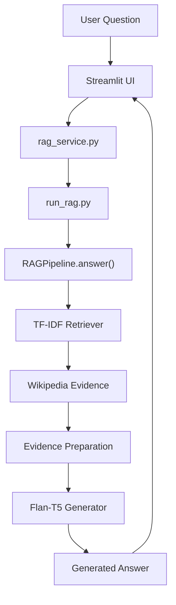


### Engineering Decision

Create a separate project:

`Mid-Sem-Project-RAG-Engineering`

This project will introduce a FastAPI backend and reuse the existing RAG engine through an adapter.

The original academic implementation and Streamlit UI will not be modified.

### Key Learning

- The current application uses direct Python function calls rather than a separate HTTP API.
- FastAPI will allow other applications to communicate with the RAG engine using HTTP requests.
- A separate API is an architectural improvement, not a requirement for the existing Streamlit UI.

### Verification

A read-only Python inspection confirmed:

- Original project locations are valid.
- RAG integration functions are available.
- `initialize_rag(config)` exists.
- `RAGPipeline.answer()` exists.
- Streamlit uses the existing Python integration.

**Final result: PASSED**

### C10.2.2 — Python Package Initialization

**Status:** Completed — PASSED

#### 1. What We Had Earlier

Our original academic RAG system organized functionality into Python modules.

Examples included:

- `run_rag.py` — RAG application initialization.
- `pipeline.py` — Coordinates retrieval and generation.
- `rag_service.py` — Connects Streamlit with the RAG engine.
- `app.py` — Streamlit user interface.

The Streamlit UI imported functions from the service module:

```python
from services.rag_service import load_rag_pipeline
```

Python modules allowed us to reuse existing functionality without copying its implementation into the UI.

#### 2. How the Earlier Implementation Worked

The original application followed this execution flow:

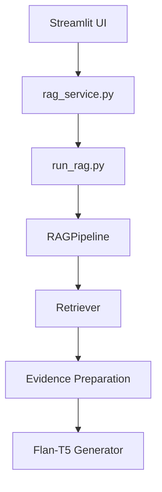

All these components worked together through Python function calls.

The architecture was suitable for our academic implementation.

#### 3. What We Are Doing Now

We are creating a separate Python application for Production Engineering enhancements.

Eight Python packages have been initialized:

- `api`
- `adapters`
- `retrieval`
- `observability`
- `evaluation`
- `performance`
- `security`
- `tests`

Each directory contains an `__init__.py` file.

#### 4. Why Are We Making This Change?

The academic system already uses separate modules.

Track C extends this organization by assigning clear responsibilities to additional engineering components.

For example:

- API code should handle HTTP communication.
- Adapter code should connect to the original RAG engine.
- Retrieval code should implement search mechanisms.
- Observability code should record operational metrics.
- Test code should verify expected behavior.

This design supports separation of concerns.

#### 5. Old vs New Implementation

| Aspect | Academic RAG | Track C Engineering |
|---|---|---|
| Main purpose | Academic demonstration | Engineering experimentation |
| UI integration | Direct Python calls | FastAPI planned |
| Retrieval | TF-IDF | TF-IDF initially; ChromaDB later |
| Logging | Existing application output | Structured observability planned |
| Testing | Existing verification and evaluation | Expanded automated tests planned |
| Code organization | RAG and UI modules | Separate engineering packages |

The original implementation remains unchanged.

#### 6. Proposed Engineering Flow

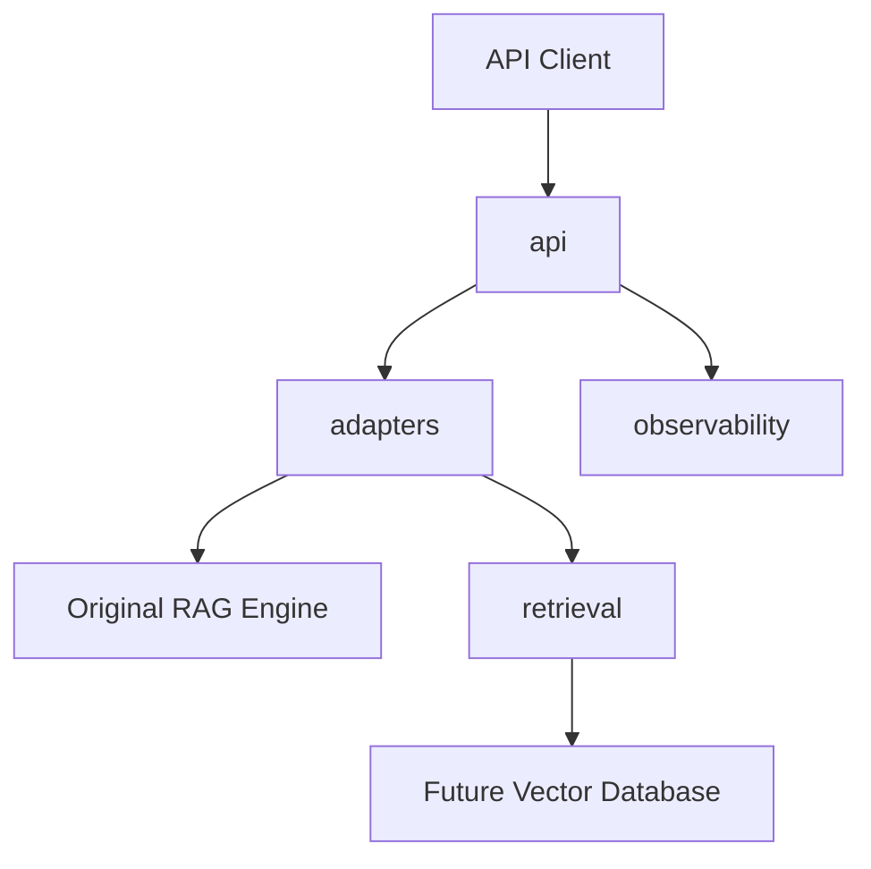

This is a proposed architecture. The packages have
been initialized, but the API and vector database
are not yet implemented.

#### 7. Implementation Details

The following files were created:

```text
api/__init__.py
adapters/__init__.py
retrieval/__init__.py
observability/__init__.py
evaluation/__init__.py
performance/__init__.py
security/__init__.py
tests/__init__.py
```

An `__init__.py` file explicitly marks a directory as a Python package.

Modern Python can also support packages without this file through namespace packages.

We use explicit package initialization to keep the project organization clear and predictable.

#### 8. Verification Results

All eight package files were created successfully.

Verification output:

```text
api              True
adapters         True
retrieval        True
observability    True
evaluation       True
performance      True
security         True
tests            True
```

**Final result: PASSED**

#### 9. Key Learning and Revision Notes

**Module:** A Python file containing reusable code.
**Package:** A way of organizing related Python modules under a common namespace.
**Separation of concerns:** Designing components so that each has a clearly defined responsibility.
**Modularity:** Organizing software into components that can be developed, tested and maintained independently.

A modular architecture helps manage complexity, but creating additional folders alone does not automatically improve software quality.
Good interfaces, tests and clear responsibilities are equally important.

### C10.2.3 — Environment and Dependency Inspection

**Status:** Completed — Follow-up verification required

#### 1. What We Had Earlier

The original academic RAG project used a Python environment named `.cvenv`.

The environment contained the libraries required for the academic implementation:

- PyTorch for tensor operations and GPU execution.
- Transformers for loading Flan-T5-small.
- scikit-learn for TF-IDF retrieval.
- Streamlit for the user interface.

The academic RAG system called Python functions directly and did not require FastAPI.

#### 2. How the Earlier Implementation Worked

The original system followed this architecture:

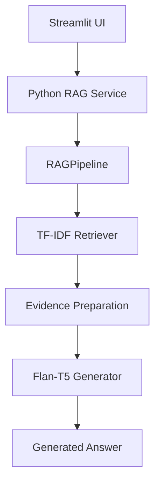

- The RAG pipeline was initialized in Python.
- Once initialized, its retriever and generator could be reused to answer multiple questions.
- The Streamlit application cached the initialized pipeline to avoid reloading the model on every rerun.

#### 3. What We Are Doing Now

Track C introduces a separate engineering application.

- We are inspecting the existing environment before adding backend dependencies.
- The objective is to determine which libraries are already installed and which new dependencies are actually required.

#### 4. Why Are We Making This Change?

- The original architecture was suitable for a local academic demonstration.
- The proposed engineering architecture introduces a separately callable HTTP API.
- This allows other applications to request RAG answers without importing the RAG implementation directly.
- FastAPI will handle API endpoints and request validation.
- Uvicorn will run the ASGI application.
- These additions introduce new dependencies and deployment responsibilities.
- They do not automatically improve retrieval accuracy or generation quality.

#### 5. Old vs New Architecture

| Aspect | Academic implementation | Proposed engineering implementation |
|---|---|---|
| Application interface | Streamlit | FastAPI endpoints |
| Communication | Python calls | HTTP requests |
| Model loading | Existing Python pipeline | Reused through adapter |
| Retriever | TF-IDF | Initially existing TF-IDF |
| Generator | Flan-T5-small | Existing generator reused |
| Deployment | Local Streamlit process | Separate API service |
| Validation | Existing application logic | API request schemas |

#### 6. Proposed Engineering Flow

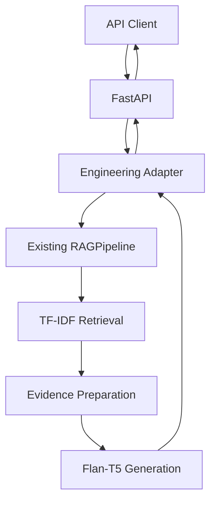

The diagram is a planned architecture. The API has not yet been implemented.

#### 7. Environment Inspection Results

Python version:

`3.11.14`

Existing environment:

`.cvenv`

Selected installed packages:

| Package | Version |
|---|---|
| PyTorch | 2.10.0+cu128 |
| Transformers | 5.21.0 |
| scikit-learn | 1.8.0 |
| Streamlit | 1.66.1 |
| Uvicorn | 0.54.0 |

The package metadata inspection reported the following packages as not installed:

- FastAPI
- Pydantic
- pytest
- ChromaDB
- sentence-transformers

No packages were installed or modified during this inspection.

#### 8. Integration Finding

The earlier source inspection located the
`RAGPipeline` class and its `answer()` method.

However, a direct check for `src/pipeline.py` did not find that file.
The earlier inspection searched recursively, so the pipeline may be located in a subdirectory.
The exact source location requires confirmation before implementing the engineering adapter.

#### 9. Key Learning and Revision Notes

**Dependency:** A library or component required by an application.
**Python environment:** An isolated collection of Python packages and their installed versions.
**FastAPI:** A Python framework used to build HTTP APIs.
**ASGI:** An interface between asynchronous-capable Python web applications and servers.
**Uvicorn:** An ASGI server capable of running applications such as FastAPI.
**Pydantic:** A library used for data validation and structured data models.
**Dependency management:** The practice of recording, installing and maintaining compatible library versions.

A working academic environment should not be modified unnecessarily when introducing optional engineering enhancements.

#### 10. Verification Status

Completed:

- Confirmed Python environment.
- Inspected package metadata.
- Confirmed original project directories.
- Confirmed local Flan-T5 model configuration.

Pending:

- Confirm exact `RAGPipeline` source location.
- Confirm API package import availability.
- Determine the minimal backend dependencies.

**Overall status: Follow-up verification required.**

### C10.2.4 — Pipeline Location and API Dependency Verification

**Status:** Completed — PASSED

#### 1. What We Had Earlier

- Our academic RAG project contained a Python class named `RAGPipeline`.
- This class coordinated the question-answering process.

Its main method was:

```python
RAGPipeline.answer(question, top_k=1)
```

- The method performed retrieval, evidence preparation and answer generation.
- The Streamlit UI accessed this functionality through `services/rag_service.py`.

#### 2. How the Original Pipeline Worked

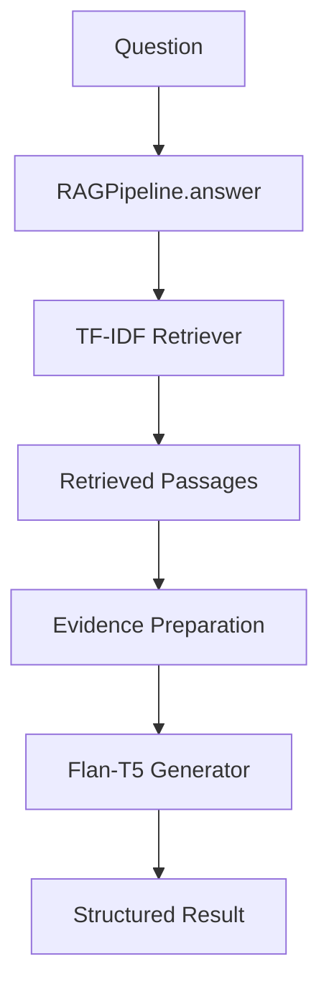

- The pipeline returned a dictionary containing the generated answer, evidence and performance information.
- This structured result allowed the Streamlit UIto display answers, retrieval evidence and metrics.

#### 3. What We Verified Now

The exact source location is:

`Mid-Sem-Project-RAG/src/rag/pipeline.py`

Verified implementation:

- Class: `RAGPipeline`
- Method: `answer`
- Method definition: Line 48

- The earlier file-not-found warning occurred because the inspection checked `src/pipeline.py` instead of `src/rag/pipeline.py`.
- No original source files were missing.

#### 4. Why This Matters for Track C

- Our new FastAPI backend needs a reliable interfaceto the original RAG implementation.
- The engineering adapter will reuse the existing pipeline rather than duplicating its retrieval and generation logic.
- This helps preserve the academic implementation.

#### 5. Dependency Verification

| Package | Installed | Version |
|---|---|---|
| FastAPI | No | — |
| Pydantic | No | — |
| Uvicorn | Yes | 0.54.0 |
| pytest | No | — |

- FastAPI and Pydantic will be considered for C10.
- pytest will be introduced when automated testing is developed.
- ChromaDB and embedding dependencies belong to the later retrieval enhancement stage.

#### 6. Architecture Decision

The engineering project will initially:

1. Accept HTTP requests through FastAPI.
2. Validate incoming question parameters.
3. Call the original RAG pipeline through an adapter.
4. Convert structured RAG results into API responses.

The original RAG project and original Streamlit UI will remain unchanged.

#### 7. Key Learning and Revision Notes

**Class:** A Python definition that groups data and methods.
**Method:** A function associated with a class.
**Adapter:** A component that translates between two existing interfaces.
**HTTP API:** An interface through which applications exchange requests and responses over HTTP.
**Dependency compatibility:** Ensuring that adding a library does not introduce incompatible requirements.
**Dry-run installation:** Inspecting what a package installer proposes to change before applying it.

#### 8. Verification Result

- The pipeline source location was confirmed.
- The missing API dependencies were identified.
- No original implementation files were modified.

**Final result: PASSED**

### C10.2.5 — FastAPI Dependency Compatibility Assessment

**Status:** Completed — PASSED

#### 1. What We Had Earlier

The original academic RAG project used the sharedConda environment `.cvenv`.
This environment already supported:

- PyTorch with CUDA acceleration.
- Hugging Face Transformers.
- scikit-learn TF-IDF retrieval.
- Streamlit visualization.
- Local Flan-T5-small inference.

- The original application did not require FastAPI.
- Streamlit called the RAG pipeline directly through Python functions.

#### 2. How the Original Environment Worked

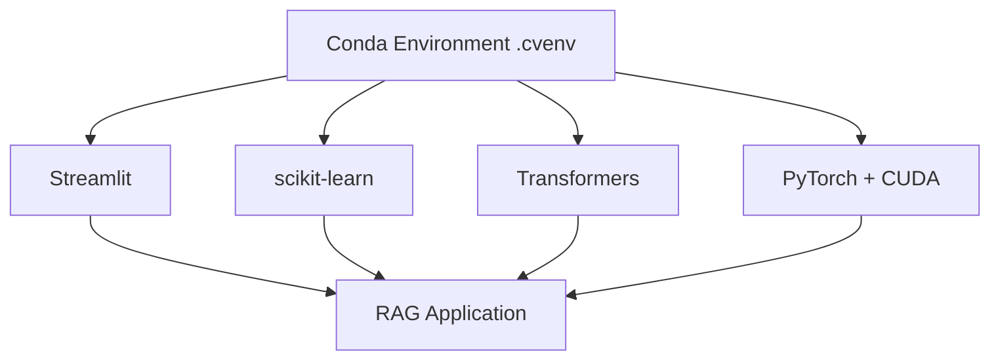

The environment contained the libraries needed
to execute the complete academic RAG application.

#### 3. What We Are Doing Now

We are preparing to introduce FastAPI into Track C.

Before installation, we executed:

```powershell
python -m pip install --dry-run fastapi
```

The command resolved the proposed dependencies without installing them.

We also executed:

```powershell
python -m pip check
```

Result:

```text
No broken requirements found.
```

#### 4. Why Are We Making This Change?

- Track C will introduce a separate HTTP API.
- FastAPI provides routing and request handling.
- Pydantic provides structured request validation.
- Uvicorn runs the API application.
- Our original Streamlit application does not need these additions because it calls Python directly.
- The API will allow future clients to communicate with the same RAG functionality over HTTP.

#### 5. Dependency Inspection Results

The dry run proposed:

| Package | Proposed version |
|---|---|
| FastAPI | 0.162.4 |
| Pydantic | 2.14.3 |
| pydantic-core | 2.50.4 |
| typing-inspection | 0.4.5 |
| annotated-types | 0.8.0 |
| OpenTelemetry API | 1.45.2 |
| typing-extensions | 4.16.0 |

Existing typing-extensions version:`4.15.0`
The proposed installation would upgrade typing-extensions to version 4.16.0.

#### 6. Engineering Decision

The original academic applications use the same Conda environment as the new engineering project.
We will therefore inspect dependency changesbefore installing new libraries.

The preferred approach is:

1. Preserve existing dependencies where practical.
2. Record the current environment.
3. Test dependency resolution before installation.
4. Install only the required backend libraries.
5. Verify package compatibility after installation.
6. Confirm the original applications still work.

If shared-environment compatibility becomes difficult, a separate Engineering environment may be preferable.

#### 7. Key Learning and Revision Notes

**Dependency resolution:** Determining compatible versions of packages required by an application.
**Transitive dependency:** A package requiredindirectly through another installed package.
**Version pinning:** Specifying a particular package version to improve reproducibility.
**Environment isolation:** Keeping project dependencies separate to reduce conflicts.
**Dry run:** Previewing proposed installation changes without applying them.

#### 8. Verification Result

- FastAPI dependency resolution completed.
- The existing environment passed `pip check`.
- No packages were installed or modified.

**Final result: PASSED**

### C10.2.6 — Constrained Dependency Resolution

**Status:** Completed — PASSED

#### 1. What We Had Earlier

The original academic RAG implementation used the shared Conda environment `.cvenv`, which contained PyTorch, Transformers, scikit-learn and Streamlit. The Streamlit application called the Python RAG pipeline directly, so a separate HTTP framework was unnecessary.

#### 2. How the Earlier Implementation Worked

The original application used Python imports and function calls to connect the user interface to the RAG engine. Streamlit collected a question, invoked the existing pipeline, and displayed the generated answer and supporting evidence.

This avoided the additional complexity of maintaining an independent backend server.

#### 3. What We Are Doing Now

Track C introduces FastAPI to expose the existing RAG functionality through HTTP endpoints. Before installing it, we performed dependency resolution using pip's dry-run functionality.

The objective was to determine whether FastAPI could be introduced while preserving the existing `typing-extensions==4.15.0` installation.

#### 4. Why Are We Making This Change?

Our original architecture works well for a local academic demonstration. However, a separate API will allow future applications to request answers without directly importing the RAG implementation.

FastAPI provides API routing and integrates with Pydantic for request validation. Uvicorn runs the ASGI application.

This improves architectural flexibility, but also introduces network communication and additional operational responsibilities.

#### 5. Dependency Resolution Results

The following command was executed:

```powershell
python -m pip install --dry-run "fastapi==0.162.4" "typing-extensions==4.15.0"
```

The dependency resolver successfully identified a compatible installation plan.

| Package | Resolved version |
|---|---|
| FastAPI | 0.162.4 |
| Pydantic | 2.13.5 |
| pydantic-core | 2.46.5 |
| typing-inspection | 0.4.5 |
| annotated-types | 0.8.0 |
| OpenTelemetry API | 1.45.2 |

The existing `typing-extensions==4.15.0` installation can be retained under this resolution.

#### 6. Key Learning and Revision Notes

**Dependency resolution:** The process of identifying compatible package versions for an application.

**Dependency backtracking:** When the resolver explores alternative package versions because an initially selected version does not satisfy all constraints.

**Version constraint:** A requirement specifying which versions of a package are acceptable.

**Environment snapshot:** A record of installed packages and their versions before making changes.

#### 7. Engineering Decision

We will preserve a dependency snapshot before installing FastAPI. After installation, we will verify the installed versions, run `pip check`, and later perform a regression check against the original RAG application.

No original academic source files will be modified.

**Verification result: PASSED**

### C10.2.7 — FastAPI Installation and Verification

**Status:** Completed — PASSED

#### 1. What We Had Earlier

The original RAG application used Streamlit and direct Python calls. The RAG pipeline was initialized inside the Python application, and Streamlit displayed the generated answers and supporting evidence.

No dedicated HTTP backend was required.

#### 2. What We Are Doing Now

FastAPI has been installed in the existing `.cvenv` environment.

Verified versions:

| Package | Version |
|---|---|
| FastAPI | 0.162.4 |
| Pydantic | 2.13.5 |
| Uvicorn | 0.54.0 |

Dependency verification returned:

```text
No broken requirements found.
```

#### 3. Why Are We Making This Change?

We want to expose the existing RAG functionality through a dedicated HTTP API, allowing different clients to use the same backend without importing its Python modules directly.

The new backend will be implemented in the separate Engineering project.

The academic RAG implementation and its Streamlit UI remain unchanged.

#### 4. Key Learning

**FastAPI:** A Python framework for creating APIs.

**Pydantic:** A library for validating and structuring data.

**Uvicorn:** An ASGI server that runs the API application.

**HTTP:** The protocol used by clients and servers to exchange requests and responses.

**API endpoint:** A URL and HTTP method associated with a particular backend operation.

---

### C10.3 — First FastAPI Application

**Status:** Implementation in progress

#### 1. What We Had Earlier

The original Streamlit application used `load_rag_pipeline()` and `pipeline.answer()` to execute question answering directly.

Both the UI logic and RAG integration ran within the Streamlit application process.

#### 2. How the Original Implementation Worked

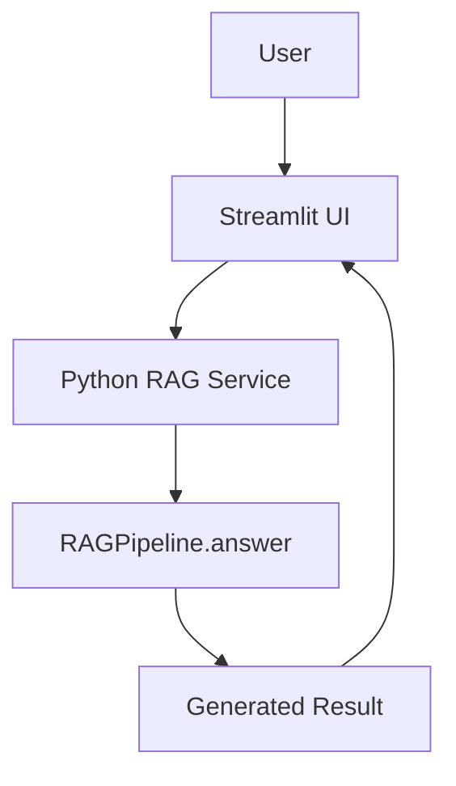

#### 3. What We Are Doing Now

We are creating a separate FastAPI application inside the Engineering project.

The first endpoint is:

`GET /health`

Its purpose is to confirm that the API application is running and responding to HTTP requests.

It does not check the RAG model or initialize GPU resources.

#### 4. Why Start with a Health Endpoint?

We want to verify the HTTP application independently before integrating model loading, retrieval and generation.

This helps distinguish API startup problems from RAG inference problems.

A successful `/health` response confirms that the API process is responding, but does not prove that the underlying RAG engine is ready.

We may introduce a separate readiness endpoint when model initialization is implemented.

#### 5. Original vs Proposed Architecture

| Aspect | Original academic system | New engineering system |
|---|---|---|
| Application interface | Streamlit | FastAPI |
| Communication | Direct Python calls | HTTP requests |
| RAG integration | Existing service module | New adapter planned |
| Model initialization | Within existing application | Backend lifecycle planned |
| Health endpoint | No dedicated API health endpoint | `/health` |

#### 6. Proposed FastAPI Architecture

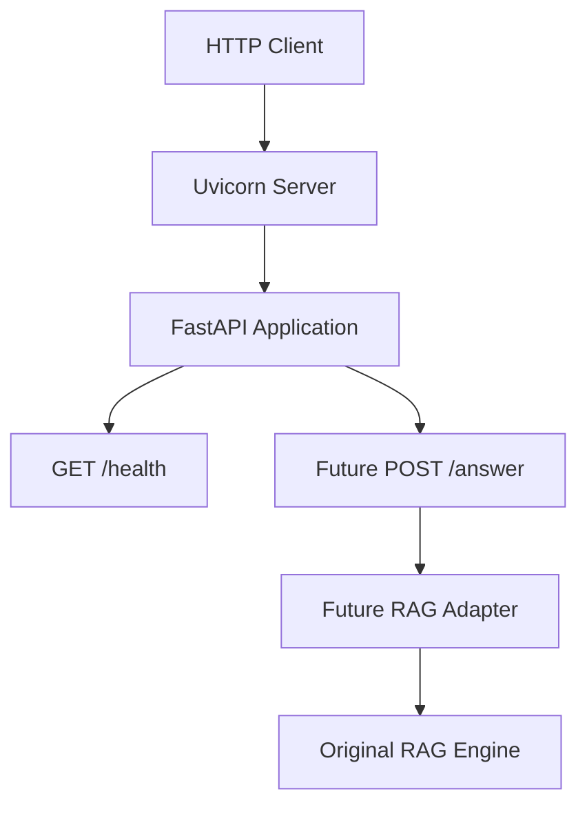

Only the health endpoint is part of the initial implementation.

The answer endpoint and RAG adapter will be added later.

#### 7. Implementation

New file:

`api/main.py`

The application is created using:

```python
from fastapi import FastAPI

app = FastAPI(
    title="Offline Wikipedia RAG Engineering API",
    version="0.1.0"
)
```

A health endpoint returns basic application status:

```python
@app.get("/health")
def health_check():
    return {
        "status": "healthy",
        "service": "offline-wikipedia-rag-engineering",
        "version": "0.1.0"
    }
```

#### 8. Verification Commands

Verify Python syntax:

```powershell
python -m py_compile .\api\main.py
```

Start the API:

```powershell
python -m uvicorn api.main:app --host 127.0.0.1 --port 8000
```

Verify the endpoint:

```powershell
Invoke-RestMethod -Uri "http://127.0.0.1:8000/health"
```

Interactive documentation:

`http://127.0.0.1:8000/docs`

#### 9. Key Learning and Revision Notes

**GET:** An HTTP method commonly used to retrieve information.

**JSON:** A structured text format used to exchange data between applications.

**HTTP 200:** A successful HTTP response status.

**API health check:** An endpoint indicating whether an application process can respond to requests.

**Readiness check:** A stronger check indicating whether an application can perform its intended work, potentially including model and dependency availability.

#### 10. Verification Status

Pending execution:

- Python syntax verification.
- FastAPI application import.
- Uvicorn startup.
- Interactive documentation inspection.
- HTTP health endpoint verification.

The stage will be marked complete after these checks pass.

### C10.3 — First FastAPI Backend and Health Endpoint

**Status:** Completed — PASSED

#### 1. What We Had Earlier

Our original academic RAG application used Streamlit as its user interface. When a user submitted a question, Streamlit called Python functions through `services/rag_service.py`.

The RAG pipeline retrieved Wikipedia passages, prepared evidence and generated an answer using Flan-T5-small.

There was no separate HTTP API between Streamlit and the RAG pipeline.

#### 2. How the Earlier Implementation Worked

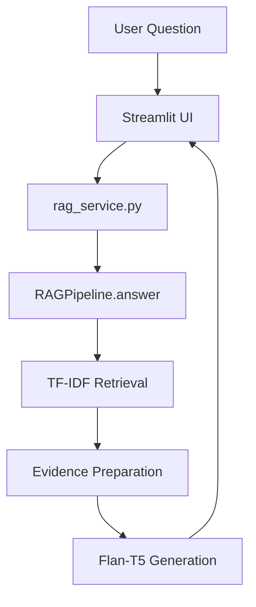

Streamlit and the RAG integration operated through direct Python calls.

#### 3. What We Implemented Now

We created a separate FastAPI application in:

`Mid-Sem-Project-RAG-Engineering/api/main.py`

The application exposes:

`GET /health`

The endpoint returns:

```json
{
  "status": "healthy",
  "service": "offline-wikipedia-rag-engineering",
  "version": "0.1.0"
}
```

This endpoint does not initialize the RAG pipeline or test whether the model is ready.

#### 4. Why Did We Introduce FastAPI?

FastAPI enables applications to communicate with backend functionality through HTTP requests.

A future Engineering UI, command-line client or other application will be able to request RAG answers without directly importing the RAG implementation.

This provides an additional integration option while preserving the original Streamlit application.

The trade-off is increased complexity: the API server must be started, monitored and secured separately.

#### 5. Original vs Engineering Implementation

| Aspect | Original academic application | Engineering application |
|---|---|---|
| Framework | Streamlit | FastAPI |
| Communication | Python calls | HTTP |
| Server | Streamlit application server | Uvicorn |
| Current functionality | RAG question answering | Health endpoint |
| Model initialization | Implemented | Not yet integrated |
| Original source files | Preserved | Preserved |

#### 6. Current Architecture

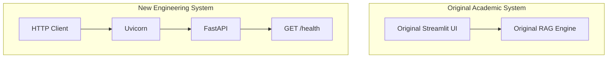

The two applications currently run independently.

#### 7. Implementation Details

The FastAPI application is initialized using:

```python
from fastapi import FastAPI

app = FastAPI(
    title="Offline Wikipedia RAG Engineering API",
    version="0.1.0"
)
```

The health endpoint is implemented using:

```python
@app.get("/health")
def health_check():
    return {
        "status": "healthy",
        "service": "offline-wikipedia-rag-engineering",
        "version": "0.1.0"
    }
```

#### 8. Verification Results

Python syntax verification:

```powershell
python -m py_compile .\api\main.py
```

Application import:

```powershell
python -c "from api.main import app; print(app.title)"
```

Server startup:

```powershell
python -m uvicorn api.main:app --host 127.0.0.1 --port 8000
```

Health endpoint:

```powershell
Invoke-RestMethod -Uri "http://127.0.0.1:8000/health"
```

Observed result:

```text
status  : healthy
service : offline-wikipedia-rag-engineering
version : 0.1.0
```

The application started successfully and responded to an HTTP request.

**Final result: PASSED**

#### 9. Key Learning and Revision Notes

**Frontend:** The part of an application through which users interact with its functionality.

**Backend:** The application component responsible for processing requests and performing business operations.

**API:** An interface through which software components exchange requests and responses.

**Endpoint:** A specific URL and HTTP method that exposes an operation.

**Uvicorn:** The ASGI server running our FastAPI application.

**HTTP GET:** A request method typically used to retrieve information.

**JSON:** A structured data format commonly used in HTTP API responses.

**Health endpoint:** An endpoint that helps confirm the application process is responsive.

A healthy API process does not necessarily imply that its RAG model is loaded or ready. Model readiness will require a separate verification after integration.

#### 10. Next Enhancement

Stage C10.4 will introduce an adapter connecting the new FastAPI backend to the existing academic RAG implementation.

The original academic source files will remain unchanged.

### C10.4.1 — Existing RAG Loader Inspection

**Status:** Completed — PASSED

#### 1. What We Had Earlier

Our original Streamlit application used `services/rag_service.py` to connect with the academic RAG implementation.

This service provided three functions:

| Function | Purpose |
|---|---|
| `inspect_rag_project()` | Verify original RAG project files |
| `get_rag_application_module()` | Import the original RAG application |
| `load_rag_pipeline()` | Initialize the configuration-driven RAG pipeline |

The Streamlit application called `load_rag_pipeline()` and then executed `pipeline.answer()` to retrieve evidence and generate answers.

#### 2. How the Earlier Implementation Worked

The original service first verified that required RAG files existed. It then added the academic project's `src` directory to Python's module search path and imported `run_rag`.

The initialization process was:

```python
rag_application = get_rag_application_module()

config = rag_application.load_config()

pipeline = rag_application.initialize_rag(config)
```

The initialized pipeline contained the retriever, generator and other components required for question answering.

#### 3. What We Are Doing Now

Track C will introduce an independent Engineering adapter.

This adapter will connect FastAPI to the original RAG application without depending on the Streamlit UI service.

The original academic source files will remain unchanged.

#### 4. Why Are We Making This Change?

The original integration was designed specifically for the Streamlit application.

The new Engineering backend needs a reusable integration layer that does not depend on Streamlit.

This separates HTTP communication from RAG initialization and question answering.

The adapter will also provide a central location for managing model initialization and reuse.

#### 5. Original vs Engineering Integration

| Aspect | Original integration | Engineering integration |
|---|---|---|
| Caller | Streamlit | FastAPI |
| Service implementation | `rag_service.py` | New `rag_adapter.py` |
| Original RAG code | Reused | Reused |
| Configuration | Original `load_config()` | Original loader reused |
| Initialization | `initialize_rag(config)` | Same function |
| Model caching | Streamlit resource cache | Backend-level caching planned |
| Original source modifications | None | None |

#### 6. Existing Initialization Flow

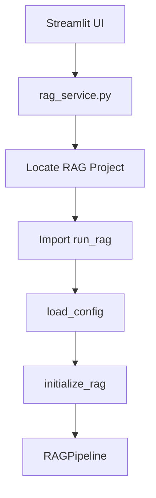

#### 7. Proposed Engineering Initialization Flow

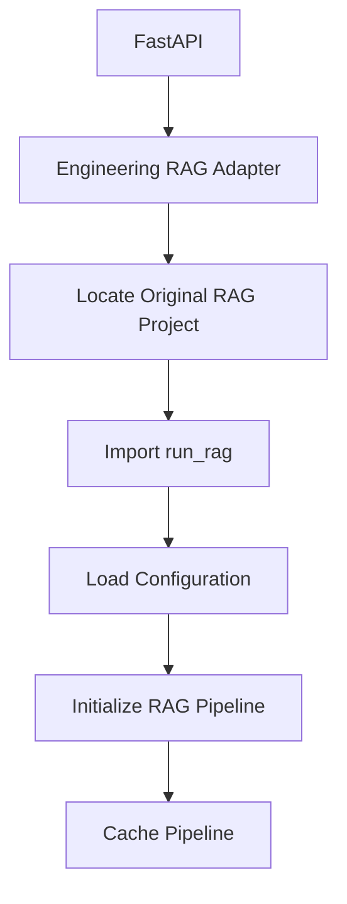

The Engineering flow is proposed and has not yet been implemented.

#### 8. Verification Results

The existing loader was inspected without initializing the model.

The inspection confirmed:

- Required project files are checked before initialization.
- The original application module is `run_rag`.
- Configuration is loaded using `load_config()`.
- Pipeline initialization uses `initialize_rag(config)`.
- Streamlit integration does not require a separate REST API.

**Final result: PASSED**

#### 9. Key Learning and Revision Notes

**Python module search path (`sys.path`):** The locations Python searches when resolving module imports.

**Adapter pattern:** A software design approach that connects components with different interfaces.

**Configuration-driven initialization:** Creating application components using settings stored outside the main implementation logic.

**Caching:** Reusing an already initialized resource rather than recreating it for every request.

Caching the RAG pipeline is particularly useful because model initialization loads the TF-IDF index and Flan-T5 weights, which is more expensive than answering an individual question after initialization.

#### 10. Next Step

Inspect the original `load_config()` implementation to verify how configuration file paths are resolved.

This verification is necessary before implementing the independent Engineering adapter.


### C10.4.2 — Configuration Loading Verification

**Status:** Completed — PASSED

#### 1. What We Had Earlier

The original academic RAG implementation used `src/run_rag.py` to initialize the configuration-driven RAG pipeline. Configuration values were stored separately in `config/rag_config.json`.

The configuration defined important parameters relating to the dataset, retrieval, evidence preparation and generator.

This allowed the RAG pipeline to be configured without hardcoding every parameter into the application logic.

#### 2. How the Earlier Implementation Worked

The original configuration loader was defined as:

```python
def load_config(config_path=CONFIG_PATH):
```

It loaded the configuration from a JSON file and checked that the required sections existed:

- `data`
- `retrieval`
- `evidence`
- `generator`

The loaded configuration was passed to `initialize_rag(config)` to create the complete pipeline.

#### 3. What We Verified Now

The configuration file exists at:

`Mid-Sem-Project-RAG/config/rag_config.json`

The loader accepts an explicit configuration path.

Therefore, our Engineering adapter can reference the original configuration directly, without modifying the original RAG implementation or changing the application's working directory.

**Final result: PASSED**

---

### C10.4.3 — Engineering RAG Adapter

**Status:** Implementation created; verification pending

#### 1. What We Had Earlier

The original Streamlit UI used `services/rag_service.py` to import and initialize the academic RAG pipeline.

Streamlit cached the initialized pipeline using `st.cache_resource`, avoiding repeated model loading during application reruns.

The UI then called `pipeline.answer(question, top_k)` to retrieve evidence and generate answers.

#### 2. What We Are Doing Now

We are creating an independent Engineering adapter in `adapters/rag_adapter.py`.

The adapter will locate the original RAG project, import its application module, load the original configuration, initialize the pipeline and expose a reusable question-answering function.

The original academic files will remain unchanged.

#### 3. Why Are We Making This Change?

The original RAG integration was designed for Streamlit. The new FastAPI backend needs an independent integration layer.

An adapter separates API-specific concerns from model initialization and inference.

It also enables future changes to the backend interface without rewriting the original RAG implementation.

#### 4. Original vs Engineering Integration

| Aspect | Original Streamlit UI | Engineering backend |
|---|---|---|
| Integration module | `services/rag_service.py` | `adapters/rag_adapter.py` |
| Original RAG engine | Reused | Reused |
| Configuration | Original JSON configuration | Same configuration |
| Initialization | `initialize_rag(config)` | Same initialization |
| Resource caching | `st.cache_resource` | `lru_cache` |
| Question answering | `pipeline.answer()` | Adapter function |
| Original code modified | No | No |

#### 5. Proposed Integration Flow

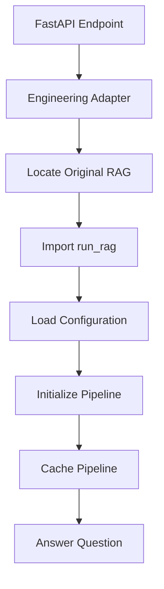

#### 6. Implementation Details

The Engineering adapter provides four main functions:

| Function | Responsibility |
|---|---|
| `inspect_original_rag()` | Verify original project files |
| `get_original_rag_module()` | Import the original application |
| `get_rag_pipeline()` | Initialize and cache the pipeline |
| `answer_question()` | Execute question answering |

The adapter uses `pathlib.Path` to determine project locations.

It uses `importlib.import_module()` to import the original application.

It uses `functools.lru_cache()` to reuse the initialized pipeline within the process.

#### 7. Model Caching

The original Streamlit application used resource caching.

The Engineering adapter uses:

```python
@lru_cache(maxsize=1)
def get_rag_pipeline():
    ...
```

The cached object is reused for subsequent calls in the same Python process.

This reduces repeated initialization overhead.

However, this initial design does not guarantee that only one initialization occurs when multiple concurrent requests arrive before the cache is populated.

Concurrency-safe initialization will be addressed during production engineering.

#### 8. Key Learning and Revision Notes

**Adapter pattern:** A software design approach that connects components through an intermediate interface.

**Configuration-driven application:** An application whose behavior is controlled by external configuration values.

**Importlib:** Python functionality for importing modules programmatically.

**Caching:** Reusing a previously computed or initialized object instead of recreating it.

**Process-local cache:** A cache that exists only within one running Python process.

**Lazy initialization:** Deferring resource initialization until the resource is first requested.

#### 9. Verification Plan

The adapter will first be checked for:

- Python syntax correctness.
- Original project path resolution.
- Required file availability.
- Application module import.
- Configuration and initialization function availability.

A separate runtime test will later verify actual model initialization and question answering.

No original academic source files will be modified.


### C10.4.4 — Engineering Adapter Import Verification

**Status:** Completed — PASSED

#### 1. What We Had Earlier

The academic Streamlit application loaded the existing RAG pipeline through `services/rag_service.py`. This service located the original project, imported `run_rag.py` and initialized the retriever and generator.

The original RAG engine was therefore already reusable through Python imports.

#### 2. What We Implemented Now

Track C introduced an independent adapter in `adapters/rag_adapter.py`.

The adapter provides the following functions:

| Function | Responsibility |
|---|---|
| `inspect_original_rag()` | Verify original project files |
| `get_original_rag_module()` | Import the academic RAG application |
| `get_rag_pipeline()` | Initialize and cache the pipeline |
| `answer_question()` | Execute question answering |

The adapter uses the existing academic implementation without modifying its source files.

#### 3. Why Are We Making This Change?

Our new FastAPI backend needs an integration mechanism independent of Streamlit.

The adapter separates RAG initialization and execution from the HTTP application layer.

This allows the Engineering project to reuse the academic pipeline while introducing new interfaces and operational capabilities.

#### 4. Architecture

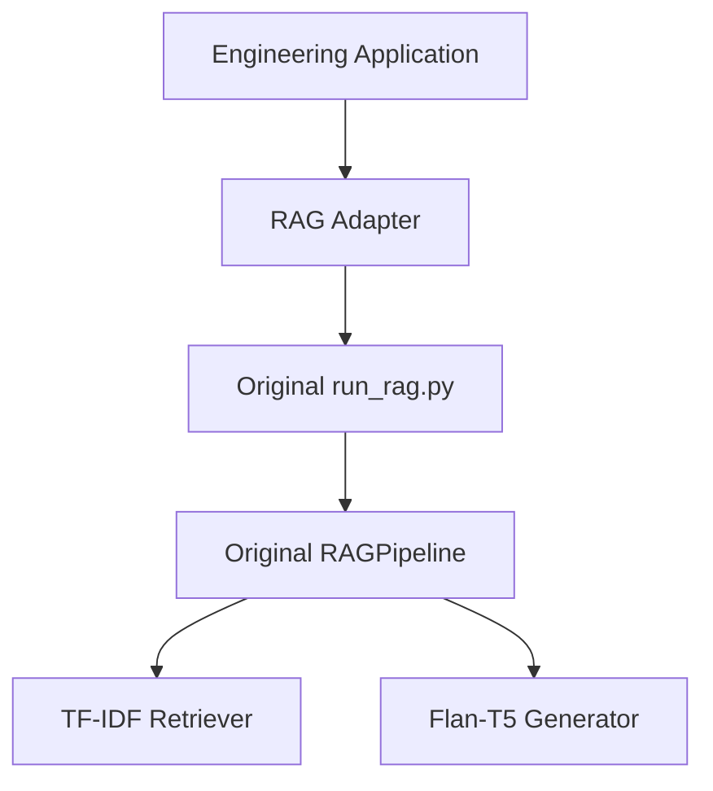

#### 5. Verification Results

Python syntax verification completed successfully.

The adapter located the following original project components:

- `src/run_rag.py`
- `src/rag/pipeline.py`
- `src/rag/generator.py`
- `config/rag_config.json`

The original `run_rag` module was imported successfully.

Both `load_config()` and `initialize_rag()` were available.

No model initialization was required for these checks.

**Final result: PASSED**

#### 6. Key Learning and Revision Notes

**Adapter pattern:** A design approach that allows components with different interfaces to work together.

**Module import:** Loading Python definitions from another module for reuse.

**Integration verification:** Checking whether components can locate and communicate with their dependencies.

**Dependency reuse:** Using existing implementations instead of duplicating functionality.

An import test verifies that the integration interface is available. It does not prove that model initialization or inference works correctly.

The next stage will perform real RAG inference through the Engineering adapter.

### C10.4.5 — Real RAG Adapter Integration

**Status:** Completed — PASSED

#### 1. What We Had Earlier

The original academic RAG project used TF-IDF retrieval, evidence preparation and Flan-T5-small to answer questions about its indexed Wikipedia corpus.

The Streamlit UI initialized the pipeline through `rag_service.py` and reused it through Streamlit resource caching.

#### 2. What We Verified Now

The Engineering adapter successfully initialized the original pipeline, loaded the local Flan-T5 model and executed question answering on CUDA.

The pipeline contained 8,191 indexed passages and a TF-IDF matrix with 30,000 features.

The adapter returned the answer "middle-distance runner" for the question "Who is Diana Richburg?" using K=1.

#### 3. Verified Performance

| Metric | Observed value |
|---|---|
| Retrieval time | 0.0136 seconds |
| Generation time | 1.1709 seconds |
| Total pipeline time | 1.1945 seconds |
| Input tokens | 119 |
| Generated tokens | 9 |
| Execution device | CUDA |

These measurements describe one test execution and should not be interpreted as average production performance.

#### 4. Pipeline Caching

The adapter uses `lru_cache(maxsize=1)` to reuse the initialized pipeline within the Python process.

Verification returned:

```text
Same pipeline instance: True
CacheInfo(hits=1, misses=1, maxsize=1, currsize=1)
```

This confirms cache reuse during sequential calls in the test process.

#### 5. Engineering Conclusion

The original academic RAG pipeline can be reused successfully from the separate Engineering project.

No original academic source files were modified.

**Final result: PASSED**

---

### C10.5 — HTTP Question Answering with FastAPI

**Status:** Implementation in progress

#### 1. What We Had Earlier

The original Streamlit application called `pipeline.answer()` directly from Python and received a structured dictionary.

The dictionary contained the generated answer, retrieved evidence, execution times, token counts and model device.

The original implementation did not expose a dedicated HTTP question-answering endpoint.

#### 2. What We Are Doing Now

Track C introduces a FastAPI endpoint:

`POST /answer`

The endpoint receives a JSON request containing a question and retrieval K value.

It validates the request, invokes the Engineering adapter and returns a structured JSON response.

#### 3. Why Are We Making This Change?

The HTTP endpoint allows applications to access the RAG engine without importing its Python modules.

This separates client applications from backend execution.

It also provides a defined interface through which requests and responses can be validated.

#### 4. Old vs New Integration

| Aspect | Original implementation | Engineering implementation |
|---|---|---|
| Caller | Streamlit | HTTP client |
| Communication | Python function call | HTTP POST |
| Input | Function arguments | JSON request |
| Validation | Existing Python logic | Pydantic schema |
| Execution | `pipeline.answer()` | Engineering adapter |
| Output | Python dictionary | JSON response |
| Original RAG code | Unchanged | Unchanged |

#### 5. Proposed API Flow

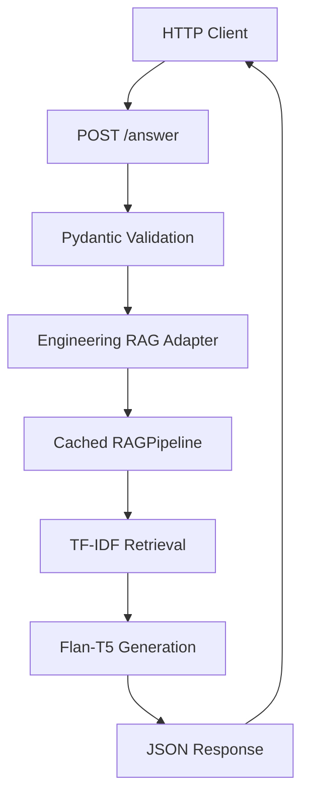

#### 6. Request Schema

The API accepts:

```json
{
  "question": "Who is Diana Richburg?",
  "top_k": 1
}
```

The question must contain non-whitespace text and must not exceed 1,000 characters.

The supported retrieval K values are 1, 3 and 5.

Other values are rejected during request validation.

#### 7. Response Schema

The initial response contains:

- Question and generated answer.
- Selected retrieval K.
- Retrieval, generation and total pipeline times.
- Input and generated token counts.
- Model execution device.
- Number of retrieved passages.

The complete retrieved evidence is not included in the initial API response.

#### 8. Implementation Files

| File | Responsibility |
|---|---|
| `api/main.py` | FastAPI endpoints and schemas |
| `adapters/rag_adapter.py` | Reuse of original RAG engine |
| `src/rag/pipeline.py` | Original academic RAG pipeline, unchanged |

#### 9. Key Learning and Revision Notes

**HTTP POST:** A method commonly used to submit data to a server for processing.

**Request body:** Data supplied by a client as part of an HTTP request.

**Pydantic schema:** A structured definition used to validate incoming and outgoing data.

**HTTP 200:** Indicates a successful request.

**HTTP 422:** Indicates that submitted data could not be validated against the expected request schema.

**Lazy model loading:** Deferring model initialization until it is actually needed.

The first valid request may take longer because the model must be initialized. Later requests can reuse the cached pipeline within the same server process.

#### 10. Verification Plan

The new endpoint will be tested for:

1. Python syntax correctness.
2. Successful FastAPI import.
3. Uvicorn startup.
4. Successful `/health` response.
5. Successful `/answer` response.
6. Invalid question rejection.
7. Invalid K rejection.
8. Pipeline reuse across sequential requests.

The stage will be marked complete after these checks pass.


### C10.5 — FastAPI RAG Question Answering Verification

**Status:** Completed — PASSED

#### 1. What We Had Earlier

The original academic RAG implementation used direct Python calls through Streamlit. The user entered a question, Streamlit invoked `pipeline.answer()`, and the resulting answer and evidence were displayed within the application.

No separate HTTP API was required.

#### 2. What We Implemented Now

Track C introduced a FastAPI endpoint:

`POST /answer`

The endpoint accepts a JSON request, validates its parameters, invokes the Engineering RAG adapter and returns a structured JSON response.

The original academic RAG source files remain unchanged.

#### 3. Why Are We Making This Change?

An HTTP API allows other applications to access the RAG engine without directly importing its Python implementation.

This creates a clear interface between client applications and the backend.

It also supports future engineering improvements such as authentication, request logging, monitoring and independent deployment.

#### 4. Original vs Engineering Implementation

| Aspect | Original academic system | Engineering backend |
|---|---|---|
| Interface | Streamlit | FastAPI |
| Communication | Direct Python calls | HTTP POST |
| Input | Python function arguments | JSON request |
| Validation | Python application logic | Pydantic request schema |
| Execution | `pipeline.answer()` | Engineering adapter |
| Output | Python dictionary | JSON response |
| Generator | Flan-T5-small | Same original generator |
| Retrieval | TF-IDF | Same original retriever |

#### 5. Verified Architecture

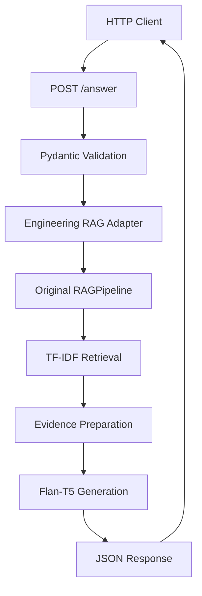

#### 6. Successful API Request

```json
{
  "question": "Who is Diana Richburg?",
  "top_k": 1
}
```

The backend returned the answer:

`middle-distance runner`

The request successfully executed the original RAG pipeline on CUDA.

#### 7. Verified Performance Metrics

| Metric | Observed value |
|---|---|
| Retrieval time | 0.0260 seconds |
| Generation time | 0.5789 seconds |
| Total pipeline time | 0.6153 seconds |
| Input tokens | 119 |
| Generated tokens | 9 |
| Retrieved passages | 1 |
| Execution device | CUDA |

These values represent one successful API execution. They are not average production benchmarks.

The reported pipeline time does not include the complete HTTP request and response overhead.

#### 8. Key Learning and Revision Notes

**REST API:** An HTTP-based interface organized around resources and operations.

**HTTP POST:** An HTTP method commonly used to submit data for processing.

**Request validation:** Checking that incoming data follows the expected schema and constraints.

**Serialization:** Converting application data into a format such as JSON for transmission.

**HTTP round-trip time:** The elapsed time between a client sending a request and receiving its response.

**Pipeline execution time:** The time measured inside the RAG pipeline. This may exclude API processing, network transmission and initial model loading.

#### 9. Verification Result

The FastAPI endpoint successfully:

- Accepted a valid JSON request.
- Invoked the Engineering RAG adapter.
- Executed the original RAG pipeline.
- Generated an answer using CUDA.
- Returned retrieval and generation metrics.
- Returned a structured JSON response.

**Final result: PASSED**

#### 10. Next Step

Stage C10.6 will verify invalid-request handling and API reliability before the Architecture Modernization stage is considered complete.


### C10.6 — FastAPI Request Validation

**Status:** Completed — PASSED

#### 1. What We Had Earlier

The original academic RAG pipeline accepted a question and a retrieval parameter through Python function arguments.

```python
result = pipeline.answer(
    question="Who is Diana Richburg?",
    top_k=1
)
```

The Streamlit UI provided input controls, while the pipeline executed retrieval and generation.

The academic implementation did not expose a public HTTP endpoint, so it did not require an HTTP request-validation schema.

#### 2. How the Earlier Implementation Worked

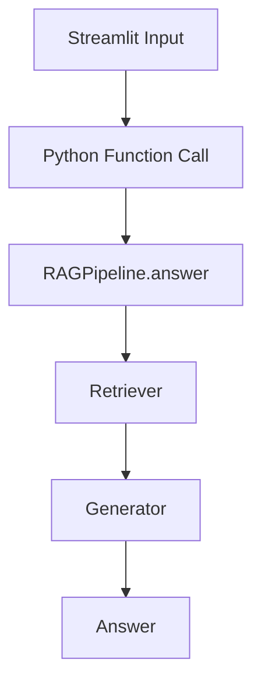

Input handling was part of the Python application and its existing components.

#### 3. What We Implemented Now

The Engineering backend exposes `POST /answer` and validates incoming JSON requests using Pydantic.

The request schema requires a non-empty question with a maximum length of 1,000 characters. Supported retrieval K values are 1, 3 and 5.

A custom validator also rejects questions containing only whitespace.

#### 4. Why Are We Making This Change?

HTTP clients can send data independently of the user interface. The backend therefore needs to validate requests rather than assuming that clients always submit appropriate values.

API-level validation helps reject malformed inputs before they reach the model, reducing unnecessary processing and improving error reporting.

Validation is one layer of application security, not a complete security solution.

#### 5. Original vs Engineering Validation

| Aspect | Academic application | Engineering API |
|---|---|---|
| Input mechanism | Streamlit controls | HTTP JSON |
| Interface | Python arguments | Pydantic schema |
| Question validation | Existing application logic | Required, non-empty, maximum length |
| K validation | UI selection and adapter logic | Allowed values 1, 3, 5 |
| Invalid HTTP response | Not applicable | HTTP 422 |

#### 6. Request Validation Flow

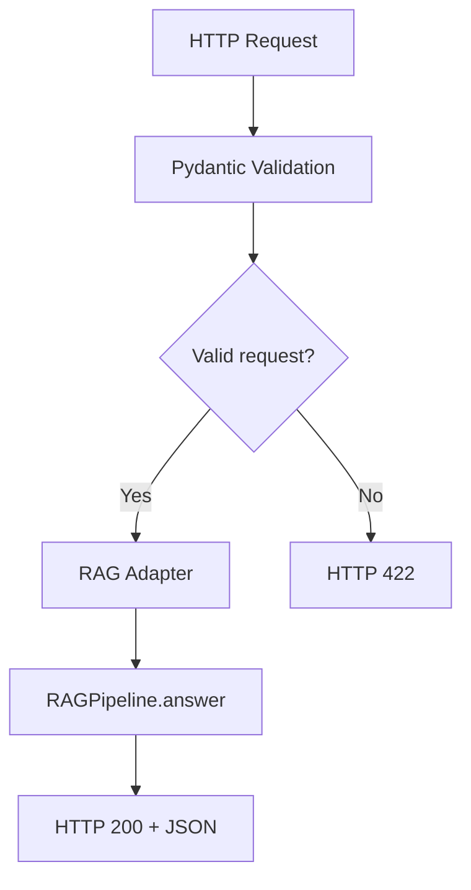

#### 7. Verification Results

Four invalid-input tests were executed through PowerShell.

| Test | Expected response | Actual response |
|---|---|---|
| Empty question | HTTP 422 | HTTP 422 |
| Invalid K = 99 | HTTP 422 | HTTP 422 |
| Missing question | HTTP 422 | HTTP 422 |
| Whitespace-only question | HTTP 422 | HTTP 422 |

**Passed: 4/4**

**Final result: PASSED**

#### 8. PowerShell Compatibility Finding

The initial verification script used `-SkipHttpErrorCheck`, which was unavailable in the installed PowerShell version.

The revised script handled HTTP error responses through `try/catch` and inspected the response status code.

This was a test-script compatibility issue, not an API failure.

#### 9. Key Learning and Revision Notes

**Input validation:** Checking whether incoming data satisfies defined requirements.

**Schema:** A description of the expected structure and types of data.

**HTTP 200:** Indicates a successful HTTP request.

**HTTP 422:** Indicates that submitted request data could not be validated against the endpoint's requirements.

**Client-side validation:** Validation performed by the user interface or client application.

**Server-side validation:** Validation performed by the backend independently of the client.

Backend validation remains necessary even when the frontend already validates user input.

#### 10. Engineering Conclusion

The Engineering API correctly rejects the four tested invalid request types before invoking the RAG pipeline.

The original academic RAG implementation remains unchanged.

**Stage C10.6: Completed**


## C10 — Architecture Modernization: Final Summary

**Status: COMPLETED — PASSED**

### 1. What We Had Earlier

The original academic RAG project implemented Retrieval-Augmented Generation using Wikipedia passages, TF-IDF retrieval, cosine similarity, evidence preparation and Flan-T5-small.

The original Streamlit UI called the RAG pipeline directly through Python.

The academic implementation contained 8,191 indexed passages and a TF-IDF matrix with 30,000 features.

The existing application worked successfully without a separate HTTP backend.

### 2. How the Original Architecture Worked

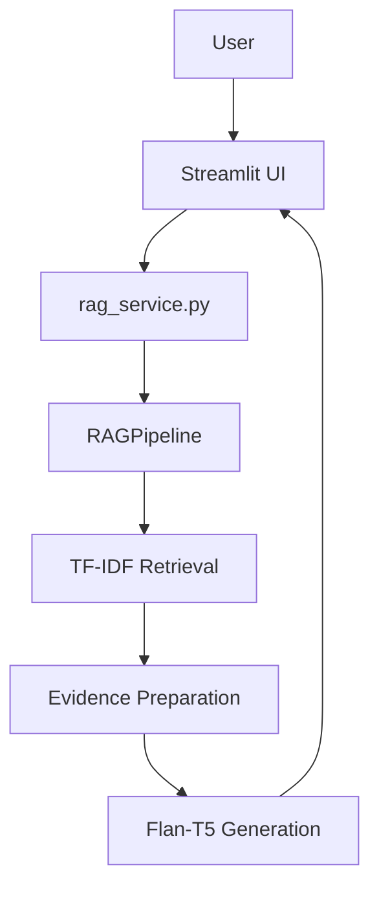

The UI was responsible for user interaction and presentation, while the RAG pipeline performed retrieval and answer generation.

Communication between the UI and the RAG engine occurred through direct Python function calls.

### 3. What We Implemented in Track C10

A separate Engineering project was created:

`Mid-Sem-Project-RAG-Engineering`

The project contains an independent FastAPI backend and RAG adapter.

The API exposes two endpoints:

| Endpoint | Purpose |
|---|---|
| `GET /health` | Verify that the API process responds |
| `POST /answer` | Execute RAG question answering |

The Engineering adapter imports and initializes the original academic RAG pipeline.

The original academic source files were not intentionally modified during C10.

### 4. Why We Introduced This Architecture

The academic implementation was suitable for demonstrating RAG functionality locally.

Track C introduces a separate API so that other applications can access the same RAG engine through HTTP.

The API architecture supports future enhancements such as independent clients, structured request validation, observability, authentication and deployment controls.

The trade-off is additional complexity. The backend server must be started, monitored and maintained separately.

FastAPI does not automatically improve answer accuracy or model inference speed.

### 5. Original vs Engineering Architecture

| Aspect | Academic implementation | Engineering implementation |
|---|---|---|
| User interface | Streamlit | API client; separate UI planned |
| Communication | Python calls | HTTP |
| Backend framework | Existing Python services | FastAPI |
| Request validation | Existing application logic | Pydantic |
| RAG engine | Original RAGPipeline | Same original RAGPipeline |
| Retriever | TF-IDF | Same TF-IDF |
| Generator | Flan-T5-small | Same Flan-T5-small |
| Caching | Streamlit resource cache | Process-local `lru_cache` |
| Model execution | CUDA | CUDA |
| Original project modification | Not required | Not required |

### 6. Verified Engineering Architecture

```mermaid
flowchart TD
    A["HTTP Client"] --> B["Uvicorn"]
    B --> C["FastAPI"]
    C --> D["Pydantic Validation"]
    D --> E["Engineering RAG Adapter"]
    E --> F["Original RAGPipeline"]
    F --> G["TF-IDF Retrieval"]
    G --> H["Evidence Preparation"]
    H --> I["Flan-T5 Generation"]
    I --> J["JSON Response"]
    J --> A
```

### 7. Important Engineering Files

| File | Responsibility |
|---|---|
| `api/main.py` | FastAPI application, endpoints and request schemas |
| `adapters/rag_adapter.py` | Integration with the original academic RAG engine |
| `api/__init__.py` | API package initialization |
| `adapters/__init__.py` | Adapter package initialization |

The original RAG implementation remains in the separate `Mid-Sem-Project-RAG` project.

### 8. Verification Results

The following tests passed:

- Python syntax verification.
- FastAPI application import.
- Uvicorn startup.
- API health endpoint.
- RAG adapter import.
- Original RAG pipeline initialization.
- CUDA-based question answering.
- Pipeline cache reuse within a single process.
- HTTP `/answer` execution.
- Four invalid-input validation tests.
- Default retrieval K verification.
- Final architecture verification.

#### Final API Test

Question:

`Who is Diana Richburg?`

Generated answer:

`middle-distance runner`

Retrieval K:

`1`

Execution device:

`cuda`

Retrieved passages:

`1`

#### Input Validation

| Test | Result |
|---|---|
| Empty question | HTTP 422 |
| Invalid K | HTTP 422 |
| Missing question | HTTP 422 |
| Whitespace-only question | HTTP 422 |

All four validation tests passed.

### 9. Limitations and Future Engineering Work

C10 provides a working local HTTP API, but it should not yet be considered production-ready.

Remaining improvements include:

- Concurrency-safe model initialization.
- Better exception handling and structured error responses.
- Request logging and tracing.
- Authentication and authorization.
- Automated integration and regression tests.
- Performance and load testing.
- Operational readiness checks.
- Configuration and dependency management.
- Deployment documentation.

These activities will be addressed during later Track C stages.

### 10. Key Learning and Revision Notes

**Frontend:** The application component responsible for user interaction.

**Backend:** The component responsible for processing requests and executing application operations.

**API:** An interface through which applications exchange requests and responses.

**FastAPI:** A Python framework for implementing HTTP APIs.

**Pydantic:** A library for structured data validation.

**Uvicorn:** An ASGI server used to run the FastAPI application.

**Adapter pattern:** A design approach that connects an application interface with an existing implementation.

**Caching:** Reusing an initialized resource to avoid repeated initialization.

**Separation of concerns:** Assigning different responsibilities to different software components.

**Backward compatibility:** Preserving the usability of an existing implementation while introducing new functionality.

### 11. Final Engineering Conclusion

Track C10 successfully introduced a separate FastAPI backend that reuses the original academic RAG pipeline.

The new architecture enables HTTP-based question answering and request validation while preserving the existing academic implementation.

**Track C10 — Architecture Modernization: COMPLETED**


# Proposed C11 Roadmap

| Substage | Topic |
|-----------|--------|
| C11.1 | TF-IDF vs Embeddings vs Vector Databases |
| C11.2 | Understanding Dense Vectors and Cosine Similarity |
| C11.3 | ChromaDB Architecture and Collections |
| C11.4 | Select and Evaluate an Embedding Model |
| C11.5 | Create a Separate Vector Index for Our Wikipedia Passages |
| C11.6 | Implement the ChromaDB Retriever |
| C11.7 | Compare TF-IDF and Semantic Retrieval |
| C11.8 | Investigate Hybrid Retrieval and Reranking |
| C11.9 | Document Results and Architecture Decisions |


## C11 — Semantic Retrieval and Vector Databases

### C11.1 — TF-IDF, Semantic Embeddings and ChromaDB

**Status:** Conceptual study completed; implementation not started.

#### 1. What We Had Earlier

The academic RAG implementation indexed 8,191 passages from 1,000 Wikipedia articles using TF-IDF. The vocabulary contained 30,000 features, and cosine similarity was used to rank retrieved passages.

The retriever was implemented as `TfidfRetriever`, while Flan-T5-small generated answers from prepared evidence.

#### 2. How the Earlier Implementation Worked

```mermaid
flowchart TD
    A["Question"] --> B["TF-IDF Vectorization"]
    B --> C["Cosine Similarity"]
    C --> D["Top-K Passages"]
    D --> E["Evidence Preparation"]
    E --> F["Flan-T5 Generator"]
    F --> G["Answer"]
```

TF-IDF represents documents using weighted vocabulary features. The weight of each term depends on its frequency within a passage and its frequency across the indexed collection.

A common smoothed IDF formula is:

\[
IDF(t)=\log\left(\frac{1+N}{1+DF(t)}\right)+1
\]

where \(N\) is the number of indexed passages and \(DF(t)\) is the number of passages containing term \(t\).

The basic TF-IDF weight is:

\[
w_{t,d}=TF(t,d)\times IDF(t)
\]

Cosine similarity compares the direction of question and passage vectors:

\[
\operatorname{cosine}(q,d)=\frac{q^\top d}{\|q\|_2\|d\|_2}
\]

Our original TF-IDF matrix had shape \(8191\times30000\).

#### 3. What Limitations Did We Observe?

TF-IDF relies on lexical features, so semantically similar questions and passages may receive lower similarity scores when their vocabulary differs.

In our Diana Richburg experiment, increasing K introduced evidence about Diana Baciu. The generator subsequently produced an answer about the wrong person.

This demonstrates the importance of evidence relevance and generation behavior. It does not prove that TF-IDF alone caused the incorrect answer.

#### 4. What We Are Planning Now

We will investigate learned dense embeddings and a separate ChromaDB index in the Engineering project.

The existing TF-IDF implementation will remain available as the baseline.

#### 5. Why Investigate Semantic Retrieval?

Semantic embedding models can represent relationships between differently worded expressions.

For example, "Where was the athlete born?" and "What is the runner's birthplace?" may receive similar embeddings even without identical vocabulary.

This could improve retrieval for certain question types, but it must be evaluated experimentally.

#### 6. TF-IDF vs Semantic Embeddings

| Aspect | TF-IDF | Dense embeddings |
|---|---|---|
| Representation | Weighted vocabulary features | Learned numerical features |
| Our original dimensions | 30,000 | Model-dependent |
| Storage | Sparse | Dense |
| Main strength | Exact lexical matching | Semantic relationships |
| Similarity | Cosine | Cosine or other metrics |
| Additional model | Not required for query encoding | Usually required |

#### 7. Understanding ChromaDB

ChromaDB stores embeddings together with identifiers, document text and metadata. Collections provide an organizational unit for storing and querying this information.

The embedding model generates vectors. ChromaDB stores and searches them. The generator subsequently uses the retrieved textual evidence to answer questions.

#### 8. Proposed Architecture

```mermaid
flowchart TD
    A["Wikipedia Passages"] --> B["Embedding Model"]
    B --> C["Dense Passage Vectors"]
    C --> D["ChromaDB Collection"]

    E["User Question"] --> F["Same Embedding Model"]
    F --> G["Question Vector"]
    G --> D

    D --> H["Top-K Evidence"]
    H --> I["Existing Flan-T5 Generator"]
    I --> J["Generated Answer"]
```

#### 9. Engineering Decision

We will preserve the academic TF-IDF implementation and create a separate semantic retriever.

Both retrieval approaches will be evaluated using the same Wikipedia corpus and question set wherever possible.

We will compare retrieval effectiveness, answer quality, latency and resource usage before recommending an approach.

#### 10. Key Learning and Revision Notes

**Lexical retrieval:** Retrieval based primarily on textual features and term overlap.

**Semantic retrieval:** Retrieval based on learned representations intended to capture meaning.

**Embedding:** A numerical vector representing information about an input.

**Sparse vector:** A vector containing mostly zero values.

**Dense vector:** A vector in which many dimensions typically contain nonzero values.

**Vector database:** A system designed to store, organize and search vector representations.

**Cosine similarity:** A measure of directional similarity between vectors.

**Lexical gap:** A mismatch between the words used in a query and the words used in a relevant document.

**Hybrid retrieval:** A method combining lexical and semantic retrieval signals.

#### 11. References

- scikit-learn: TF-IDF and cosine similarity documentation
- Sentence Transformers: Semantic search documentation
- Chroma: Collections and vector search documentation

#### 12. Next Step

Inspect the original TF-IDF retriever and indexing code before selecting an embedding model or creating a ChromaDB index.

### C11.2 — Original TF-IDF Implementation Discovery

**Status:** Component discovery completed — PASSED

#### 1. What We Had Earlier

The original IIT Bombay RAG project used TF-IDF to represent Wikipedia passages numerically.

The index was constructed during an offline preparation stage and reused during question answering.

The academic corpus contained 8,191 indexed passages represented using a vocabulary of 30,000 features.

#### 2. How the Original Architecture Worked

```mermaid
flowchart TD
    subgraph Offline["Offline Index Construction"]
        A["Wikipedia Passages"] --> B["TF-IDF Indexer"]
        B --> C["Saved TF-IDF Matrix"]
    end

    subgraph Runtime["Runtime Retrieval"]
        D["Question"] --> E["TF-IDF Retriever"]
        C --> E
        E --> F["Top-K Evidence"]
        F --> G["Flan-T5 Generator"]
    end
```

The original implementation separated index construction from runtime retrieval.

This avoided rebuilding the entire TF-IDF matrix for every question.

#### 3. Source Code Inspection Results

The following components were located:

| Component | File |
|---|---|
| `build_tfidf_index()` | `src/rag/indexer.py` |
| `load_tfidf_index()` | `src/rag/indexer.py` |
| `TfidfRetriever` | `src/rag/retriever.py` |
| `TfidfRetriever.retrieve()` | `src/rag/retriever.py` |

#### 4. Why We Are Revisiting This Implementation

Track C11 will introduce a separate semantic retriever using embeddings and ChromaDB.

Before implementing it, we need to understand the existing retrieval interface, indexing parameters and returned passage structure.

The new retriever should be compatible with the existing RAG pipeline wherever practical.

This will allow retrieval methods to be compared without unnecessarily changing evidence preparation or answer generation.

#### 5. Planned Comparison

| Component | Original TF-IDF | Proposed semantic retrieval |
|---|---|---|
| Text representation | Weighted vocabulary features | Learned dense embeddings |
| Index construction | TF-IDF vectorization | Embedding generation |
| Index storage | Existing saved TF-IDF artifacts | Separate ChromaDB collection |
| Query processing | TF-IDF transformation | Query embedding |
| Retrieval | Cosine-based ranking | Vector similarity search |
| Generator | Flan-T5-small | Same generator |

#### 6. Key Learning and Revision Notes

**Index construction:** Preparing searchable representations of source documents before queries arrive.

**Offline processing:** Work performed before interactive question answering.

**Runtime retrieval:** Finding relevant indexed passages in response to a user question.

**Retrieval interface:** The function signature and returned data structure through which a retriever communicates with other components.

**Retrieval compatibility:** Designing different retrievers so they can be used by the same downstream RAG pipeline.

#### 7. Verification Result

The original indexing and retrieval source files were successfully located.

No academic implementation files were modified.

**Component discovery: PASSED**

#### 8. Next Step

Inspect the original TF-IDF indexer and retriever implementations to identify their parameters, similarity calculation and returned passage structure.


### C11.2.1 — Understanding the Original TF-IDF Source Code

**Status:** Completed — PASSED

#### 1. What We Had Earlier

The original academic RAG implementation used scikit-learn's `TfidfVectorizer` to create numerical representations of Wikipedia passages.

The corpus contained 8,191 passages, represented using a vocabulary containing up to 30,000 features.

The TF-IDF index was generated offline, saved to disk and reused during interactive question answering.

The implementation was located in `src/rag/indexer.py` and `src/rag/retriever.py`.

#### 2. How the Original Index Was Built

The indexer initialized the vectorizer using:

```python
vectorizer = TfidfVectorizer(
    lowercase=True,
    stop_words="english",
    max_features=30000,
    norm="l2"
)
```

The passages were transformed using:

```python
tfidf_matrix = vectorizer.fit_transform(passages)
```

The `fit` operation learns the vocabulary and IDF weights. The `transform` operation converts text into numerical feature vectors using those learned values.

The `fit_transform` operation performs both tasks.

#### 3. Mathematical Background

Term Frequency measures the occurrence of a term within a passage:

\[
TF(t,d)=f_{t,d}
\]

A smoothed Inverse Document Frequency formula is:

\[
IDF(t)=\log\left(\frac{1+N}{1+DF(t)}\right)+1
\]

The basic unnormalized TF-IDF weight is:

\[
w_{t,d}=TF(t,d)\times IDF(t)
\]

The final vector can then be normalized.

L2 normalization uses:

\[
\hat{x}=\frac{x}{\sqrt{\sum_i x_i^2}}
\]

Cosine similarity is:

\[
\cos(q,d)=\frac{q^\top d}{\|q\|_2\|d\|_2}
\]

When both vectors are L2-normalized, cosine similarity equals their dot product.

#### 4. Original Index Storage

The saved TF-IDF index contains:

| File | Purpose |
|---|---|
| `vectorizer.joblib` | Fitted TF-IDF vectorizer |
| `tfidf_matrix.npz` | Sparse passage matrix |
| `index_metadata.json` | Index metadata and dimensions |

The loader validates consistency between the matrix dimensions, metadata and fitted vocabulary.

The original implementation loads the Joblib file only from a trusted local source. Joblib files should not be loaded from untrusted sources because deserialization may execute arbitrary code.

#### 5. How Retrieval Worked

At runtime, the user question was transformed using the previously fitted vectorizer:

```python
question_vector = self.vectorizer.transform([question])
```

The question vector was compared with the indexed passages:

```python
similarity_scores = cosine_similarity(
    question_vector,
    self.tfidf_matrix
).ravel()
```

The highest-scoring passage indices were selected:

```python
top_indices = np.argsort(
    -similarity_scores,
    kind="stable"
)[:top_k]
```

The retriever then assembled the passage text and metadata into a structured result.

#### 6. Why `transform()` Rather Than `fit_transform()`?

The original vocabulary and IDF weights must remain consistent between indexed passages and incoming questions.

Calling `fit_transform()` on a question would learn a new representation that might not align with the saved passage matrix.

Therefore, `fit_transform()` is used during index construction, while `transform()` is used during query processing.

#### 7. Original Retrieval Flow

```mermaid
flowchart TD
    A["Question"] --> B["Existing TF-IDF Vectorizer"]
    B --> C["Question Vector"]
    C --> D["Cosine Similarity"]
    E["Saved Passage Matrix"] --> D
    D --> F["Descending Ranking"]
    F --> G["Top-K Passages"]
    G --> H["Evidence Preparation"]
```

#### 8. Retrieval Output Contract

The original `TfidfRetriever.retrieve()` method returns a list of dictionaries containing:

| Field | Description |
|---|---|
| `rank` | Retrieval rank |
| `score` | Cosine similarity score |
| `chunk_id` | Unique passage identifier |
| `article_id` | Wikipedia article identifier |
| `title` | Article title |
| `url` | Wikipedia URL |
| `text` | Retrieved passage text |

The returned structure is used by downstream evidence preparation, generation and visualization components.

#### 9. What We Want to Improve

TF-IDF is effective for lexical matching but may struggle when a relevant question and passage use different vocabulary.

Track C11 will investigate whether learned semantic embeddings can improve retrieval for such questions.

The new implementation will preserve the existing TF-IDF baseline.

#### 10. Engineering Compatibility Decision

The future semantic retriever should return the same passage fields as the original TF-IDF retriever.

This allows the same evidence-preparation and generation components to process results from different retrieval methods.

Similarity scores from different retrieval systems must be interpreted carefully because their meanings and scales can differ.

#### 11. Key Learning and Revision Notes

**TF-IDF:** A method of assigning numerical weights to text features based on term frequency and document frequency.

**Vocabulary:** The set of text features learned during vectorizer fitting.

**Sparse matrix:** A matrix containing mostly zero entries.

**L2 normalization:** Scaling a nonzero vector to unit Euclidean length.

**Cosine similarity:** A measure of directional similarity between vectors.

**Stable sorting:** Sorting that preserves the original relative order of equal-valued entries.

**Retriever contract:** The expected inputs and outputs of a retrieval component.

**Backward compatibility:** Preserving existing interfaces so new components can integrate without requiring changes throughout the application.

#### 12. Verification Result

The original TF-IDF indexer and retriever source code was inspected successfully.

The vectorizer configuration, similarity calculation, ranking algorithm and returned passage metadata were identified.

No original academic source files were modified.

**Final result: PASSED**


### C11.2.1 — Understanding the Original TF-IDF Source Code

**Status:** Completed — PASSED

#### 1. What We Had Earlier

The original academic RAG implementation used scikit-learn's `TfidfVectorizer` to create numerical representations of Wikipedia passages.

The corpus contained 8,191 passages, represented using a vocabulary containing up to 30,000 features.

The TF-IDF index was generated offline, saved to disk and reused during interactive question answering.

The implementation was located in `src/rag/indexer.py` and `src/rag/retriever.py`.

#### 2. How the Original Index Was Built

The indexer initialized the vectorizer using:

```python
vectorizer = TfidfVectorizer(
    lowercase=True,
    stop_words="english",
    max_features=30000,
    norm="l2"
)
```

The passages were transformed using:

```python
tfidf_matrix = vectorizer.fit_transform(passages)
```

The `fit` operation learns the vocabulary and IDF weights. The `transform` operation converts text into numerical feature vectors using those learned values.

The `fit_transform` operation performs both tasks.

#### 3. Mathematical Background

Term Frequency measures the occurrence of a term within a passage:

\[
TF(t,d)=f_{t,d}
\]

A smoothed Inverse Document Frequency formula is:

\[
IDF(t)=\log\left(\frac{1+N}{1+DF(t)}\right)+1
\]

The basic unnormalized TF-IDF weight is:

\[
w_{t,d}=TF(t,d)\times IDF(t)
\]

The final vector can then be normalized.

L2 normalization uses:

\[
\hat{x}=\frac{x}{\sqrt{\sum_i x_i^2}}
\]

Cosine similarity is:

\[
\cos(q,d)=\frac{q^\top d}{\|q\|_2\|d\|_2}
\]

When both vectors are L2-normalized, cosine similarity equals their dot product.

#### 4. Original Index Storage

The saved TF-IDF index contains:

| File | Purpose |
|---|---|
| `vectorizer.joblib` | Fitted TF-IDF vectorizer |
| `tfidf_matrix.npz` | Sparse passage matrix |
| `index_metadata.json` | Index metadata and dimensions |

The loader validates consistency between the matrix dimensions, metadata and fitted vocabulary.

The original implementation loads the Joblib file only from a trusted local source. Joblib files should not be loaded from untrusted sources because deserialization may execute arbitrary code.

#### 5. How Retrieval Worked

At runtime, the user question was transformed using the previously fitted vectorizer:

```python
question_vector = self.vectorizer.transform([question])
```

The question vector was compared with the indexed passages:

```python
similarity_scores = cosine_similarity(
    question_vector,
    self.tfidf_matrix
).ravel()
```

The highest-scoring passage indices were selected:

```python
top_indices = np.argsort(
    -similarity_scores,
    kind="stable"
)[:top_k]
```

The retriever then assembled the passage text and metadata into a structured result.

#### 6. Why `transform()` Rather Than `fit_transform()`?

The original vocabulary and IDF weights must remain consistent between indexed passages and incoming questions.

Calling `fit_transform()` on a question would learn a new representation that might not align with the saved passage matrix.

Therefore, `fit_transform()` is used during index construction, while `transform()` is used during query processing.

#### 7. Original Retrieval Flow

```mermaid
flowchart TD
    A["Question"] --> B["Existing TF-IDF Vectorizer"]
    B --> C["Question Vector"]
    C --> D["Cosine Similarity"]
    E["Saved Passage Matrix"] --> D
    D --> F["Descending Ranking"]
    F --> G["Top-K Passages"]
    G --> H["Evidence Preparation"]
```

#### 8. Retrieval Output Contract

The original `TfidfRetriever.retrieve()` method returns a list of dictionaries containing:

| Field | Description |
|---|---|
| `rank` | Retrieval rank |
| `score` | Cosine similarity score |
| `chunk_id` | Unique passage identifier |
| `article_id` | Wikipedia article identifier |
| `title` | Article title |
| `url` | Wikipedia URL |
| `text` | Retrieved passage text |

The returned structure is used by downstream evidence preparation, generation and visualization components.

#### 9. What We Want to Improve

TF-IDF is effective for lexical matching but may struggle when a relevant question and passage use different vocabulary.

Track C11 will investigate whether learned semantic embeddings can improve retrieval for such questions.

The new implementation will preserve the existing TF-IDF baseline.

#### 10. Engineering Compatibility Decision

The future semantic retriever should return the same passage fields as the original TF-IDF retriever.

This allows the same evidence-preparation and generation components to process results from different retrieval methods.

Similarity scores from different retrieval systems must be interpreted carefully because their meanings and scales can differ.

#### 11. Key Learning and Revision Notes

**TF-IDF:** A method of assigning numerical weights to text features based on term frequency and document frequency.

**Vocabulary:** The set of text features learned during vectorizer fitting.

**Sparse matrix:** A matrix containing mostly zero entries.

**L2 normalization:** Scaling a nonzero vector to unit Euclidean length.

**Cosine similarity:** A measure of directional similarity between vectors.

**Stable sorting:** Sorting that preserves the original relative order of equal-valued entries.

**Retriever contract:** The expected inputs and outputs of a retrieval component.

**Backward compatibility:** Preserving existing interfaces so new components can integrate without requiring changes throughout the application.

#### 12. Verification Result

The original TF-IDF indexer and retriever source code was inspected successfully.

The vectorizer configuration, similarity calculation, ranking algorithm and returned passage metadata were identified.

No original academic source files were modified.

**Final result: PASSED**

### C11.3 — Selecting a Semantic Embedding Model

**Status:** Initial candidate selected; compatibility verification pending.

#### 1. What We Had Earlier

The original academic RAG system represented Wikipedia passages using TF-IDF. Each passage was converted into a sparse vector based on a fitted vocabulary containing 30,000 features.

The TF-IDF representation was created using scikit-learn and reused during retrieval.

Cosine similarity ranked the passages according to their similarity with the question vector.

#### 2. How the Original Representation Worked

```mermaid
flowchart TD
    A["Wikipedia Passages"] --> B["TF-IDF Vectorizer"]
    B --> C["Sparse Passage Matrix"]
    D["Question"] --> E["Same Vectorizer"]
    E --> F["Sparse Question Vector"]
    C --> G["Cosine Similarity"]
    F --> G
    G --> H["Top-K Passages"]
```

TF-IDF represents text using vocabulary features. It is efficient and interpretable but may struggle when relevant questions and passages use different words.

#### 3. What We Are Planning Now

Track C11 will introduce a learned sentence-embedding model to represent passages as dense vectors.

An embedding model maps text into a fixed-dimensional numerical representation.

Mathematically:

\[
f_\theta(x)\in\mathbb{R}^{d}
\]

where \(x\) is input text, \(\theta\) represents learned model parameters, and \(d\) is the embedding dimension.

#### 4. Candidate Models

| Model | Dimensions | Role |
|---|---:|---|
| all-MiniLM-L6-v2 | 384 | Initial semantic baseline |
| e5-small-v2 | 384 | Retrieval-focused comparison |
| all-mpnet-base-v2 | 768 | Optional larger model |

The initial recommendation is `sentence-transformers/all-MiniLM-L6-v2`.

The selection is based on simplicity, relatively modest resource requirements and suitability for an initial comparison—not on a claim that it will achieve the highest retrieval accuracy.

#### 5. Memory Calculation

For \(N\) passages and embedding dimension \(d\), raw float32 vector storage is:

\[
M=N\times d\times4
\]

For our corpus:

\[
M=8191\times384\times4=12,580,224\text{ bytes}
\]

This is approximately 12.0 MiB.

Actual database storage and process memory usage will be higher because of indexes, metadata, model weights and other overhead.

#### 6. Why This Enhancement Is Useful

Learned embeddings can capture relationships between differently worded expressions.

For example, "Where was the athlete born?" and "What is the runner's birthplace?" may receive similar vector representations.

This could address some limitations of lexical retrieval, but experimental comparison is necessary.

Dense embeddings can also retrieve incorrect passages. Semantic similarity does not guarantee factual relevance.

#### 7. Proposed Semantic Architecture

```mermaid
flowchart TD
    A["Wikipedia Passages"] --> B["Embedding Model"]
    B --> C["Dense Vectors"]
    C --> D["ChromaDB"]

    E["Question"] --> F["Same Embedding Model"]
    F --> G["Question Vector"]
    G --> D

    D --> H["Top-K Passages"]
    H --> I["Existing RAG Generator"]
```

#### 8. Engineering Decisions

1. Preserve the original TF-IDF index.
2. Use the same 8,191 passages.
3. Store new embeddings separately in the Engineering project.
4. Start with MiniLM as the initial semantic baseline.
5. Retain the original retrieval output fields.
6. Compare retrieval quality before selecting a preferred approach.
7. Evaluate token truncation before indexing the complete corpus.
8. Record embedding model identity and version for reproducibility.

#### 9. Key Learning and Revision Notes

**Embedding model:** A learned model that maps text into numerical vectors.

**Embedding dimension:** The number of numerical values in each vector.

**Dense embedding:** A learned numerical representation in which many dimensions typically contain nonzero values.

**Semantic retrieval:** Retrieval based on learned vector representations of meaning.

**Asymmetric retrieval:** Matching inputs of different types or lengths, such as short questions against document passages.

**Float32:** A 32-bit floating-point representation commonly used to store numerical vectors.

**Controlled experiment:** A comparison in which relevant conditions remain consistent so differences can be attributed more reliably to the component being tested.

#### 10. Next Step

Inspect Sentence Transformers compatibility with the existing `.cvenv` environment before installation.

No original academic files will be modified.


### C11.3.1 — Sentence Transformers Dependency Compatibility

**Status:** Completed — PASSED

#### 1. What We Had Earlier

The original academic RAG implementation used scikit-learn to generate TF-IDF vectors. TF-IDF calculates numerical features from the vocabulary and statistical properties of the indexed documents.

The original retriever did not require a neural embedding model.

#### 2. What We Are Planning Now

Track C11 introduces Sentence Transformers to generate learned dense embeddings for the same 8,191 Wikipedia passages.

These embeddings will later be stored in a separate ChromaDB collection and used for semantic retrieval.

The original TF-IDF implementation will remain unchanged.

#### 3. Why Are We Making This Change?

TF-IDF is effective for lexical matching but may struggle when a question and relevant passage use different vocabulary.

Learned embeddings can capture semantic relationships between differently worded expressions.

We will investigate whether this improves retrieval effectiveness on our existing evaluation questions.

Improvement is not guaranteed and will be measured experimentally.

#### 4. Dependency Compatibility

A pip dry run was performed:

```powershell
python -m pip install --dry-run sentence-transformers
```

The resolver selected:

`sentence-transformers==6.2.0`

Existing dependencies were compatible.

| Package | Existing version |
|---|---|
| Python | 3.11.14 |
| PyTorch | 2.10.0+cu128 |
| Transformers | 5.21.0 |
| scikit-learn | 1.8.0 |
| NumPy | 2.1.3 |

The dry run proposed installing only Sentence Transformers.

No existing package upgrades were proposed.

#### 5. What Sentence Transformers Provides

Sentence Transformers offers an interface for loading embedding models and converting text into numerical vectors.

Example:

```python
from sentence_transformers import SentenceTransformer

model = SentenceTransformer(
    "sentence-transformers/all-MiniLM-L6-v2"
)

embeddings = model.encode([
    "Who is Diana Richburg?",
    "Diana Richburg was a middle-distance runner."
])
```

The example illustrates the intended API. Model execution will be tested separately.

#### 6. Key Learning and Revision Notes

**Embedding model:** A neural model that converts text into learned numerical representations.

**Sentence Transformers:** A Python library for generating sentence embeddings and performing related text-representation tasks.

**Model weights:** Learned numerical parameters required to execute a neural network.

**Library installation:** Installing Python code and dependencies needed to load and use models.

**Model download:** Obtaining the trained model files separately from the Python library.

**Dependency resolution:** Identifying compatible package versions before installation.

#### 7. Verification Result

Dependency resolution completed successfully.

The existing environment passed `pip check`.

The proposed installation required one additional package without replacing existing packages.

**Compatibility verification: PASSED**

#### 8. Next Step

Install Sentence Transformers, verify its import and test the selected MiniLM embedding model.

The original academic RAG implementation will remain unchanged.


### C11.3.2 — Sentence Transformers Installation

**Status:** Completed — PASSED

#### 1. What We Had Earlier

The academic RAG project used scikit-learn's TF-IDF vectorizer to represent Wikipedia passages numerically.

The original system did not require a neural sentence-embedding model.

#### 2. What We Implemented Now

Sentence Transformers version 6.2.0 was installed in the existing `.cvenv` environment.

Import verification succeeded, and `pip check` reported no broken requirements.

The original PyTorch and Transformers installations were retained.

#### 3. Why Are We Making This Change?

Sentence Transformers provides an interface for loading trained embedding models and generating dense numerical representations of text.

These embeddings will be used to investigate semantic retrieval as an alternative to the original TF-IDF approach.

No original academic source files were modified.

#### 4. Verification Result

```text
Sentence Transformers: 6.2.0
No broken requirements found.
```

**Final result: PASSED**

---

### C11.3.3 — First Semantic Embedding Experiment

**Status:** Implementation prepared; execution pending.

#### 1. What We Had Earlier

Our original TF-IDF retriever converted a question into a sparse vocabulary-based vector and compared it against indexed Wikipedia passage vectors.

The vector representation was based on term statistics.

#### 2. What We Are Doing Now

We are using `all-MiniLM-L6-v2` to convert a question and three sample passages into 384-dimensional dense vectors.

We will calculate cosine similarity and rank the passages.

The experiment will use CUDA if available.

#### 3. Mathematical Background

An embedding model maps text into a numerical vector:

\[
f_\theta(x)\in\mathbb{R}^{384}
\]

The embedding is normalized using:

\[
\hat{x}=\frac{x}{\|x\|_2}
\]

Cosine similarity is:

\[
\cos(q,d)=\frac{q^\top d}{\|q\|_2\|d\|_2}
\]

For L2-normalized embeddings:

\[
\cos(q,d)=q^\top d
\]

Therefore, the experiment calculates similarity using matrix multiplication.

#### 4. Experimental Inputs

Question:

`Who is Diana Richburg?`

Candidate passages:

1. Diana Richburg was an American middle-distance runner.
2. Diana Baciu was a Moldovan chess player.
3. The athlete competed in track and field events.

The experiment will reveal whether MiniLM prioritizes direct entity relevance, semantic similarity or potentially distracting information.

#### 5. Implementation

New file:

`scripts/embedding_smoke_test.py`

The script performs model loading, embedding generation, normalization, similarity calculation and passage ranking.

#### 6. Experimental Flow

```mermaid
flowchart TD
    A["Question and Passages"] --> B["MiniLM Model"]
    B --> C["Dense Embeddings"]
    C --> D["L2 Normalization"]
    D --> E["Cosine Similarity"]
    E --> F["Ranked Passages"]
```

#### 7. Key Learning and Revision Notes

**Sentence embedding:** A numerical representation generated by a trained model.

**Embedding dimensions:** The number of numerical values representing each input.

**L2 normalization:** Scaling a vector to unit length.

**Dot product:** Multiplying corresponding vector components and summing the products.

**Cosine similarity:** Comparing vector directions independently of their magnitudes.

**Semantic similarity:** Similarity based on learned representations of textual meaning.

Semantic similarity does not automatically guarantee that retrieved evidence answers a question correctly.

#### 8. Verification Plan

The experiment will verify:

- Successful embedding model loading.
- One question embedding.
- Three passage embeddings.
- Embedding dimensionality of 384.
- Valid cosine similarity scores.
- Approximately unit-length normalized vectors.

Actual ranking results will be recorded after execution.

### C11.3.3 — First Semantic Embedding Experiment Results

**Status:** Completed — PASSED

#### 1. What We Had Earlier

The original academic RAG implementation represented Wikipedia passages using TF-IDF vectors with up to 30,000 vocabulary features.

Questions and passages were compared using cosine similarity.

The retriever selected the highest-ranking passages and provided them to the existing evidence-preparation and Flan-T5 generation components.

#### 2. What We Implemented Now

Track C11 introduced an experiment using `sentence-transformers/all-MiniLM-L6-v2`.

The embedding model was downloaded from Hugging Face and successfully executed on the NVIDIA GPU.

One question and three passages were converted into 384-dimensional vectors.

The experiment calculated cosine similarity and ranked the passages.

#### 3. Why Are We Making This Change?

TF-IDF primarily represents lexical features. Learned embeddings can represent semantic relationships between differently worded expressions.

The objective is to investigate whether semantic retrieval improves evidence selection for our Wikipedia question-answering system.

This experiment is exploratory and does not yet establish that MiniLM outperforms TF-IDF.

#### 4. Experimental Inputs

Question:

`Who is Diana Richburg?`

Candidate passages:

1. Diana Richburg was an American middle-distance runner.
2. Diana Baciu was a Moldovan chess player.
3. The athlete competed in track and field events.

#### 5. Mathematical Background

The question embedding has shape:

\[
Q\in\mathbb{R}^{1\times384}
\]

The passage embedding matrix has shape:

\[
D\in\mathbb{R}^{3\times384}
\]

Cosine similarity is:

\[
\cos(q,d)=\frac{q^\top d}{\|q\|_2\|d\|_2}
\]

After L2 normalization, the similarity matrix can be calculated using:

\[
S=QD^\top
\]

The resulting shape is:

\[
S\in\mathbb{R}^{1\times3}
\]

#### 6. Actual Results

| Rank | Passage | Cosine similarity |
|---|---|---:|
| 1 | Diana Richburg — middle-distance runner | 0.7412 |
| 2 | Diana Baciu — Moldovan chess player | 0.4695 |
| 3 | Athlete competing in track and field | 0.1440 |

The correct passage received the highest similarity score.

However, the passage about Diana Baciu also received a substantial score despite describing a different person.

#### 7. Interpretation

MiniLM successfully ranked the correct Diana Richburg passage first in this small experiment.

However, the results also demonstrate that semantic similarity does not guarantee entity correctness or factual relevance.

The experiment contains only three candidate passages and one question. Therefore, its results cannot establish performance on the complete Wikipedia corpus.

A controlled evaluation against the original TF-IDF retriever is still required.

#### 8. Implementation Verification

| Check | Result |
|---|---|
| MiniLM loaded | PASSED |
| CUDA execution | PASSED |
| Question embedding shape | (1, 384) |
| Passage embedding shape | (3, 384) |
| Finite similarity scores | PASSED |
| L2 normalization | PASSED |

The model weights were downloaded successfully and cached locally by Hugging Face.

#### 9. Key Learning and Revision Notes

**Embedding model:** A trained model that converts text into numerical vectors.

**Dense vector:** A vector whose dimensions generally contain learned nonzero values.

**Cosine similarity:** A measure of directional similarity between numerical vectors.

**Matrix transpose:** An operation that exchanges rows and columns.

**Matrix multiplication:** An operation used here to calculate similarities between question and passage vectors.

**Entity confusion:** A retrieval or generation failure involving information about the wrong named entity.

**Semantic similarity versus factual relevance:** Two passages can be semantically similar without both correctly answering a particular question.

#### 10. Engineering Conclusion

The first MiniLM embedding experiment executed successfully on CUDA.

The correct passage received the highest similarity score, but irrelevant evidence also received a nontrivial score.

The next step is to verify token coverage before embedding the complete 8,191-passage corpus.

**Final result: PASSED**


### C11.3.4 — Embedding Token Coverage Analysis

**Status:** Completed — PASSED

#### 1. What We Had Earlier

The academic RAG implementation divided Wikipedia articles into overlapping passages using a word-based chunking strategy.

Each chunk contained up to 100 whitespace-delimited words, with an overlap of 20 words between consecutive full-length chunks.

The resulting corpus contained 8,191 passages.

These passages were represented using TF-IDF during the original academic implementation.

#### 2. How the Earlier Implementation Worked

The original chunker controlled passage size using word counts.

The retrieval system transformed each passage into a sparse TF-IDF vector.

During answer generation, retrieved passages were shortened using the Flan-T5 tokenizer and an evidence token budget.

Word-based chunking and generator evidence shortening were separate operations.

#### 3. What We Are Doing Now

Track C11 introduces MiniLM, which uses its own tokenizer and input sequence limit.

Before indexing the full corpus, we measured the token lengths of all 8,191 original Wikipedia passages.

The selected embedding model was `sentence-transformers/all-MiniLM-L6-v2`.

#### 4. Why Are We Performing This Check?

Embedding models cannot necessarily process arbitrarily long inputs.

If a passage exceeds the model's maximum sequence length, information may be omitted through truncation.

This could cause the stored embedding to represent only part of the original passage.

A retrieval system may then fail to retrieve a passage based on relevant information that was truncated.

#### 5. Token Coverage Results

| Metric | Value |
|---|---:|
| Indexed passages | 8,191 |
| Model maximum length | 256 tokens |
| Minimum length | 23 tokens |
| Mean length | 131.31 tokens |
| Median length | 130 tokens |
| Maximum length | 1,772 tokens |
| Passages over limit | 32 |
| Percentage over limit | 0.39% |

Therefore, 8,159 passages, or approximately 99.61% of the corpus, fit within the model's input limit.

#### 6. Why Word Count and Token Count Differ

The original chunking algorithm counted whitespace-delimited words.

The embedding tokenizer divides text into model-specific token units, which may include complete words, subword fragments, punctuation or special tokens.

A passage containing 100 words can therefore contain more than 100 model tokens.

Unusual text sequences may produce particularly high token counts.

#### 7. Token Coverage Flow

```mermaid
flowchart TD
    A["Original 100-Word Chunks"] --> B["MiniLM Tokenizer"]
    B --> C["Measure Token Length"]
    C --> D{"Length > 256?"}
    D -->|No| E["Full Passage Fits"]
    D -->|Yes| F["Potential Truncation"]
    E --> G["Semantic Indexing"]
    F --> G
```

#### 8. Engineering Decision

The first semantic retrieval benchmark will preserve the original 8,191 passage records.

MiniLM's standard 256-token limit will be used.

The 32 overlong passages will be documented as a potential limitation.

Token-aware chunking will be considered as a separate experiment rather than introduced during the initial comparison.

This decision helps isolate the effect of changing the retrieval representation from TF-IDF to MiniLM embeddings.

#### 9. Key Learning and Revision Notes

**Word-based chunking:** Dividing text using word counts.

**Tokenization:** Converting text into model-specific token units.

**Token budget:** The maximum number of tokens accepted or allocated for a particular processing stage.

**Truncation:** Removing part of an input when it exceeds a defined limit.

**Controlled experiment:** A comparison that keeps relevant variables consistent while changing the component being evaluated.

**Confounding variable:** An additional difference between experiments that makes it harder to determine what caused an observed result.

#### 10. Engineering Conclusion

The token coverage inspection confirmed that approximately 99.61% of the original Wikipedia passages fit within MiniLM's configured input limit.

The original passage collection is suitable for an initial controlled semantic retrieval experiment, subject to the documented truncation limitation.

**Final result: PASSED**


### C11.3.5 — Understanding Overlong Wikipedia Passages

**Status:** PASSED  
**Scope:** Read-only inspection of the original academic corpus.

#### 1. Background: What We Had Earlier

The original IIT Bombay RAG implementation uses Wikipedia articles
divided into approximately 100-word chunks, with overlapping text
between consecutive chunks.

These passages are indexed using TF-IDF.

Original implementation:

- `src/rag/indexer.py` builds the TF-IDF document matrix.
- `src/rag/retriever.py` ranks passages using cosine similarity.
- The original corpus contains 8,191 passages.
- The original indexing and retrieval files remain unchanged.

TF-IDF represents text using vocabulary-based numerical features.
Its vector dimensions correspond to terms learned from the corpus.

The Engineering project introduces a separate semantic retrieval
experiment using `sentence-transformers/all-MiniLM-L6-v2`.

Unlike TF-IDF, this model generates a dense vector of 384 numerical
values for each passage.

#### 2. Why Token Length Matters

A word is a human-readable unit of language. A token is a unit
produced by a model-specific tokenizer.

A token might be:

- A complete word
- Part of a word
- A punctuation symbol
- Part of a URL
- A fragment of an unfamiliar expression

Consequently, word count and token count are not interchangeable.

The selected MiniLM embedding model processes sequences of up to
256 tokens under its configured maximum sequence length.

For a tokenized passage containing L tokens:

    L <= 256: The passage fits within the model limit.
    L > 256:  Some tokens must be truncated or handled separately.

#### 3. Inspection Results

| Measurement | Result |
|---|---:|
| Total passages | 8,191 |
| Overlong passages | 32 |
| Percentage overlong | 0.39% |
| Passages within limit | 8,159 |
| Percentage within limit | 99.61% |
| Maximum token count | 1,772 |
| Model limit | 256 |

The longest passages included:

| Article | Words | Tokens |
|---|---:|---:|
| Experimental uncertainty analysis | 100 | 1,772 |
| Experimental uncertainty analysis | 100 | 908 |
| Experimental uncertainty analysis | 100 | 690 |
| Experimental uncertainty analysis | 100 | 681 |
| Crystal Cabin Award | 39 | 504 |
| Agafon | 95 | 406 |

Some passages contained long punctuation sequences, equation
references, URLs, bibliography entries, multilingual text, and
extended lists.

These structures may require many tokens despite containing
relatively few whitespace-separated words.

#### 4. Tokenization Mathematics

Let a passage be:

    P = (w1, w2, ..., wm)

where m is the number of words.

A tokenizer transforms the passage into:

    T(P) = (t1, t2, ..., tn)

where n is the number of model tokens.

Generally:

    n != m

The number of tokens depends on the vocabulary and tokenization
algorithm, not simply on the number of spaces.

Define the token coverage ratio as:

    Coverage = min(n, 256) / n

For the longest observed passage:

    Coverage = 256 / 1772
             ≈ 0.1445
             ≈ 14.45%

Thus, a 256-token representation could retain approximately
14.45% of that passage's token sequence.

This calculation describes token coverage, not semantic
information retention.

Important: The exact content retained also depends on special
tokens, truncation direction, and tokenizer configuration.

#### 5. Why We Are Changing the Retrieval Approach

The original TF-IDF retriever is useful for vocabulary-based
matching and does not have MiniLM's 256-token input restriction.

The new semantic retriever aims to recognize similarities in
meaning, including cases where the question and passage use
different words.

However, semantic embedding models introduce their own
constraints, including sequence-length limits.

Therefore, semantic retrieval is not automatically superior.
It must be evaluated against the original TF-IDF baseline.

#### 6. Proposed Semantic Indexing Flow

```mermaid
flowchart TD
    A["Original 8,191 Wikipedia passages"]
    B["MiniLM tokenizer"]
    C{"Within 256 tokens?"}
    D["Use complete tokenized passage"]
    E["Apply model truncation"]
    F["MiniLM: 384-dimensional embedding"]
    G["Engineering vector index"]

    A --> B --> C
    C -->|Yes| D --> F
    C -->|No| E --> F
    F --> G
```

This is the proposed Engineering indexing flow. It does not
describe changes made to the original academic implementation.

#### 7. Engineering Decision

For our initial comparison:

1. Preserve the original 8,191 passages.
2. Preserve their IDs, text, titles, and source metadata.
3. Use MiniLM with its configured sequence-length limit.
4. Document the 32 passages affected by truncation.
5. Build the semantic index in the separate Engineering project.
6. Compare semantic retrieval with the original TF-IDF baseline.

A later enhancement may introduce token-aware chunking.

That experiment must use its own derived corpus and index so that we can compare the effects of chunking independently.

#### 8. Key Learning

- A chunking strategy suitable for one retrieval algorithm may not be ideal for another.
- Word-based chunking controls approximate human-readable length.
- Token-aware chunking controls the input consumed by a particular model.
- Neither strategy should replace the original IIT implementation without separate experimentation and evaluation.

**Stage C11.3.5: PASSED**

**Next:** C11.4 — Investigate ChromaDB for persistent semantic-vector storage and retrieval.

### C11.4.1 — Dependency Management and Reproducibility

**Status:** Compatibility verification in progress.

#### What We Had Earlier

- The original IIT RAG project and Streamlit UI maintain their own Python dependencies and share the `.cvenv` Conda environment.
- The Engineering project initially reused this environment while adding FastAPI and Sentence Transformers.

#### What We Are Improving

The Engineering project will maintain an independent `requirements.txt` listing its direct dependencies.
This improves reproducibility: another developer can identify the libraries required to run the Engineering implementation.

Dependencies fall into two categories:

1. Direct dependencies: Libraries explicitly used by our code,
   such as FastAPI, Sentence Transformers, and ChromaDB.
2. Transitive dependencies: Libraries installed automatically
   because direct dependencies require them.

A manually maintained requirements file generally lists the
direct dependencies, while a separate lock file or environment
snapshot can record the complete resolved environment.

#### Why Compatibility Checks Matter

Python libraries depend on particular versions of other libraries.
Installing a new package may therefore upgrade existing packages.

Our initial ChromaDB dry run proposed:

- ChromaDB 1.5.9
- Pydantic 2.13.5 → 2.14.3
- typing-extensions 4.15.0 → 4.16.0

We will test whether the current dependency versions can be
preserved before making changes.

A successful `pip check` confirms that installed distributions
have no reported dependency conflicts. It does not guarantee
that every application function works correctly.

We will therefore perform both dependency checks and functional
tests following installation.

#### Engineering Principle

Preserve the academic implementations, explicitly document
Engineering dependencies, and test changes before accepting them.

**Next:** Complete constrained ChromaDB compatibility verification,
then establish the Engineering dependency specification.


### C11.4.1 — ChromaDB Dependency Compatibility

**Status:** PASSED — dependency dry run.

#### What We Had Earlier

Our academic RAG implementation uses a TF-IDF index stored
locally as a sparse matrix and fitted vectorizer.

The Engineering project has additionally verified that MiniLM
can produce 384-dimensional semantic embeddings using CUDA.

#### What We Are Introducing

ChromaDB will provide persistent storage and similarity search
for semantic embeddings.

Unlike the original TF-IDF representation, these embeddings
represent passages using dense numerical vectors.

The original TF-IDF implementation will remain available
as our comparison baseline.

#### Why Dependency Compatibility Matters

Because the academic and Engineering projects currently share
the `.cvenv` environment, installing a new library could affect
existing applications.

Our initial unrestricted ChromaDB dry run proposed upgrading
Pydantic and typing-extensions.

We therefore repeated the dependency resolution with explicit
version constraints.

#### Verification Results

| Dependency | Preserved version |
|---|---|
| Pydantic | 2.13.5 |
| typing-extensions | 4.15.0 |
| PyTorch | 2.10.0+cu128 |
| NumPy | 2.1.3 |

The constrained resolver selected ChromaDB 1.5.9 without
requiring changes to these packages.

Existing dependency health: PASSED.

**Important:** A dependency dry run does not install packages
or prove runtime compatibility.

#### Engineering Decision

Maintain a separate Engineering `requirements.txt`.
Preserve the original academic requirements files.
Install using explicit version constraints.
Verify imports, dependencies, and application behavior afterward.

**Next:** C11.4.2 — Install and verify ChromaDB.

### C11.4.2 — ChromaDB Installation and Dependency Conflict

**Status:** ChromaDB installed; environment repair pending.

#### Earlier Implementation

The IIT academic RAG system stores its TF-IDF index locally.
The Engineering project introduces ChromaDB to persist semantic
embeddings without changing the original implementation.

#### What We Did

Installed ChromaDB 1.5.9 in the shared `.cvenv` environment.

The ChromaDB import test passed.

However, the post-installation dependency check identified
a protobuf version conflict.

#### Why the Conflict Occurred

ChromaDB introduced additional dependencies, including
ONNX Runtime.

During installation, protobuf was upgraded from 5.29.3
to 7.36.2.

TensorFlow CPU 2.19.1 requires protobuf below version 6.

#### Key Learning

A successful package installation does not guarantee that
every previously installed library remains compatible.

Dependency management therefore requires:

1. Reviewing the proposed installation changes.
2. Checking the complete environment afterward.
3. Verifying relevant application functionality.

#### Proposed Resolution

Investigate restoring protobuf 5.29.3, which satisfies
the reported TensorFlow and ONNX Runtime version ranges.

The repair must be validated before proceeding.

**Next:** C11.4.3 — Dependency compatibility repair.

### C11.4.3 — Resolving Dependency Conflicts

**Status:** Compatibility dry run PASSED.

#### What We Had Earlier

Our original IIT RAG implementation uses TF-IDF retrieval
and a Flan-T5 generator.

The Engineering project adds semantic embeddings and ChromaDB
while continuing to use the shared `.cvenv` environment.

#### What Happened

Installing ChromaDB introduced additional dependencies.

During installation, protobuf was upgraded from 5.29.3
to 7.36.2.

This conflicted with TensorFlow CPU 2.19.1, which requires
protobuf below version 6.

#### Why It Matters

A Python environment may contain multiple frameworks
that depend on the same underlying library.

Those frameworks must agree on compatible dependency versions.

For two dependencies with constraints A and B, compatibility
requires a non-empty intersection:

    Compatible versions = A ∩ B

For our installation:

    TensorFlow: protobuf >= 3.20.3 and < 6
    ONNX Runtime: protobuf >= 4.25.8

Their compatible intersection includes protobuf 5.29.3.

#### Our Solution

A constrained dependency dry run identified:

- protobuf 5.29.3
- googleapis-common-protos 1.75.0

The resolver accepted these versions alongside the installed
ChromaDB, TensorFlow, and ONNX Runtime versions.

This establishes a proposed compatible configuration.
Actual installation and runtime verification remain necessary.

#### Engineering Lesson

Package installation, dependency resolution, and runtime
verification are separate activities.

A production-quality workflow should verify all three.

**Next:** Apply the repair and confirm dependency health.

### C11.4.4 — Restoring Environment Compatibility

**Status:** PASSED.

#### What We Had Earlier

Our original IIT RAG implementation uses TF-IDF retrieval and Flan-T5 generation.

The separate Engineering implementation introduces semantic embeddings and ChromaDB while sharing the original Conda environment, `.cvenv`.

#### What Changed

Installing ChromaDB upgraded protobuf to version 7.36.2.

This conflicted with TensorFlow CPU 2.19.1, which requires
a protobuf version below 6.

A constrained compatibility check identified a solution.

We installed:

- protobuf 5.29.3
- googleapis-common-protos 1.75.0

ChromaDB remained at version 1.5.9.

#### Verification

The following key packages were confirmed as installed:

| Package | Version |
|---|---|
| ChromaDB | 1.5.9 |
| Protobuf | 5.29.3 |
| TensorFlow CPU | 2.19.1 |
| ONNX Runtime | 1.31.1 |
| PyTorch | 2.10.0+cu128 |
| Sentence Transformers | 6.2.0 |
| FastAPI | 0.162.4 |
| Pydantic | 2.13.5 |

Dependency verification:python -m pip check
Result: No broken requirements found.

#### Key Engineering Lesson

Dependency compatibility is an important part of reproducibility.
Installing a new package may change libraries shared by multiple applications.

A reliable workflow should:

1. Inspect dependency changes before installation.
2. Preserve important version constraints.
3. Run dependency verification after installation.
4. Execute runtime tests for critical components.
5. Record the validated versions in requirements files.

The original academic project files were not modified.

**Next:** Runtime verification of the updated environment.


### C11.4.5 — ChromaDB Runtime Verification

**Status:** PASSED.

#### What We Had Earlier

The original IIT RAG project uses TF-IDF vectors and cosine
similarity to retrieve relevant Wikipedia passages.

The original retriever calculates similarity scores using:

```python
similarity_scores = cosine_similarity(
    question_vector,
    self.tfidf_matrix
).ravel()
```

It sorts passages by descending similarity.

The Engineering project introduces ChromaDB for persistent
storage and retrieval of semantic embeddings.

#### What We Tested

We created an in-memory ChromaDB collection containing
three documents with manually specified embeddings.

```python
collection = client.create_collection(
    name="engineering_smoke_test",
    configuration={"hnsw": {"space": "cosine"}}
)
```

The collection stored:

- Three unique document IDs
- Three embedding vectors
- Three corresponding text documents

We queried the collection using the vector [1, 0, 0].

#### Results

| Document | Cosine distance |
|---|---:|
| doc1 | 0.0000 |
| doc2 | 1.0000 |

The expected closest document was retrieved first.

All three runtime verification checks passed.

#### Mathematical Background

Cosine similarity measures the angle between vectors:

\[
\operatorname{cosine}(A,B)
=\frac{A\cdot B}{\|A\|\|B\|}
\]

Cosine distance is defined as:

\[
d(A,B)=1-\operatorname{cosine}(A,B)
\]

For normalized, identical vectors:

\[
\operatorname{cosine}(A,A)=1
\]

Therefore:

\[
d(A,A)=0
\]

When comparing retrieval methods, remember that cosine
similarity and cosine distance have opposite ranking directions.

#### Architecture Comparison

| Original IIT RAG | Engineering enhancement |
|---|---|
| TF-IDF vectors | Dense semantic embeddings |
| Sparse document matrix | ChromaDB collection |
| Cosine similarity | Cosine distance |
| Higher score preferred | Lower distance preferred |
| Original implementation preserved | Separate implementation |

#### Engineering Decision

The smoke test demonstrates that ChromaDB can accept externally
generated embeddings and perform vector similarity search.

The actual Engineering implementation will:

1. Load the original 8,191 Wikipedia passages.
2. Generate 384-dimensional MiniLM embeddings.
3. Store embeddings and metadata in a persistent ChromaDB index.
4. Retrieve relevant passages using semantic similarity.
5. Compare results against the original TF-IDF baseline.

**Stage C11.4.5: PASSED**

**Next:** Finalize the Engineering dependency specification.


### C11.4.6 — Engineering Dependency Specification

**Status:** PASSED — requirements file verified.

#### What We Had Earlier

The original IIT RAG project contains the TF-IDF retriever,
Flan-T5 generator, and supporting Python modules.

The Streamlit UI is maintained as a separate project.

Both projects are preserved while the Engineering implementation
introduces FastAPI, semantic retrieval, and ChromaDB.

#### What We Have Now

The Engineering project maintains its own `requirements.txt`.

Important dependencies include:

| Component | Library | Version |
|---|---|---|
| REST API | FastAPI | 0.162.4 |
| Request validation | Pydantic | 2.13.5 |
| GPU computation | PyTorch | 2.10.0+cu128 |
| Transformer models | Transformers | 5.21.0 |
| Semantic embeddings | Sentence Transformers | 6.2.0 |
| Vector database | ChromaDB | 1.5.9 |
| Numerical processing | NumPy | 2.1.3 |

Compatibility constraints include:

- protobuf 5.29.3
- googleapis-common-protos 1.75.0
- typing-extensions 4.15.0

Python version: 3.11.14.

Dependency verification:

    python -m pip check

Result:

    No broken requirements found.

#### Why Requirements Files Matter

A requirements file documents the libraries needed by an
application.

Specifying versions helps reproduce the development environment
and reduces unexpected behavior caused by dependency upgrades.

However, a requirements file alone does not guarantee identical
environments across operating systems or hardware.

For example, our CUDA-enabled PyTorch installation requires an
appropriate wheel distribution.

A fully reproducible setup should also document:

- Python version
- Operating system
- CUDA and GPU requirements
- Package installation sources
- Environment verification commands

#### Engineering Decision

Maintain separate dependency specifications for the academic
and Engineering projects.

Preserve the original implementations and validate Engineering
dependencies independently.

**Stage C11.4.6: PASSED**

**Next:** C11.5 — Building the persistent semantic vector index.


### C11.5.1 — Inspecting the Original Wikipedia Passage Loader

**Status:** PASSED.

#### What We Had Earlier

The original IIT Bombay RAG project loads Wikipedia passages
using Hugging Face Datasets.

The passages were previously generated using approximately
100-word chunks with 20-word overlap.

The resulting dataset contains 8,191 passages.

Original data configuration:

```json
{
  "passage_directory": "data/wiki_chunks_100w_20overlap",
  "index_directory": "data/tfidf_index",
  "num_passages": 8191
}
```

#### How the Original Python Code Works

The original `initialize_rag(config)` function resolves the
configured passage directory:

```python
passage_dir = (
    PROJECT_ROOT
    / config["data"]["passage_directory"]
)
```

It loads the dataset:

```python
passages = load_from_disk(str(passage_dir))
```

It then loads the previously constructed TF-IDF index:

```python
vectorizer, tfidf_matrix, metadata = (
    load_tfidf_index(index_dir)
)
```

Finally, it initializes the retriever:

```python
retriever = TfidfRetriever(
    vectorizer=vectorizer,
    tfidf_matrix=tfidf_matrix,
    passages=passages
)
```

The resulting retriever is combined with the Flan-T5 generator
inside `RAGPipeline`.

#### Why We Are Introducing a New Index

The original TF-IDF approach represents passages using
vocabulary-based features.

Our Engineering enhancement will use MiniLM to produce
384-dimensional dense embeddings.

ChromaDB will store these embeddings for semantic search.

We will retain the original dataset and create a separate
semantic index.

#### Proposed Architecture

```mermaid
flowchart TD
    A["Original 8,191 Wikipedia passages"]
    B["TF-IDF vectorizer"]
    C["MiniLM embedding model"]
    D["Original TF-IDF index"]
    E["Engineering ChromaDB index"]
    F["Comparative retrieval evaluation"]

    A --> B --> D --> F
    A --> C --> E --> F
```

#### Experimental Control

The dataset must remain constant when comparing retrieval
approaches.

If both methods use the same passages and evaluation questions,
differences in results can be attributed more directly to the
retrieval methods.

Other conditions, including retrieval K and evaluation metrics,
should also be kept consistent.

This is an example of a controlled experiment.

#### Engineering Decision

The Engineering project will:

1. Read the original Hugging Face dataset.
2. Preserve its existing records and identifiers.
3. Generate new MiniLM embeddings.
4. Store them in a separate ChromaDB collection.
5. Evaluate semantic retrieval against TF-IDF.

The original IIT RAG and Streamlit UI files will not be modified.

**Stage C11.5.1: PASSED**

**Next:** Inspect dataset schema, metadata, and record identity.


### C11.5.2 — Original Dataset Integrity Verification

**Status:** PASSED.

#### What We Had Earlier

The IIT academic RAG project uses Wikipedia passages
created with approximately 100-word chunks and 20-word overlap.

The dataset is stored using Hugging Face Datasets and loaded
through `load_from_disk()`.

The original TF-IDF index contains one vector per passage.

#### What We Verified

The Engineering project loaded the same dataset without
modifying the original files.

| Measurement | Result |
|---|---:|
| Expected passages | 8,191 |
| Actual passages | 8,191 |
| Unique chunk IDs | 8,191 |
| Duplicate chunk IDs | 0 |
| Empty passages | 0 |

The dataset contains seven fields:

- chunk_id
- article_id
- title
- url
- chunk_number
- text
- word_count

#### Why Data Integrity Matters

Each passage needs a unique identifier so that retrieved
embedding vectors can be mapped back to their original text.

Duplicate IDs could cause indexing errors or unintended
record replacement.

Empty passages would produce meaningless retrieval records.

We will preserve these original identifiers in ChromaDB.

#### Original vs Engineering Implementation

Original IIT project:

    Wikipedia passages
           |
           v
      TF-IDF vectors
           |
           v
      Sparse matrix

Engineering project:

    Same Wikipedia passages
           |
           v
      MiniLM embeddings
           |
           v
      ChromaDB collection

Both approaches will use the same underlying corpus.

#### Engineering Decision

The original passage dataset is valid and ready for semantic
indexing.

All Engineering artifacts will be stored in the separate
Engineering project.

**Stage C11.5.2: PASSED**

**Next:** C11.5.3 — Design the persistent semantic index.


### C11.5.3 — Persistent Semantic Index Design

**Status:** Architecture design complete; implementation pending.

#### What We Had Earlier

The IIT academic RAG project represents 8,191 Wikipedia
passages using TF-IDF.

The original code builds a sparse document-term matrix
with up to 30,000 vocabulary features.

A user question is transformed using the same fitted
vectorizer and compared against the stored passages
using cosine similarity.

#### What We Are Building

The Engineering project will generate semantic embeddings
using `sentence-transformers/all-MiniLM-L6-v2`.

Each passage will be represented by a dense vector
containing 384 floating-point values.

ChromaDB will persist these vectors and their source
metadata in the Engineering project.

#### Mathematical Background

Let the original corpus be:

\[
D=\{d_1,d_2,\ldots,d_N\},\quad N=8191
\]

Let the embedding model be:

\[
f_\theta:D\rightarrow\mathbb{R}^{384}
\]

Each passage is converted to:

\[
e_i=f_\theta(d_i),\quad e_i\in\mathbb{R}^{384}
\]

For a new question q:

\[
e_q=f_\theta(q)
\]

Relevant passages are retrieved using vector similarity.

With cosine similarity:

\[
s(q,d_i)=
\frac{e_q\cdot e_i}
{\|e_q\|\|e_i\|}
\]

ChromaDB's cosine distance is:

\[
d(q,d_i)=1-s(q,d_i)
\]

Thus, smaller cosine distance means greater cosine similarity.

#### Storage Schema

| ChromaDB field | Source |
|---|---|
| ID | chunk_id |
| Document | text |
| Embedding | MiniLM output |
| Metadata | article_id, title, URL |
| Metadata | chunk_number, word_count |

The original chunk IDs will remain unchanged.

#### Indexing Architecture

```mermaid
flowchart TD
    A["Original Wikipedia dataset"]
    B["Read passage batches"]
    C["MiniLM: 384-dimensional vectors"]
    D["Validate IDs and dimensions"]
    E["Persistent ChromaDB collection"]
    F["Semantic retrieval"]

    A --> B --> C --> D --> E --> F
```

#### Reliability Requirements

The implementation should:

1. Preserve all 8,191 original passages.
2. Maintain unique chunk IDs.
3. Normalize embeddings consistently.
4. Process passages in manageable batches.
5. Avoid duplicating records after interrupted runs.
6. Verify the final stored record count.
7. Keep all new artifacts inside the Engineering project.

#### Why Separate Indexes Matter

The original TF-IDF index and the new semantic index
must coexist.

This allows controlled retrieval experiments while
preserving the original IIT submission.

**Stage C11.5.3: DESIGN COMPLETE**

**Next:** C11.5.4 — Implement the persistent indexing script.


### C11.5.5 — Building the First Semantic Vector Index

**Status:** PASSED — 10-passage indexing experiment.

#### What We Had Earlier

The original IIT RAG implementation creates a TF-IDF index
using `TfidfVectorizer`.

The TF-IDF matrix represents the original 8,191 Wikipedia
passages using vocabulary-based numerical features.

The original retriever uses cosine similarity to rank passages.

#### What We Introduced

The Engineering project now contains a separate semantic
indexing implementation:

`retrieval/build_chroma_index.py`

This implementation:

1. Loads the original Wikipedia passages.
2. Generates MiniLM embeddings.
3. Normalizes the embeddings.
4. Stores vectors, text, and metadata in ChromaDB.
5. Checks existing IDs to support interrupted runs.
6. Verifies the final record count.

#### Mathematical Representation

Let the passage embedding model be:

\[
f_\theta(d_i)=e_i
\]

where:

- \(d_i\) is the original Wikipedia passage.
- \(f_\theta\) is the MiniLM embedding model.
- \(e_i\) is a 384-dimensional embedding vector.

For the complete corpus:

\[
E\in\mathbb{R}^{8191\times384}
\]

For the initial 10-passage experiment:

\[
E_{\text{test}}\in\mathbb{R}^{10\times384}
\]

The embeddings are L2-normalized:

\[
\hat e_i=\frac{e_i}{\|e_i\|_2}
\]

Therefore, each nonzero normalized embedding has magnitude
approximately equal to 1.

Normalization makes cosine comparisons convenient.

#### Initial Execution

Command:

```powershell
python -m retrieval.build_chroma_index --limit 10
```

Results:

| Measurement | Result |
|---|---:|
| Original passages | 8,191 |
| Selected passages | 10 |
| Inserted records | 10 |
| Stored records | 10 |
| Embedding dimensions | 384 |
| Device | CUDA |

The index was stored in:

`data/chroma_minilm`

The collection name is:

`wikipedia_minilm_384`

#### Why Batch Processing Matters

Instead of processing all 8,191 passages simultaneously,
the indexer works with smaller batches.

This reduces peak memory usage and makes it easier to
monitor indexing progress.

The indexer also checks existing record IDs before insertion.

This supports resuming interrupted indexing without
intentionally inserting duplicate IDs.

#### Original vs Engineering Implementation

| Original RAG | Engineering RAG |
|---|---|
| TF-IDF | MiniLM |
| Sparse vectors | Dense vectors |
| 30,000 vocabulary features | 384 embedding dimensions |
| Saved sparse matrix | Persistent ChromaDB |
| Original source preserved | Separate implementation |

#### Verification Result

Python syntax: PASSED.

MiniLM execution: PASSED.

CUDA execution: PASSED.

ChromaDB insertion: PASSED.

Stored record count: 10.

**Stage C11.5.5: PASSED**

**Next:** Verify persistence, embedding dimensions, and
stored passage metadata before full indexing.

### C11.5.6 — Persistent Semantic Index Verification

**Status:** PASSED.

#### What We Had Earlier

The original IIT RAG project stores its TF-IDF representation
as a sparse document-term matrix.

The Engineering project now generates MiniLM embeddings and
stores them in a persistent ChromaDB collection.

The initial indexing experiment processed 10 Wikipedia passages.

#### What We Verified

We reopened the existing ChromaDB collection using a new
Python process.

The stored records were successfully retrieved.

| Measurement | Result |
|---|---:|
| Stored records | 10 |
| Retrieved records | 10 |
| Embedding dimensions | 384 |
| Unique chunk IDs | 10 |
| Empty passages | 0 |
| Minimum vector norm | 1.0 |
| Maximum vector norm | 1.0 |

#### Original Passage Identity

The first stored record contains:

- Chunk ID: 55617566::0
- Article ID: 55617566
- Title: Diana Richburg
- Chunk number: 0
- Word count: 100

The original passage text and source URL were preserved.

This confirms that semantic vectors can be associated with
their originating Wikipedia passages.

#### Mathematical Background: L2 Normalization

For an embedding vector:

\[
v=(v_1,v_2,\ldots,v_{384})
\]

Its Euclidean norm is:

\[
\|v\|_2=\sqrt{\sum_{i=1}^{384}v_i^2}
\]

The normalized vector is:

\[
\hat v=\frac{v}{\|v\|_2}
\]

For a nonzero vector:

\[
\|\hat v\|_2=1
\]

Our stored embeddings were verified to have norms of
approximately 1.

#### Why Persistence Matters

An in-memory vector index must be rebuilt whenever the
process terminates.

A persistent ChromaDB collection stores records on disk,
allowing the application to reopen them later.

This avoids regenerating every passage embedding during
normal application startup.

#### Engineering Significance

The persistent semantic index must satisfy three conditions:

1. Correct embedding dimensions.
2. Correct passage-to-embedding mapping.
3. Consistent storage and retrieval behavior.

All initial verification checks passed.

**Stage C11.5.6: PASSED**

**Next:** C11.5.7 — Verify resumable indexing.


### C11.5.7 — Resumable and Idempotent Indexing

**Status:** PASSED.

#### What We Had Earlier

The original IIT RAG project creates a TF-IDF index and
stores its fitted vectorizer and sparse document matrix.

The Engineering project uses MiniLM to generate embeddings
and ChromaDB to store the resulting vectors.

#### Why Resumability Matters

Embedding thousands of documents can take time.

If indexing stops unexpectedly, rebuilding the entire
index would waste computation.

Our Engineering indexer checks whether each passage ID
already exists before generating its embedding.

#### Python Implementation

The existing IDs are retrieved using:

```python
existing = collection.get(
    ids=batch_ids,
    include=[]
)
```

We identify missing records:

```python
existing_ids = set(existing["ids"])

new_records = [
    record
    for record in batch
    if record["chunk_id"] not in existing_ids
]
```

Only the missing records are embedded and inserted.

#### Verification Results

| Execution | Inserted | Skipped | Total |
|---|---:|---:|---:|
| Initial 10 passages | 10 | 0 | 10 |
| Repeat 10 passages | 0 | 10 | 10 |
| Extend to 20 passages | 10 | 10 | 20 |

All verification checks passed.

#### Mathematical Interpretation

Let:

\[
D=\{d_1,d_2,\ldots,d_N\}
\]

be the original corpus.

Let \(I\) be the set of passage IDs already indexed.

The set requiring processing is:

\[
D_{\text{new}}=
\{d_i\in D:\operatorname{id}(d_i)\notin I\}
\]

Only records in \(D_{\text{new}}\) require new embeddings.

For a repeated run with an unchanged corpus:

\[
D_{\text{new}}=\varnothing
\]

Therefore, no new embeddings need to be inserted.

#### Limitations

The current indexer checks record identity, not whether the
content of an existing record has changed.

It is designed for sequential indexing, not simultaneous
writers.

These limitations can be addressed in later Engineering
improvements.

#### Engineering Decision

The indexer is ready for the full-corpus indexing experiment.

The original IIT implementation remains unchanged.

**Stage C11.5.7: PASSED**

**Next:** C11.5.8 — Index all 8,191 passages.

### C11.5.8 — Full Wikipedia Semantic Index Construction

**Status:** PASSED.

#### What We Had Earlier

The original IIT RAG project retrieves Wikipedia passages
using TF-IDF and cosine similarity.

Its index contains 8,191 passages represented by a sparse
matrix with up to 30,000 vocabulary features.

The original index and retrieval implementation remain
unchanged.

#### What We Built

The Engineering project now contains a complete semantic
vector index using:

- MiniLM-L6-v2 for embedding generation
- NVIDIA CUDA for model execution
- ChromaDB for persistent vector storage
- Cosine distance for vector retrieval

The new index uses exactly the same original passage corpus.

#### Indexing Results

| Measurement | Result |
|---|---:|
| Original passages | 8,191 |
| Already indexed | 20 |
| Newly inserted | 8,171 |
| Total stored | 8,191 |
| Embedding dimensions | 384 |
| Batch size | 32 |
| Execution device | CUDA |
| Indexing status | PASSED |

#### Mathematical Background

The original TF-IDF representation has a matrix of shape:

\[
X_{\mathrm{TFIDF}}\in\mathbb{R}^{8191\times30000}
\]

This matrix is sparse because most passages contain only a
small fraction of the vocabulary.

The semantic embedding matrix has shape:

\[
X_{\mathrm{semantic}}\in\mathbb{R}^{8191\times384}
\]

Each semantic embedding contains 384 numerical values.

The number of scalar embedding values is:

\[
8191\times384=3,145,344
\]

If stored as float32 values, the raw vectors alone require
approximately 12 MiB.

Actual ChromaDB storage also includes metadata, documents,
index structures, and database overhead.

#### Why the New Index Matters

The original TF-IDF retriever primarily compares weighted
vocabulary features.

The semantic retriever compares learned representations
of passage meaning.

For example, a semantic model may recognize relationships
between expressions that share relatively few words.

However, this advantage is not guaranteed for every query.

Retrieval quality must be measured experimentally.

#### Current Architecture

```mermaid
flowchart TD
    A["Original Wikipedia corpus"]
    B["TF-IDF encoding"]
    C["MiniLM encoding"]
    D["Original sparse index"]
    E["Engineering ChromaDB index"]
    F["Controlled retrieval evaluation"]

    A --> B --> D --> F
    A --> C --> E --> F
```

#### Engineering Achievement

The complete corpus has been indexed successfully.

The index is persistent and supports incremental processing.

The original academic source files were not modified.

**Stage C11.5.8: PASSED**

**Next:** C11.5.9 — Full index integrity audit.


### C11.5.9 — Complete Semantic Index Integrity Audit

**Status:** PASSED.

#### What We Had Earlier

The IIT academic RAG project uses TF-IDF to retrieve passages
from an 8,191-record Wikipedia corpus.

The Engineering project has now generated MiniLM embeddings
for the same passages and stored them in ChromaDB.

Before using the semantic index for retrieval, we performed
a complete integrity audit.

#### What We Verified

Every stored ChromaDB record was compared with its original
Hugging Face dataset record.

| Verification | Result |
|---|---:|
| Original passages | 8,191 |
| Stored embeddings | 8,191 |
| Missing IDs | 0 |
| Unexpected IDs | 0 |
| Text mismatches | 0 |
| Metadata mismatches | 0 |
| Incorrect vector dimensions | 0 |
| Non-finite vectors | 0 |
| Unnormalized vectors | 0 |

All verification checks passed.

#### Mathematical Interpretation

The complete semantic embedding matrix is:

\[
E\in\mathbb{R}^{8191\times384}
\]

Each row represents one original Wikipedia passage.

Let:

\[
D=\{d_1,d_2,\ldots,d_{8191}\}
\]

be the original passage collection.

Let:

\[
I=\{i_1,i_2,\ldots,i_{8191}\}
\]

be its set of unique chunk identifiers.

The audit confirmed that the stored identifier set matches
the original identifier set exactly.

For each matching identifier, the stored text and metadata
were also verified.

All embeddings had 384 dimensions, contained finite numerical
values, and were approximately L2-normalized.

#### Why This Matters

A correct vector index must preserve the relationship between
an embedding and the source passage it represents.

If embeddings are associated with incorrect passages,
retrieval results may appear plausible but provide incorrect
evidence.

Our audit confirms the integrity of the stored representation.

It does not yet measure retrieval relevance or answer quality.

Those questions will be addressed in subsequent evaluations.

#### C11.5 Final Outcome

The Engineering project now contains:

- A persistent ChromaDB database.
- The complete 8,191-passage Wikipedia corpus.
- MiniLM embeddings with 384 dimensions.
- Original passage IDs, text, and source metadata.
- A resumable indexing implementation.
- A successfully verified index.

The original IIT academic RAG implementation remains unchanged.

**Stage C11.5: COMPLETE**

**Next:** C11.6 — Implement the semantic retriever.

### C11.6.1 — Understanding the Original RAG Pipeline Contract

**Status:** PASSED.

#### What We Had Earlier

The original IIT RAG project implements `RAGPipeline`
in `src/rag/pipeline.py`.

The pipeline combines three major components:

1. Retriever
2. Evidence preparation
3. Flan-T5 generator

The original implementation uses `TfidfRetriever`.

#### How the Original Python Code Works

The pipeline calls:

```python
retrieved_passages = self.retriever.retrieve(
    question=question,
    top_k=top_k
)
```

Retrieved passages are then passed to:

```python
concatenate_evidence(...)
```

Finally, the prepared evidence is supplied to:

```python
self.generator.generate(...)
```

The pipeline also records retrieval, generation, and total
execution times.

#### What We Are Changing

The Engineering project will introduce `SemanticRetriever`.

It will retrieve passages using MiniLM embeddings and ChromaDB
instead of TF-IDF.

The original `RAGPipeline` and `FlanT5Generator` will remain
unchanged.

#### Python Concept: Duck Typing

Python supports using different object types through a
common behavioral interface.

For example:

```python
class RetrieverA:
    def retrieve(self, question, top_k):
        ...

class RetrieverB:
    def retrieve(self, question, top_k):
        ...
```

Both objects can be accepted by code that expects a compatible
`retrieve()` method.

This is an example of polymorphism through duck typing.

#### Proposed Architecture

```mermaid
flowchart TD
    A["User question"]
    B{"Retriever selection"}
    C["TF-IDF retriever"]
    D["Semantic retriever"]
    E["Existing evidence preparation"]
    F["Existing Flan-T5 generator"]

    A --> B
    B --> C --> E
    B --> D --> E
    E --> F
```

#### Why Interface Compatibility Matters

Changing the retrieval algorithm should not require rewriting
the evidence preparation or text-generation components.

The new retriever must therefore preserve:

- The `retrieve(question, top_k)` method.
- The expected evidence fields.
- Compatible ranking information.
- Original passage IDs and source metadata.

This approach allows multiple retrieval strategies to share
the same downstream pipeline.

#### Engineering Decision

Implement the semantic retriever as a separate class inside
the Engineering project.

Reuse the original pipeline and generator through the
existing adapter.

**Stage C11.6.1: PASSED**

**Next:** Verify the evidence formatting contract.

### C11.6.2 — Evidence Preparation and Fusion Contract

**Status:** PASSED.

#### What We Had Earlier

The original IIT RAG implementation retrieves Wikipedia
passages using TF-IDF.

Retrieved passages are passed to the evidence preparation
module before reaching the Flan-T5 generator.

The original implementation supports concatenation-based
evidence fusion.

#### How the Original Python Code Works

The function `concatenate_evidence()` is defined in:

`src/rag/fusion.py`

It first calls:

```python
prepared = prepare_evidence(
    passages=passages,
    tokenizer=tokenizer,
    max_tokens=max_tokens
)
```

It then combines the prepared passages:

```python
combined_text = "\n\n".join(
    passage["text"] for passage in prepared
)
```

Finally, it returns:

```python
return prepared, [{"text": combined_text}]
```

#### What Is Evidence Fusion?

Evidence fusion combines information from multiple retrieved
passages before passing it to a language model.

For retrieval depth K:

\[
R_K=\{d_1,d_2,\ldots,d_K\}
\]

After evidence preparation, the passages become:

\[
P_K=\{p_1,p_2,\ldots,p_K\}
\]

Concatenation constructs:

\[
E=p_1\oplus p_2\oplus\cdots\oplus p_K
\]

where the operator represents text concatenation.

The resulting evidence is supplied to Flan-T5.

#### Why Token Limits Matter

A generator has a limited context capacity.

Evidence preparation helps control the amount of retrieved
text placed into the generation prompt.

The embedding model and generator use separate tokenization
processes.

Our MiniLM embedding limit is 256 tokens.

The original evidence-preparation function has a default
per-passage limit of 80 tokens.

The actual pipeline setting may override that default
through configuration.

#### Engineering Decision

The new semantic retriever must supply passage records
compatible with the original evidence-preparation functions.

The original fusion and generation modules will remain
unchanged.

**Stage C11.6.2: PASSED**

**Next:** Inspect the `prepare_evidence()` implementation.


### C11.6.3 — Evidence Preparation and Interface Compatibility

**Status:** PASSED.

#### What We Had Earlier

The IIT academic RAG pipeline retrieves Wikipedia passages
using `TfidfRetriever`.

Retrieved passages are passed to `prepare_evidence()`,
defined in `src/rag/evidence.py`.

This function prepares retrieved text for Flan-T5.

#### How the Original Python Code Works

For each retrieved passage:

```python
prepared_passage = passage.copy()
```

The function creates a shallow copy of the passage dictionary.

It then replaces the copied passage's text:

```python
prepared_passage["text"] = shorten_passage(
    text=passage["text"],
    tokenizer=tokenizer,
    max_tokens=max_tokens
)
```

The remaining dictionary fields are preserved.

The prepared passages are subsequently combined using
concatenation-based evidence fusion.

#### Python Concept: Shallow Copy

The expression:

```python
copied = original.copy()
```

creates a new dictionary containing references to the
original values.

Changing a top-level immutable string value in the copied
dictionary does not change that entry in the original.

However, nested mutable objects would still be shared unless
they were copied separately.

In our passage structure, the metadata and text fields are
simple scalar values, so this approach is appropriate.

#### What We Are Changing

The Engineering project will introduce `SemanticRetriever`.

It will use:

- MiniLM to encode user questions.
- ChromaDB to retrieve matching passage vectors.
- The original passage metadata and text.
- A result structure compatible with `TfidfRetriever`.

The evidence preparation and generation components will
remain unchanged.

#### Mathematical Background

For query embedding q and passage embedding d:

\[
s(q,d)=\frac{q\cdot d}{\|q\|\|d\|}
\]

ChromaDB returns cosine distance:

\[
\delta(q,d)=1-s(q,d)
\]

Therefore, the semantic retriever will calculate:

\[
s(q,d)=1-\delta(q,d)
\]

This produces a cosine-similarity score for the output
record, consistent in meaning with the original retriever.

The numerical scores from TF-IDF and MiniLM are not directly
calibrated against one another, even though both use cosine
similarity.

#### Engineering Decision

Preserve the original retrieval interface and evidence
fields.

Implement semantic retrieval in the separate Engineering
project without modifying the IIT academic source files.

**Stage C11.6.3: PASSED**

**Next:** C11.6.4 — Implement SemanticRetriever.

### C11.6.4 — Implementing the Semantic Retriever

**Status:** PASSED.

#### What We Had Earlier

The original IIT RAG implementation retrieves Wikipedia
passages using TF-IDF and cosine similarity.

The original retrieval method is:

```python
retriever.retrieve(question, top_k)
```

It returns ranked passages containing:

- rank
- score
- chunk_id
- article_id
- title
- url
- text

#### What We Implemented

The Engineering project now contains:

`retrieval/semantic_retriever.py`

This module implements `SemanticRetriever`.

It uses MiniLM to encode questions and ChromaDB to retrieve
semantically similar Wikipedia passages.

The output structure matches the original `TfidfRetriever`.

The original IIT source files remain unchanged.

#### Retrieval Process

```mermaid
flowchart TD
    A["User question"]
    B["MiniLM query embedding"]
    C["384-dimensional vector"]
    D["ChromaDB cosine search"]
    E["Top-K passage records"]
    F["Original RAG-compatible output"]

    A --> B --> C --> D --> E --> F
```

#### Mathematical Background

Let the question embedding be:

\[
q\in\mathbb{R}^{384}
\]

Let the indexed passage embeddings be:

\[
E\in\mathbb{R}^{8191\times384}
\]

For each indexed passage embedding \(e_i\), similarity is:

\[
s_i=
\frac{q\cdot e_i}
{\|q\|\|e_i\|}
\]

The retriever selects the highest-scoring passages.

ChromaDB returns cosine distance:

\[
d_i=1-s_i
\]

Our implementation converts the distance into similarity:

```python
similarity = 1.0 - float(distance)
```

This preserves the interpretation used by the original
TF-IDF retriever: a higher similarity score is better.

#### Python Implementation

The question is embedded using:

```python
query_embedding = self.model.encode(
    [question],
    convert_to_numpy=True,
    normalize_embeddings=True,
    show_progress_bar=False,
)
```

ChromaDB searches the stored passage embeddings:

```python
response = self.collection.query(
    query_embeddings=query_embedding.tolist(),
    n_results=effective_k,
    include=[
        "documents",
        "metadatas",
        "distances",
    ],
)
```

The returned records are converted into the original
retriever's dictionary structure.

#### Experimental Results

Question:

"Who is Diana Richburg?"

| Rank | Retrieved article | Similarity |
|---|---|---:|
| 1 | Diana Richburg | 0.4846 |
| 2 | Larry Rivers | 0.4000 |
| 3 | Order of the Precious Crown | 0.3908 |

The correct Wikipedia article ranked first.

The remaining two results appeared less relevant.

This demonstrates successful semantic retrieval, but it
also illustrates that embedding similarity is not equivalent
to factual relevance.

#### Interface Verification

| Check | Result |
|---|---|
| Three passages returned | PASSED |
| Compatible output fields | PASSED |
| Correct ranking order | PASSED |
| Non-empty passage text | PASSED |

#### Engineering Significance

We now have two interchangeable retrieval implementations:

1. Original `TfidfRetriever`
2. Engineering `SemanticRetriever`

Both expose the same retrieval method and output fields.

This allows the same RAG pipeline and generator to be reused
with different retrieval strategies.

The semantic retriever has not yet been integrated into
the full question-answering pipeline.

**Stage C11.6.4: PASSED**

**Next:** C11.6.5 — Semantic retriever robustness tests.


### C11.6.5 — Semantic Retriever Robustness Verification

**Status:** PASSED.

#### What We Had Earlier

The original IIT RAG project implements input validation
inside `TfidfRetriever.retrieve()`.

It rejects invalid questions and retrieval parameters.

The Engineering project's `SemanticRetriever` follows
the same interface and validation requirements.

#### What We Tested

The semantic retriever was tested with six invalid inputs.

| Test | Result |
|---|---|
| Empty question | PASSED |
| Whitespace-only question | PASSED |
| Retrieval K = 0 | PASSED |
| Retrieval K = -1 | PASSED |
| Boolean retrieval K | PASSED |
| String retrieval K | PASSED |

All six tests passed.

#### Python Concept: Defensive Programming

Defensive programming validates inputs before performing
potentially expensive operations.

For example:

```python
if not isinstance(question, str) or not question.strip():
    raise ValueError(
        "Question must be a non-empty string."
    )
```

The retriever also validates `top_k`:

```python
if (
    not isinstance(top_k, int)
    or isinstance(top_k, bool)
    or top_k < 1
):
    raise ValueError(
        "top_k must be a positive integer."
    )
```

The explicit Boolean check matters because Python treats
`bool` as a subclass of `int`.

For example:

```python
isinstance(True, int)  # True
```

Without the additional Boolean check, `True` could be
mistakenly accepted as retrieval K = 1.

#### Engineering Significance

The semantic retriever now provides:

- Input validation.
- Query embedding generation.
- Persistent ChromaDB search.
- Cosine similarity scores.
- Ranked Wikipedia passages.
- Original-compatible result fields.

The original IIT retrieval implementation remains unchanged.

#### C11.6 Outcome

The semantic retriever has been implemented and its initial
functional and invalid-input checks have passed.

Further integration and evaluation testing will follow.

**Stage C11.6: INITIAL VALIDATION COMPLETE**

**Next:** C11.7 — Integrate semantic retrieval with the
original RAG pipeline.


### C11.7.1 — Engineering Adapter Integration Design

**Status:** PASSED — original adapter inspected.

#### What We Had Earlier

The original IIT RAG project initializes a pipeline containing
the TF-IDF retriever and Flan-T5 generator.

During C10, the Engineering project introduced
`adapters/rag_adapter.py` to load the original pipeline.

During C11, we independently implemented a semantic retriever
using MiniLM and ChromaDB.

#### What We Are Introducing

A separate Engineering pipeline will combine:

- The new SemanticRetriever
- The original Flan-T5 generator
- The original evidence-preparation configuration
- The original RAGPipeline class

The original pipeline object will not be modified.

#### Python Concept: Object Composition

A RAG pipeline is composed of multiple objects.

For example:

```python
pipeline = RAGPipeline(
    retriever=retriever,
    generator=generator
)
```

The retriever determines which evidence is selected.

The generator determines how an answer is produced
from the selected evidence.

Replacing one component does not necessarily require
changing the other components.

#### Proposed Architecture

```mermaid
flowchart TD
    A["Original IIT RAG implementation"]
    B["TF-IDF pipeline"]
    C["Engineering semantic pipeline"]
    D["Original TF-IDF retriever"]
    E["MiniLM + ChromaDB retriever"]
    F["Shared Flan-T5 generator"]

    A --> B
    A --> C
    B --> D
    C --> E
    B --> F
    C --> F
```

#### Why This Matters

We can compare TF-IDF and semantic retrieval while retaining
the same generator and evidence-preparation settings.

This reduces the number of variables changing between
experimental configurations.

Both pipeline instances remain separate.

The generator may be shared to avoid loading duplicate
model weights into memory.

Concurrent use of the shared generator has not yet been
validated.

#### Engineering Decision

Create a new Engineering adapter for semantic RAG.

Preserve the original:

- Academic RAG source files
- Academic Streamlit UI
- Engineering TF-IDF adapter

**Stage C11.7.1: PASSED**

**Next:** C11.7.2 — Implement semantic RAG integration.


### C11.7.2 — End-to-End Semantic RAG Integration

**Status:** PASSED.

#### What We Had Earlier

The original IIT RAG implementation contains:

- TfidfRetriever
- RAGPipeline
- Evidence preparation and concatenation
- FlanT5Generator

During Track C10, we created an Engineering adapter that
loads and caches the original academic RAG pipeline.

During Track C11, we implemented MiniLM embeddings,
persistent ChromaDB storage, and SemanticRetriever.

#### What We Implemented

The Engineering project now contains:

`adapters/semantic_rag_adapter.py`

This module creates a separate semantic RAG pipeline.

The new pipeline uses SemanticRetriever while sharing the
original Flan-T5 generator.

#### Python Implementation

The original pipeline is loaded:

```python
original_pipeline = get_rag_pipeline()
```

A new semantic retriever is initialized:

```python
semantic_retriever = SemanticRetriever()
```

A separate pipeline is constructed:

```python
semantic_pipeline = type(original_pipeline)(
    retriever=semantic_retriever,
    generator=original_pipeline.generator,
    max_evidence_tokens=original_pipeline.max_evidence_tokens,
    fusion_method=original_pipeline.fusion_method,
)
```

The original pipeline is not modified.

#### Python Concept: Composition and Reuse

A pipeline is composed of independent components.

A retrieval component chooses evidence.

An evidence-preparation component formats that evidence.

A generator produces the answer.

When components expose compatible interfaces, one component
can be replaced without rewriting the remaining components.

This design supports experimentation and maintainability.

#### Current Architecture

```mermaid
flowchart TD
    A["User question"]
    B{"Choose retrieval strategy"}
    C["Original TF-IDF retriever"]
    D["Engineering SemanticRetriever"]
    E["Existing evidence preparation"]
    F["Shared Flan-T5 generator"]
    G["Grounded answer"]

    A --> B
    B --> C --> E
    B --> D --> E
    E --> F --> G
```

#### Verification Results

| Check | Result |
|---|---|
| Separate pipelines | PASSED |
| Original retriever preserved | PASSED |
| Semantic retriever active | PASSED |
| Shared generator | PASSED |
| Pipeline caching | PASSED |
| Answer generated | PASSED |
| Retrieved evidence | PASSED |

#### Question-Answering Result

Question:

"Who is Diana Richburg?"

Generated answer:

"middle-distance runner"

Retrieved article:

Diana Richburg

Cosine similarity:

0.4846

Retrieval time:

0.2078 seconds

Generation time:

0.2006 seconds

Execution device:

CUDA

#### Engineering Significance

The project now supports two retrieval approaches using
the same underlying corpus and generator.

The original TF-IDF implementation remains available as
our baseline.

The Engineering semantic pipeline is functional.

However, retrieval accuracy and performance comparisons
have not yet been completed.

#### Known Consideration

Both pipeline instances share the same generator object.

This reduces duplicate model loading.

Concurrent requests to the shared generator require
additional testing before production deployment.

**Stage C11.7.2: PASSED**

**Next:** C11.7.3 — Controlled retrieval strategy comparison.


### C11.7.3 — Exploratory TF-IDF vs Semantic RAG Comparison

**Status:** COMPLETED — exploratory experiment.

#### What We Had Earlier

The original IIT RAG project uses TF-IDF retrieval followed
by evidence concatenation and Flan-T5 generation.

The Engineering project now supports an additional retrieval
strategy using MiniLM embeddings and ChromaDB.

Both pipelines use:

- The same 8,191 Wikipedia passages.
- The same Flan-T5 generator.
- The same evidence-preparation configuration.
- The same question-answering interface.

#### Experimental Objective

Investigate whether changing the retrieval method or
retrieval depth affects generated answers.

We compared:

- TF-IDF retrieval
- Semantic retrieval
- K = 1
- K = 3

Two questions about Diana Richburg were used.

#### Experimental Results

| Question | Method | K | Answer |
|---|---|---:|---|
| Who is Diana Richburg? | TF-IDF | 1 | middle-distance runner |
| Who is Diana Richburg? | Semantic | 1 | middle-distance runner |
| Who is Diana Richburg? | TF-IDF | 3 | Moldovan chess player |
| Who is Diana Richburg? | Semantic | 3 | middle-distance runner |
| What sport did she compete in? | TF-IDF | 1 | Runners' World Championships |
| What sport did she compete in? | Semantic | 1 | Runners' World Championships |
| What sport did she compete in? | TF-IDF | 3 | Runner |
| What sport did she compete in? | Semantic | 3 | chess |

#### Key Finding: More Evidence Is Not Always Better

Increasing K introduces additional passages.

Some additional passages may be irrelevant or misleading.

For example, a passage about Diana Baciu, a chess player,
appeared among the retrieved results for Diana Richburg.

The generator sometimes produced answers influenced by
this unrelated evidence.

This phenomenon is often described as evidence contamination.

#### Retrieval Quality vs Generation Quality

RAG quality has at least two distinct components.

1. Retrieval quality: Did the system retrieve relevant evidence?
2. Generation quality: Did the model use that evidence correctly?

A system may retrieve the correct passage but still generate
an incorrect answer.

Therefore, retrieval metrics and answer-quality metrics
should be evaluated separately.

#### Mathematical Background: Recall at K

Let \(R(q)\) be the set of relevant passages for question q.

Let \(T_K(q)\) be the retrieved top-K passages.

Recall at K is:

\[
\operatorname{Recall@K}(q)=
\frac{|R(q)\cap T_K(q)|}{|R(q)|}
\]

Recall measures how many relevant passages were retrieved.

It does not directly measure whether the generated answer
is correct.

For example, Recall@K may increase while answer quality
decreases because irrelevant evidence is also included.

#### Mathematical Background: Precision at K

Precision at K is:

\[
\operatorname{Precision@K}(q)=
\frac{|R(q)\cap T_K(q)|}{K}
\]

Precision measures what proportion of retrieved passages
are relevant.

Both metrics require relevance labels.

We must not calculate them from similarity scores alone.

#### Latency Observations

The exploratory retrieval times varied across requests.

The first semantic query was slower than subsequent queries.

This may reflect warm-up effects.

Reliable performance comparisons require repeated trials,
consistent conditions, and summary statistics.

#### Limitations

This experiment used only two closely related questions.

The findings do not establish which retrieval method is
better overall.

We have not yet calculated corpus-level retrieval metrics
or systematically evaluated generated-answer correctness.

#### Engineering Conclusion

Both retrieval methods successfully integrate with the
same generator.

Both methods can retrieve correct evidence.

Both methods can also produce incorrect answers when
retrieved context is misleading or generation fails.

The next step is systematic evaluation using the existing
academic evaluation dataset.

**Stage C11.7.3: COMPLETED**

**Next:** C11.8 — Quantitative retrieval and RAG evaluation.


### C11.8.1 — Discovering the Original Evaluation Dataset

**Status:** PASSED.

#### What We Had Earlier

During the original IIT RAG project, we created an
evaluation dataset containing 20 questions.

The academic implementation also produced evaluation
results for multiple retrieval and evidence configurations.

The Streamlit Evaluation Dashboard reads these results
through `services/evaluation_service.py`.

#### What We Discovered

Seven evaluation files were found in the original
academic RAG project.

| Evaluation artifact | Purpose |
|---|---|
| rag_evaluation_20.csv | Evaluation questions |
| rag_evaluation_20.json | Question dataset |
| rag_full_evaluation.csv | Detailed results |
| rag_full_evaluation.jsonl | Detailed JSONL results |
| rag_evaluation_summary.csv | Aggregated results |
| rag_manual_assessment.csv | Human assessment records |
| rag_fusion_comparison.csv | Fusion comparison results |

The exact schemas will be inspected before reuse.

#### What We Are Introducing

The Engineering project will compare:

1. Original TF-IDF retrieval
2. MiniLM + ChromaDB semantic retrieval

Both approaches will use the same:

- Wikipedia corpus
- Evaluation questions
- Flan-T5 generator
- Evidence-preparation configuration

#### Why Controlled Evaluation Matters

To measure the effect of retrieval strategy, the other
experimental conditions should remain consistent.

Let:

\[
Q=\{q_1,q_2,\ldots,q_N\}
\]

be the evaluation questions.

For each question, both retrievers will be evaluated using
the same retrieval depth K.

We can then compare retrieval relevance, generated answers,
and execution time.

#### Important Limitation

The original dataset contains 20 unique evaluation questions.

Multiple evaluation records may represent different
configurations of those same questions.

Repeated configurations must not be treated as independent
questions when reporting results.

#### Engineering Decision

Reuse the existing academic evaluation artifacts in
read-only mode.

Write all new Engineering evaluation results into the
separate Engineering project.

The original academic files remain unchanged.

**Stage C11.8.1: PASSED**

**Next:** Inspect evaluation schemas and relevance labels.


### C11.8.2 — Evaluation Schema and Ground-Truth Inspection

**Status:** PASSED.

#### What We Had Earlier

The original IIT academic RAG project contains 20 evaluation
questions and 120 detailed evaluation results.

The evaluation compares different evidence-fusion and
retrieval-depth configurations.

It also contains reference answers, supporting passage IDs,
and human assessments.

#### What We Discovered

The question dataset contains:

| Field | Purpose |
|---|---|
| question_id | Unique question identifier |
| question | Evaluation question |
| reference_answer | Expected answer |
| source_article | Supporting Wikipedia article |
| supporting_chunk_id | Designated supporting passage |

The full evaluation dataset contains generated answers,
retrieval indicators, token F1, exact match, and timing data.

#### Important Experimental Distinction

The original `method` field refers to evidence fusion.

The Engineering evaluation will introduce a separate
`retriever` field to distinguish:

- tfidf
- semantic

This keeps retrieval strategy separate from fusion strategy.

#### Supporting-Chunk Hit at K

Let \(g_q\) be the designated supporting chunk for question q.

Let \(T_K(q)\) be the set of top-K retrieved chunks.

Define:

\[
\operatorname{GoldHit@K}(q)=
\begin{cases}
1 & \text{if }g_q\in T_K(q)\\
0 & \text{otherwise}
\end{cases}
\]

Mean GoldHit@K is the average across evaluation questions.

This measures retrieval of the designated supporting chunk.

It does not measure recall over every potentially relevant
passage unless the relevance annotations are exhaustive.

#### Source-Article Hit at K

Let \(a_q\) be the expected source article.

Define:

\[
\operatorname{ArticleHit@K}(q)=
\begin{cases}
1 & \text{if a retrieved passage belongs to }a_q\\
0 & \text{otherwise}
\end{cases}
\]

This measures whether the retriever finds at least one
passage from the expected article.

#### Reciprocal Rank

If the designated supporting chunk first appears at rank r:

\[
RR(q)=\frac{1}{r}
\]

If it does not appear within the evaluated ranking, RR is 0.

Mean Reciprocal Rank is:

\[
MRR=\frac{1}{N}\sum_{q=1}^{N}RR(q)
\]

MRR rewards systems that retrieve relevant evidence earlier.

We will calculate designated-chunk and source-article
ranking metrics separately.

#### Evaluation Design

Our Engineering comparison will use:

- The original 20 questions.
- The original 8,191 Wikipedia passages.
- The same retrieval depths.
- The same Flan-T5 generator.
- The same evidence-preparation configuration.

We will measure retrieval quality and generated-answer
quality separately.

#### Engineering Decision

Reuse the original evaluation questions and annotations
without modifying academic files.

Store all new comparison results in the Engineering project.

The original evaluation artifacts will remain unchanged.

**Stage C11.8.2: PASSED**

**Next:** Verify the original metric implementations.


### C11.8.3 — Understanding the Original Evaluation Metrics

**Status:** PASSED.

#### What We Had Earlier

The original IIT RAG project implements evaluation functions
in `src/rag/evaluation.py`.

These functions measure answer matching, retrieval hits,
and evidence support.

The Engineering evaluation will reuse the original metric
definitions while introducing additional retrieval metrics.

#### Answer Normalization

The original `normalize_answer()` function:

1. Converts text to lowercase.
2. Replaces ASCII punctuation with spaces.
3. Removes English articles: a, an, the.
4. Normalizes whitespace.

This makes text comparisons less sensitive to formatting.

#### Exact Match

Exact Match returns 1 when the normalized prediction
and reference are identical.

\[
EM=\mathbf{1}[\hat y_{\mathrm{norm}}=y_{\mathrm{norm}}]
\]

Exact Match is strict.

A factually correct answer may receive EM = 0 if its wording
differs from the reference.

#### Token F1

Token F1 measures overlap between prediction and reference
after normalization.

\[
P=\frac{\text{overlapping tokens}}
{\text{predicted tokens}}
\]

\[
R=\frac{\text{overlapping tokens}}
{\text{reference tokens}}
\]

\[
F_1=\frac{2PR}{P+R}
\]

The implementation uses token counts, including repetitions.

Example:

Reference:
"An American former middle-distance runner"

Prediction:
"middle-distance runner"

After normalization:

Reference: american former middle distance runner

Prediction: middle distance runner

There are three overlapping tokens.

\[
P=3/3=1
\]

\[
R=3/5=0.6
\]

\[
F_1=0.75
\]

Thus, Token F1 can reward partially matching answers
even when Exact Match equals zero.

#### Original Retrieval Hit

The original function is:

```python
retrieval_hit_at_k(
    retrieved_passages,
    expected_article
)
```

It checks whether at least one retrieved passage has
the expected article title.

Therefore, this metric is article-level Hit@K.

It does not require the designated supporting chunk.

#### New Engineering Retrieval Metrics

We will report both:

1. ArticleHit@K: Expected article appears in the results.
2. GoldChunkHit@K: Designated supporting chunk appears.

We will also calculate ranking metrics based on the
position of the first matching result.

The original article-level metric will remain unchanged.

#### Evidence Support

The original `evidence_support_at_k()` checks whether
normalized reference-answer text appears in a retrieved
passage.

This is a lexical evidence-support proxy.

It does not perform semantic entailment or factual
verification.

#### Evaluation Principles

Different metrics measure different aspects of RAG quality.

- Exact Match measures strict answer equality.
- Token F1 measures lexical answer overlap.
- ArticleHit@K measures source-article retrieval.
- GoldChunkHit@K measures designated-chunk retrieval.
- Evidence support checks lexical presence in passages.
- Latency measures computational time.

No single metric fully captures answer correctness.

#### Engineering Decision

Reuse the original evaluation definitions for consistency.

Report additional retrieval metrics separately.

Preserve the original academic evaluation files and code.

**Stage C11.8.3: PASSED**

**Next:** Validate evaluation question annotations.


### C11.8.4 — Evaluation Ground-Truth Verification

**Status:** PASSED.

#### What We Had Earlier

The IIT academic RAG project contains 20 evaluation
questions with reference answers, source article names,
and designated supporting chunk IDs.

The Engineering project will reuse these annotations
to compare TF-IDF and semantic retrieval.

#### What We Verified

| Validation | Result |
|---|---:|
| Evaluation questions | 20 |
| Wikipedia passages | 8,191 |
| Duplicate question IDs | 0 |
| Missing supporting chunks | 0 |
| Source article mismatches | 0 |
| Empty questions | 0 |
| Empty reference answers | 0 |

All six verification checks passed.

#### Why Ground Truth Matters

Evaluation requires a reliable reference against which
predictions or retrieval results can be compared.

For retrieval evaluation, a ground-truth annotation
identifies the expected source passage or article.

For answer evaluation, the reference answer provides
the expected response.

Incorrect annotations can make a good retrieval system
appear poor or a poor system appear successful.

#### Mathematical Interpretation

Let:

\[
Q=\{q_1,q_2,\ldots,q_{20}\}
\]

be the evaluation question set.

For each question \(q_i\), we have:

- A reference answer \(y_i\).
- An expected article \(a_i\).
- A designated supporting chunk \(g_i\).

The audit confirmed:

\[
g_i\in D
\]

for every evaluation question, where D is the original
8,191-passage Wikipedia corpus.

It also confirmed that each designated chunk belongs
to the annotated source article.

#### Engineering Decision

The evaluation annotations are valid and ready for use.

The Engineering project will independently measure
retrieval and answer-generation quality.

The original academic evaluation files remain unchanged.

**Stage C11.8.4: PASSED**

**Next:** C11.8.5 — Quantitative retrieval-only evaluation.


### C11.8.5.1 — Initial Quantitative Retrieval Evaluation

**Status:** PASSED — three-question smoke test.

#### What We Had Earlier

The original IIT RAG project uses TF-IDF retrieval.

The Engineering project now supports semantic retrieval
using MiniLM embeddings and ChromaDB.

Both systems operate on the same 8,191 Wikipedia passages.

#### What We Implemented

The Engineering project contains:

`evaluation/retrieval_comparison.py`

The evaluation compares TF-IDF and semantic retrieval
using the original academic evaluation questions.

For each question, both retrievers return their top five
passages.

Metrics are calculated at K = 1, 3, and 5.

#### Evaluation Metrics

ArticleHit@K measures whether the expected Wikipedia
article appears among the first K retrieved passages.

GoldChunkHit@K measures whether the designated supporting
chunk appears among the first K passages.

Mean Reciprocal Rank rewards systems that rank the
expected result earlier.

Retrieval latency measures query execution time.

#### Initial Results

Three questions were evaluated.

| Metric | TF-IDF | Semantic |
|---|---:|---:|
| ArticleHit@1 | 1.0000 | 1.0000 |
| GoldChunkHit@1 | 1.0000 | 1.0000 |
| Article MRR@5 | 1.0000 | 1.0000 |
| Gold Chunk MRR@5 | 1.0000 | 1.0000 |
| Mean top-5 latency | 0.0060 s | 0.0077 s |

Both systems retrieved the designated supporting chunk
at rank 1 for all three questions.

#### Important Limitations

The initial questions were closely related and referred
to the same Wikipedia article.

Therefore, these results should be treated as a smoke
test rather than an overall retrieval benchmark.

Latency was measured using one timed top-5 query per
question after a warm-up.

More repetitions would be required for a robust latency
benchmark.

#### Engineering Decision

The evaluation implementation passed its initial checks.

Proceed to the full 20-question evaluation before
drawing comparative conclusions.

**Stage C11.8.5.1: PASSED**

**Next:** C11.8.5.2 — Full retrieval evaluation.


### C11.8.5.2 — Full Quantitative Retrieval Comparison

**Status:** PASSED.

#### What We Had Earlier

The original IIT RAG project retrieves evidence using TF-IDF.

The Engineering project introduces MiniLM embeddings and
persistent ChromaDB retrieval.

Both systems were evaluated using the same 20 academic
questions and 8,191 Wikipedia passages.

#### Experimental Design

For each question, both retrievers returned their top five
passages.

Retrieval metrics were evaluated at K = 1, 3, and 5.

The evaluation used:

- Expected source article
- Designated supporting chunk ID
- Retrieved passage ranking
- Retrieval execution time

The generator was not invoked during timed retrieval tests.

#### Retrieval Quality Results

| Metric | TF-IDF | Semantic |
|---|---:|---:|
| ArticleHit@1 | 1.00 | 1.00 |
| ArticleHit@3 | 1.00 | 1.00 |
| ArticleHit@5 | 1.00 | 1.00 |
| GoldChunkHit@1 | 0.95 | 0.90 |
| GoldChunkHit@3 | 0.95 | 0.90 |
| GoldChunkHit@5 | 0.95 | 0.90 |
| Article MRR@5 | 1.00 | 1.00 |
| Gold Chunk MRR@5 | 0.95 | 0.90 |

#### Interpretation

Both retrieval methods found the expected Wikipedia article
at rank 1 for all 20 questions.

TF-IDF found the designated supporting chunk at rank 1
for 19 questions.

Semantic retrieval found it at rank 1 for 18 questions.

Neither method recovered its missing designated chunks
within ranks 2–5.

#### Retrieval Latency

| Measurement | TF-IDF | Semantic |
|---|---:|---:|
| Mean top-5 latency | 0.0055 s | 0.0068 s |
| Median top-5 latency | 0.0054 s | 0.0064 s |

Semantic retrieval was slightly slower in this experiment.

These are exploratory latency measurements, not a
comprehensive performance benchmark.

#### Important Statistical Limitations

The evaluation contains only 20 questions.

Some questions share the same source article.

Therefore, the results may not represent broad retrieval
performance across diverse topics.

The dataset also provides one designated supporting chunk
per question rather than exhaustive relevance annotations.

The difference between 95% and 90% represents one question.

#### Engineering Conclusion

The semantic retrieval implementation is functional.

However, this evaluation did not demonstrate a retrieval
quality improvement over the original TF-IDF baseline.

TF-IDF performed slightly better on designated-chunk
retrieval, while both systems achieved perfect article hits.

Further answer-quality evaluation is needed before deciding
whether the semantic enhancement offers practical benefits.

**Stage C11.8.5.2: PASSED**

**Next:** Inspect retrieval disagreements and missing chunks.

### C11.8.5.3 — Retrieval Error Analysis

**Status:** COMPLETED.

#### What We Had Earlier

The original IIT evaluation dataset identifies one designated
supporting chunk for each question.

Our Engineering evaluation measures whether TF-IDF and
semantic retrieval find this chunk within the top-K results.

Both methods achieved a 100% source-article hit rate on
the 20-question evaluation set.

However, neither method achieved a 100% designated-chunk
hit rate.

#### Identified Retrieval Misses

| Question | Retriever | Expected chunk | Top-ranked chunk |
|---|---|---|---|
| Q009 | Semantic | 21921907::4 | 21921907::3 |
| Q014 | TF-IDF | 21922319::0 | 21922319::84 |
| Q015 | Semantic | 1300733::0 | 1300733::70 |

All retrieved top-five passages for these cases belonged
to the expected Wikipedia articles.

#### Why This Matters

A designated-chunk miss is not necessarily equivalent
to a failure to retrieve useful evidence.

The evaluation dataset identifies one supporting chunk,
but an article may contain multiple passages supporting
the same answer.

The original corpus also uses overlapping chunks.

Consequently, different passage IDs may contain related
or partially overlapping information.

#### Evaluation Limitation

Let \(G_q\) represent the designated supporting chunk.

Let \(R_q\) represent all passages genuinely relevant
to question q.

Our dataset provides:

\[
G_q\in R_q
\]

assuming the annotation is correct.

However, it does not establish:

\[
R_q=\{G_q\}
\]

Therefore, failure to retrieve the designated chunk
does not prove that no relevant evidence was retrieved.

#### Engineering Conclusion

The two retrievers identified the correct source article
for all 20 questions.

TF-IDF missed one designated supporting chunk.

Semantic retrieval missed two designated supporting chunks.

Further evidence inspection is required before interpreting
these misses as factual retrieval failures.

**Stage C11.8.5.3: COMPLETED**

**Next:** Inspect the contents of missed supporting chunks
and alternative retrieved passages.


### C11.8.5.4 — Interpreting Retrieval Evidence

**Status:** COMPLETED.

#### What We Had Earlier

The original IIT evaluation dataset assigns one designated
supporting chunk to each question.

Our Engineering evaluation found three cases where a
retriever did not return the designated chunk within
its top-five results.

We inspected the original passage text to understand why.

#### Case 1: B. Reith

Question:
"What was B. Reith's first full-length album?"

Reference answer:
"Now Is Not Forever"

Designated chunk:
21921907::4

Semantic retrieval returned:
21921907::3

The retrieved chunk also contains the correct album name.

Therefore, the exact supporting-chunk metric reports a miss,
although the retrieved evidence supports the answer.

This occurred because the source corpus contains
overlapping passages.

#### Case 2: Kate Beckett

Question:
"Who portrays Kate Beckett in Castle?"

Reference answer:
"Stana Katic"

Designated chunk:
21922319::0

TF-IDF returned chunk 21922319::84 at rank 1.

That passage discusses the fictional character but does
not contain the actor's name.

The inspected top-ranked passage is therefore insufficient
to answer the question.

The remaining top-five passages require separate inspection.

#### Case 3: John Hubley

Question:
"Who was John Hubley's second wife?"

Reference answer:
"Faith Hubley"

Designated chunk:
1300733::0

Semantic retrieval returned chunk 1300733::70 at rank 1.

The retrieved passage discusses Hubley's earlier marriage
and mentions Faith Elliott.

However, the displayed passage does not explicitly establish
the second-wife relationship.

It is related evidence, but not sufficient by itself.

#### Key Learning: Incomplete Relevance Annotations

A dataset may identify one known supporting passage even
when multiple passages contain the answer.

Therefore:

\[
\operatorname{GoldChunkHit@K}=0
\]

does not necessarily imply that no useful evidence
was retrieved.

Conversely:

\[
\operatorname{ArticleHit@K}=1
\]

does not guarantee that the retrieved evidence contains
the information needed to answer the question.

#### Evaluation Implication

The Engineering evaluation should report multiple metrics:

- Article-level retrieval.
- Designated supporting-chunk retrieval.
- Evidence support.
- Generated-answer correctness.

Human review is valuable for ambiguous cases.

#### Engineering Conclusion

Retrieval quality cannot always be summarized using
a single exact-chunk matching metric.

The semantic retriever's Q009 result demonstrates
successful retrieval of an alternative supporting passage.

The other inspected top-ranked passages demonstrate why
retrieving the correct article is not sufficient by itself.

**Stage C11.8.5.4: COMPLETED**

**Next:** Complete the targeted evidence review before
running full answer-generation evaluation.


### C11.8.5.5 — Final Retrieval Evidence Error Analysis

**Status:** COMPLETED.

#### What We Had Earlier

The original IIT project evaluates retrieval using the
expected Wikipedia article and designated supporting chunk.

During our Engineering comparison, both TF-IDF and
semantic retrieval achieved a 100% article-level hit rate.

However, three designated supporting-chunk misses occurred.

We inspected the actual top-five passages to understand
whether those misses represented genuine evidence failures.

#### Final Findings

| Question | Retriever | Finding |
|---|---|---|
| Q009 | Semantic | Alternative chunk contains answer |
| Q014 | TF-IDF | Answer missing from top-five evidence |
| Q015 | Semantic | Related but insufficient evidence |

#### Q009 — Alternative Answer-Bearing Passage

The designated chunk contained the album name
"Now Is Not Forever".

Semantic retrieval returned an overlapping chunk
containing the same correct answer.

The exact-chunk metric reported a miss even though
the retrieved passage contained sufficient evidence.

This illustrates incomplete relevance annotation.

#### Q014 — Correct Article, Incorrect Evidence

TF-IDF retrieved five passages from the Kate Beckett
article.

However, none of those passages identified Stana Katic
as the actor portraying Kate Beckett.

The source-article hit was successful, but the retrieved
evidence was insufficient.

#### Q015 — Related but Incomplete Evidence

Semantic retrieval returned passages from John Hubley's
biography.

Some mentioned Faith Elliott, but the inspected passages
did not explicitly establish that Faith Hubley was his
second wife.

These passages were related to the question but did not
provide sufficient explicit evidence.

#### Three Levels of Retrieval Quality

A retrieved passage can be evaluated at three levels:

1. Source relevance: Does it belong to the expected article?
2. Evidence relevance: Does it support the expected answer?
3. Annotation match: Does its ID match the designated chunk?

These are distinct properties.

#### Engineering Conclusion

The evaluation demonstrated that:

- Exact-chunk misses can occur despite valid evidence.
- Correct-article retrieval does not guarantee answer support.
- Embedding similarity does not establish factual correctness.
- Multiple metrics and targeted evidence inspection are useful.

The next evaluation will measure how these retrieval
differences affect generated answers.

**Stage C11.8.5: RETRIEVAL EVALUATION COMPLETE**

**Next:** C11.8.6 — End-to-end answer-quality evaluation.


### C11.8.6.1 — Original Evaluation Metric Reuse

**Status:** PASSED.

#### What We Had Earlier

The original IIT RAG project implements evaluation metrics
in `src/rag/evaluation.py`.

These include:

- Answer normalization
- Exact Match
- Token F1
- Retrieval Hit@K
- Evidence Support@K

#### What We Verified

The Engineering project successfully imported all five
original evaluation functions.

A controlled metric calculation was performed.

Reference answer:

"An American former middle-distance runner"

Generated answer:

"middle-distance runner"

Results:

| Metric | Result |
|---|---:|
| Exact Match | 0 |
| Token F1 | 0.75 |

Both calculations matched the expected values.

#### Why Metric Reuse Matters

Different implementations of an evaluation metric may
produce different results.

For example, answer normalization might differ in how
punctuation, capitalization, or articles are handled.

Reusing the original functions ensures consistent metric
definitions across the academic and Engineering experiments.

#### Mathematical Background

Exact Match:

\[
EM=\mathbf{1}[\hat y_{\mathrm{norm}}=y_{\mathrm{norm}}]
\]

Token F1:

\[
F_1=\frac{2PR}{P+R}
\]

where P is token precision and R is token recall.

For the tested example:

\[
P=1,\quad R=0.6,\quad F_1=0.75
\]

#### Engineering Decision

Reuse the original academic evaluation functions through
the existing Engineering adapter.

Preserve the original metric definitions and source files.

**Stage C11.8.6.1: PASSED**

**Next:** Implement end-to-end answer-quality evaluation.


### C11.8.6.3 — Initial Answer Quality Comparison

**Status:** PASSED.

#### What We Had Earlier

The original IIT RAG project uses TF-IDF retrieval and
Flan-T5 answer generation.

The Engineering project introduces semantic retrieval
using MiniLM and ChromaDB.

Both pipelines now reuse the original evaluation metrics
and the same Flan-T5 generator.

#### Experimental Design

Three evaluation questions were tested with:

- TF-IDF retrieval
- Semantic retrieval
- K = 1, 3, and 5

This produced 18 measured answer-generation results.

Two additional warm-up generations were performed.

#### Results

| Metric | K | TF-IDF | Semantic |
|---|---:|---:|---:|
| Exact Match | 1 | 0.6667 | 0.6667 |
| Exact Match | 3 | 0.6667 | 0.6667 |
| Exact Match | 5 | 0.6667 | 0.6667 |
| Token F1 | 1 | 0.9167 | 0.9167 |
| Token F1 | 3 | 0.6667 | 0.9167 |
| Token F1 | 5 | 0.6667 | 0.9167 |

Both systems achieved perfect article and supporting-chunk
hit rates for the three questions.

#### Key Finding: Evidence Contamination

For Q001, TF-IDF produced the correct answer at K=1.

At K=3 and K=5, additional misleading evidence resulted
in the incorrect answer "Moldovan chess player".

Semantic retrieval continued to produce the correct
short answer "middle-distance runner".

#### Why Exact Match Was Insufficient

Exact Match assigns 0 when normalized prediction and
reference are not identical.

A correct but shorter answer may therefore receive 0.

An unrelated answer also receives 0.

Token F1 provides partial credit for lexical overlap,
although it does not establish factual correctness.

#### Engineering Conclusion

Increasing retrieval depth can change answer quality.

More retrieved evidence does not necessarily improve
generation.

The initial results favored semantic retrieval at
higher K values on Token F1.

However, this experiment covered only three related
questions and is not representative of the complete
evaluation set.

**Stage C11.8.6.3: PASSED**

**Next:** Full 20-question answer-quality evaluation.


## C11.8.6 — End-to-End RAG Answer Evaluation

### Objective

Evaluate whether semantic retrieval improves the answers generated
by the original IIT Bombay RAG implementation.

The original academic project uses:

- TF-IDF vectorization
- Cosine similarity
- Flan-T5-Small for answer generation

The Engineering enhancement introduces:

- Sentence Transformers (all-MiniLM-L6-v2)
- 384-dimensional semantic embeddings
- Persistent ChromaDB vector search
- The same original Flan-T5 generator

Keeping the generator unchanged helps isolate the effect of changing
the retrieval algorithm.

### Experimental Setup

| Component | Configuration |
|---|---|
| Wikipedia passages | 8,191 |
| Evaluation questions | 20 |
| Retrievers | TF-IDF, MiniLM |
| Retrieval depths | 1, 3, 5 |
| Generator | Flan-T5-Small |
| Evidence fusion | Concatenation |
| Total evaluations | 120 |

Formula:

Total evaluations = Questions × Retrievers × K configurations

                  = 20 × 2 × 3

                  = 120

### Evaluation Metrics

#### 1. Exact Match (EM)

Exact Match checks whether the normalized generated answer matches
the normalized reference answer exactly.

EM = 1 if normalized_prediction == normalized_reference
EM = 0 otherwise

Normalization includes lowercasing, punctuation removal, English
article removal, and whitespace normalization.

Example:

Reference: "An American former middle-distance runner"
Prediction: "middle-distance runner"

Exact Match = 0

The prediction may be factually acceptable even when EM is zero.

#### 2. Token Precision and Recall

Precision measures the proportion of generated tokens that overlap
with the reference.

Precision = Common Tokens / Predicted Tokens

Recall measures the proportion of reference tokens recovered.

Recall = Common Tokens / Reference Tokens

Repeated tokens are counted using token frequencies.

#### 3. Token F1

Token F1 is the harmonic mean of precision and recall.

F1 = 2 × Precision × Recall / (Precision + Recall)

If no common tokens exist, F1 = 0.

For the Diana Richburg example:

Prediction: "middle-distance runner"
Reference: "An American former middle-distance runner"

After normalization:

Prediction tokens = 2
Reference tokens = 4
Common tokens = 2

Precision = 2/2 = 1

Recall = 2/4 = 0.5

F1 = 2 × 1 × 0.5 / (1 + 0.5)

F1 = 0.6667

Note: The actual evaluation implementation should be treated as
authoritative for any example because normalization and tokenization
must exactly match the source code.

#### 4. Article Hit Rate

Checks whether the expected source article appears among retrieved
passages.

ArticleHit@K = 1 if expected article is retrieved
ArticleHit@K = 0 otherwise

#### 5. Gold Chunk Hit Rate

Checks whether the specifically annotated supporting chunk appears
among the top-K retrieved passages.

GoldChunkHit@K = 1 if supporting chunk is retrieved
GoldChunkHit@K = 0 otherwise

Important limitation:

Only one designated supporting chunk is annotated per question.
Another retrieved chunk may contain the correct answer, even when
GoldChunkHit@K equals zero.

Therefore, this metric is not exhaustive evidence recall.

#### 6. Evidence Support

Checks whether normalized reference-answer text appears within
the retrieved evidence.

This implementation uses lexical substring matching.

It is not a semantic entailment or factual correctness metric.

### Full Evaluation Results

| Retriever | K | EM | Token F1 | Gold Chunk Hit |
|---|---:|---:|---:|---:|
| TF-IDF | 1 | 0.75 | 0.85625 | 0.95 |
| Semantic | 1 | 0.75 | 0.85625 | 0.90 |
| TF-IDF | 3 | 0.70 | 0.78875 | 0.95 |
| Semantic | 3 | 0.70 | 0.82625 | 0.90 |
| TF-IDF | 5 | 0.65 | 0.73875 | 0.95 |
| Semantic | 5 | 0.70 | 0.83958 | 0.90 |

All configurations achieved ArticleHit@K = 1.0.

### Findings

1. At K=1, both retrievers achieved identical answer-quality scores.

2. At K=3, semantic retrieval improved mean Token F1 by 0.0375.

3. At K=5, semantic retrieval improved mean Token F1 by approximately
   0.1008 and Exact Match by 0.05.

4. TF-IDF retrieved the designated gold chunk more often.

5. Retrieving the designated chunk more often did not guarantee a
   better generated answer.

6. Larger K introduced irrelevant evidence in some experiments,
   demonstrating evidence contamination.

7. Increasing K was not consistently beneficial for either retriever.

### Python Implementation Concepts

The Engineering evaluation reuses these functions:

- load_questions(limit)
- evaluate_answers(limit)
- summarize_results(records)

Pandas is used to structure evaluation records into DataFrames,
aggregate results, and export CSV files.

Key concepts:

- Function reuse
- DataFrames
- Group-by aggregation
- Input validation
- Duplicate detection
- Reproducible experimental outputs
- Separation of evaluation logic and file persistence

### Evaluation Artifacts

results/evaluation/c11_answer_comparison_full.csv

Contains 120 individual evaluation records.

results/evaluation/c11_answer_comparison_summary.csv

Contains six aggregated retrieval configurations.

Both files belong exclusively to the Engineering project.

### Limitations

- The benchmark contains only 20 questions.
- Several questions concern the same Wikipedia articles.
- Exact Match penalizes some factually correct paraphrases.
- Token F1 measures lexical overlap, not factual correctness.
- Evidence support uses lexical matching.
- Only one supporting chunk is designated per question.
- Latency measurements are exploratory rather than a controlled
  performance benchmark.
- The results do not establish statistical significance.

### Conclusion

The original TF-IDF system remains a strong baseline.

Semantic retrieval showed better answer-quality robustness at
larger retrieval depths in this experiment, despite having a
slightly lower designated-chunk retrieval hit rate.

The results demonstrate that retrieval quality, evidence quality,
and final answer quality are related but distinct measurements.

Status: C11.8.6.7 PASSED.

## C11.8.7 — Comparative Retrieval Error Analysis

### Objective

Investigate which evaluation questions benefit from semantic
retrieval and which remain better served by TF-IDF.

The analysis uses previously saved evaluation results.

No additional model inference is required.

### Question-Level Comparison

| K | Semantic Better | TF-IDF Better | Equal F1 |
|---|---:|---:|---:|
| 1 | 1 | 1 | 18 |
| 3 | 2 | 1 | 17 |
| 5 | 4 | 1 | 15 |

### Effect of Increasing Retrieval Depth

Comparing K=1 against K=5:

| Outcome | TF-IDF | Semantic |
|---|---:|---:|
| Improved | 0 | 1 |
| Worsened | 4 | 1 |
| Unchanged | 16 | 18 |

TF-IDF deteriorated on:

- Q001
- Q004
- Q008
- Q018

Semantic retrieval deteriorated on:

- Q018

### Important Error Cases

#### Q001 — Evidence Contamination

At higher retrieval depths, TF-IDF retrieved evidence associated
with another person and generated an incorrect occupation.

Semantic retrieval retained the more appropriate answer.

#### Q009 — Semantic Answer Failure

TF-IDF produced the correct album title.

Semantic retrieval produced an answer with zero Token F1.

Earlier inspection showed that a semantically retrieved passage
contained the correct title.

Further investigation is required to determine whether evidence
truncation or generation caused the failure.

#### Q014 — Semantic Retrieval Advantage

TF-IDF retrieved passages about Kate Beckett's storyline without
the necessary actor information.

Semantic retrieval enabled the correct answer, Stana Katic.

### Python Concepts

Pandas pivot operations align evaluation records by question ID.

This enables paired comparison:

F1_difference = F1_semantic - F1_tfidf

Interpretation:

- Positive: Semantic retrieval performs better.
- Negative: TF-IDF performs better.
- Zero: Both achieve equal Token F1.

A second comparison measures sensitivity to retrieval depth:

Delta_F1 = F1_at_K5 - F1_at_K1

Interpretation:

- Positive: Answer quality improved.
- Negative: Answer quality deteriorated.
- Zero: No measured change.

### Interpretation

Semantic retrieval showed better resistance to answer-quality
degradation at larger K on this 20-question benchmark.

However, the improvement was concentrated in a few examples.

The benchmark is small, and several questions concern the same
articles. Results should not be generalized without further testing.

Exact Match failures must not automatically be interpreted as
factual inaccuracies.

Status: C11.8.7.1 PASSED.

## C11.8.7.2 — Targeted RAG Failure Analysis

### Objective

Investigate why some generated answers receive poor evaluation
scores and distinguish retrieval errors, evidence preparation
problems, generation errors, and metric limitations.

### Failure Categories

#### 1. Evidence Contamination

Question: Who is Diana Richburg?

At K=1, TF-IDF returned the correct occupation.

At K=3 and K=5, the generated answer incorrectly described
Diana Richburg as a Moldovan chess player.

Additional evidence concerning Diana Baciu influenced generation.

Lesson:

Increasing retrieval depth can introduce misleading information.

#### 2. Generation Error

Question: In which city was Mir Basri born?

Reference: Baghdad

TF-IDF at K=5 generated "Bag".

The generated response was incomplete despite prepared evidence
support being present.

Lesson:

Relevant evidence does not guarantee correct answer generation.

#### 3. Evidence Preparation Failure Candidate

Question: What was B. Reith's first full-length album?

Reference: Now Is Not Forever

An earlier retrieval inspection found the album title within
a semantically retrieved passage.

However, prepared evidence support was zero, and the generated
answers were incorrect.

Possible explanation:

The evidence shortening procedure may have excluded the
answer-bearing text.

This hypothesis requires direct inspection of prepared evidence.

#### 4. Lexical Evaluation Limitation

Question: Where did the Michigan Wolverines play home games?

Reference: Crisler Arena

Generated answer: Crisler Arena in Ann Arbor, Michigan

Although the generated answer contains the correct venue,
Exact Match equals zero because additional words are present.

Lesson:

Exact Match measures normalized textual equality, not factual
correctness.

#### 5. Semantic Retrieval Advantage

Question: Who portrays Kate Beckett in Castle?

Reference: Stana Katic

Semantic retrieval produced the correct answer for K=1, 3, and 5.

TF-IDF did not retrieve sufficient actor information and
produced incorrect or abstaining answers.

### Overall Findings

- Semantic retrieval was more resistant to evidence contamination
  on the evaluated questions.
- TF-IDF remained better on some exact-fact retrieval questions.
- Evidence preparation can potentially discard useful information.
- Generators can produce incorrect answers even when useful
  evidence is available.
- Exact Match and Token F1 cannot independently determine factual
  correctness.

### Engineering Implications

Potential future improvements include:

1. Inspecting answer-bearing token positions before truncation.
2. Better passage selection or reranking.
3. Limiting irrelevant evidence.
4. Improving abstention behavior.
5. Adding human factual correctness assessments.
6. Evaluating evidence faithfulness separately from text overlap.

These improvements are proposals, not implemented features.

Status: C11.8.7.2 PASSED.

## C11.8.7.3 — Evidence Truncation Root Cause Analysis

### Investigation

Question:

What was B. Reith's first full-length album?

Reference answer:

Now Is Not Forever

The semantic retriever returned the correct Wikipedia article.

The highest-ranked passage contained the correct answer before
evidence preparation.

However, the generator did not receive the answer-bearing text.

### Verified Measurements

| Property | Result |
|---|---|
| Retrieved chunk | 21921907::3 |
| Cosine similarity | 0.6462 |
| Original tokens | 145 |
| Prepared tokens | 80 |
| Original answer support | True |
| Prepared answer support | False |

### Root Cause

The original academic RAG pipeline shortens each retrieved passage
using the Flan-T5 tokenizer.

The configured evidence budget is 80 tokens per passage.

For the selected passage:

Original length = 145 tokens

Retained length = 80 tokens

Discarded tokens = 145 - 80 = 65

Discarded percentage:

65 / 145 × 100 = 44.83%

The answer-bearing text was removed during evidence preparation.

### Important Finding

This failure originated at the boundary between retrieval and
evidence preparation.

The semantic retriever successfully located answer-bearing text,
but the shortened evidence no longer contained the answer.

Consequently, the generator received insufficient information
to produce the correct full-length album title reliably.

### Distinguishing Pipeline Failures

Retrieval failure:

The retriever does not locate relevant information.

Evidence preparation failure:

The retriever locates relevant information, but preprocessing
removes it before generation.

Generation failure:

The generator receives sufficient evidence but produces an
incorrect or unsupported answer.

The Q009 experiment confirms an evidence preparation failure.

### Possible Future Improvements

- Query-aware passage truncation
- Increased evidence token budgets
- More appropriate chunk boundaries
- Passage reranking
- Answer-aware evidence compression

These are future Engineering experiments and have not been
implemented in the original academic submission.

### Conclusion

RAG quality must be evaluated across the complete pipeline.

High retrieval similarity alone cannot guarantee that the
generator receives sufficient evidence.

Status: C11.8.7.3 PASSED.


## C12 — API Observability and Monitoring

### Objective

Introduce request-level visibility into the Engineering FastAPI
application without modifying the original IIT academic project.

### Implemented Components

- Unique request identifiers using UUID4
- Structured JSON logging
- Request latency measurement
- HTTP status tracking
- Exception-type logging
- X-Request-ID response header
- X-Process-Time response header

### Request Latency

Latency is the elapsed time between the beginning and end of
request processing.

L = t_end - t_start

Average latency:

MeanLatency = sum(request_latencies) / number_of_requests

Python's time.perf_counter() provides a high-resolution monotonic
timer suitable for measuring elapsed durations.

### Request Correlation

Each request receives a unique UUID.

The identifier appears in both the server log and the HTTP response.

This allows a reported API failure to be correlated with a
particular server request.

### Privacy Considerations

Observability logs contain request metadata only.

They intentionally exclude:

- User questions
- Generated answers
- Retrieved Wikipedia passages
- Request bodies

This reduces the risk of exposing user-provided content in logs.

### Limitations

The implementation provides structured request logging and
basic instrumentation.

It does not yet implement:

- Persistent log collection
- Distributed tracing
- Centralized dashboards
- Alerting
- Long-term metrics storage

These would be additional production enhancements.

### Verification

C12 observability smoke test validates:

- HTTP health response
- UUID request identifiers
- Latency response headers
- Unique IDs across requests
- Instrumentation of 404 responses

Status: Pending execution verification.


## C13 — Performance and Scalability Engineering

### Objective

Establish a bounded local performance baseline for the
Engineering FastAPI application.

### Measurements

- Health endpoint latency
- Cold RAG request latency
- Warm RAG request latency
- Mean and median response time
- Nearest-rank P95 latency
- Concurrent health-request throughput
- Pipeline cache status
- PyTorch GPU memory allocation

### Mathematical Definitions

Mean latency:

Mean = Sum(request latencies) / Number of requests

Throughput:

Throughput = Completed requests / Elapsed seconds

P95 latency:

The nearest-rank 95th percentile of the measured request
latency distribution.

### Cold Versus Warm Requests

Cold requests may include model initialization and artifact loading.

Warm requests reuse initialized model and retrieval objects.

Caching can reduce repeated initialization overhead.

### GPU Memory

PyTorch exposes:

- memory_allocated()
- memory_reserved()
- max_memory_allocated()

Allocated memory refers to live tensor allocations tracked by
PyTorch.

Reserved memory includes memory retained by the PyTorch
caching allocator.

These values are not equivalent to total GPU memory usage.

### Limitations

- Small local benchmark
- Single machine
- In-process HTTP test client
- No concurrent GPU inference benchmark
- No network latency measurement
- No production capacity claims

### Results

To be populated from the C13 benchmark output.

Status: Pending verification.

### C13 — Verified Performance Results

| Metric | Result |
|---|---:|
| Health mean latency | 2.157 ms |
| Health P95 | 4.992 ms |
| Cold RAG latency | 6.046 s |
| Warm RAG mean latency | 103.526 ms |
| Warm RAG median latency | 97.287 ms |
| Warm RAG P95 | 123.272 ms |
| Concurrent health throughput | 242.84 requests/s |
| GPU allocated memory | 301.71 MiB |
| GPU reserved memory | 344.00 MiB |
| Peak PyTorch allocation | 305.29 MiB |

Pipeline cache:

CacheInfo(hits=5, misses=1, maxsize=1, currsize=1)

Interpretation:

- Cold initialization is substantially slower than warm inference.
- Pipeline caching avoids repeated model initialization.
- The original RAG pipeline successfully reused its cached instance.
- GPU memory allocation remained measurable and bounded during
  the tested workload.
- The application handled ten health requests using two workers.

Limitations:

Results come from a small, local, in-process benchmark.

The health endpoint concurrency test does not establish concurrent
GPU inference capacity or production throughput.

Status: C13 PASSED.


## C14 — Automated Testing and Regression Protection

### Objective

Introduce repeatable automated tests for the Engineering API.

### Framework

Python unittest (standard library).

No additional test framework is required.

### Test Coverage

- Health endpoint
- Request ID generation
- Request ID uniqueness
- Request latency headers
- Missing question validation
- Empty and whitespace-only questions
- Invalid retrieval depths
- Incorrect question types
- Malformed JSON
- Unknown endpoint handling
- Engineering module availability

### Python Concepts

unittest.TestCase:

Groups related test methods.

setUpClass():

Creates shared test resources.

tearDownClass():

Releases shared resources after testing.

assertEqual():

Verifies expected values.

subTest():

Runs multiple input cases within one test method.

### Regression Testing

Regression tests check whether previously working behavior
continues working after code changes.

These tests focus on API contracts and request validation.

They do not replace full RAG integration tests or answer-quality
evaluation.

### Verification Command

python -m unittest discover -s tests -p "test_*.py" -v

Status: Pending execution verification.

### C14 — Boolean Input Validation Regression

The automated regression suite identified an API validation defect.

Input:

top_k = true

Expected:

HTTP 422 Unprocessable Entity

Observed before correction:

HTTP 200

Root cause:

Python treats bool as a subclass of int.

Additionally, Pydantic may convert boolean input to an integer
during field validation.

Correction:

A Pydantic field_validator with mode="before" explicitly rejects
boolean values before type coercion.

This preserves the original academic retriever's validation
contract.

Engineering lesson:

Automated regression tests can identify behavioral inconsistencies
between API validation and underlying application logic.

Status: Fix proposed; awaiting regression verification.


## C15 — API Security and Deployment Readiness

### Objective

Establish a basic security baseline for the Engineering API
without modifying the original IIT academic RAG project.

### Implemented Security Design

The Engineering API supports:

- Optional API-key authentication for /answer
- X-Content-Type-Options: nosniff
- X-Frame-Options: DENY
- Cache-Control: no-store
- Existing Pydantic input validation
- Existing structured request logging

### API-Key Authentication

When RAG_API_KEY is configured, requests to /answer must include:

X-API-Key: <configured secret>

The server compares supplied and expected secrets using
hmac.compare_digest().

Missing or incorrect credentials return HTTP 401.

The health endpoint remains publicly accessible.

When no API key is configured, the application remains in
unauthenticated local development mode.

### Security Principles

Authentication:

Determines whether a client possesses the required credential.

Authorization:

Determines what an authenticated client is permitted to do.

Authentication and authorization are distinct concepts.

Input Validation:

Rejects malformed or unsupported client inputs before invoking
the expensive RAG pipeline.

Defense in Depth:

Uses multiple protections instead of relying on a single control.

### Remaining Production Controls

Before public deployment, consider:

- HTTPS
- Rate limiting
- Request-size limits
- Resource quotas
- Strong authentication and authorization
- Secure secret management
- Secret rotation
- Monitoring and alerting
- Dependency vulnerability assessment
- Backup and recovery
- Deployment-specific security testing

### Scope

C15 establishes a local security baseline.

It does not certify the application as production-secure or
demonstrate compliance with any particular legal framework.

### Verification

The C15 security tests verify:

- Middleware registration
- Security response headers
- Missing API-key rejection
- Incorrect API-key rejection
- Correct API-key acceptance
- Public health endpoint behavior
- Preservation of observability headers

Status: Pending execution verification.