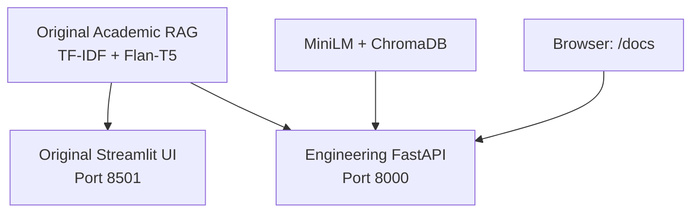

# IIT Bombay — Complete RAG Project Execution Guide

**A beginner-friendly operating manual for all three projects**

**Project:** Offline Wikipedia Retrieval-Augmented Generation  
**Environment:** Windows 11 · VS Code · Conda · Python · PyTorch  
**Audience:** Students and first-time Python/RAG users  
**Documentation version:** November 2026

---

## 1. Welcome — What have we built?

This project answers questions using information from a local Wikipedia dataset.

Instead of asking a language model to answer only from its memory, our system:

1. Receives a question.
2. Searches locally stored Wikipedia passages.
3. Identifies relevant information.
4. Passes that information to Flan-T5.
5. Generates an answer.

This approach is called **Retrieval-Augmented Generation (RAG)**.

We created three separate project folders, each with a different responsibility.

## 2. Understand the three projects first

| Project | What it does | How you interact |
|---|---|---|
| **1. Mid-Sem-Project-RAG** | Implements the original academic RAG using TF-IDF and Flan-T5 | Python / command line |
| **2. Mid-Sem-Project-RAG-UI** | Provides a graphical interface to the original RAG | Streamlit webpage |
| **3. Mid-Sem-Project-RAG-Engineering** | Adds MiniLM, ChromaDB, FastAPI, evaluation, logging, and security | FastAPI webpage and Python |

### Folder layout

```text
code/
│
├── Mid-Sem-Project-RAG/
│   ├── src/
│   │   ├── run_rag.py
│   │   └── rag/
│   ├── data/
│   ├── models/
│   ├── README.md
│   └── requirements.txt
│
├── Mid-Sem-Project-RAG-UI/
│   ├── app.py
│   ├── README.md
│   └── requirements.txt
│
└── Mid-Sem-Project-RAG-Engineering/
    ├── api/
    │   ├── main.py
    │   ├── observability.py
    │   └── security.py
    ├── adapters/
    ├── retrieval/
    ├── evaluation/
    ├── tests/
    ├── data/
    └── requirements.txt
```

### How they interact



**Very important:** The Engineering system currently has an API testing interface, not a separate Streamlit chat UI. Building a visual comparison UI is planned for later.

---

# PART A — Prepare Your Computer

## 3. Prerequisites

Before running anything, ensure you have:

- Windows with PowerShell.
- Anaconda or Miniconda.
- Python 3.11 installed in `.cvenv`.
- VS Code, preferably with the Python extension.
- The three project folders.
- The previously generated Wikipedia dataset and TF-IDF index.
- The locally stored Flan-T5 model.
- The previously built ChromaDB index for semantic retrieval.

The NVIDIA GPU is useful for acceleration, but some operations can run on the CPU, subject to your application's device configuration.

### 3.1 Open PowerShell

You can open PowerShell directly or use:

**VS Code → Terminal → New Terminal**

### 3.2 Activate your Python environment

```powershell
conda activate .cvenv
```

Your terminal should begin with:

```text
(.cvenv) PS C:\...
```

This means the correct environment is active.

### 3.3 Check Python

```powershell
python --version
```

Expected on the environment previously verified:

```text
Python 3.11.14
```

### 3.4 Check the GPU

```powershell
python -c "import torch; print('CUDA:', torch.cuda.is_available()); print('GPU:', torch.cuda.get_device_name(0) if torch.cuda.is_available() else 'CPU')"
```

Previously verified output:

```text
CUDA: True
GPU: NVIDIA GeForce RTX 5060 Laptop GPU
```

### 3.5 Check installed dependencies

```powershell
python -m pip check
```

Expected:

```text
No broken requirements found.
```

If a check fails, resolve the environment issue before attempting to run all three projects. Do not blindly reinstall every package into the working environment.

---

# PART B — Execute the Original Academic Project

## 4. Project 1: Mid-Sem-Project-RAG

### What is this?

This is the original academic implementation.

It contains:

- 1,000 selected Wikipedia articles.
- 8,191 passages.
- TF-IDF indexing.
- Cosine similarity retrieval.
- Flan-T5-small answer generation.
- Evaluation methods.

### Step 4.1 — Navigate to the project

```powershell
conda activate .cvenv

$root = "C:\AshutoshLocal\explore\Code\local-workspaces\IIT-B\Sem-2\DeepLearning-Prof-Biplab\code"

cd "$root\Mid-Sem-Project-RAG"
```

### Step 4.2 — Check essential files

```powershell
Test-Path .\src\run_rag.py
Test-Path .\data\wiki_chunks_100w_20overlap
Test-Path .\data\tfidf_index
Test-Path .\models\flan-t5-small
```

Expected: `True` for the files and directories that are present.

### Step 4.3 — Inspect the application command

```powershell
python .\src\run_rag.py --help
```

This is a discovery command. The academic entrypoint is known, but its exact supported command-line arguments have not yet been verified.

If the script does not implement `--help`, consult its source or the original project's README before trying additional arguments.

### What should happen when the original RAG runs?

The application is expected to load the saved Wikipedia passages, TF-IDF index, and Flan-T5 model, and answer questions according to its configured entrypoint.

The model may take longer to load on the first request.

**Do I need to keep this script running when I open Streamlit?**

No. Streamlit is a separate application that integrates with the academic code. You do not need to run the command-line entrypoint as an additional server.

---

# PART C — Run the Original Visual Interface

## 5. Project 2: Mid-Sem-Project-RAG-UI

**Use this option when you want a graphical webpage for asking questions.**

### Step 5.1 — Open a new terminal

In VS Code:

**Terminal → New Terminal**

Activate the environment:

```powershell
conda activate .cvenv
```

### Step 5.2 — Navigate to the UI project

```powershell
$root = "C:\AshutoshLocal\explore\Code\local-workspaces\IIT-B\Sem-2\DeepLearning-Prof-Biplab\code"

cd "$root\Mid-Sem-Project-RAG-UI"
```

### Step 5.3 — Start Streamlit

```powershell
python -m streamlit run app.py
```

### Step 5.4 — Open the webpage

Normally, Streamlit prints something resembling:

```text
Local URL: http://localhost:8501
```

Open:

**http://localhost:8501**

### Step 5.5 — Use the interface

The original Streamlit interface provides a graphical way to interact with and inspect the academic RAG implementation.

Enter a question supported by the selected Wikipedia corpus.

Example:

```text
Who is Diana Richburg?
```

The application should retrieve relevant evidence and display the generated answer through its implemented UI components.

### Step 5.6 — Stop Streamlit

Return to the terminal where Streamlit is running.

Press:

```text
Ctrl + C
```

This stops the Streamlit server.

**Note:** Closing the browser tab does not necessarily stop the Python server.

---

# PART D — Run the Enhanced Engineering Project

## 6. Project 3: Mid-Sem-Project-RAG-Engineering

### What is different?

The Engineering project introduces:

| Component | Purpose |
|---|---|
| MiniLM | Converts text into dense semantic embeddings |
| ChromaDB | Stores and retrieves those embeddings |
| FastAPI | Exposes RAG functionality over HTTP |
| Observability | Records request IDs and execution times |
| Evaluation | Compares retrieval and answer quality |
| Automated tests | Checks expected application behavior |
| Security baseline | Optional API-key protection and response headers |

The Engineering project builds on the academic implementation. Its semantic retrieval functionality is separate from the original TF-IDF retrieval.

### Step 6.1 — Open a new terminal

```powershell
conda activate .cvenv
```

### Step 6.2 — Navigate to Engineering

```powershell
$root = "C:\AshutoshLocal\explore\Code\local-workspaces\IIT-B\Sem-2\DeepLearning-Prof-Biplab\code"

cd "$root\Mid-Sem-Project-RAG-Engineering"
```

### Step 6.3 — Start FastAPI

```powershell
python -m uvicorn api.main:app --host 127.0.0.1 --port 8000
```

Expected:

```text
Uvicorn running on http://127.0.0.1:8000
```

Keep this terminal open.

### Step 6.4 — Open the Engineering interface

Open:

**http://127.0.0.1:8000/docs**

This opens **Swagger UI**, generated automatically by FastAPI.

Swagger UI is used to inspect API endpoints and send requests.

It is not the same as your original Streamlit webpage.

### Step 6.5 — Check application health

Find:

```text
GET /health
```

Click:

1. The endpoint.
2. **Try it out**.
3. **Execute**.

Expected HTTP status:

```text
200 OK
```

This confirms that the server is responding. It does not necessarily mean the RAG model or ChromaDB index has been fully loaded.

### Step 6.6 — Ask the Engineering API a question

Find:

```text
POST /answer
```

Click **Try it out**.

Enter:

```json
{
  "question": "Who is Diana Richburg?",
  "top_k": 3
}
```

Click **Execute**.

You should receive a JSON response containing the API's answer data.

If authentication has been enabled through the `RAG_API_KEY` environment variable, an appropriate `X-API-Key` header is also required.

### Does this automatically use MiniLM?

**Not necessarily.**

Your Engineering project contains both the original TF-IDF adapter and the MiniLM + ChromaDB semantic adapter.

The `/answer` endpoint's current default retriever and whether it exposes a selection option must be confirmed in `api/main.py`.

Therefore, do not assume that every successful request to `/answer` uses MiniLM.

### Step 6.7 — Stop FastAPI

Return to its PowerShell terminal:

```text
Ctrl + C
```

---

# PART E — Do I Need to Stop One Project Before Starting Another?

## 7. Understanding application processes

The three project folders are not three servers that must run together.

Each serves a different purpose.

| Situation | What you need to start |
|---|---|
| Study original Python RAG code | Academic project only |
| Use original visual application | Streamlit UI |
| Test Engineering HTTP API | Engineering FastAPI |
| Open both original UI and Engineering API | Streamlit and FastAPI in separate terminals |
| Run Engineering automated tests | No server required |
| Use future MiniLM comparison UI | Engineering API + new UI, once implemented |

### Example: Run the original UI and Engineering API together

**Terminal 1 — Original Streamlit UI**

```powershell
conda activate .cvenv

$root = "C:\AshutoshLocal\explore\Code\local-workspaces\IIT-B\Sem-2\DeepLearning-Prof-Biplab\code"

cd "$root\Mid-Sem-Project-RAG-UI"

python -m streamlit run app.py
```

Open:

`http://localhost:8501`

**Terminal 2 — Engineering API**

```powershell
conda activate .cvenv

$root = "C:\AshutoshLocal\explore\Code\local-workspaces\IIT-B\Sem-2\DeepLearning-Prof-Biplab\code"

cd "$root\Mid-Sem-Project-RAG-Engineering"

python -m uvicorn api.main:app --host 127.0.0.1 --port 8000
```

Open:

`http://127.0.0.1:8000/docs`

Both applications can run simultaneously because they use different ports.

However, both may load models or consume memory, so running them together can use more RAM and GPU resources.

---

# PART F — Testing and Verification

## 8. Run automated Engineering tests

You do not need to start FastAPI separately.

Navigate to Engineering:

```powershell
conda activate .cvenv

$root = "C:\AshutoshLocal\explore\Code\local-workspaces\IIT-B\Sem-2\DeepLearning-Prof-Biplab\code"

cd "$root\Mid-Sem-Project-RAG-Engineering"
```

Run:

```powershell
python -m unittest discover -s tests -p "test_*.py" -v
```

Previously verified result:

```text
Ran 12 tests
OK
```

These tests cover API behavior including request validation, health checks, response headers, and module availability.

### Check dependency health

```powershell
python -m pip check
```

Expected:

```text
No broken requirements found.
```

### Check saved evaluation data

```powershell
@'
import pandas as pd

base = "results/evaluation/"

full = pd.read_csv(
    base + "c11_answer_comparison_full.csv"
)

summary = pd.read_csv(
    base + "c11_answer_comparison_summary.csv"
)

print("Evaluation rows:", len(full))
print("Configurations:", len(summary))
print("Questions:", full["question_id"].nunique())

print(summary.to_string(index=False))
'@ | python -
```

Previously verified:

```text
Evaluation rows: 120
Configurations: 6
Questions: 20
```

Do not rebuild the ChromaDB index for routine application startup or testing.

---

# PART G — Beginner Troubleshooting

## 9. Common problems

### Problem: `conda` is not recognized

Open Anaconda Prompt or initialize Conda for PowerShell according to your Anaconda installation.

### Problem: `No module named streamlit`

Check that `.cvenv` is active and inspect the UI project's `requirements.txt`.

Do not install packages into a different Python environment accidentally.

### Problem: Port 8501 or 8000 is already in use

Another application may already be running on that port.

Stop its terminal using `Ctrl + C`, or use another port if appropriate.

### Problem: The API says 422

FastAPI rejected the request because the JSON body did not satisfy the required schema.

Check that:

- `question` is a nonempty string.
- `top_k` is an allowed integer.
- The JSON syntax is valid.

### Problem: The API says 401

API-key protection may be enabled.

Supply the configured key using the `X-API-Key` header.

### Problem: The first answer takes longer

The application may need to load the model, tokenizer, index, and other cached resources.

Subsequent requests may be faster.

### Problem: ChromaDB files are missing

The saved semantic index may need to be restored or rebuilt.

Do not immediately run the indexing script: first check the configuration and index location, because rebuilding can be expensive.

### Problem: `StarletteDeprecationWarning`

This warning appeared during our successful tests.

It did not prevent the regression suite from passing. Treat it as a dependency-maintenance item rather than an immediate application failure.

---

# PART H — Future Engineering UI

## 10. Planned MiniLM and TF-IDF comparison interface

**Status: Planned, not yet implemented.**

Our next Engineering UI will be created separately, preserving the academic Streamlit interface.

Proposed design:

```text
Engineering Streamlit UI
           |
           v
       FastAPI
           |
      +----+----+
      |         |
    TF-IDF    MiniLM
                |
             ChromaDB
      |         |
      +----+----+
           |
        Flan-T5
           |
  Answers + Evidence
           |
  Side-by-Side Display
```

### Planned development sequence

1. Inspect and confirm the Engineering API's retriever selection contract.
2. Expose a backward-compatible TF-IDF/MiniLM selection parameter if needed.
3. Create `ui/app.py` inside the Engineering folder.
4. Add the question field, retrieval selector, and Top-K control.
5. Display answers and retrieved passages side by side.
6. Display latency, evidence sources, and retrieval scores.
7. Test both retrieval methods and update documentation.

### Proposed future interface

Once implemented, the Engineering Streamlit UI could run using:

```powershell
python -m streamlit run ui/app.py --server.port 8502
```

Its proposed URL would be:

```text
http://localhost:8502
```

**Do not run this command yet:** `ui/app.py` has not been implemented.

---

# PART I — Quick Reference

## 11. Commands at a glance

| Task | Command |
|---|---|
| Activate Python | `conda activate .cvenv` |
| Check Python | `python --version` |
| Check dependencies | `python -m pip check` |
| Inspect academic CLI | `python .\src\run_rag.py --help` |
| Start academic Streamlit UI | `python -m streamlit run app.py` |
| Start Engineering API | `python -m uvicorn api.main:app --host 127.0.0.1 --port 8000` |
| Run Engineering tests | `python -m unittest discover -s tests -p "test_*.py" -v` |
| Stop a running server | `Ctrl + C` |

**Remember:** Run each command from its corresponding project directory.

## 12. Recommended beginner workflow

For someone running the project for the first time, use this order:

**First:** Check the `.cvenv` environment.

**Second:** Run the original Streamlit UI and ask a Wikipedia question.

**Third:** Stop Streamlit, then start FastAPI and explore `/docs`.

**Fourth:** Run Engineering tests and inspect saved evaluation results.

**Fifth:** Once comfortable, run Streamlit and FastAPI in separate terminals to compare their interfaces.

Starting one application at a time is recommended for beginners because it makes troubleshooting easier. It is not a technical requirement.

---

## Final summary

The original academic RAG is the foundation.

The original Streamlit project provides the current graphical user interface.

The Engineering project adds semantic retrieval, a vector database, API services, evaluation, tests, and security-related improvements.

**You do not have to start or stop all three projects together. Choose the application you want to use, navigate to its folder, and run its entrypoint.**

**End of beginner execution guide.**
