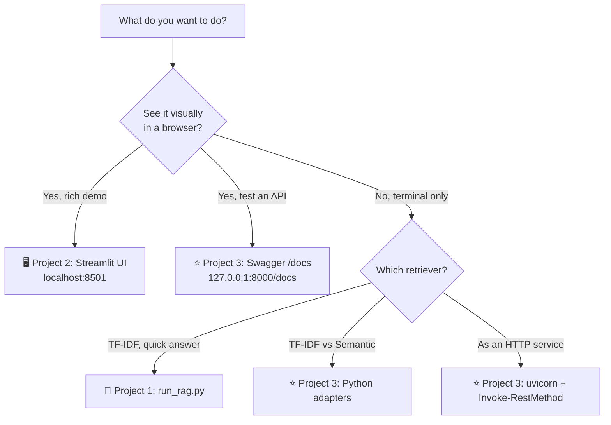
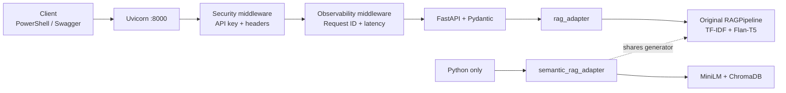

<div align="center">

# 🚀 Offline Wikipedia RAG — Execution Guide

### Step-by-step commands for all three projects

**IIT Bombay · ePGD AI & DS · Deep Learning / Generative AI**

`Mid-Sem-Project-RAG` · `Mid-Sem-Project-RAG-UI` · ⭐ `Mid-Sem-Project-RAG-Engineering`

</div>

---

## 📑 Contents

- [🧭 Which project should I run?](#-which-project-should-i-run)
- [⚙️ Step 0 — Terminal setup (always first)](#️-step-0--terminal-setup-always-first)
- [📘 Project 1 — Mid-Sem-Project-RAG (Academic)](#-project-1--mid-sem-project-rag-academic)
- [🖥️ Project 2 — Mid-Sem-Project-RAG-UI (Streamlit)](#️-project-2--mid-sem-project-rag-ui-streamlit)
- [⭐ Project 3 — Mid-Sem-Project-RAG-Engineering (Refined)](#-project-3--mid-sem-project-rag-engineering-refined)
- [🎯 Quick picker — "I want to…"](#-quick-picker--i-want-to)
- [🧯 Troubleshooting](#-troubleshooting)

---

## 🧭 Which project should I run?



| Project | Role | Retriever | Interface | Port |
|---|---|---|---|---|
| 📘 **Mid-Sem-Project-RAG** | Original academic RAG | TF-IDF | Command line / Python | — |
| 🖥️ **Mid-Sem-Project-RAG-UI** | Visual demo + dashboards | TF-IDF (imports Project 1) | Streamlit (browser) | `8501` |
| ⭐ **Mid-Sem-Project-RAG-Engineering** | Refined, production-style | TF-IDF **and** MiniLM + ChromaDB | FastAPI (HTTP + Swagger) / Python | `8000` |

> [!IMPORTANT]
> **Run one project at a time.** Each one loads its own copy of Flan-T5 onto the GPU.
> The Engineering project has **no Streamlit page**. Its browser interface is FastAPI's **Swagger UI** at `/docs`.

---

## ⚙️ Step 0 — Terminal setup (always first)

Run this in **every new PowerShell terminal**:

```powershell
conda activate .cvenv
$code = "C:\AshutoshLocal\explore\Code\local-workspaces\IIT-B\Sem-2\DeepLearning-Prof-Biplab\code"
python --version          # ✅ expect: Python 3.11.14
```

<details>
<summary>💡 <b>Optional:</b> strict offline mode and fixing <code>conda activate</code></summary>

Force fully offline execution. Models are already on disk or in the cache:

```powershell
$env:HF_HUB_OFFLINE = "1"
$env:HF_DATASETS_OFFLINE = "1"
$env:TRANSFORMERS_OFFLINE = "1"
```

If `conda activate` does nothing in PowerShell, run this **once**, then reopen the terminal:

```powershell
conda init powershell
```

</details>

---

## 📘 Project 1 — Mid-Sem-Project-RAG (Academic)

> TF-IDF retrieval → 80-token evidence → Flan-T5-small. Best configuration: **Concatenation, K = 1 → 75% EM / 85.62% F1**.

### 1A · 💬 Ask one question from the command line

```powershell
cd "$code\Mid-Sem-Project-RAG"
python src\run_rag.py --question "Who is Diana Richburg?"
```

✅ **Expected:** `Answer: middle-distance runner`, plus sources, similarity `0.3932`, timings and token counts.

> [!NOTE]
> `--question` is the **only** option. K is fixed at **1** by `config\rag_config.json`. To try other K values, use **1B**.

### 1B · 🐍 Python only: load once, ask at K = 1, 3, 5

```powershell
cd "$code\Mid-Sem-Project-RAG\src"
@'
import run_rag
p = run_rag.initialize_rag(run_rag.load_config())
for k in (1, 3, 5):
    r = p.answer("Who is Diana Richburg?", top_k=k)
    print(k, "->", r["answer"], "|", [s["title"] for s in r["sources"]])
'@ | python -
```

✅ **Expected:** K=1 → `middle-distance runner`; K=3/5 → `Moldovan chess player` *(evidence contamination from the Diana Baciu passage)*.

### 1C · 📊 View the saved ablation results (no model runs)

```powershell
cd "$code\Mid-Sem-Project-RAG"
Import-Csv results\evaluation\rag_evaluation_summary.csv | Format-Table method,k,exact_match_pct,token_f1_pct,total_model_calls
Import-Csv results\evaluation\rag_fusion_comparison.csv  | Format-Table
Import-Csv results\evaluation\rag_manual_assessment.csv  | Format-Table
```

---

## 🖥️ Project 2 — Mid-Sem-Project-RAG-UI (Streamlit)

> A visual front end that **imports Project 1 directly**, in the same Python process with no HTTP.

### 2A · ▶️ Start the UI

```powershell
cd "$code\Mid-Sem-Project-RAG-UI"
python -m streamlit run app.py
```

🌐 Open the URL it prints, usually **http://localhost:8501**. ⏹️ Stop with **Ctrl+C**.

| Page | What you can do |
|---|---|
| 💬 **Ask Wikipedia** | Type a question, pick **K = 1 / 3 / 5**, click **Generate Answer**, then compare the original passages with the 80-token evidence the model saw |
| 📈 **Evaluation Dashboard** | Charts from the saved 120-run study. Nothing is recomputed |
| 🔎 **Knowledge Base Explorer** | Search article titles and send an evaluation question to the Ask page |

> [!TIP]
> The first answer is slow while Flan-T5 loads. Click **Initialize RAG Engine** in the sidebar to load it in advance.

**🎬 Guided demo:**

| # | Question | K | What you'll see |
|---|---|---|---|
| 1 | Who is Diana Richburg? | 1 | ✅ `middle-distance runner`, a grounded success |
| 2 | Who is Diana Richburg? | 3 | ❌ `Moldovan chess player`, a distractor took over |
| 3 | Who was John Hubley's second wife? | 1 | ⚠️ `Insufficient evidence`, the answer was cut at 80 tokens |

### 2B · 🩺 Check the UI without starting it

```powershell
cd "$code\Mid-Sem-Project-RAG-UI"
python services\evaluation_service.py      # ✅ "Evaluation service verification: PASSED"
```

---

## ⭐ Project 3 — Mid-Sem-Project-RAG-Engineering (Refined)

> FastAPI service · MiniLM + ChromaDB semantic retrieval · TF-IDF vs Semantic evaluation · JSON logs · optional API key · 12 regression tests.
> Reuses Project 1's code and Flan-T5 **without modifying it**.

### 🗺️ What's available

| Feature | TF-IDF | Semantic (MiniLM + ChromaDB) |
|---|:---:|:---:|
| HTTP API `POST /answer` | ✅ | ❌ *(not exposed by the API)* |
| Browser via Swagger `/docs` | ✅ | ❌ |
| Python-only adapters | ✅ | ✅ |
| Evaluation scripts | ✅ | ✅ |



### 🖼️ Terminal layout

```text
┌──────────────────────────────┐   ┌──────────────────────────────┐
│  TERMINAL A — the server     │   │  TERMINAL B — the client     │
│  uvicorn api.main:app ...    │◄──│  Invoke-RestMethod ...       │
│  (leave running, JSON logs)  │   │  (send requests here)        │
└──────────────────────────────┘   └──────────────────────────────┘
```

---

### E1 · 🩺 Health check first (fast, no model loaded)

```powershell
cd "$code\Mid-Sem-Project-RAG-Engineering"
python -m pip check                                        # ✅ No broken requirements found.
python -m unittest discover -s tests -p "test_*.py" -v     # ✅ Ran 12 tests ... OK
```

---

### E2 · 🟢 Start the API server — **Terminal A**

```powershell
conda activate .cvenv
$code = "C:\AshutoshLocal\explore\Code\local-workspaces\IIT-B\Sem-2\DeepLearning-Prof-Biplab\code"
cd "$code\Mid-Sem-Project-RAG-Engineering"
python -m uvicorn api.main:app --host 127.0.0.1 --port 8000
```

✅ Wait for: `Uvicorn running on http://127.0.0.1:8000`. Each request prints one JSON log line. ⏹️ Stop with **Ctrl+C**.

> [!WARNING]
> Keep `--host 127.0.0.1`. The service is **not** hardened for public exposure: there's no HTTPS and no rate limiting.

---

### E3 · 💻 Use the API from the command line — **Terminal B**

**Liveness check.** It confirms the server is up and does **not** load the model:

```powershell
Invoke-RestMethod -Uri "http://127.0.0.1:8000/health"
```

**Ask a question.** The first call takes about 6 s while the model loads; later calls take about 0.1 s:

```powershell
$body = @{ question = "Who is Diana Richburg?"; top_k = 1 } | ConvertTo-Json
Invoke-RestMethod -Method Post -Uri "http://127.0.0.1:8000/answer" -ContentType "application/json" -Body $body
```

**Try K = 3.** Allowed values are **1, 3 and 5** only:

```powershell
$body = @{ question = "Who is Diana Richburg?"; top_k = 3 } | ConvertTo-Json
Invoke-RestMethod -Method Post -Uri "http://127.0.0.1:8000/answer" -ContentType "application/json" -Body $body
```

**Show the observability and security headers:**

```powershell
(Invoke-WebRequest -UseBasicParsing -Uri "http://127.0.0.1:8000/health").Headers |
  Select-Object 'X-Request-ID','X-Process-Time','X-Content-Type-Options','X-Frame-Options','Cache-Control'
```

**Validation test.** It should print `Status: 422`:

```powershell
try {
  Invoke-RestMethod -Method Post -Uri "http://127.0.0.1:8000/answer" -ContentType "application/json" -Body '{"question":"   ","top_k":2}'
} catch { "Status: " + $_.Exception.Response.StatusCode.value__ }
```

| HTTP status | Meaning |
|:---:|---|
| `200` | ✅ Success |
| `401` | 🔒 API key required and missing or wrong (see E5) |
| `404` | ❓ Unknown route |
| `422` | ⚠️ Invalid body: empty question, `top_k` not 1/3/5, `true`, or malformed JSON |
| `500` | 💥 Server error: check Terminal A's logs |

---

### E4 · 🌐 Use the API from the browser (Swagger UI)

With **E2** running, open:

| URL | What it is |
|---|---|
| 🧪 **http://127.0.0.1:8000/docs** | **Swagger UI.** Open `POST /answer` → **Try it out** → edit the JSON → **Execute** |
| 📖 http://127.0.0.1:8000/redoc | Read-only API documentation |
| 💓 http://127.0.0.1:8000/health | Raw health JSON |

Request body to paste into Swagger:

```json
{
  "question": "Who is Diana Richburg?",
  "top_k": 1
}
```

---

### E5 · 🔒 Optional: require an API key

**Terminal A.** Stop the server first; the key is read only at startup:

```powershell
$env:RAG_API_KEY = "my-local-secret"
python -m uvicorn api.main:app --host 127.0.0.1 --port 8000
```

**Terminal B:**

```powershell
$body = @{ question = "Who is Diana Richburg?"; top_k = 1 } | ConvertTo-Json
Invoke-RestMethod -Method Post -Uri "http://127.0.0.1:8000/answer" -ContentType "application/json" -Body $body -Headers @{ "X-API-Key" = "my-local-secret" }
```

🔁 **Back to local development mode** (Terminal A, then restart the server):

```powershell
Remove-Item Env:RAG_API_KEY
```

> [!CAUTION]
> Never commit, print or screenshot a real key. `/health` stays public even when a key is set.

---

### E6 · 🐍 Python only, no server: TF-IDF vs Semantic

Run everything from the Engineering root:

```powershell
cd "$code\Mid-Sem-Project-RAG-Engineering"
```

**🧠 Semantic RAG (MiniLM + ChromaDB):**

```powershell
@'
from adapters.semantic_rag_adapter import answer_semantic_question
r = answer_semantic_question("Who is Diana Richburg?", top_k=3)
print("Answer:", r["answer"])
for s in r["sources"]:
    print(s["rank"], round(s["score"], 4), s["title"], s["chunk_id"])
'@ | python -
```

**⚖️ Both retrievers side by side at K = 1, 3, 5.** Both pipelines share the same Flan-T5 model:

```powershell
@'
from adapters.rag_adapter import answer_question
from adapters.semantic_rag_adapter import answer_semantic_question
q = "Who is Diana Richburg?"
for k in (1, 3, 5):
    t = answer_question(q, k)
    s = answer_semantic_question(q, k)
    print(f"K={k} | TF-IDF: {t['answer']!r} | Semantic: {s['answer']!r}")
'@ | python -
```

**🔬 Interesting questions to put in `q`:**

| Question | Why it's interesting |
|---|---|
| `Who is Diana Richburg?` | TF-IDF is contaminated at K=3/5; Semantic stays correct |
| `What was B. Reith's first full-length album?` | Semantic finds the answer, then the 80-token cut removes it |
| `Who portrays Kate Beckett in the television series Castle?` | Semantic wins (`Stana Katic`) |
| `Who was John Hubley's second wife?` | Both fail (truncation for one, wrong relationship for the other) |

---

### E7 · 📊 Evaluations

> [!NOTE]
> These scripts **print** results. They do **not** overwrite the saved CSV files.

```powershell
cd "$code\Mid-Sem-Project-RAG-Engineering"
python -m evaluation.retrieval_comparison --limit 3     # ⚡ quick retrieval-only check
python -m evaluation.retrieval_comparison               # all 20 questions: Hit@K, MRR, latency
python -m evaluation.answer_comparison --limit 3        # ⚡ 18 end-to-end runs
python -m evaluation.answer_comparison                  # 🐢 all 120 runs
```

**📁 Read the saved C11 results (no model needed):**

```powershell
Import-Csv results\evaluation\c11_answer_comparison_summary.csv |
  Format-Table retriever,k,exact_match,token_f1,gold_chunk_hit

Import-Csv results\evaluation\c11_answer_comparison_full.csv |
  Where-Object exact_match -ne '1' | Format-Table question_id,retriever,k,answer,token_f1
```

| Retriever | K | Exact Match | Token F1 | Gold-chunk hit |
|---|:---:|:---:|:---:|:---:|
| TF-IDF | 1 | 75% | 85.63% | 95% |
| Semantic | 1 | 75% | 85.63% | 90% |
| TF-IDF | 3 | 70% | 78.88% | 95% |
| Semantic | 3 | 70% | 82.63% | 90% |
| TF-IDF | 5 | 65% | 73.88% | 95% |
| Semantic | 5 | **70%** | **83.96%** | 90% |

---

### E8 · 🔬 Embedding diagnostics (read-only)

```powershell
python scripts\embedding_smoke_test.py          # ✅ 384-dim, normalized, Richburg ranked first
python scripts\embedding_token_inspection.py    # ✅ 8,191 passages; 32 over the 256-token limit
```

---

### E9 · ⛔ Don't run routinely

```powershell
# python -m retrieval.build_chroma_index          # rebuilds/extends the vector index
```

> [!CAUTION]
> The ChromaDB index is **already complete and audited (8,191 / 8,191)**. The builder skips existing IDs, so it won't create duplicates, but normal use never needs it.

---

## 🎯 Quick picker — "I want to…"

| I want to… | Project | Go to |
|---|---|---|
| Get one quick answer in the terminal | 📘 RAG | [1A](#1a---ask-one-question-from-the-command-line) |
| Try K = 1, 3, 5 in Python | 📘 RAG | [1B](#1b---python-only-load-once-ask-at-k--1-3-5) |
| See saved ablation numbers | 📘 RAG | [1C](#1c---view-the-saved-ablation-results-no-model-runs) |
| Give a visual demo with evidence comparison | 🖥️ UI | [2A](#2a--️-start-the-ui) |
| Browse evaluation charts | 🖥️ UI | 2A → Evaluation Dashboard |
| Run RAG as an HTTP service | ⭐ Engineering | [E2](#e2---start-the-api-server--terminal-a) + [E3](#e3---use-the-api-from-the-command-line--terminal-b) |
| Click-test the API in a browser | ⭐ Engineering | [E4](#e4---use-the-api-from-the-browser-swagger-ui) |
| Compare TF-IDF and Semantic answers | ⭐ Engineering | [E6](#e6---python-only-no-server-tf-idf-vs-semantic) |
| Rerun the TF-IDF vs Semantic study | ⭐ Engineering | [E7](#e7---evaluations) |
| Make sure nothing is broken | ⭐ Engineering | [E1](#e1---health-check-first-fast-no-model-loaded) |

---

## 🧯 Troubleshooting

| Symptom | Likely cause | Fix |
|---|---|---|
| `conda activate` does nothing | PowerShell not initialized | `conda init powershell`, then reopen the terminal |
| `ModuleNotFoundError` | Wrong folder or environment | Activate `.cvenv`; `cd` to the folder shown in that step |
| `Connection refused` on :8000 | Uvicorn isn't running | Start **E2** in Terminal A |
| `localhost refused to connect` on :8501 | Streamlit stopped | Rerun **2A**; use the port it prints |
| Port already in use | An old server is still running | Press **Ctrl+C** in that terminal |
| First request very slow | Lazy model loading | Normal (about 6 s); later requests take about 0.1 s |
| `422` response | Invalid request body | Non-empty question; `top_k` = 1, 3 or 5 |
| `401` response | API key enabled | Add the `X-API-Key` header, or unset `RAG_API_KEY` (E5) |
| Wrong answer at K = 3/5 | Distractor passage | Compare with K = 1; inspect the sources |
| `CUDA: False` | CPU fallback | Works, just slower; check the PyTorch CUDA build and driver |

```powershell
# One-line GPU check
python -c "import torch; print('CUDA:', torch.cuda.is_available(), '|', torch.cuda.get_device_name(0) if torch.cuda.is_available() else 'CPU')"
```

---

<div align="center">

**⏹️ Stop any server with `Ctrl+C` · 🧠 One project at a time · 🔒 Keep the API on `127.0.0.1`**

*Commands are read-only unless marked ⛔. No step modifies project source, data or indexes.*

</div>
