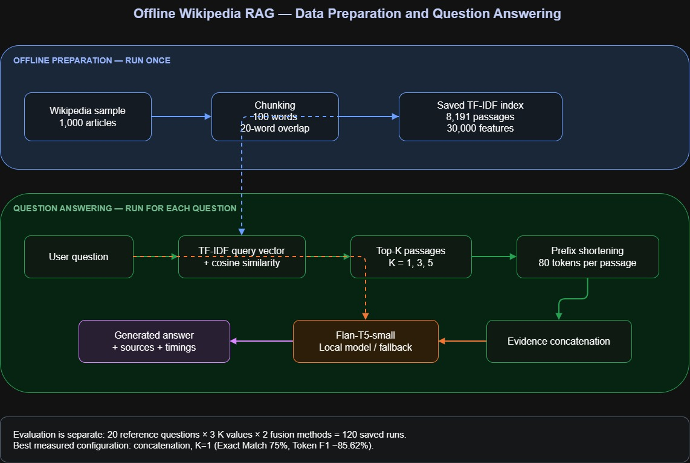
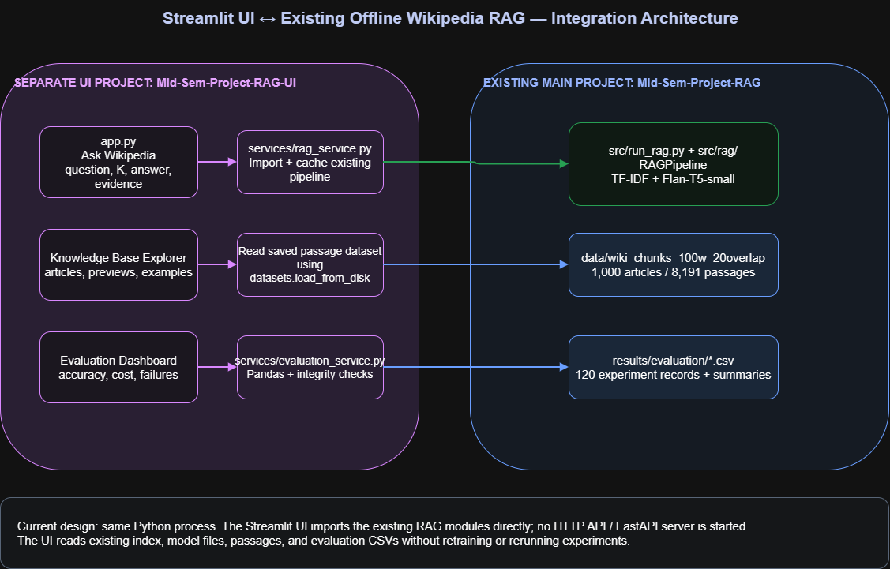
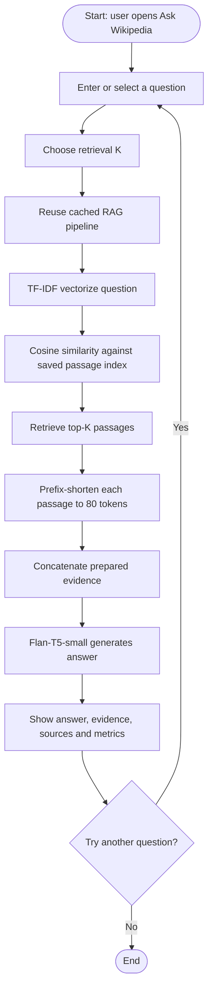
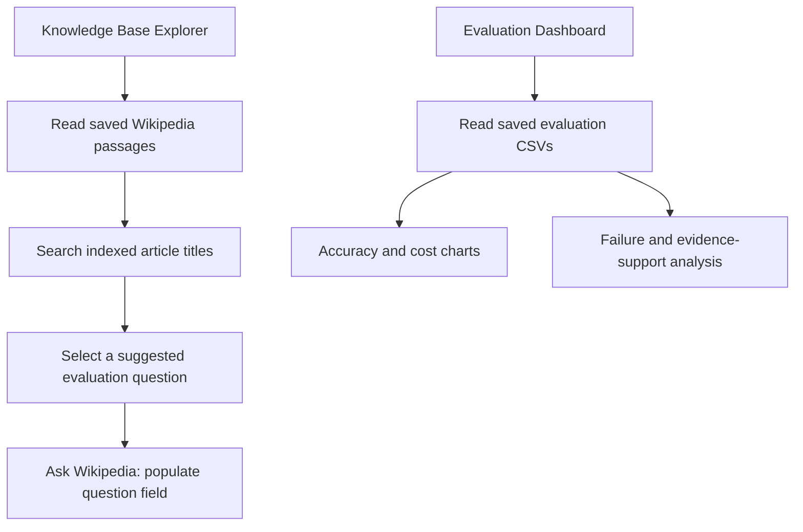

# Offline Wikipedia RAG — Streamlit Visualization

**IIT Bombay | ePGD in Artificial Intelligence and Data Science | Deep Learning / Generative AI Project**

An interactive, local-first interface for a Retrieval-Augmented Generation (RAG) system built from a selected Wikipedia corpus. The app lets users ask questions, discover indexed topics, inspect source passages, and explore evaluation findings. This UI is a **separate project** that reuses the existing Python RAG implementation directly.

> **Scope:** This system indexes **1,000 selected English Wikipedia articles**, not the entire encyclopedia. An article being indexed does not guarantee that every question about it can be answered correctly.

## 1. What the application offers

| Page | What you can do |
|---|---|
| **Ask Wikipedia** (`app.py`) | Ask a question, choose retrieval K = 1/3/5, inspect the generated answer, original versus shortened evidence, token budgets, sources, and timings. |
| **Evaluation Dashboard** (`pages/1_Evaluation_Dashboard.py`) | Compare Exact Match, Token F1, generation time, input tokens, model calls, and inspect manually reviewed failures. |
| **Knowledge Base Explorer** (`pages/2_Knowledge_Base_Explorer.py`) | Search indexed article titles, preview article passages, browse 20 example evaluation questions, and send a selected question to the Ask page. |

### Corpus and model at a glance

| Item | Project value |
|---|---|
| Wikipedia source | `wikimedia/wikipedia`, configuration `20231101.en` |
| Selected articles | 1,000 |
| Indexed passages | 8,191 |
| Chunk size / overlap | 100 words / 20 words |
| Retriever | TF-IDF with cosine similarity |
| TF-IDF vocabulary | 30,000 features |
| Tested retrieval values | K = 1, 3, 5 |
| Default selected configuration | K = 1, evidence concatenation |
| Evidence shortening | Prefix shortening, up to 80 tokenizer tokens per passage |
| Generator | `google/flan-t5-small` |
| Maximum model input | 512 tokens |

## 2. Architectural diagrams

### 2.1 RAG pipeline architecture



Editable source: [rag_pipeline.drawio](assets/architecture/rag_pipeline.drawio)

**Two distinct phases:** Wikipedia selection, chunking, and TF-IDF indexing are performed beforehand; each user question uses the saved index rather than rebuilding it.

### 2.2 Streamlit-to-RAG integration architecture



Editable source: [streamlit_architecture.drawio](assets/architecture/streamlit_architecture.drawio)

The Streamlit app imports Python modules from the sibling RAG project via `services/rag_service.py`. The dashboard reads previously saved CSVs using `services/evaluation_service.py`. **There is no FastAPI server or HTTP API in the current implementation.**

### 2.3 End-to-end question-answering flow

The following **flow diagram is embedded directly in the README**; no third image or screenshots are required. VS Code's Markdown preview supports Mermaid in compatible versions/extensions, and GitHub renders Mermaid diagrams.



### 2.4 Knowledge discovery and evaluation flow



## 3. Repository layout

Keep the projects as **sibling directories with these names**, because the current UI resolves the main RAG project's location relatively.

```text
code/
├── Mid-Sem-Project-RAG/
│   ├── config/rag_config.json
│   ├── data/wiki_chunks_100w_20overlap/
│   ├── data/tfidf_index/
│   ├── data/evaluation/rag_evaluation_20.csv
│   ├── models/flan-t5-small/
│   ├── results/evaluation/
│   └── src/run_rag.py + src/rag/
└── Mid-Sem-Project-RAG-UI/
    ├── app.py
    ├── pages/
    │   ├── 1_Evaluation_Dashboard.py
    │   └── 2_Knowledge_Base_Explorer.py
    ├── services/
    │   ├── rag_service.py
    │   └── evaluation_service.py
    ├── assets/architecture/
    │   ├── rag_pipeline.drawio
    │   ├── rag_pipeline.png
    │   ├── streamlit_architecture.drawio
    │   └── streamlit_architecture.png
    ├── requirements.txt
    └── README.md
```

Other existing folders such as `components/` and `config/` may remain. The diagrams are documentation assets; the UI does not depend on them for inference.

## 4. Installation

### 4.1 Prerequisites

- Python 3.11 (the original development environment used 3.11.14).
- Windows, Linux, or macOS with compatible Python packages.
- Enough memory and disk space for the model and index.
- NVIDIA CUDA-capable GPU is optional; CPU inference is supported when the configured model and libraries support the selected device.

The original Windows development environment used Streamlit 1.66.1, Pandas 3.0.1, and CUDA-enabled PyTorch. A successful installation on another operating system has **not** yet been independently verified.

### 4.2 Create or activate a Python environment

With Conda, for example:

```bash
conda create -n wikipedia-rag python=3.11
conda activate wikipedia-rag
```

You can instead reuse an existing compatible environment, as was done during development.

### 4.3 Install main RAG dependencies first

Install a PyTorch build appropriate to your platform and hardware, following the [official PyTorch selector](https://pytorch.org/get-started/locally/). CPU/CUDA/other accelerator packages are platform-specific.

From the main RAG project directory:

```bash
python -m pip install -r requirements-portable.txt
```

The main project must also contain its **saved passages**, **TF-IDF index**, **configuration**, and **local model files** for a fully local run.

### 4.4 Install UI dependencies

From the sibling UI directory:

```bash
python -m pip install -r requirements.txt
python -m pip check
```

UI requirements currently include `streamlit==1.66.1` and `pandas==3.0.1`. The same Python environment must be able to import the main RAG project's dependencies.

## 5. Run the UI

From `Mid-Sem-Project-RAG-UI`:

```bash
python -m streamlit run app.py
```

Open the **Local URL reported in the terminal**, usually `http://localhost:8501`. If that port is occupied, Streamlit may use `8502` or another port. Keep the terminal open; closing it stops the server.

Use Streamlit navigation to switch among **Ask Wikipedia**, **Evaluation Dashboard**, and **Knowledge Base Explorer**.

## 6. Offline operation and model fallback

The generator first checks its configured local model path, usually `models/flan-t5-small` in the main project. The exported model contains files such as `config.json`, `model.safetensors`, `tokenizer.json`, and tokenizer/generation configuration files.

If the local model directory is missing, the generator retains the original Hugging Face model-loading fallback (`google/flan-t5-small`). **A fallback may require internet access** unless the necessary files are already cached. This is deliberate backward compatibility; it does not guarantee a fully offline first run on a new computer.

Optionally force Hugging Face offline behavior for testing:

**PowerShell:**

```powershell
$env:HF_HUB_OFFLINE = "1"
$env:HF_DATASETS_OFFLINE = "1"
$env:TRANSFORMERS_OFFLINE = "1"
python -m streamlit run app.py
```

**Linux/macOS shell:**

```bash
export HF_HUB_OFFLINE=1
export HF_DATASETS_OFFLINE=1
export TRANSFORMERS_OFFLINE=1
python -m streamlit run app.py
```

These flags do **not** install missing packages or create absent data/model artifacts. Internet access may be required during initial installation or model acquisition.

## 7. Guided demonstration

### 7.1 Successful, evidence-grounded response

Ask **“Who is Diana Richburg?”** with **K = 1**. The recorded model answer was **“middle-distance runner.”** The reference was **“An American former middle-distance runner.”** This is factually correct but fails strict Exact Match because of the omitted words.

### 7.2 Distractor interference

Ask the same question with **K = 3**. In the recorded experiment, the answer became **“Moldovan chess player”**, because retrieved evidence also mentioned another person, Diana Baciu. More evidence is not automatically better evidence.

### 7.3 Evidence-shortening failure

Ask **“Who was John Hubley's second wife?”** The reference is **Faith Hubley**. The recorded answer was **“Insufficient evidence.”** The original retrieved evidence supported the answer, but the 80-token shortened evidence did not. The limitation occurred during evidence preparation rather than retrieval.

Model outputs and timings can vary across environments or model versions. These are examples from the saved evaluation run.

## 8. Academic evaluation results

The academic experiment used **20 questions × 3 retrieval values × 2 fusion methods = 120 evaluations**.

| Fusion | K | Exact Match | Token F1 |
|---|---:|---:|---:|
| Concatenation | 1 | **75%** | **85.62%** |
| Concatenation | 3 | 70% | 78.88% |
| Concatenation | 5 | 65% | 73.88% |
| Generate-from-evidence | 1 | 50% | 57.54% |
| Generate-from-evidence | 3 | 35% | 43.66% |
| Generate-from-evidence | 5 | 20% | 24.38% |

The best measured configuration is **K = 1 with concatenation**, not because it is universally optimal, but because it gave the highest Exact Match and Token F1 on this project's evaluation set.

### Metrics explained briefly

- **Exact Match:** normalized output must match the normalized reference exactly.
- **Token F1:** balances shared-token precision and recall between generated and reference answers.
- **Retrieval hit:** checks whether the relevant source was retrieved according to the evaluation setup.
- **Original/prepared evidence support:** checks whether the reference answer is supported before/after shortening.
- **Abstention:** model declines to answer, such as “Insufficient evidence.”
- **Generation time, input tokens, model calls:** measure different aspects of computational cost.

For the **best configuration**, 15/20 answers were exact matches, and two additional non-exact responses were judged factually correct in manual assessment. The preliminary manually assessed factual correctness was therefore 17/20 (85%); this is not an automatic Exact Match score.

## 9. Troubleshooting

| Symptom | What to check |
|---|---|
| Browser says `localhost refused to connect` | Start `python -m streamlit run app.py` and use the port shown in the terminal. |
| UI cannot find the main project | Verify both project folders have the exact expected sibling names. |
| Model fails to load | Verify model directory and exported model files, then inspect offline flags/cache behavior. |
| Evaluation dashboard cannot load | Verify `results/evaluation/*.csv` in the main project. |
| Explorer is empty or fails | Verify the saved `data/wiki_chunks_100w_20overlap` dataset. |
| CUDA not available | Check PyTorch build/driver and use CPU inference if appropriate. |
| Python import error | Activate the expected environment and run `python -m pip check`. |

Useful verification commands (from the UI project):

```powershell
python -m py_compile .\app.py
python -m py_compile .\pages\1_Evaluation_Dashboard.py
python -m py_compile .\pages\2_Knowledge_Base_Explorer.py
python services/evaluation_service.py
python -m pip check
```

## 10. Limitations and optional future work

- The corpus is only a selected 1,000-article Wikipedia subset.
- Topic discovery currently matches substrings in article titles; it is not semantic search.
- Multiple retrieved passages can distract the generator.
- Prefix shortening can remove an answer even when retrieval succeeded.
- The UI and main project rely on a sibling-folder layout.
- The current application is an academic, single-machine demonstration; production authentication, scaling, logging, concurrency, and security hardening are not included.

Later optional engineering work may explore semantic embeddings, ChromaDB, improved retrieval, reranking, FastAPI, observability, automated testing/CI, accessibility, privacy/compliance analysis, and adversarial testing. These are **future possibilities**, not features implemented in the current academic system.

## 11. Attribution and project context

**IIT Bombay — ePGD in AI & DS**  
**Deep Learning / Generative AI academic project**  
**Core engine:** Offline Wikipedia RAG with TF-IDF and Flan-T5-small  
**UI:** Streamlit with separate data-loading services

This README intentionally includes **architecture images and flow diagrams only**. No screenshots of the user interface are required.
