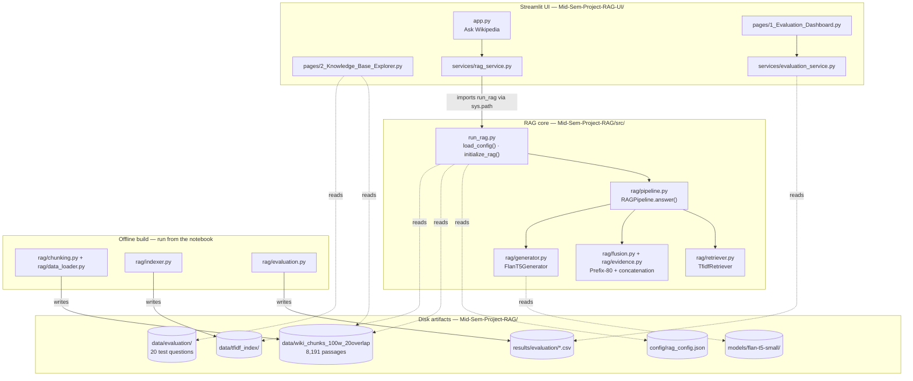

# Code Architecture — Offline Wikipedia RAG

## The UI reuses the RAG core unchanged; both read the same files on disk

The project has two folders.

- `Mid-Sem-Project-RAG/` is the RAG system itself: the code, the saved data, the index and the model.
- `Mid-Sem-Project-RAG-UI/` is a Streamlit front end. It contains no retrieval or generation logic of its own.

The UI imports the RAG project's own start-up code (`run_rag.py`) and builds the same `RAGPipeline` the command line uses. The CLI and the web app therefore always give identical answers for the same question and K.

The code is organised in four layers, top to bottom:

| Layer | Folder | Role |
|---|---|---|
| 1. Streamlit UI | `Mid-Sem-Project-RAG-UI/` | Pages people click, and two thin services |
| 2. RAG core | `Mid-Sem-Project-RAG/src/` | Answers a question: retrieve → fuse → generate |
| 3. Offline build | `Mid-Sem-Project-RAG/src/rag/`, run from the notebook | Builds the passages and the index, and scores results |
| 4. Disk artifacts | `Mid-Sem-Project-RAG/` | Saved files that layers 1 and 2 load at start-up |

---

## Diagram

---

## Layer 1 — Streamlit UI (`Mid-Sem-Project-RAG-UI/`)

| File | What it does |
|---|---|
| `app.py` | **Ask Wikipedia** page. The user types a question and picks K. The page calls `pipeline.answer()` and shows the answer, the source passages, and timings and token counts. |
| `pages/1_Evaluation_Dashboard.py` | Charts and tables of accuracy, cost, the best configuration and failure analysis, all built from the saved evaluation CSVs. |
| `pages/2_Knowledge_Base_Explorer.py` | Search and browse the 1,000 indexed articles and their passages. Offers the 20 evaluation questions as one-click suggestions. |
| `services/rag_service.py` | The bridge to the RAG core. It checks the core files exist, adds `Mid-Sem-Project-RAG/src` to `sys.path`, imports `run_rag`, then calls `load_config()` and `initialize_rag()`. |
| `services/evaluation_service.py` | Loads and validates the four result files: `rag_full_evaluation.csv`, `rag_evaluation_summary.csv`, `rag_fusion_comparison.csv` and `rag_manual_assessment.csv`. |

`app.py` wraps the pipeline in `st.cache_resource`. The index and Flan-T5 are loaded **once per session**, not on every click.

## Layer 2 — RAG core (`Mid-Sem-Project-RAG/src/`)

| File | What it does |
|---|---|
| `run_rag.py` | Command-line entry point. `load_config()` reads `config/rag_config.json`. `initialize_rag()` loads the passages and the TF-IDF index, runs consistency checks, and builds the retriever, generator and pipeline. |
| `rag/pipeline.py` | `RAGPipeline.answer(question, top_k)` is the single query path: **retrieve → prepare and concatenate evidence → generate**. |
| `rag/retriever.py` | `TfidfRetriever` turns the question into a vector with the saved vectorizer, ranks all 8,191 passages by cosine similarity, and returns the top K with title, URL and score. |
| `rag/evidence.py` | `prepare_evidence()` cuts each passage to its first 80 Flan-T5 tokens (Prefix-80). |
| `rag/fusion.py` | `concatenate_evidence()` is the selected method. `generate_from_evidence()` is the alternative we compared in experiments. |
| `rag/generator.py` | `FlanT5Generator` loads Flan-T5-small from `models/flan-t5-small/` (falling back to the Hugging Face cache), builds the grounded prompt, checks the 512-token limit, and decodes greedily (at most 64 new tokens). |

## Layer 3 — Offline build (`src/rag/`, run from the notebook)

| File | What it does |
|---|---|
| `rag/chunking.py` + `rag/data_loader.py` | Sliding-window chunking (100 words, 20-word overlap, stride 80), plus loading datasets saved with `save_to_disk()`. |
| `rag/indexer.py` | `build_tfidf_index()` fits the 30,000-term L2-normalised vectorizer. `load_tfidf_index()` reloads it at start-up. |
| `rag/evaluation.py` | Exact Match, Token F1, Retrieval Hit@K and Evidence Support@K. |

These modules ran once, from `Project-Offline-RAG-Wikipedia.ipynb`, to produce the files in layer 4. Answering a question does not re-run them.

## Layer 4 — Disk artifacts (`Mid-Sem-Project-RAG/`)

| Artifact | Contents | Read by |
|---|---|---|
| `config/rag_config.json` | Paths, K, token limits, model name, device | `run_rag.py` (and therefore the UI) |
| `data/wiki_chunks_100w_20overlap/` | 8,191 passages with title, URL and chunk ID | Retriever, Knowledge Base Explorer |
| `data/tfidf_index/` | `vectorizer.joblib`, `tfidf_matrix.npz` (8,191 × 30,000 CSR), `index_metadata.json` | `indexer.load_tfidf_index()` |
| `models/flan-t5-small/` | Local Flan-T5-small weights and tokenizer | `generator.py` |
| `results/evaluation/*.csv` | Results of the 120 evaluations | Evaluation Dashboard |
| `data/evaluation/` | The 20 hand-checked test questions | Knowledge Base Explorer |

---

## What happens when a user clicks "Generate Answer"

1. **First use only:** `rag_service.load_rag_pipeline()` imports `run_rag` and calls `initialize_rag(config)`. This loads the passages, index and model, and the result is cached.
2. `app.py` calls `pipeline.answer(question, top_k=K)`.
3. **Retrieve:** `TfidfRetriever` vectorises the question and returns the top-K passages by cosine similarity.
4. **Prepare evidence:** `concatenate_evidence()` cuts each passage to 80 tokens (Prefix-80) and joins them into one evidence block.
5. **Generate:** `FlanT5Generator` builds the prompt (*"Answer the question using only the evidence below. If the evidence does not contain the answer, say 'Insufficient evidence'."*), checks it is under 512 tokens, and decodes greedily.
6. **Return:** a dictionary with `answer`, `sources`, `prepared_sources`, `retrieval_time_seconds`, `generation_time_seconds`, `total_time_seconds`, `input_tokens` and `generated_tokens`. The page renders it.

## Safety checks at start-up

`initialize_rag()` refuses to start if the saved files disagree with each other or with the config:

- The passage count must equal `num_passages` in the config (8,191).
- The passage count must equal the number of TF-IDF matrix rows.
- The number of matrix columns must equal `max_features` (30,000).
- The retrieval method must be TF-IDF and the similarity must be cosine.

`rag_service.inspect_rag_project()` checks that `run_rag.py`, `pipeline.py`, `generator.py` and `rag_config.json` exist before importing anything.

---

## Design decisions

| Decision | Why |
|---|---|
| The UI imports the core instead of copying it | One source of truth. A fix in `src/rag/` reaches the CLI and the UI together. |
| Build and query are separated | Chunking and TF-IDF fitting run once. Each question costs only one sparse lookup and one model call. |
| All settings live in `rag_config.json` | Changing K, token limits or the model needs no code change. |
| The pipeline is cached with `st.cache_resource` | Flan-T5 and the index load once, so later questions answer in well under a second. |
| A local model folder, with a Hugging Face cache fallback | Runs fully offline with `HF_HUB_OFFLINE=1`, `HF_DATASETS_OFFLINE=1` and `TRANSFORMERS_OFFLINE=1`. |

**Known trade-off:** the UI finds the core through a relative path (`../Mid-Sem-Project-RAG`). The two folders must therefore stay side by side, for example in one Git repository.

---

## Slide version (for the presentation)

**Title:** The UI reuses the RAG core unchanged; both read the same files on disk

- **4 layers:** Streamlit UI → RAG core → offline build → disk artifacts.
- **One query path:** `RAGPipeline.answer()` retrieves (TF-IDF cosine), prepares the evidence (Prefix-80 + concatenation), then generates (Flan-T5-small, greedy).
- **Build once, answer many times:** the notebook wrote the passages, index and results to disk, and the app only loads them.
- **No duplicate logic:** `rag_service.py` imports `run_rag` through `sys.path`, so the CLI and the UI give the same answer.
- **Fail-fast checks:** passage count, matrix shape and config must agree before the app starts.

**Speaker note (about 40 seconds):**
"Our code has four layers. At the bottom are the files we built once offline: the passages, the TF-IDF index, the local Flan-T5 model and the evaluation results. Above that, the offline modules (chunking, indexing and scoring) are what produced those files from the notebook. The RAG core is a single pipeline: retrieve, prepare evidence, generate. The Streamlit UI on top adds no AI logic of its own. It imports the same start-up code as our command-line tool, so what you see in the demo is exactly what we evaluated."
